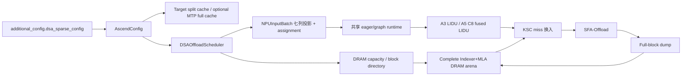

# vLLM-Ascend DSA Sparse Offload

本分支在 vLLM-Ascend v0.23.0 上实现 DSA 稀疏卸载，不修改配套的 vLLM
源码。实现以 GLM-5.1/GLM-5.2 为首要验收模型，并保留 DeepSeek-V3.2
兼容回归。

> 上游 vLLM-Ascend 项目说明原样保存在
> [README.upstream.md](README.upstream.md) 和
> [README.upstream.zh.md](README.upstream.zh.md)。

## 当前能力

- HBM KV cache 拆分为完整 Indexer K 平面和有界 resident MLA 平面；
- EngineCore/scheduler 按单机可用内存和本地 TP 数统一规划 DRAM 容量，
  coordinator 统一管理 DRAM block id，worker 只创建固定地址 arena 并镜像
  assignment；
- 一个 DRAM block 完整保存 target Indexer+MLA：A3 为 dense Indexer 与
  NOPE/ROPE，A5 C8 为 Indexer key/scale 与 656-byte packed MLA；
- scheduler 统一管理 `PREFILL`、`DENSE_DECODE`、
  `ENTER_SPARSE_DECODE`、`SPARSE_DECODE` 请求布局；
- decode 整批执行 LI/resident-update -> KSC -> sparse attention，不按
  dense/sparse 拆分子 batch；A5 C8 decode 使用融合 Quant-LI/resident-update，
  prefill 复用社区 Quant-LI，attention 复用社区 QSFA；
- prefill 与 decode 新满 target Indexer+MLA block 通过 full-block dump
  算子写入同一个逻辑 DRAM block id；
- 支持 chunked prefill；完整 prompt 必须先在所有启用的 full-context group 完成容量准入，
  中间 chunk 保持 PREFILL，下一轮 decode 才允许进入 DENSE/ENTER；
- eager 与 ACL FULL decode graph 共用同一套 InputBatch 行状态、
  resident pool、DRAM ledger 和算子缓冲；
- `DENSE`、`ENTER`、`SPARSE` 任意混排、不同 resident budget 和
  graph PAD 行可以复用同一 FULL decode 图族；
- DSA 关闭时保留 vLLM-Ascend v0.23 原生 cache 和执行路径。



## 代码集成

vLLM 通过 Python distribution entry point 发现 vLLM-Ascend 平台插件。
DSA 优先使用 v0.23 的 `AscendConfig`、KV spec registry、coordinator
factory、`scheduler_cls`、`NPUInputBatch` 和原生 FULL graph dispatcher
等扩展点。vLLM 尚无正式扩展点的 KV 分组、容量规划和
`KVCacheManager.allocate_slots()` 位置，复用 vLLM-Ascend 现有 patch
入口做带 DSA 类型守卫的窄适配；非 DSA 调用原样委托给上游实现。

因此，后续开发不应重新引入 vLLM 源码修改、全量复制上游 scheduler，或
恢复已退役的 GatherSelection 数据面。

## 最小配置

```python
from vllm import LLM

llm = LLM(
    model="/path/to/GLM-5.1-W4A8",
    tensor_parallel_size=16,
    quantization="ascend",
    block_size=128,
    max_num_seqs=4,
    max_model_len=131072,
    max_num_batched_tokens=131072,
    enable_prefix_caching=False,
    enable_chunked_prefill=False,
    async_scheduling=False,
    enforce_eager=True,
    additional_config={
        "dsa_sparse_config": {
            "enabled": True,
            "split_indexer_cache": True,
            "indexer_mla_block_ratio": 3,
            "sparse_activation_tokens": 6144,
            "prompt_budget_thresholds": [32768, 65536],
            "resident_budget_tokens": [6144, 10240, 12288],
            "max_active_reqs": 256,
            "hot_cpu_block_multiple": 3.0,
            "enable_row_mode_decode_graph": False,
            "trace_points": {
                "enabled": False,
                "points": ["first_sample"],
                "ranks": [0],
            },
        },
    },
)
```

本地 DRAM complete-bundle prefix cache 第一版可将
`enable_prefix_caching` 设为 `True`。命中只复用 hash-ready 的完整块；可选
MTP3 还会与原生 full-HBM MTP cache 的 EAGLE 有效命中取公共前缀。当前该
开关已完成 CPU UT，正式使用前仍需完成 NPU restore 与端到端重复前缀验收。

图模式需要同时设置：

```python
enforce_eager=False
compilation_config={
    "mode": "VLLM_COMPILE",
    "cudagraph_mode": "FULL_DECODE_ONLY",
    "cudagraph_capture_sizes": [1, 2, 4, 8],
}
additional_config={
    "dsa_sparse_config": {
        # 其余配置同上
        "enabled": True,
        "enable_row_mode_decode_graph": True,
    },
}
```

首次部署或更新 DSA 自定义算子后，必须完整重编译并重新安装
vLLM-Ascend。

若改动同时新增了 ``torch.ops._C_ascend`` schema，除了清理根目录
``build`` 和 ``csrc/build|output|build_out``，还要移除源码包内可能抢先于
site-packages 被导入的旧 ``vllm_ascend/vllm_ascend_C*.so``，并确认新扩展
实际复制回当前 checkout。仅重建 CANN OPP 不能刷新 Torch schema。

### A5 C8 增量配置

A5 当前只接通 SFA C8 与 LI C8 同时开启的完整数据面。在上述
`additional_config` 同级加入：

```python
additional_config={
    "enable_sparse_sfa_c8": True,
    "enable_sparse_li_c8": True,
    "dsa_sparse_config": {
        # 其余 DSA 配置同上
        "enabled": True,
    },
}
```

A5 两个开关全关或半开会在启动期明确拒绝；A3 继续使用既有 BF16/FP16
算子链。A5 C8 的非 MTP decode 已切换为
`vllm_a5_li_manage_nomtp_c8 -> vllm_a5_kvcache_scatter_copy_c8 -> native QSFA`；
妥协版 MTP target 路径使用
`vllm_a5_li_manage_c8 -> vllm_a5_kvcache_scatter_copy_c8 -> native QSFA`，
框架与算子代码已接入，仍处于 A5 编译和端到端验收阶段。MTP proposer
保持社区基线的 BF16 Indexer+MLA forward，不进入 DSA resident/DRAM 数据面；
其 Cache 作为第三个原生 full-cache group 全量驻留 HBM，并与 target
Indexer 使用相同的 `indexer_mla_block_ratio` token coverage。默认 ratio=3
时，三个物理 pool 的容量为 target Indexer `3N`、target resident `N`、
MTP full cache `3N`。
新融合路径已在真实 A5 上完成算子数值、eager/graph replay 和 GLM-5.1
端到端初验。GLM-5.2 的 21 个 full Indexer 与 57 个 shared follower 已接入
同一 target 数据面；MTP BF16 第三组已完成 UT、离线 eager/FULL graph 与
在线 FULL graph 冒烟，其中 FULL graph 覆盖单条约 40K 及
8K/5K/70K/40K 四请求混合长度。

妥协版 MTP3 还需同时设置：

```python
speculative_config={"method": "mtp", "num_speculative_tokens": 3}

# dsa_sparse_config 内
"sparse_activation_tokens": 8192,
"resident_budget_tokens": [8192, 10240, 12288],
```

首版只接受 `temperature=0.0`。FULL graph 的 capture size 仍使用 token 数；
MTP3 下 B 个请求对应 `4 * B` 个 target query token。SPARSE resident 固定为
`[budget blocks][tail parity 0][tail parity 1]`，跨 128-token 边界不会临时
退回非 MTP。

## 当前边界

当前版本尚未支持：

- prefill/decode mixed batch；
- async scheduling；
- HBM Indexer/dense-MLA 热副本协同命中与 L3 prefix cache；本地 DRAM
  complete-bundle prefix 第一版已实现，仍待 NPU 端到端验收；
- preemption/resume；
- 非 MTP speculative method、MTP draft 数不等于 3、非 greedy MTP；
- 外部 KV transfer connector；
- decode/prefill context parallel 和 pipeline parallel；
- KV-cache metrics/events；
- GLM-5.2 A5 C8 的正式 QA、长稳并发与性能验收；
- A5 BF16 DSA 算子链。
- 多机 TP 的按节点 DRAM 容量规划（当前自动规划只承诺单机 TP）。

具有显式配置入口的未支持组合会在启动期拒绝，preemption/resume 会在当前
运行边界明确失败。A5 GLM-5.1 与 GLM-5.2 MTP 已取得上板冒烟结果，但仍以
DP=1 为主；DP 扩展、完整数据集与性能验收属于下一阶段。

## 文档与测试入口

- [DSA 稀疏卸载详细设计](docs/source/developer_guide/Design_Documents/dsa_offload_design.md)
- [DSA demo 与测试说明](examples/dsa_demo/README.md)
- [上游 vLLM-Ascend README](README.upstream.md)

`simple_prompt_test.py` 延续旧版测试方式：先在文件顶部修改 `MODEL_PATH`、
`RUN_MODE` 和 prompt 等常量，再直接运行。`RUN_MODE` 可取
`disabled/cache-init/eager/graph`。

```bash
python -m pytest tests/ut/dsa_offload -vv --tb=short

python examples/dsa_demo/simple_prompt_test.py
```

数据集精度回归与评分分别使用
`examples/dsa_demo/qa_dataset_test.py` 和
`examples/dsa_demo/eval_dataset_acc_score.py`。正式精度、性能测试必须关闭
DSA trace points。
