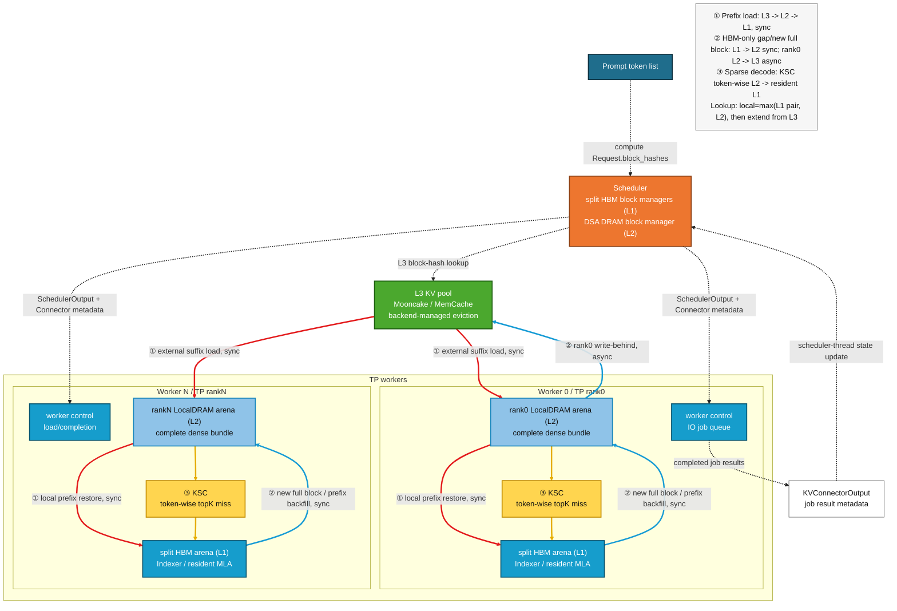

# DSA Rank-local L2 与 AscendStore L3 分层缓存设计

## 1. 文档状态

本文是 DSA 稀疏卸载接入远端 KV pool 的详细设计，基于：

- vLLM v0.23；
- vLLM-Ascend v0.23.0 正式版；
- 当前 DSA custom 分支；
- 单机 8 x Ascend 950DT；
- GLM-5.1/GLM-5.2 W4A4C8 为首要验收模型；
- Mooncake `0.3.11.post1` + Store-owned TCP 为第一后端；
- MemCache `1.2.0` 临时 local-EID 版本为第二后端。

主 DSA 架构、模型执行和算子 ABI 仍以
{doc}`dsa_offload_design` 为总设计。本文只展开 L1/L2/L3 分层缓存、
Connector 生命周期、异步上传和后续 HBM 热层复用。

**2026-09-09单机DP进展补记**：无MTP的DP2/TP4/EP8共享Mooncake TCP主路径已
完成P5实机回归。P6-A固定MTP3共享L3已完成代码接入与组合UT，并通过A5单40k、
128输出tokens、7请求功能闭环：三次外部回载均包含目标域四TP的324块三组件
load/restore，两域prewrite/postwrite均出现。后续8k/70k交换域及local reset并发
回载的8请求也已通过，4个外部请求对应16条TP完成记录，两个DP均实际重放Graph。
P6-A主数据路径可阶段性收口，数值等价、逐轮图覆盖、故障/长稳及生命周期仍待验收；
P6-B在线internal-DP正常管理主闭环已通过A5八请求验证：在途请求/IO排空后local
reset、两域统一external epoch、新epoch双向跨域回读和pause期间排队后resume。
后续九请求补测也通过了已暂停且DP0有1条排队请求时的local/external reset，
显式resume后新epoch冷算及跨域回读。管理故障注入、暂停期间退出和长稳仍待实机覆盖；失败保留owner、要求重启，
不提供跨进程故障恢复。具体运行证据见示例README的P6-B验收记录。
单机offline SPMD也已通过Graph+MTP3的12请求cold/local/cross-L3闭环，
两域all drained及所有IO结果完成有实机证据；该轮worker随后仍由基线升级SIGKILL，
不能由脚本PASS外推资源注销/关闭及干净退出。
2026-09-10针对2bd00308补入退出前资源关闭：所有域drain后，在worker RPC队列仍
存活时完成当前模型流同步和原生Connector shutdown；全TP及全DP确认后才进入原生
进程退出。保留原生4秒+4秒终止策略，新增关闭阶段耗时和失败状态。
后续六请求运行`dsa-dp-offline-9bedef1c841d4119b17e8230d47b7b61`已确认八个
worker全部成功注销123个region并完成backend关闭，两个Core均收到全TP成功回执；
随后仍SIGKILL。因此L3资源关闭已验收，剩余问题限于此后的worker退出流程，
具体阻塞位置及归属未定，不能直接判为Mooncake关闭阻塞或已证明的基线缺陷。
后续`dsa-dp-offline-98e3407215834cb7af79b374a9e39f3f`八worker的atexit之后
两次快照均停在TorchNPU post6的`runtime_lifecycle.py:15`，已按相同git版本
确认是`_C._npu_shutdown(success)`。剩余native资源清理超过原生等待窗口，
不是L3 IO未排空；内部具体步骤及是否受DSA资源使用触发仍未确定。
此问题单列已知生命周期限制，不阻塞单机DP正常功能阶段性收口，也不宣称干净退出通过。
999c9727后的收尾仅清理正式示例的临时退出探针、诊断RPC、zip打包与专用pickle配置，
保留全域drain、全TP资源关闭回执及原生幂等清理；不改生产模块、算子或eager/Graph元数据。
常规回归入口见示例README“单机DP收尾回归”，本次只要求UT，不重复申请八卡跑已验矩阵。
offline单域external reset与direct-HBM仍拒绝。本文下述P0/P1/P2是分层缓存早期阶段编号，
不与DP方案P0-P6混用；具体启动/测试入口以`examples/dsa_demo/README.md`为准。

P6-A继续由各域TP0上传完整Indexer/MLA/MTP bundle，load成功只在本域TP组
汇总，不增加EP级IO collective。MTP模型身份加入schema，具体DP/rank不进入
key；proposer完成copy校验后才放行store，dummy的独立forward context必须
保留禁IO标记。旧MTP namespace不复用、由后端自然淘汰；无MTP key规则不变。
partial MTP key不可读、短读、同TP组失败均不得发布成功，load失败仍fail-fast。

P6-B只改低频管理面：PAUSED_NEW期间新请求排队，运行请求和write-behind继续排空；
DSA waiting-prefill判断不能阻塞此时的decode排空。prepare只读检查全部pool的
零引用状态与待消费load/restore；commit清本地hash及未分配lookup候选，external
reset使用统一UUID epoch而不是各域自增计数。所有commit确认后才resume，预先
paused的服务保持paused。HTTP取消不会自动取消已开始的事务；管理owner无TTL，
未知失败不能由另一API前端自动接手。该方案不物理删除Mooncake对象，也不保证
重启后延续该epoch。正常退出沿用全域drain后再释放segment的P5机制。

当前状态：**P0 Store-owned TCP 的单卡、跨 NUMA 与 TP8 120-plane 门禁已通过；
P1-W rank0 异步 write-behind 已完成 TCP 框架适配、UT，以及 TP8 离线单 40K
长请求的 eager/graph、5K+8K+40K+70K 混合长度多请求 graph/chunked prefill
和在线 graph 单 40K 流式请求的完整闭环验收，首版正确性阶段已经关闭。
P1-R 同步 L3 suffix lookup、all-rank `L3 -> L2` 与既有 `L2 -> HBM`
restore 已完成代码接入并补齐 CPU UT 覆盖；A5 TP8 单请求及
`5K+8K+40K+70K` graph/chunked 混合请求的离线三轮闭环、在线顺序双回放与
并发压力回放均已通过。在线记录中 943 个唯一 prompt bundle 只写一次，三组
L3 回放每 rank 均完成 `3 * 943` 个 block load，无重复增长、漏 rank 或 IO
失败。多请求 graph 仍存在与 L3 无关的 replay 数值变化。**

**P1-HOT no-MTP 已完成代码改造和上述上板闭环：L1
Indexer+dense-MLA pair 与 L2 complete bundle 独立查询，本地命中取较长者；
HBM-only L2 gap 在首个 prefill forward 中同步补齐。P2-MTP 多级 prefix 已
完成首个 A5 TP8 eager 单 40K 三轮闭环：MTP active decode 仍保持 BF16
full-HBM，不做 token-wise swap；verified 满块进入 L2/L3 complete bundle，
并参与 lookup/loadback。eager 与 FULL graph 下，Local-L2 与清空本地后的
L3 replay token 序列均严格一致；graph 的 cold/Local-L2/L3 三轮也完全一致。
混合 8K/5K/70K/40K graph 已完成 L3 与 Local/Local 配对控制：两处严格分叉
以相同 request、common-prefix 和 token 对在无 L3 load 时复现，归因于既有
multi-request graph prefix 数值路径，不构成 L3 独有错误；该轮同时触发并完成
一个 MTP decode prewrite durable block。外部命中继续固定走
`L3 -> L2 -> HBM`。在线 MTP 多级 prefix 仍待回归。**

## 2. 目标与非目标

### 2.1 目标

1. 保留当前 scheduler-owned DSA L2 DRAM directory，不重新建立第二套本地
   block manager。
2. 新请求按唯一 `Request.block_hashes` 查询本地 L1 HBM pair、L2 complete
   bundle 与远端 L3。
3. 本地有效命中取 `max(HBM pair, L2 bundle)`；L3 只补充该最长本地前缀
   之后的连续 suffix。
4. TCP 首版将 L3-only suffix 恢复到各 rank 已注册的 L2，再复用现有
   L2->HBM restore；不为 TCP 另建 HBM staging 或第二套 read metadata。
5. prefill/decode 新 durable 满块完成同步 L1->L2 dump 后，由 TP rank0
   异步执行 L2->L3 write-behind。
6. 请求完成不等待 L3 put；块即将被复用时才使用基线风格 reuse fence。
7. eager 与 graph 共用相同 scheduler/worker 状态和最终 HBM block table；
   外部 IO 不进入 graph。
8. Mooncake/MemCache 复用同一 DSA 控制面，后端差异封装在 AscendStore
   `Backend` 层。
9. no-MTP 按完整 HBM pair 复用；MTP 按 target pair+MTP full-cache triple
   复用，并保留未来独立 component source mask 接口。

### 2.2 第一版非目标

- request preemption/resume；
- async scheduling；
- PP、DCP、PCP 与跨节点 TP；
- P/D 分离；
- L3 eviction policy 定制；
- L3 SSD tier；
- L3 load failure 后静默 recompute；
- 修改 Mooncake/MemCache 社区源码的淘汰算法。

## 3. 当前基线盘点

### 3.1 DSA L1/L2 已有能力

当前 target cache 具有三个不同的物理语义：

| 层级/平面 | 当前物理语义 | block id 空间 |
|---|---|---|
| HBM Indexer | 完整上下文 dense Indexer | 独立 pool |
| HBM resident MLA | prefill 时 dense；sparse decode 时 budget+tail | 独立 pool |
| rank-local DRAM | 完整 dense Indexer+MLA；MTP 时再含 BF16 full-cache | scheduler-owned 独立 pool |
| MTP HBM | BF16 full cache；active decode 不做 token-wise swap | 可选独立 pool |

`DSASchedulerDRAMBlockDirectory` 已经复用 vLLM `BlockPool` 的 null block、
refcount、hash map、free queue 和 LRU。scheduler 是 DRAM physical id、hash、
ready watermark 与 request->logical block 映射的唯一真源。

`DSAWorkerDRAMStore` 在每个 TP worker 创建相同容量、固定地址的
`empty_with_swapped_memory` arena，只镜像 scheduler assignment；worker 不分配
DRAM id。A5 GLM-5.2 一个逻辑 L2 block 当前包含：

```text
21 个 full Indexer layer:
    key bytes + scale bytes
78 个 target MLA layer:
    packed C8 [128, 1, 656]
no-MTP 总计 6,904,320 bytes / rank / logical block

MTP3 额外一个原生 BF16 full-cache layer:
    128 * (512 + 64 + 128) * 2 = 180,224 bytes
MTP complete bundle 总计 7,084,544 bytes / rank / logical block
```

本地 prefix cache 同时查询完整 L2 bundle 与 HBM。no-MTP 的 HBM 命中是
target Indexer+dense-MLA pair；MTP 的 HBM 命中是 target pair+MTP full-cache
triple。MTP L2 bundle 本身已经包含三 component，不再依赖原请求的 MTP HBM
副本才能恢复。

### 3.2 当前 HBM target prefix 限制

启用 prefix caching 后，target Indexer、dense resident MLA 与可选 MTP group
均可发布 hash。resident MLA 同时容纳以下角色，因此只有 PREFILL/DENSE 表中的
块能够发布，ENTER 后的 budget/tail 永不发布：

```text
dense prefix block      有文本前缀语义
sparse budget block     无文本前缀语义
KSC resident slots      无连续前缀语义
tail/provisional block  未完全 durable
```

完整 HBM pair/triple 与 L2 分别查最长前缀，取较长者；单 component HBM
source mask 仍是后续优化项。

### 3.3 vLLM Connector 与 OffloadingConnector 可复用能力

vLLM v0.23 已经提供：

- `KVConnectorOutput` worker->scheduler 输出；
- `Scheduler.update_from_output()` 单线程更新入口；
- `kv_connector_worker_meta` 跨 TP 聚合；
- `kv_connector_no_forward()` 零 token control step；
- `OffloadingConnector` 的 job id、异步 store/load、完成回报；
- `_block_id_to_pending_jobs` 与 `jobs_to_flush` block-reuse fence；
- request finish 后 pending store 不阻塞客户端响应；
- `OffloadingManager.prepare/complete_store/load` 生命周期；
- worker `TransferResult(job_id, success, bytes, time, type)`。

这些结构应作为 DSA L3 的异步生命周期骨架。DSA 不应新建 scheduler 接收
线程，也不应使用独立 RPC 直接修改 scheduler BlockPool。

不能直接原样使用通用 `OffloadingConnector` 的原因是：

- 它的 store source 是普通 GPU/HBM block table；
- DSA sparse decode 的 resident block table 是 budget+tail，不再对应完整
  logical context；
- DSA 完整 source 位于自定义 rank-local DRAM arena；
- DSA 的 Indexer/MLA physical pool 容量和 block id 不同；
- DSA L2 一个 physical id 对应两个 L3 component；
- TP rank0-only store 的完成计数不是 `world_size`。

因此实现应复用 Connector/job 模型，但使用 DSA-specific scheduler/worker
schema adapter。

### 3.4 AscendStore/Mooncake 已验证能力

已验证：

- Mooncake `global_ub_device` 单卡、TP2、TP4、TP8 multi-buffer round trip；
- TP8 环形 remote get 逐字节一致；
- DSA-disabled GLM-5.2 完整模型 3200/3287 external hit；
- 每个 rank 25/25 keys、`failed=0`；
- 每 rank 单次恢复 304,742,400 bytes；
- warm replay token/logprobs 稳定；
- 零 HBM prefix hit 下发生真实 L3->HBM load。
- `empty_with_swapped_memory` 的完整 A5 DSA schema 可通过 Mooncake
  `global_ub` 直接 put/get，无需 staging ring；
- 单卡 exact schema 包含 42 个 Indexer plane、78 个 MLA plane、242 个
  registration region，总注册 110,477,312 bytes；
- 两个 component 的 put/get、interior block 地址和逐字节 digest 均通过；
- 同一 TransferEngine 同时注册普通 HBM 与 swapped LocalDRAM 可行。

`global_ub_device` 只创建 device endpoint。它会把 host memory 再次执行
`aclrtHostRegister` 后映射到 device 链路；而
`empty_with_swapped_memory` 在 torch_npu 分配期已经完成该注册，二次注册会以
`halHostRegister drvRetCode=12` 失败。`global_ub` 同时创建 device/host
endpoint，使 HBM 走 device、DSA L2 走 host，是当前正向合同。

尚未验证：

- DSA split HBM schema 的 AscendStore load；
- rank0-only DSA store + 全 rank DSA load；
- DSA L3 正常 shutdown/drain。

### 3.5 vLLM、vLLM-Ascend 与 DSA 的复用边界

当前实现不是让 `DSAL3Connector` 与 `AscendStoreConnector` 同时运行，而是按
职责做三层组合：

| 层次 | 复用内容 | 当前所有者 |
|---|---|---|
| vLLM Connector 规范 | Factory、`KVConnectorBase_V1`、scheduler metadata、worker hooks、`KVConnectorOutput` 聚合、shutdown | vLLM |
| Ascend L3 数据面 | `Backend`、Mooncake Store-owned TCP；可选 GlobalTE/HIXL AscendDirect | vLLM-Ascend |
| DSA 策略适配 | split schema/key、scheduler-owned L2 IDs、rank0-only store、dump event、reuse fence | DSA |

`AscendStoreConnector` 本身同样继承 vLLM `KVConnectorBase_V1`，因此
vLLM-Ascend 并未抛弃 vLLM 生命周期；它是在接口内部增加
`KVPoolScheduler/KVPoolWorker/Backend`。DSA 也应遵循同一个外层接口，但不能
直接复用两类 pool 对象，因为它们假定 store source 是普通 HBM block table、
各 group block identity 可按基线解释，并按 worker/rank 保存。DSA 的 durable
source 则是完整 LocalDRAM bundle，resident HBM 是 budget+tail，且首版只允许
rank0 写。强行套用会把错误的 HBM block 语义隐藏在“复用”名义下。

因此当前选择是组合 `MooncakeBackend`，而不是复制 Mooncake/HIXL 实现，也不是
继承后覆盖大部分 `AscendStoreConnector`。同一进程只配置一个 connector；DSA
配置校验拒绝 `AscendStoreConnector`、`MultiConnector` 等并行组合，避免双
scheduler 状态机和重复注册。

对 vLLM-Ascend 公共模块的修改限制为可独立回归的通用增强：GlobalTE 增量幂等
注册/解注册、Mooncake put 返回原始逐 key 结果、显式 close。未来若
AscendStore 抽象出可插拔 source schema、rank policy 和成功结果合同，DSA
应继续下沉复用这些公共能力，使 `DSAL3Connector` 收敛为薄策略层。

## 4. 不变量

### 4.1 唯一 token identity

所有层级继续使用 vLLM 创建的唯一 `Request.block_hashes`。DSA 不重新计算
token hash，不按 request id 建 L3 identity。

### 4.2 logical block 与 physical id

```text
logical block index  请求完整上下文中的第几个 128-token block
L1 physical id       Indexer/MLA/MTP 各自 pool 内编号
L2 physical id       完整 DSA bundle 的 rank-local arena 行
L3 key               内容寻址 key，不等于任何 L1/L2 physical id
```

### 4.3 durable 规则

只有以下 token 可以写入 L2/L3 prefix cache：

- 已完成 target forward；
- 已通过 MTP target verification；
- 位于完整 block；
- 对应 Indexer、MLA，以及启用时的 MTP BF16 payload 都已完成；
- scheduler 已拥有该 logical block 的 block hash。

不满尾块和 MTP provisional token 不得发布 L2/L3 key。

### 4.4 scheduler 单线程真源

所有 physical-id reuse、job state、remote-ready、failure 和 prefix lookup
结果只在 scheduler 主线程更新。worker 后台线程只能向本地 completion queue
写结果，不能回调或直接修改 scheduler 对象。

## 5. L3 对象与 key schema

### 5.1 component 拆分

每个 token block 在 L3 使用两个或三个对象：

```text
INDEXER component -> 所有 full Indexer layer 的 key/scale plane
MLA component     -> 所有 target MLA layer 的 dense packed plane
MTP component     -> 可选；所有 MTP layer 的原生 BF16 MLA+Indexer planes
```

no-MTP 要求前两个 component 均 ready；MTP 要求三个 component 均 ready。

拆分的理由：

- Indexer/MLA 在 HBM 已是独立物理池；
- 未来允许两个 component 从不同层级恢复；
- component 失败可以独立重试；
- 避免将 L3 ABI 锁死为当前 L2 bundle；
- GLM-5.2 只保存 21 个 full Indexer，不为 shared follower padding。

### 5.2 key 必备字段

L3 key 至少包含：

```text
namespace/version
model identity
quant/cache format
block size
component
schema fingerprint
request block hash
```

示意：

```text
vllm-ascend:dsa-l3:v1:<model>:a5-c8:bs128:<schema>:indexer:<hash>
vllm-ascend:dsa-l3:v1:<model>:a5-c8:bs128:<schema>:mla:<hash>
vllm-ascend:dsa-l3:v1:<model>:a5-c8:bs128:<schema>:mtp:<hash>
```

schema fingerprint 应覆盖：

- full Indexer layer id 顺序；
- MLA layer id 顺序；
- 可选 MTP layer id 与原生 BF16 plane 顺序；
- 每个 plane dtype、byte size 和顺序；
- packed/非 packed 模式；
- Indexer shared topology；
- TP replica/shard 语义。

不能直接复用 DSA-disabled AscendStore key。当前 A5 GLM-5.2 的基线 HBM
对象约为 12,189,696 bytes/block，而 DSA packed-C8 L2 对象为
6,904,320 bytes/block，二者 payload ABI 不同。

### 5.3 TP identity

GLM/DeepSeek MLA 与 Indexer target payload 当前按 TP 副本处理：

- L2：每个 rank 保留本地副本；
- L2->L3：初版只由 TP rank0 上传一份；
- L3->HBM：每个 rank 分别加载到自己的 HBM block；
- key 不包含 TP rank。

因此 L3 中每个 `(schema fingerprint, component, block hash)` 只有一个逻辑对象，
不会像 L2/HBM 那样按 TP rank 保存八份。所有 rank 的 segment 组成一个容量池，
Mooncake 只为该 key 选择一个物理落点；当前 `ReplicateConfig()` 没有请求额外
框架副本。P1-R 的 all-rank get 是从同一池化对象向 8 个 rank-local L2 做读出
扇出，重复的是网络读流量和 L2/HBM 副本，不是 L3 存储对象。若 Mooncake 未来
启用自身容灾副本，那属于 backend-managed replication，不改变 DSA key 数量。

Mooncake 的“贡献池容量”和“写入 DSA 副本”是两个独立维度，不能都按
rank0-only 处理。当前 vLLM-Ascend AscendStore 采用 Mooncake 内嵌 client
模式：每个 TP worker 都以 `contribute_memory=True` 创建 backend，并向全局池
挂载一段 `global_segment_size`；只有 scheduler 查询客户端使用
`contribute_memory=False`。因此单机 TP8 配置每 rank 4 GiB 时，名义全局池容量
为 32 GiB，而不是 4 GiB。

DSA 应按同一基线范式划分角色：

- 所有 TP rank：创建可贡献存储的 Mooncake backend/TransferEngine，将各自的
  segment 汇入全局池，并在 load 时注册本 rank HBM destination；
- TP rank0：作为当前副本型 Indexer/MLA payload 的唯一 producer，发起一次
  L2->L3 put，避免把相同 KV 数据按 TP 数重复写入；Mooncake Master 可把该次
  put 的对象分配到任一可用 segment；
- 其他 TP rank：不重复发起相同 put，但其贡献的 segment 仍是池容量的一部分，
  并在 load 时从全局池读取到自己的 HBM；
- scheduler：只拥有 lookup/admission 决策。远端 exists 可沿用 AscendStore 的
  rank0 lookup service/RPC 范式，不能让所有 rank 重复查询同一组 key；
- store completion 的 expected producer count 为 1，load completion 的
  expected worker count 为参与 TP load 的 rank 数。

Mooncake 也支持“每个 rank 为 dummy client、每个推理实例仅一个 real client
贡献整机内存”的部署方式，但这要求单独的 dummy-real/store-service 架构，
不是当前 vLLM-Ascend AscendStore backend 的执行方式。P1-W 初版曾只有 TP0
初始化 Mooncake，会把名义池容量从 `TP * per_rank_segment` 缩成一个 rank 的
segment；现已改为 all-rank segment contribution、rank0-only put。P1-W 验收
必须同时检查每个 rank 的 backend 初始化日志和唯一 producer 的 store 日志。

两卡 swapped Host 跨 segment 基础门禁已通过：TP0 的 1 MiB swapped buffer
可强制定向写入 TP1 segment，并由 TP0 从全局池完整读回。Mooncake/HIXL 基础
H2H 池化能力成立。120-buffer、6,904,320-byte 小 arena scatter/gather 也已
通过；每个 plane 使用 4,353-block swapped arena、TP0 注册总量约 30 GiB 并从
非零 block offset 读取的门禁同样通过。Mooncake API 从主线程移至 background
thread 后，put/get 与逐 buffer 校验仍通过，因此真实 write-behind 的线程设备/
通信上下文也已排除。真实 GLM-5.2 A5 双 key 布局同样通过：Indexer key 含
42 个 16,384/512-byte 交错 plane，MLA key 含 78 个 83,968-byte packed
plane，put/get 分别返回 `[0,0]` 与 `[354816,6549504]`。

TP8 框架日志暴露了两卡门禁没有覆盖的拓扑风险。TP0 producer 对由 Mooncake
Master 自动选择的 TP1/TP2/TP3 segment 可以继续推进，而对 TP4/TP5/TP7
segment 的 120-descriptor Host write 均在 30 秒后失败；NPU0-3 与 NPU4-7
恰好位于不同 NUMA/卡组。因而“all-rank contribution + rank0-only put”目前只
是待验证方案，不能再视作已完成设计。下一门禁必须依次覆盖：

1. TP2 进程、物理 NPU0->NPU4；
2. TP8 进程、显式 NPU0->NPU4；
3. TP8 进程、`preferred_segment=false` 的 Master automatic placement；
4. 与框架相同的 host IP、4 GiB global segment、1 GiB local buffer。

其中第一项已经复现失败：仅创建 NPU0/NPU4 两个 probe worker，固定 loopback
控制地址并将双 key 显式放到 NPU4 segment 后，TransferEngine 建链、segment
mount 和 source arena 注册均成功，但 Host put 在
`HcommChannelFenceOnThread` 返回 `hccl_ret=19 (HCCL_E_NETWORK)`。因此当前
问题不是 TP8 数量、模型通信并发、Master 放置或 DSA payload，而是 NPU0/NPU4
之间这条 `global_ub` Host endpoint direct data path。该结果仍不能证明硬件本身
不支持跨 NUMA；CANN/HComm/HIXL endpoint 选择、路由配置或当前 wheel 实现均
可能是根因。

同一 NPU0/NPU4 目标下，将 source/destination 改为 HBM tensor，并改用
`global_ub_device` 后完整往返通过：put 为 `[0,0]`，remote get 为
`[354816,6549504]`，逐 plane 内容一致。这条路径实际覆盖
`NPU0 HBM -> NPU4 进程 Host L3 segment -> NPU0 HBM`，说明跨 NUMA/卡组的
Device-to-remote-Host 与 remote-Host-to-Device 能力可用；故障不能归因于
Mooncake 全局池或跨卡组网络整体不可达，而应严格限定为 swapped Host source
与 Host endpoint 参与的 direct Host-to-Host 路径。

Mooncake/HIXL 源码进一步显示该失败路径不是唯一实现。HIXL 正式接口提供
`OPTION_BUFFER_POOL`，用于 Host direct 不可用、Host registration 受限或大量
小块传输时的中转模式；未注册地址会按 Host memory 处理。Mooncake Ascend
TransferEngine 却在初始化时显式设置 `adxl.BufferPool=0:0`，只有环境变量
`ASCEND_BUFFER_POOL` 非零时才重新启用。启用后，Mooncake 对 Host region 的
`registerMem` 会直接返回，不再把 30 GiB swapped arena 注册为 direct Host
memory，而由固定 staging pool 负责传输。当前 GLM-5.2 DSA 逻辑块为 6.59 MiB，
`ASCEND_BUFFER_POOL=4:8` 的单 buffer 为 8 MiB；HIXL 当前创建两组 device
pool，每组 `4 * 8 MiB`，合计约 64 MiB HBM/进程。对象大于单 buffer 时会按
8 MiB 切片循环复用，因此 staging 容量与 L2 总容量无关。该路径需先完成功能
诊断，但额外 H2D/D2H、跨卡 Device 带宽和 HBM 占用使其不作为 DSA 正式
fallback。

需要注意 HIXL 当前存在两条 engine 路由：设置 `GlobalResourceConfig`/
`protocol_desc`（包括 `global_ub`）时，`EngineFactory` 选择新版
`HixlEngine`，该实现明确只允许 `BufferPool=0:0`；不设置 protocol desc 时选择
兼容 `CommEngine/AdxlInnerEngine`，后者才实现上述 staging pool。实测
`global_ub + ASCEND_BUFFER_POOL=4:8` 在 TransferEngine 初始化期即以
`PARAM_INVALID` 拒绝，未进入数据传输。buffer pool 能力门禁因此必须先用
`comm_mode=auto`，后续若成立，再评估如何在正式 backend 中显式选择兼容 engine
而不是依赖模糊的环境默认值。

`auto + BufferPool` 已确认能进入 `CommEngine/AdxlInnerEngine`：两端 staging
pool 初始化成功，Host segment 与 swapped buffer registration 均被正确跳过。
当前失败推进到 `HcclCommInitClusterInfoMemConfig(ret=1)`，属于兼容 engine 生成的
rank-table/通信参数错误。HIXL 仓内所有同机双卡 CommEngine 样例均显式设置
`HCCL_INTRA_ROCE_ENABLE=1`，下一门禁补齐该变量，并在失败收集中保留
`rank_table` 与 `HcclCommInit` 日志。

补齐 `HCCL_INTRA_ROCE_ENABLE=1` 后，同卡组 NPU0/NPU1 与跨卡组 NPU0/NPU6
仍以相同方式失败。诊断日志给出确定根因：HIXL v1 generator 输出
`server_count/server_list/status/version`，但没有当前 HCCL parser 必需的顶层
`rank_count`。该问题位于 HIXL/HCCL 兼容层，不属于本项目允许修改的边界；本地
HIXL 私有补丁已撤销，也不把修通旧 CommEngine staging 作为 DSA L3 交付前提。
同步检查 HIXL `origin/master`（2026-08-28 拉取到 `61a2ee4`）后，主线 v1/v2
generator 仍未输出 `rank_count`，简单升级到 master 也不能消除该诊断缺口。

当前 `mooncake-transfer-engine-npu` wheel 以 `USE_ASCEND` 构建，会无条件安装
AscendDirectTransport；传入 `protocol=tcp|rdma` 不会选择通用 Host transport，
仍会进入 HIXL/HCCL。因此 NPU 探针撤销 TCP/RDMA 选项；在不重新构建或修改
Mooncake 的边界下，不能把通用 Mooncake Host transport 视为可用方案。

NPU wheel 已有的 direct Host 路径已分别用 `global_ub+pinned` 隔离 swapped SVM
地址、用 `global_ub_host+pinned` 隔离 mixed endpoint 选路。pinned 始终只是诊断
介质，不能替换 KSC、dump 和 restore 共用的 `empty_with_swapped_memory` L2 arena。

`global_ub+pinned` 的 NPU0/NPU6 单 descriptor 门禁仍以
`HcommChannelFenceOnThread: HCCL_E_NETWORK` 失败；allocation、Host registration
与 segment connect 均成功。因此 swapped SVM、scatter/gather 数量和大 arena
均已排除。

`global_ub_host+pinned` 的相同门禁也失败。日志确认协议只包含
`ub_ctp:host`，两端均由 `aclrtMallocHost` 分配并按 Host memory 注册，segment
连接成功，最终仍在 NPU0 到 NPU6 的 `HcommChannelFenceOnThread` 返回
`HCCL_E_NETWORK`。因此 mixed Device/Host endpoint 选路也已排除。当前
Mooncake NPU wheel/HIXL/CANN 组合不能证明跨卡组 direct Host-to-Host 可用；除非
通信侧提供经过验证的显式 HiXLEP route，否则停止继续排列组合 transport 参数。

该结论不否定 Mooncake 整体能力：基线 HBM KV Connector、
`global_ub_device` TP8 以及同组门禁仍然有效。阻塞边界仅是 DSA 所需的“任意
rank-local swapped Host L2 直接发布到全局 L3，并可跨组恢复”的数据面合同。

源码也不能被解读为“明确拒绝 H2H”。Mooncake Ascend Direct 可以注册
`MEM_HOST`，其 HIXL 依赖会把 Host/Host 描述符分类为 `COMM_TYPE_UB_H2H`，A5
接口样例也列出了 `ub_ctp:host`。但 Mooncake 的 Ascend Direct 文档只明确承诺
H2D、D2H、D2D；Mooncake 与 HIXL 都没有进一步承诺 A5 单机跨 NUMA/跨卡组
H2H。通用 Transfer Engine 的 NUMA-aware NIC 选择也没有在该 Ascend Direct
远端路径中实现；Mooncake 只选择 ADXL endpoint 并把传输交给 HIXL。因此当前
结果应定性为“抽象层支持 H2H，但目标拓扑在当前依赖和配置下未实现或未打通”，
而不是上层主动拒绝。

跨卡组 preferred put 失败后，不能把 NUMA/rank 拓扑直接写进 DSA scheduler。
DSA 对 L3 的合同仍应是任意合法 L2 source 可发布为全局对象、任意 consumer 可
恢复；direct、staging、relay、replica 和本地 ingest 都属于 L3 backend/transport
实现。**唯一对象、分片本地 producer**只能作为 backend 内部优化或临时诊断，
不能改变 key/schema 或让 scheduler 依赖物理 NPU 编号。HBM staging/relay 不作为
本项目可接受的生产 fallback。Mooncake AscendDirect 路径继续作为外部依赖阻塞；
Store-owned TCP 已通过 swapped Host、跨进程、跨 NUMA、TP8 与 120-plane 门禁，
因此成为 P1-W 正式 fallback。其他 L3 后端也必须先通过相同门禁，才能进入完整
框架集成。

P0 必须通过 TP8 逐字节比较证明 DSA payload 确实可按副本处理；未通过时不得
使用 rank0-only store。

## 6. 总体架构



图中虚线是 scheduler/worker/L3 lookup 的控制信息，红、蓝、黄实线分别对应
① prefix load、② full-block 下沉/backfill、③ decode KSC miss IO。当前外部
prefix 固定走 `L3 -> L2 -> L1`。蓝色 `L1 -> L2` 既承载每个 chunk 的新满块，
也承载 HBM pair 比 L2 更长时，首个 prefix-suffix chunk 对 L2 缺口的回填；
`L2 -> L3` 初版只有 rank0 提交。direct-HBM 不属于当前正确性合同。

## 7. Prefix lookup 与 load path

### 7.0 当前实施顺序

为先闭合 durable source 生命周期，代码实施顺序调整为：

1. **P1-W store-only**：同轮 projection 规划 durable blocks，TP rank0 在
   forward/dump 后记录预分配 event，后台执行 L2->L3 put；scheduler 通过
   `KVConnectorOutput` 接收显式结果，并在 L2 physical ID 复用前 flush 相关
   job。request finish 不等待。
2. **P1-R sync-read**：write-behind 稳定后，再开放 L2 hit 之后的 L3 suffix
   lookup、L2/HBM 联合 admission、all-rank `L3->local L2` 与既有
   `L2->HBM` restore。
3. **P1-HOT compromise**：L2 complete bundle 与 L1 Indexer+dense-MLA pair
   独立查询，本地有效前缀取二者较长值；L1-only 范围在首个 prefill forward
   中用既有 full-block dump 补齐 L2。L3 仍固定经 L2 恢复到 L1。
4. **后续研究项**：独立 component source mask、direct-HBM、layerwise async
   不进入当前版本门禁。

两阶段共用 `DSAL3Connector`、key/schema 与 completion 通道，不建立临时旁路。

### 7.1 第一版顺序

1. DSA `get_computed_blocks()` 分别查询 L2 完整 bundle 与 L1 成对
   Indexer+dense-MLA 的最长连续 prefix。
2. 本地有效命中取 `max(l2_blocks, hbm_pair_blocks)`；HBM pair 直接 touch 为
   新请求 block table 前段。
3. vLLM 基线继续调用 Connector，L3 只查询最长本地命中之后的 suffix。
4. Indexer/MLA L3 component hit 取公共连续前缀。
5. scheduler 为 HBM-only L2 缺口、L3 suffix 和本轮 compute 一次分配完整 L2
   bundle，并同时完成 split HBM admission。
6. Connector metadata 携带 L3 component keys 与每 rank local L2 destination。
7. all-rank worker 在 forward 前用 Store-owned TCP 将 L3 suffix 写入各自 L2，
   再把 HBM 尚未覆盖的部分执行 `L2 -> HBM` restore。
8. 若 `hbm_pair_blocks > l2_blocks`，worker durable 水位保持在旧 L2 边界，
   不跨过尚未物化的缺口；首个 prefill forward 的既有 dump 将该缺口与本轮
   新满块一起同步补齐。
9. model output 成功返回后，scheduler 才推进完整 L2 ready/hash，并允许 rank0
   异步下沉 L3。
10. 任一 rank/component load 失败则 fail-fast，不发布 L2 hash。

这里的 `enable_prefix_caching=True` 是当前 vLLM 公共入口，同时启用 DSA L1
target hash 与 L2 directory 的 hash/refcount/restore。no-MTP 使用完整 HBM
pair；固定 MTP3 使用完整 HBM triple 和三 component bundle。两者都暂不支持
Indexer-only/MLA-only source mask。

### 7.2 为什么 TCP 第一版选择 L3->L2->HBM

优点：

- 对齐已通过的 Store-owned TCP swapped Host 数据面；
- 对齐 LMCache 的“注册固定 L2，get into 预分配 L2”模式；
- 不要求 TCP transport 识别或直接写 NPU HBM；
- L3 suffix 在 forward 前已经成为完整 L2 bundle，可直接供后续 KSC、prefix
  reuse 与 L2 eviction 使用；
- 已在 HBM 的成对 prefix 不重复执行 L2->HBM restore；若它比 L2 更长，
  首个 prefill forward 才用既有 dump 补齐缺失的 L2 bundle。

代价：

- scheduler 必须联合预留 L2 bundle 与 split HBM blocks；
- pending L3 load 期间 L2 destination 不可被复用；
- all-rank get 完成后才能原子发布完整 durable bundle 公共前缀；
- 初版必须 fail-fast，不能静默 recompute。

### 7.3 L3->HBM direct 后续路径（当前冻结）

AscendDirect 修复跨 NUMA Host H2H、或未来后端能可靠直接写 split HBM 后，可在
不改变 lookup/schema 的前提下增加 direct destination capability。它必须复用同一
scheduler source plan，不能另建一套 eager/graph metadata。该优化保留给：

- 不要求 L2 常驻副本的 P/D consumer；
- 大容量只读 prefix；
- 已证明 direct load 后无需立刻物化 L2 的场景。

当前 A5 + Mooncake wheel 无法仅靠配置同时满足拓扑无感 L2 pool 与 direct-HBM，
正式数据面固定使用 `L3 -> L2 -> HBM`。代码中的 direct capability 仅用于隔离
实验，不属于部署脚本、回归矩阵或当前版本完成标准。

### 7.4 P2-LAYERWISE：TTFT 流水优化

vLLM-Ascend 基线 `AscendStoreConnector` 已提供 `use_layerwise`、`load_async`、
`num_prefetch_layers` 和 attention-side `wait_for_layer_load()`：worker 为每层构造
transfer task，提前提交后续层，并在该层 attention 前等待完成。

P1-R 暂不直接复用，原因是 DSA 当前每个 block 只有一个跨层 Indexer key 和一个
跨层 MLA key，Mooncake object 分别包含 42/78 个 plane descriptor；本地
`L2 -> HBM` restore 也在 prefill 前一次遍历全部 target layer。仅打开基线开关
无法得到可靠的逐层完成事件，还会让 eager/graph 合同变得含糊。

后续分两步：

1. 保持现有远端 schema，先把已完整落入 L2 的数据按 layer 执行 H2D restore，
   复用 attention `wait_for_layer_load()` 与固定 prefetch window，重叠 H2D 和 prefill
   计算；
2. 若 L3 网络 IO 仍是主要 TTFT 瓶颈，再将 schema 版本升级为 per-layer object，
   让 `L3 -> L2 -> HBM` 真正逐层流水。GLM-5.2 的 shared Indexer 必须按 21 个
   physical source layer 建映射，不能机械按 78 层重复存取。

该优化在 P1-R 同步精度门禁通过后进入 P2，不改变首版正确性范围。

## 8. DSA allocator 改造

当前 `allocate_dsa_slots()` 仍显式拒绝：

```text
delay_cache_blocks
reserved_blocks
```

P1 只开放同步 L3 load：

- `num_external_computed_tokens > 0`；
- `delay_cache_blocks=False`；
- `reserved_blocks=0`；
- `load_async=False`。

planner 的已计算长度必须改为：

```text
request.num_computed_tokens
+ local_l2_hit_tokens
+ external_l3_hit_tokens
```

HBM target block 分配覆盖全部 local+external prefix；local 与 external 最终都由
同一 DSA restore 从 L2 写入 HBM，Connector 只先把 external suffix 写入 L2。
不能调用基线
`allocate_new_computed_blocks()` 并假设 local hit 已经是 HBM block，因为 DSA
local target hit 实际来自 L2。

admission 必须在任何 pool 修改前同时检查：

- HBM Indexer；
- HBM resident MLA；
- 当前请求后续 full sequence reservation；
- 可选 MTP HBM；
- L2 logical directory 容量。

## 9. 异步 L2->L3 write-behind

### 9.1 触发点

scheduler 在构造本轮 DSA projection 时已经知道 forward 成功后将推进到的
durable full-block watermark。它可以生成本轮尚未远端发布的：

```text
logical block index
L2 physical block id
block hash
INDEXER/MLA/可选 MTP component key
job id
```

任务随同一次 forward 的 Connector metadata 下发。worker 不得在 dump 之前
读取 L2。

这里存在一个明确的基线时序差异：vLLM `Scheduler.schedule()` 会在
`_update_after_schedule()` 和返回之前调用 Connector `build_connector_meta()`；
当前 DSA DRAM assignment/projection 则在 `super().schedule()` 返回后，由
`DSAOffloadScheduler._attach_dsa_cache_layout()` 生成。普通 Connector metadata
因此天然看不到同轮新增的 L2 physical ids。

第一版应增加一个只对 DSA connector 生效的类型化后置钩子：

```text
base Scheduler.schedule()
    -> base connector metadata
    -> DSA projection / DRAM assignment
    -> dsa_connector.extend_store_jobs(scheduler_output, projection)
    -> return final SchedulerOutput
```

该钩子同时把新分配/复用的 L2 physical ids 交给 reuse-fence 逻辑。不能只在
下一轮普通 `build_connector_meta()` 中扫描，因为最后一个 forward 之后可能只有
zero-token control step；也不能让 worker 根据 row 长度自行推导 store job。

### 9.2 worker 提交时序

no-MTP 的 target Indexer/MLA 都在 target forward 内完成 dump，因此可在
post-forward `get_finished()` 中直接记录 event 并提交异步 put。MTP 的第三个
component 由后续 proposer 写入，必须使用两阶段发布：

```text
target forward 完成 Indexer/MLA dump
    -> 基线 Connector context 退出并调用 get_finished()
    -> DSAL3Connector 只 stage 本轮 store jobs，不记录 ready event
    -> MTP proposer 写 cache，并完成 MTP HBM -> L2 dump
    -> runtime 校验所有 MTP layer 已完成当前 forward epoch
    -> finalize_kv_connector() 调用 wait_for_save()
    -> release staged jobs，记录 dump-ready event
    -> rank0 后台执行 L2 -> L3 put
```

vLLM 基线的 `defer_finalize=True` 只延后 `wait_for_save()` 和 metadata clear，
不会延后 `get_finished()`。因此不得在 MTP 路径的 `get_finished()` 中直接
提交当前 store job，否则 event 位于 proposer dump 之前，会把陈旧 MTP L2
payload 发布到 L3。zero-token Connector progress step 没有 attention forward，
其 job 已有 durable backing，仍可立即提交。上传保持异步，不在当前 token
generation 尾部执行同步 `join()`。

### 9.3 block reuse fence

复核 vLLM 基线后，第一选择不是长期增加 transfer ref，而是复用
`_block_id_to_pending_jobs + jobs_to_flush`：

1. pending job 记录它正在读取的 L2 physical block ids；
2. request finish 可以正常释放自己的 L2 refs；
3. block 可进入 L2 cached free queue，不长期减少可用容量；
4. scheduler 若再次分配同一个 physical id，先把关联 job id 放入
   `jobs_to_flush`；
5. worker 在应用新 assignment、执行任何 overwrite 之前等待这些 job 完成；
6. put 完成后再允许新请求覆盖该 L2 block。

该机制仅在真实复用压力出现时阻塞，比 request-finish 全量等待和永久 pin 更适合
在线吞吐。作为保守回退，也可以对小规模 P0/P1 使用 transfer ref pin；正式
P2 以 reuse fence 为目标。

### 9.4 request finish

request finish 不调用 `join()`，客户端响应不等待 L3。pending job 只保留：

- job metadata；
- old hash/component keys；
- source physical ids；
- reuse fence。

请求对象不再是 L3 object 的身份。所有请求完成但仍有 pending job 时，Connector
通过 `has_pending_transfers()` 让 `DSAOffloadScheduler.has_requests()` 保持为真，
复用 vLLM 的 zero-token connector progress step 收集 completion。客户端响应不
等待该 control step；但 EngineCore shutdown 必须等 pending job 清零后，才能
关闭各 TP rank 贡献的 Mooncake segment，避免 rank0 put 访问已退出的远端
segment owner。vLLM 外层 process manager 默认只等待 5 秒，无法覆盖 Mooncake
首次跨 segment 懒建链，因此 DSA L3 要求配置 `shutdown_timeout>0`；示例使用
300 秒上限，稳态通常会更早退出。vLLM 离线 `LLM` 的 finalizer 当前不向
MPClient 传递该 timeout，DSA 离线 demo 需显式调用 engine-core shutdown；在线
launcher 已按基线传递该配置。

## 10. job 与状态机

### 10.1 scheduler job

```text
job_id（异步 STORE）
direction: LOAD / STORE
request_id（诊断与 load resume 使用）
block_hashes
components
source/destination block ids
expected_worker_acks
status
bytes
```

store job 的 `expected_worker_acks=1`，因为只有 rank0 写。P1-R load 是随本轮
metadata 下发的 request-scoped 同步任务：所有 TP worker 在 pre-update hook 中
完成 get，任一 worker 抛错都会让整次 execute-model RPC fail-fast，因此首版不再
额外维护异步 ack 计数。P2 若改为异步 load，再增加 all-rank completion 聚合。

### 10.2 状态

```text
LOCAL_READY
  -> STORE_PLANNED
  -> STORE_SUBMITTED
  -> REMOTE_READY
  -> STORE_FAILED

REMOTE_READY
  -> LOAD_PLANNED
  -> LOAD_SUBMITTED
  -> LOAD_COMPLETE
  -> LOAD_FAILED
```

远端状态以 `(schema namespace, component, block hash)` 为身份；在飞 source
保护以 `(physical block id, generation/hash, job id)` 为身份。迟到事件必须同时
匹配 job id 和旧 hash，不能只凭可复用的 block id 更新状态。

### 10.3 完成回报

worker 后台线程完成阻塞式 Backend `put` 后，将结果写入本地线程安全队列。
worker 主线程在正常或 zero-token Connector `get_finished()` 中清空队列，生成
`KVConnectorOutput.kv_connector_worker_meta`。scheduler 在
`connector.update_connector_output()` 中消费。

P1-W 验收期间 scheduler 与 TP0 worker 分别维护 planned/submitted/finished/
failed/bytes 计数，并在 shutdown 打印汇总。普通 poll 与 reuse/shutdown flush
必须共用同一 completion 记录函数，避免“future 已完成但无 completed 日志”。
scheduler shutdown 若仍有 unacknowledged job 必须失败，不能清空账本后静默退出。
DSA L3 模块复用 `vllm.logger.logger`，与当前大多数 vLLM-Ascend 热路径一致；不能
使用只落到 `vllm_ascend` file handler 的独立 logger 后再凭 console 判断状态。

P1-R `get` 在 `model_runner._update_states()` 之前同步执行。成功后同轮 projection
应用 L2 assignment 并调用既有 prefix restore；失败则在任何 HBM forward/graph
replay 前抛错。该顺序复用 Connector 的 pre-update `handle_preemptions(metadata)`
hook，因为标准 `start_load_kv()` 晚于 `_update_states()`，不能满足
`L3 -> L2 -> HBM` 的依赖关系。

不创建 scheduler 接收线程；即使未来增加 IPC receiver，receiver 也只能入队，
不能直接修改 BlockPool。

### 10.4 当前基线缺口

现有 AscendStore/Offloading 代码有以下不能原样沿用的行为：

- AscendStore `completed_events` 只有计数，没有 success/error；
- AscendStore sending thread 在 `finally` 中也标记 event 完成；
- Mooncake/MemCache `Backend.put()` 当前不返回可靠逐 key 结果；
- upstream `OffloadingConnectorWorker` 当前对 `TransferResult.success=False`
  直接 assert；
- `pending_count` 默认使用 world size，不适合 rank0-only store；
- AscendStore 非 layerwise `wait_for_save()` 会 `request_queue.join()`。

DSA connector 必须补充显式 `JobResult(success, failed_components,
error_codes)`，不得把“线程结束”当成“远端发布成功”。

## 11. worker 地址映射与 buffer registration

### 11.1 DSA L2 component view

`DSAWorkerDRAMStore` 需要新增只读 API，按 L2 physical ids 生成：

```text
Indexer: keys, list[list[address]], list[list[size]]
MLA:     keys, list[list[address]], list[list[size]]
```

地址来自初始化期固定 arena；热路径不 `.contiguous()`、不创建 tensor、不重新
组织 payload。

### 11.2 registration 顺序问题

Mooncake `GlobalTE.register_buffer()` 已从单个 `is_register_buffer` 改为增量
interval 账本：

- 维护已注册 interval 集合，而不是全局 bool；
- 支持 HBM/L2 分阶段增量注册；
- 合并同 storage 连续区间；
- 重复区间幂等；
- partial failure 回滚或明确失败；
- shutdown 时 unregister/close。

GLM-5.2 A5 L2 当前约有 78 个 MLA arena 和 42 个 Indexer plane arena；P0
必须验证约 120 个 multi-buffer component 的 registration 数量与资源限制。

### 11.3 swapped-memory P0

当前结果：

以下单卡项已经通过：swapped arena registration、swapped put/get、NPU 回读、
逐字节一致、HBM+swapped 同引擎注册。仍待验证 TP8 rank0 put/all-rank get 与
正式 connector shutdown/drain。

固定 device staging ring 仅保留为能力定位手段，不进入正式 DSA 设计。若未来
某个 L3 backend 在其内部透明使用 staging，它仍必须满足框架可见的 Host H2H
合同和性能门槛，DSA 不自行维护 ring slot 或拓扑路由。

## 12. 各模型阶段

### 12.1 prefill

- 每个 chunk 都可能产生新 durable 满块；
- L1->L2 继续使用当前同步 full-block dump；
- 本轮新增 ready block 生成异步 L3 store job；
- L3 external hit 只发生在请求第一次进入 scheduler 的 prefix lookup；
- chunked prefill 后续 chunk 不重复 lookup 已提交 prefix。

### 12.2 dense decode

- 新满块与 prefill 使用同一 dump/job 语义；
- HBM resident block 尚有 dense 语义，但第一版不作为 target HBM prefix tier；
- L3 store source 始终取 L2，不依赖 HBM 请求布局。

### 12.3 sparse decode

- KSC 只执行 token-wise L2->resident-HBM miss copy；
- sparse budget block 不进入 L3；
- 新 durable tail 满块先同步写完整 L2 bundle，再异步上传 L3；
- active request 持有 L2 refs，因此 KSC 不会读到被重分配的 block；
- L3 不参与 decode 热路径的 token-wise miss。

### 12.4 compromise MTP

妥协版 MTP 多级 prefix 使用以下合同：

- active sparse decode 的 MTP proposer 仍使用原生 BF16 full-HBM cache，不做
  topK swap，也不依赖新的 BF16 稀疏算子；
- scheduler 以排除本轮 provisional query 后的 confirmed token 数计算 durable
  full-block watermark；
- prefill 在 MTP cache 写后 dump，decode 在本轮 proposer 第一次 cache 写前
  dump；一个 outer step 每个 MTP 层只发射一次；
- target forward 退出时 `get_finished()` 只暂存三 component store job；MTP
  dump 完成并通过 epoch 校验后，才由 `wait_for_save()` 记录 event、发布 L3
  job，禁止 Indexer/MLA ready 而 MTP payload 仍陈旧的半完成 bundle；
- target 双尾块与 MTP baseline rollback 各自保护未验证 token，任何 provisional
  tail 都不能推进 L2/L3 key；
- MTP complete L2/L3 bundle 增加第三个 BF16 component；prefix load 后同时恢复
  target Indexer、target MLA 与 MTP full cache；
- 对合并后的 L1/L2/L3 最长前缀只应用一次基线 Eagle 末块回退，用于重建
  drafting 边界状态；
- terminal 未 flush 满块只能降低命中长度，不能发布错误 key。

## 13. eager 与 graph

L3 lookup、load/store metadata、buffer registration 和 completion 都位于 host
控制面。L3 load 和 L2 restore 都在 model forward/graph replay 前完成，forward
只读取最终 HBM block table。

必须保持：

- 一个 `SchedulerOutput`/Connector metadata 真源；
- worker 先执行基线 `_update_states()`，再按最终行序应用 DSA projection；
- eager/graph 不维护两份 L3 row metadata；
- background store job 不进入 captured tensor；
- zero-token completion 不运行模型图；
- graph PAD 行不创建真实 L2/L3 job。

## 14. failure policy

### 14.1 load

第一版固定 `kv_load_failure_policy=fail`。任一 rank、任一 Indexer/MLA
component load 失败：

- 不进入 forward；
- 不发布 L2 ready/hash；
- 释放本轮 HBM/L2 admission；
- 返回明确请求错误或终止当前测试；
- 不使用裸 `invalid_block_ids`，因为 DSA 多物理 pool 重用 block id。

后续若支持 recompute，必须使用 group/tier-qualified failure identity 或 request
级失败结果，不能广播裸 block id。

### 14.2 store

store 失败不影响已经完成的推理：

- 对应 component 不标 remote-ready；
- reuse fence 解除；
- L2 副本若尚在，可按限次策略重试；
- L2 已复用则放弃该次 L3 promotion；
- 不允许部分 Indexer/MLA object 构成完整 prefix hit。

### 14.3 backend 原子可见性

worker `put()` 成功回报是 source-lifetime 完成依据。未来 prefix lookup 仍以
Backend `exists/lookup` 为远端可用真值。debug 模式可在 worker success 后做
二次 exists，但 scheduler 不轮询 L3 来判断 source 是否可复用。

## 15. L2 与 L3 淘汰

### 15.1 L2

L2 继续使用 vLLM BlockPool 全局 LRU。request free 使用 reverse-free 保留
tail-first eviction bias，但不承诺严格按每个请求尾部淘汰。

正确性来自：

- prefix lookup 从 logical block 0 开始；
- 遇到第一个 miss 停止；
- pending store source 在 overwrite 前执行 reuse fence；
- active request ref 阻止 KSC source 被复用。

### 15.2 L3

Mooncake/MemCache 自主管理容量和淘汰。DSA 不修改后端源码，也不假设它按请求
尾部淘汰。Indexer/MLA component 分别 lookup，并从 block 0 求公共连续 prefix。

未来可增加 retention/TTL/parent-hash hint，但不是第一版正确性条件。

## 16. 背压与性能

配置建议：

```text
max_inflight_l3_store_jobs
max_inflight_l3_store_bytes
max_descriptors_per_l3_put
l3_completion_poll_interval
l3_connection_warmup
```

达到上限时不得阻塞 decode：

- 暂缓新的 L3 promotion；
- 保留普通 L2 cache；
- 若 block 后续仍在且队列有空位再补传；
- L2 即将复用时只 flush 真正相关 job。

已观察到 Mooncake 第一次 warm load 因 segment 懒建链耗时 10~24s，连接复用后
各 rank get 为约 17~327ms。正式性能测试前需要连接预热，不能把首轮建链混入
稳态 L3 带宽。

## 17. Backend 抽象

DSA connector 不直接 import Mooncake/MemCache API，复用 vLLM-Ascend
AscendStore `Backend`：

```text
exists(keys)
register_buffer(ptrs, sizes)
put(keys, addrs, sizes)
get(keys, addrs, sizes)
shutdown/close/drain
```

### 17.1 LMCache Mooncake 对照

LMCache 主线的 `MooncakestoreConnector` 为 DSA 的 L2/L3 边界提供了直接参考：

- 配置默认 `protocol=tcp`；
- 调用 `MooncakeDistributedStore.setup()` 时不注入外部 TransferEngine，由 Store
  自己创建对应协议的 engine；
- 初始化期把 LocalCPUBackend allocator 的整块固定 CPU buffer 通过
  `store.register_buffer()` 注册；
- put 直接使用该 L2 MemoryObj 的地址，get 先从 LocalCPUBackend 分配目标对象，
  再用 `batch_get_into()` 写回同一注册 arena；
- connector 关闭时先 unregister，再关闭 Store；
- NUMA 绑定发生在 Store setup 之前，但 block 分配、引用计数和淘汰仍由
  LocalCPUBackend 管理，Mooncake 不接管 L2 ownership。

因此“把 DSA L2 地址注册给 Mooncake”不构成层级耦合。注册仅是 transport 的
memory-region 合同；DSA scheduler 继续独占 L2 block 生命周期，Mooncake 只拥有
自己的 L3 segment 和 object。Store-owned TCP 真实介质门禁已经通过：原始
`mooncake-transfer-engine-npu==0.3.11.post1` 可直接注册 swapped L2，并在
NPU0↔1、跨 NUMA NPU0↔6 两组 worker 间完成双向逐字节往返。因此 TCP 首版确定为
`TP0 L2 -> L3` 写入、`L3 -> all-rank local L2 -> HBM` 读取。它仍需与本文前述
AscendDirect `L3->HBM` 方案统一收敛，不能同时维护两套 scheduler/read metadata。
无论最终选择哪条数据面，schema、job、reuse fence 与 L2 ownership 均不得因
transport 分叉。

TP8 放大门禁也已经通过：4-plane/1 MiB 与 120-plane/6,904,320-byte 两组均由
8 个 rank 同时贡献 segment、注册 source/destination L2 regions，并完成环形
remote get。每 rank 结果均为 put=`[0]`、get 等于完整 payload bytes。该结果
覆盖进程数、region 数与单逻辑块 descriptor/payload，但测试 arena 只有 2 个
physical blocks；正式 scheduler 规划的几十 GiB L2 MR 注册仍属于框架 E2E 门禁。

当前 vLLM-Ascend `MooncakeBackend` 仍拒绝非 `ascend` 配置，并向 Store 注入由
`GlobalTE` 以 `ascend` 初始化的外部 engine。这是 Store-owned TCP 不可达的框架
约束，不是 wheel 能力缺失。TCP 模式必须让 Store 自建 engine，并把
register/unregister 转发给 Store；Ascend 模式继续复用现有外部 `GlobalTE`。

NPU wheel 的 TransferEngine 会同时安装 AscendDirect 和 TCP，且普通 memory
registration 会遍历全部已安装 transport，所以 TCP 日志仍可能出现 HIXL 初始化和
Host registration。实际 payload transport 由目标 segment descriptor 的
`protocol` 决定；TCP cross 门禁已证明跨 NUMA payload 不经过 HComm。首版可接受
未使用 AscendDirect 的初始化开销，后续再评估 TCP-only wheel 或 Mooncake 上游
按需安装 transport，不能为消除日志而修改 DSA scheduler。

需要统一返回合同：

```text
len(result) == len(keys)
0           == success
nonzero     == explicit failure
exception   == transport/backend failure
```

Mooncake multi-buffer 调用仍受 descriptor 数量和单次同步时延影响。A5 GLM-5.2
一个逻辑块当前包含 42 个 Indexer plane 与 78 个 MLA plane；若把 64 个块一次
交给 `batch_put_from_multi_buffers()`，会形成 7,680 个 descriptor。
`DSAL3BackendAdapter` 因此按 `max_descriptors_per_l3_put` 对 key 批次做贪心切分，
默认预算 128。Store-owned TCP 的 TP8 120-plane 单块门禁已通过；多块合批上限
仍应由 P1-W profiling 决定。该切分只改变
一次 backend 调用包含多少 key，不改变 L3 object key、component schema、job
完成语义或 scheduler 元数据。该 128 上限也与 Mooncake HiCache 文档的经验
batch page 上限一致。仅 AscendDirect 模式补齐 `ASCEND_CONNECT_TIMEOUT` 与
`ASCEND_TRANSFER_TIMEOUT`；TCP 不设置 HComm/HIXL timeout。

该预算是跨 key 合批的软限制，不是模型结构上限。若未来单个 Indexer 或 MLA
component 自身超过 128 个 descriptor，它仍保持一个完整 Mooncake key，由
Mooncake transport 在该 key 内部分 chunk；backend 只将其隔离成 single-key
put 并告警。scheduler
始终只接收逻辑 component/job 的最终完成状态，不跟踪 HIXL packet。

Mooncake 优先实现。MemCache 后续复用相同 DSA key/schema/job 状态机，只保留：

- Local EID 初始化；
- AICPU run 包检查；
- Backend put/get 实现；
- lease/GVA 特有能力（第一版 non-layerwise 不依赖）。

## 18. HBM target prefix 高优先级后续

L3 数据路径阶段性收口后，HBM target 热副本进入 P1-HOT 实施：

```text
Indexer: HBM -> L2 -> L3
MLA:     dense HBM -> L2 -> L3
MTP:     active full HBM -> durable full blocks in L2 -> L3
```

no-MTP 妥协版已实现以下正确性闭环：

- Indexer 与 dense MLA 同时命中形成 HBM pair，pair 允许比 L2 complete bundle
  更长；
- HBM pair 直接 touch 为请求 block table 前段；
- 本地有效命中为 `max(hbm_pair_blocks, l2_blocks)`；L3 从该边界之后查询；
- L3 suffix 固定 `L3 -> L2 -> HBM`，不执行 direct-HBM；
- HBM-only 范围先分配 L2 block，但不推进 durable ready；首个 prefill
  forward 用既有 full-block dump 补齐后才发布 hash；
- 不命中时保持现有 L2/L3 行为和 steady decode 热路径。

当前只按完整 HBM pair 复用，不拆 Indexer-only/MLA-only source mask。若一个
component 的 HBM 命中更长，超出 pair 的部分仍按 L2 restore 处理。这是有意的
阶段性保守策略，不改变最终 component-wise 研究方向。

Mooncake capability 以 transport 为边界：当前 Store-owned TCP 的
`tcp_transport.cpp` 没有 Ascend device-memory staging 分支，裸 socket read 写
NPU pointer 会返回 `EFAULT`。因此框架启动期拒绝 TCP direct-HBM；TCP 继续走
`L3 -> L2 -> HBM` 正式路径。为避免误入同样未闭合 L2 合同的 Ascend 路径，
当前框架对任意 protocol 的 `direct_hbm_load=true` 都会启动期拒绝。
direct-HBM 只保留为未来 NPU-aware backend 的独立研究项。

当前 A5 单机 TP8 的实测能力矩阵为：

| Mooncake transport | rank-local L2 / 跨 NUMA Host IO | L3 直达 NPU HBM | 当前用途 |
|---|---|---|---|
| `protocol=ascend` + `global_ub` | swapped Host 本地路径可用，但跨 NUMA H2H 曾在 HComm/URMA completion 失败 | 可用，基线 HBM 与独立 probe 已验证 | 研究候选，不进入当前部署 |
| Store-owned `protocol=tcp` | 可用，已完成 TP8 L2 write/loadback | 不可用；TCP 无 Ascend device staging，裸 socket 写 NPU pointer 返回 `EFAULT` | 当前正式 P1-W/P1-R/P1-HOT 数据面 |

因此“L2 跨 NUMA 池化”和“L3 direct-HBM”在当前 wheel 的单一 transport
实例中暂不可兼得。当前版本明确选择前者并冻结 `L3 -> L2 -> HBM`；框架侧
不能用拓扑硬编码或无界 staging 假装消除该缺口。

> **硬约束**：任何 tier 组合最终都必须在请求释放 dense MLA 或进入 sparse
> decode 前，使 L2 `[0, durable_full_blocks)` 成为完整且 ready 的
> durable bundle；MTP 时该 bundle 必须同时含 Indexer+MLA+MTP。HBM hit
> 只能改变 restore/source mask；HBM-only 数据
> 必须先回填 L2，不能把 HBM refcount 或一次 lookup 当成 durable backing。

后续独立 component mask 仍需：Indexer/MLA 分别选择最热 source、restore plan
拆成独立 source/destination/mask，并保持 worker 最终 HBM block table 为
eager/graph 唯一真源；这些不属于本轮 pair 版本。

### 18.1 当前妥协版规范数据流

当前 lookup 使用完整 pair/triple 粒度：

```text
hbm_pair_blocks = min(HBM Indexer, HBM dense MLA)
hbm_mtp_blocks  = min(hbm_pair_blocks, HBM MTP after Eagle drop)
hbm_blocks      = hbm_pair_blocks (no-MTP) or hbm_mtp_blocks (MTP)
l2_raw_blocks   = complete LocalDRAM bundle prefix
l2_blocks       = l2_raw_blocks                  # no-MTP
                = max(l2_raw_blocks - 1, 0)      # MTP replay boundary
local_blocks    = max(hbm_blocks, l2_blocks)
external_blocks = pooled L3 complete-bundle suffix after local_blocks
                # MTP 对 suffix 末端再 drop 1，合并前缀总共只 drop 一次

executable_prefix = local_blocks + external_blocks
```

lookup/admission 必须先 pin/touch HBM pair/triple 与 L2 blocks，再修改 block
table，防止查询后、执行前被淘汰。

数据动作固定为：

| HBM pair | L2 bundle | L3 bundle | 计算源与动作 |
|---|---|---|---|
| 有 | 有/无 | 任意 | 直接复用 HBM；超出 L2 的范围在首个 forward 回填 L2 |
| 无/较短 | 有 | 任意 | 对 HBM 未覆盖的 L2 后缀执行 `L2 -> HBM` |
| 无 | 无 | 有 | `L3 -> L2 -> HBM` |
| 无 | 无 | 无 | prefix 在该 block 前结束 |

当 HBM pair 比 L2 更长时，L2 logical row 会先分配完整 block ID，但 worker
durable 水位停在原 L2 边界。即使更靠后的 L3 suffix 已经写入 L2，也不能跨过
中间 HBM-only 缺口发布 hash。

### 18.2 Prefill 与 durable 补齐时序

L3 suffix 在 forward 前先完整写入 L2，再恢复到 HBM。HBM-only 本地 prefix
造成的 L2 缺口并入首个 prefix-suffix prefill forward 的既有 full-block dump
plan：每层沿用当前 cache write 之后的同 stream D2H，把 prefix 缺口和该 chunk
新产生的满块一起增量写入 L2。model output 返回后 scheduler 再统一推进
ready/hash。

必须满足：

1. backfill source HBM 在首个 forward 完成前保持 pin，不能被 block pool 复用；
2. 每个 chunk 新产生的 durable 满块继续增量 `HBM -> L2`；
3. L2 component 齐备后才发布 complete-bundle ready/hash，并异步
   `L2 -> L3`；
4. request 释放 dense HBM、进入 `ENTER/SPARSE` 或向下游 P/D 交接前，必须
   等待 `[0, durable_full_blocks)` 的全部 L2 backfill 完成；
5. 已存在的 HBM pair 不重复从 L2/L3 加载；当前 pair 版本允许 full-block dump
   覆盖 HBM-only gap 之后已经由 L3 填入的 L2 suffix，以换取单调连续水位和
   简单正确性。逐 component/逐区间去重留给性能阶段。

prefix caching 开启时，dump metadata 在 runtime 初始化期按
`max_num_reqs * max_logical_blocks` 一次预分配，确保单 token 的首个 prefill
forward 也能回填长历史；steady decode 仍只切片复制实际 job 数，不在热路径
创建新空间。

后续 layerwise/multi-stream 优化可以用 event 让 `L3 -> L2 -> HBM` 与 prefill
计算部分重叠，但那是性能阶段；event 不能替代上述首个 forward 返回后的
ready 提交边界。

最终热路径因此是：

```text
lookup:   local=max(HBM pair, complete L2), then complete L3 suffix
load:     L3 -> L2 -> HBM / L2 -> HBM（只补 HBM pair 未覆盖部分）
prefill:  首个 chunk 的既有 dump 同步补 L2 prefix 缺口和新满块
persist:  complete L2 bundle -> L3 async
decode:   KSC 按 topK miss 执行 L2 -> resident HBM
```

该项原编号为 **P3-HOT（高）**，在当前执行 RoadMap 中前移为 P1，排在
L3 数据路径阶段性收口之后，不归入低优先级远期优化。

## 19. 配置与初版支持矩阵

建议沿用标准 `KVTransferConfig`，使用能力命名的 Connector，例如：

```python
KVTransferConfig(
    kv_connector="DSAL3Connector",
    kv_role="kv_both",  # P1-W-only 使用 kv_producer
    kv_load_failure_policy="fail",
    kv_connector_extra_config={
        "backend": "mooncake",
        "max_inflight_l3_store_jobs": 8,
        "max_active_channels": 8,
        "max_descriptors_per_l3_put": 128,
    },
)
```

DSA 配置校验第一版要求：

| 能力 | 第一版 |
|---|---|
| 单机 TP | 支持 |
| GLM-5.1/5.2 A5 C8 | 首要 |
| DeepSeek-V3.2 | 回归 |
| Mooncake | 支持 |
| MemCache | 后续同 schema |
| eager | 支持 |
| FULL graph | 支持，IO 在图外 |
| chunked prefill | 支持 |
| async scheduling | 拒绝 |
| 固定 MTP3 + greedy | 支持，complete bundle 含 BF16 MTP component |
| preemption | 拒绝 |
| PP/DCP/PCP | 拒绝 |
| load failure recompute | 拒绝 |

当前 `dsa_offload/config.py` 对所有 KV connector 的无条件拒绝，应改成只允许
经过验证的 DSA connector，而不是笼统放开 AscendStoreConnector。

## 20. 计划代码结构

建议新增：

```text
vllm_ascend/dsa_offload/l3/
    __init__.py
    connector.py          标准 KVConnector 生命周期入口
    scheduler.py          lookup、job、reuse fence、completion
    worker.py             rank0 uploader、全 rank loader、completion queue
    metadata.py           pickle-safe job/result dataclass
    schema.py             component/key/schema fingerprint
    backend_adapter.py    对现有 AscendStore Backend 做严格返回封装
```

现有文件窄改：

| 文件 | 改造 |
|---|---|
| `dsa_offload/config.py` | 支持矩阵与 Connector 校验 |
| `kv_cache_manager.py` | 接受 external tokens，component admission |
| `kv_cache_coordinator.py` | local hit commit、L2 assignment、未来 HBM source |
| `scheduler.py` | 将新增/复用 L2 IDs 提供给 connector fence |
| `worker_dram_store.py` | component 地址视图和 registration regions |
| `model_runner_v1.py` | bind DSA L3 worker/store，保持基线 connector hooks |
| `mooncake_backend.py` | 严格 put/get 结果、close |
| `memcache_backend.py` | 同一结果合同、close |
| `mooncake_transfer_engine.py` | 增量注册与 unregister |

不新增模型名特化模块，不修改 vLLM 源码，不复制 Scheduler 主循环。

## 21. 分阶段实施

### P0：介质与 schema

- exact 6,904,320-byte DSA block；
- split HBM TP8 round trip；
- swapped L2 put/get；
- HBM+L2 同进程增量注册；
- rank0 put/all-rank get；
- strict status 与 teardown。

### P1-W：rank0 异步 write-behind

- Store-owned TCP engine 与 per-rank segment identity；
- TCP L2 registration 转发给 Store，Ascend 路径继续使用 GlobalTE；
- all-rank Mooncake segment contribution；
- store job 和 dump-ready event；
- rank0-only Mooncake put；
- reuse fence；
- request finish 不等待；
- pending store 通过 zero-token control step 推进；
- EngineCore shutdown 在 all-rank segment teardown 前完成 drain；
- 显式 success/error result；
- prefill/chunk/decode durable block。

当前代码项与服务器 UT 已完成。2026-08-29 的 TP8 离线 eager 单 40K 验收中，
TP0 成功注册 120 个 LocalDRAM region、30,054,504,960 bytes（约 27.99 GiB），
scheduler 按 `64 + 64 + 64 + 64 + 64 + 5` 增量规划 325 个 durable block；
TP0 提交并完成 6 个任务，累计 2,243,904,000 bytes，失败数和残留任务均为 0。
scheduler 最终发布 650 个 remote-ready key，恰好等于 325 个 block 的
Indexer/MLA 两个 component。其他 TP rank 的提交数均为 0，符合 rank0-only put。

该结果关闭了“真实几十 GiB L2 MR + 单请求离线 eager/graph + chunked prefill
write-behind”门禁：`max_num_batched_tokens=8192`、`block_size=128`，所以前五个
chunk 各推进 64 个 durable block，最后推进 5 个，且没有重复上传已经发布的块。
graph 复测的 block/job/key/byte 计数与 eager 完全一致，输出 token 也逐个一致；
真实请求阶段出现 ACL graph replay，未因 PAD 或 replay 额外创建 store job，8 个
worker 均正常退出。

混合长度 graph/chunked 复测最终 durable watermark 为 `(60, 39, 574, 325)`，
合计 998 个逻辑满块；其中 5K 请求在 decode 阶段跨过块边界，新增的第 39 块被
独立规划。scheduler 按内容寻址规划 944 个唯一块、1,888 个 component key、
6,517,678,080 bytes（约 6.07 GiB），相对逻辑块少 54 个，符合请求间公共
block hash 复用。16 个异步任务全部成功，最后两个任务在请求输出后由 shutdown
drain 完成，未阻塞请求 finish；所有 worker 正常退出。该轮 `planner_calls=1856`
暴露出等待异步 IO 时存在较多 zero-token polling，作为 P1-W 正确性关闭后的性能
收敛项，不影响本轮数据闭环结论。

在线 TP8 graph 服务使用 `max_num_batched_tokens=16384`，40K 请求的 prefill
按 `128 + 128 + 69` 规划 325 个块；生成阶段又形成第 326、327 个 durable 满块。
5 个 job 全部返回 `success=True`，累计 327 blocks、654 component keys、
2,257,712,640 bytes。ACL graph replay、流式 HTTP 服务与异步 write-behind 并行
工作正常；服务持续运行，因此该轮没有 shutdown summary，外部 prefix hit 为 0
符合 producer-only 边界。由此关闭 P1-W 首版正确性阶段，在线多请求 continuous
batching 与长稳转入 P2 统一回归。

已知但不阻塞关闭的事项：eager 轮退出时曾出现 6 个 worker 超过
executor grace period 后被发送 SIGTERM，但该提示发生在 6 个 store job 全部完成、
各 rank summary 输出及 Mooncake segment 解注册之后；暂归类为 teardown 时延问题，
不计作数据写失败，后续长稳测试继续观察。混合请求轮的 `planner_calls=1856`
表明 zero-token polling 尚有性能收敛空间，同样不影响 P1-W 正确性结论。

### P1-R：同步只读

- DSA connector 注册；
- L2 hit 后 L3 suffix lookup；
- external L2/HBM 联合 admission；
- all-rank `L3 -> local L2` Store get；
- 复用现有 L2->HBM restore 后进入 forward；
- no-MTP及固定MTP3正常主路径已上板，含TP8和单机DP2/TP4组合；fail-fast、Mooncake only。

上述代码项已完成。scheduler 使用不贡献 segment 的 Mooncake client 查询本地 L2
命中后的 Indexer/MLA/可选 MTP key；allocator 在修改任一 pool 前联合检查 split HBM
与 L2 free queue，并为 L3-only suffix 分配完整 L2 bundle。所有 TP worker 在
assignment 前同步 get 到相同 rank-local block IDs，再用 TP success consensus
阻止任一失败 rank 的同伴提前进入 restore/forward，随后统一 projection 执行现有
restore。`kv_role=kv_producer` 保持 P1-W 行为，只有
`kv_role=kv_both + enable_prefix_caching=True` 开启 P1-R。服务器 UT、三轮
same-prompt（cold、local-L2、清本地后的 L3）和 A5 TP8 eager/graph 收缩门禁
已经完成；cold/full-prefill 只作参考，避免不同 query chunk 数值路径形成误报。
在线 continuous batching、FD/连接长稳、physical-id reuse 与 load/store
completion 联合 drain 归入 P2，不再描述成 P1-R 代码缺口。

2026-08-29 的 A5 TP8 graph 收缩结果进一步确定了精度门禁边界：单 5K 请求
Local-L2 与 L3 replay 的 38 个块、262,364,160 bytes/rank 和 32 个输出 token
完全一致。混合 `8K+5K+70K+40K` bsz=4 中，5K 请求在第 5 个生成 token 出现
Local-L2/L3 分叉；关闭 L3 loadback 后，连续两轮 Local-L2 在相同请求、相同
位置复现相同 token 与 top-logprobs 分布。启用和禁用 L3 loadback 的四条输出又
按 replay 轮次逐条相同，因此该差异属于多请求 graph 的既有执行数值变化，而非
L3 数据恢复错误。

最终门禁分层如下：bsz=1/eager 继续要求 token 完全一致；bsz>1 graph 只有在
首个分歧前存在公共生成前缀，且双方选中 token 都位于对方同位置 top-k 时，才
记录为数值等价。其余情况仍失败。该放宽必须同时满足 component bitwise UT、
all-rank get 成功、命中 block 数一致、restore 完成和无 transport failure，不能
以文本可读性或请求通过比例代替。

### P2：读写闭环与稳态

- load/store completion 联合 drain；
- L3 object lookup 与连续公共前缀；
- store/load failure policy；
- TP8 rank0 store/all-rank load；
- 在线 continuous batching 与长稳。

### P3-HOT：HBM target prefix

- component-wise HBM/L2/L3 source；
- dense MLA role；
- independent restore masks；
- LRU/eviction 性能。

### P4：扩展

- MTP 多级 prefix 性能优化与更多 proposer 形态；
- preemption/resume；
- P/D；
- 多节点与 CP/PP；
- MemCache 正式版；
- L3 event/metrics/retention。

## 22. 测试门禁

### 22.1 Python UT

- key/schema 稳定与 namespace 隔离；
- Indexer/MLA component 公共前缀；
- L2 hit + L3 suffix；
- L3 hole/partial component；
- external token allocator；
- rank0 store expected count；
- success/failure completion；
- request finish 不等待；
- physical id reuse 触发 flush；
- stale job/hash generation 防护；
- zero-token completion；
- backpressure；
- shutdown/reset。

### 22.2 NPU component

- realistic HBM/L2 schema bitwise；
- TP8 rank0 put/all-rank get；
- same-process HBM+L2 registration；
- empty/error return；
- first connection 与 steady bandwidth；
- in-flight reuse fence。

### 22.3 E2E

1. DSA disabled control；
2. DSA L2 only control；
3. DSA+Mooncake，清 L2/缩小 L2 强制 L3 hit；
4. eager/graph；
5. bsz=1/bsz>1；
6. 相同/混合长度；
7. chunked prefill；
8. prefill 新块与 decode 新块远端增长；
9. online continuous batching；
10. request finish/row reuse/L2 physical id reuse；
11. output token 与 top-logprobs 对照；
12. L3 put/get/object 数和 external hit 证据；
13. profiling 与长稳。

GLM-5.2 当前冷算与 HBM/L3 warm prefix 路径存在相同的 top-token 边界变化；
L3 验收应继续对照 HBM-prefix warm 结果，不能只比较 cold/warm token 是否完全相同。

## 23. 已识别风险

| 风险 | 当前处理 |
|---|---|
| AscendDirect swapped H2H 跨 NUMA 失败 | P1-W 改用已通过 TP8 的 Store-owned TCP；保留 direct 结果作历史门禁 |
| 正式几十 GiB L2 MR 注册 | TP8 P1-W/P1-R 已通过；容量计划先扣除每 rank Mooncake global segment 与 local buffer |
| Backend put 吞错误 | 严格结果 adapter |
| completion 把异常当成功 | 显式 JobResult |
| physical id 在上传中复用 | upstream-style jobs_to_flush fence |
| base Connector metadata 早于 DSA projection | DSA 类型化后置 metadata 扩展钩子 |
| split pool 裸 block id 冲突 | job/component/group-qualified identity |
| rank0-only store 误按 world size 等待 | per-job expected ack count |
| DSA target key 与基线/异配置 key 冲突 | schema namespace + model-config/TP/cache-spec fingerprint |
| 首次 Mooncake 建链过慢 | connection warmup 与稳态指标分离 |
| TCP 短连接耗尽临时端口 | DSA TCP 初始化强制连接池开启，离线/在线入口显式导出 |
| 当前 Mooncake TCP pool 的 idle cleanup/FD 长稳风险 | 在线长稳监控 worker FD/ESTAB；升级或回合上游修复前不宣称生产长稳关闭 |
| 同一 Master 上多实例 segment 名冲突 | 每个实例显式使用不同 `MOONCAKE_TCP_SEGMENT_PORT_BASE`；禁止新旧实例同 base 交叠 |
| remote-ready 历史 key 无界增长 | hint set 按本地 L2 最大 component key 数清理；后端 exists 仍为最终真值 |
| lookup 后、get 前对象被 L3 淘汰 | P1-R 保持 all-rank fail-fast；P2 需 lease 或可回滚 recompute，不能把 exists 当永久承诺 |
| 权重更新/reset 后命中旧远端 KV | external reset 仅在 transfer drain 后轮换 DSA L3 namespace generation；旧对象不再命中并交给后端淘汰。该操作暂不物理 GC，重复测试默认不得轮换 namespace |
| Connector teardown 泄漏 | stop/join/unregister/close/drain |
| sparse resident 被通用 save 错读 | store source 固定为 DSA L2 component view |
| MTP provisional block 提前发布 | scheduler confirmed watermark + target 双尾 + MTP pre-write dump |
| eager/graph 元数据分裂 | 所有 IO 在图外，共用 scheduler plan/HBM table |

## 24. 决策摘要

1. L2 block id 绑定完整 durable bundle；MTP 时包含额外 BF16 component。
2. L3 按 Indexer/MLA/可选 MTP component 分对象，以 hash 为身份。
3. TCP 第一版 read 为 L2 hit + `L3-only suffix -> local L2 -> HBM`。
4. L3 suffix 在 forward 前已物化到 L2，不再执行一次 HBM->L2 回写。
5. L2->L3 只由 rank0 异步写。
6. 不在 request finish 等待。
7. 优先复用 vLLM OffloadingConnector job/reuse-fence/no-forward 模型。
8. worker 完成事件是 source lifetime 真值；scheduler 不轮询 L3 判断完成。
9. L3 eviction 由后端自治，DSA 只做连续公共前缀。
10. no-MTP HBM target prefix 已闭环；固定 MTP3 多级 prefix 进入 P2 上板阶段。
