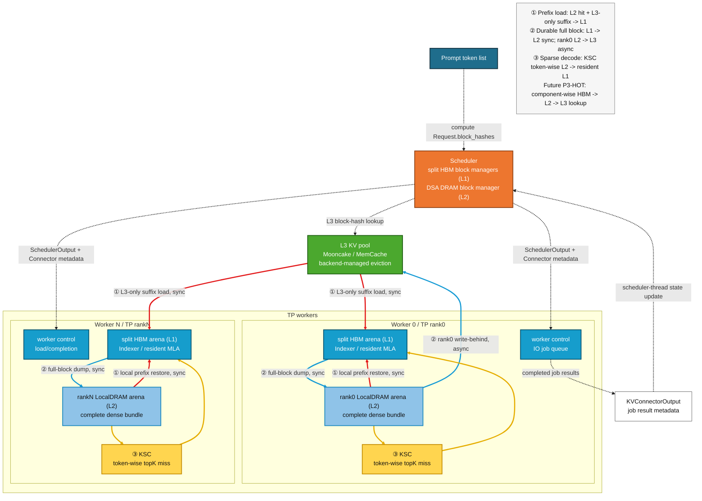

# DSA Rank-local L2 与 AscendStore L3 分层缓存设计

## 1. 文档状态

本文是 DSA 稀疏卸载接入远端 KV pool 的详细设计，基于：

- vLLM v0.23；
- vLLM-Ascend v0.23.0 正式版；
- 当前 DSA custom 分支；
- 单机 8 x Ascend 950DT；
- GLM-5.1/GLM-5.2 W4A4C8 为首要验收模型；
- Mooncake `0.3.11.post1` + `global_ub_device` 为第一后端；
- MemCache `1.2.0` 临时 local-EID 版本为第二后端。

主 DSA 架构、模型执行和算子 ABI 仍以
{doc}`dsa_offload_design` 为总设计。本文只展开 L1/L2/L3 分层缓存、
Connector 生命周期、异步上传和后续 HBM 热层复用。

当前状态：**设计已收敛，进入 P0 介质/schema 门禁，尚未宣称 DSA+L3 功能完成。**

## 2. 目标与非目标

### 2.1 目标

1. 保留当前 scheduler-owned DSA L2 DRAM directory，不重新建立第二套本地
   block manager。
2. 新请求按唯一 `Request.block_hashes` 查询本地 L2 与远端 L3。
3. L3 只补充 L2 之后的连续 prefix suffix，不重复加载 L2 已命中的部分。
4. L3-only suffix 优先直接恢复到 HBM；同一 forward 再通过现有 full-block
   dump 物化到 rank-local L2。
5. prefill/decode 新 durable 满块完成同步 L1->L2 dump 后，由 TP rank0
   异步执行 L2->L3 write-behind。
6. 请求完成不等待 L3 put；块即将被复用时才使用基线风格 reuse fence。
7. eager 与 graph 共用相同 scheduler/worker 状态和最终 HBM block table；
   外部 IO 不进入 graph。
8. Mooncake/MemCache 复用同一 DSA 控制面，后端差异封装在 AscendStore
   `Backend` 层。
9. 为未来 component-wise `HBM > L2 > L3` source plan 保留接口。

### 2.2 第一版非目标

- MTP target cache 的 L3 存储；
- request preemption/resume；
- async scheduling；
- PP、DCP、PCP 与跨节点 TP；
- P/D 分离；
- L3 eviction policy 定制；
- L3 SSD tier；
- L3 load failure 后静默 recompute；
- 修改 Mooncake/MemCache 社区源码的淘汰算法。

## 3. 当前基线盘点

### 3.1 DSA L1/L2 已有能力

当前 target cache 具有三个不同的物理语义：

| 层级/平面 | 当前物理语义 | block id 空间 |
|---|---|---|
| HBM Indexer | 完整上下文 dense Indexer | 独立 pool |
| HBM resident MLA | prefill 时 dense；sparse decode 时 budget+tail | 独立 pool |
| rank-local DRAM | 完整 dense Indexer+MLA bundle | scheduler-owned 独立 pool |
| MTP HBM | BF16 full cache，不卸载 | 可选独立 pool |

`DSASchedulerDRAMBlockDirectory` 已经复用 vLLM `BlockPool` 的 null block、
refcount、hash map、free queue 和 LRU。scheduler 是 DRAM physical id、hash、
ready watermark 与 request->logical block 映射的唯一真源。

`DSAWorkerDRAMStore` 在每个 TP worker 创建相同容量、固定地址的
`empty_with_swapped_memory` arena，只镜像 scheduler assignment；worker 不分配
DRAM id。A5 GLM-5.2 一个逻辑 L2 block 当前包含：

```text
21 个 full Indexer layer:
    key bytes + scale bytes
78 个 target MLA layer:
    packed C8 [128, 1, 656]
总计 6,904,320 bytes / rank / logical block
```

当前本地 prefix cache 只把完整 L2 bundle 作为 target 命中源。MTP 开启时，
target L2 hit 还会与 MTP full-HBM hit 取公共前缀。

### 3.2 当前 HBM target prefix 限制

目前 HBM physical pool 中只有 MTP group 开启 prefix caching。target Indexer
和 resident MLA pool 不发布 hash，原因不是 HBM 无法复用，而是 resident MLA
同时容纳：

```text
dense prefix block      有文本前缀语义
sparse budget block     无文本前缀语义
KSC resident slots      无连续前缀语义
tail/provisional block  未完全 durable
```

在缺少 block-role 状态前直接给整个 resident pool 开 hash 会产生错误命中。
因此第一版 L3 仍以 L2 为唯一 target 本地 prefix tier；HBM target 热层列为本文
第 18 节的高优先级后续项。

### 3.3 vLLM Connector 与 OffloadingConnector 可复用能力

vLLM v0.23 已经提供：

- `KVConnectorOutput` worker->scheduler 输出；
- `Scheduler.update_from_output()` 单线程更新入口；
- `kv_connector_worker_meta` 跨 TP 聚合；
- `kv_connector_no_forward()` 零 token control step；
- `OffloadingConnector` 的 job id、异步 store/load、完成回报；
- `_block_id_to_pending_jobs` 与 `jobs_to_flush` block-reuse fence；
- request finish 后 pending store 不阻塞客户端响应；
- `OffloadingManager.prepare/complete_store/load` 生命周期；
- worker `TransferResult(job_id, success, bytes, time, type)`。

这些结构应作为 DSA L3 的异步生命周期骨架。DSA 不应新建 scheduler 接收
线程，也不应使用独立 RPC 直接修改 scheduler BlockPool。

不能直接原样使用通用 `OffloadingConnector` 的原因是：

- 它的 store source 是普通 GPU/HBM block table；
- DSA sparse decode 的 resident block table 是 budget+tail，不再对应完整
  logical context；
- DSA 完整 source 位于自定义 rank-local DRAM arena；
- DSA 的 Indexer/MLA physical pool 容量和 block id 不同；
- DSA L2 一个 physical id 对应两个 L3 component；
- TP rank0-only store 的完成计数不是 `world_size`。

因此实现应复用 Connector/job 模型，但使用 DSA-specific scheduler/worker
schema adapter。

### 3.4 AscendStore/Mooncake 已验证能力

已验证：

- Mooncake `global_ub_device` 单卡、TP2、TP4、TP8 multi-buffer round trip；
- TP8 环形 remote get 逐字节一致；
- DSA-disabled GLM-5.2 完整模型 3200/3287 external hit；
- 每个 rank 25/25 keys、`failed=0`；
- 每 rank 单次恢复 304,742,400 bytes；
- warm replay token/logprobs 稳定；
- 零 HBM prefix hit 下发生真实 L3->HBM load。

尚未验证：

- DSA split HBM schema 的 AscendStore load；
- swapped-memory arena 直接作为 `global_ub_device` put/get 地址；
- HBM 与 swapped arena 在同一 worker/TransferEngine 中的增量注册；
- rank0-only DSA store + 全 rank DSA load；
- DSA L3 正常 shutdown/drain。

## 4. 不变量

### 4.1 唯一 token identity

所有层级继续使用 vLLM 创建的唯一 `Request.block_hashes`。DSA 不重新计算
token hash，不按 request id 建 L3 identity。

### 4.2 logical block 与 physical id

```text
logical block index  请求完整上下文中的第几个 128-token block
L1 physical id       Indexer/MLA/MTP 各自 pool 内编号
L2 physical id       完整 DSA bundle 的 rank-local arena 行
L3 key               内容寻址 key，不等于任何 L1/L2 physical id
```

### 4.3 durable 规则

只有以下 token 可以写入 L2/L3 prefix cache：

- 已完成 target forward；
- 已通过 MTP target verification；
- 位于完整 block；
- 对应 Indexer 和 MLA payload 都已完成；
- scheduler 已拥有该 logical block 的 block hash。

不满尾块和 MTP provisional token 不得发布 L2/L3 key。

### 4.4 scheduler 单线程真源

所有 physical-id reuse、job state、remote-ready、failure 和 prefix lookup
结果只在 scheduler 主线程更新。worker 后台线程只能向本地 completion queue
写结果，不能回调或直接修改 scheduler 对象。

## 5. L3 对象与 key schema

### 5.1 component 拆分

每个 token block 在 L3 使用两个对象：

```text
INDEXER component -> 所有 full Indexer layer 的 key/scale plane
MLA component     -> 所有 target MLA layer 的 dense packed plane
```

只有两个 component 都 ready 时，该 token block 才是完整 target L3 hit。

拆分的理由：

- Indexer/MLA 在 HBM 已是独立物理池；
- 未来允许两个 component 从不同层级恢复；
- component 失败可以独立重试；
- 避免将 L3 ABI 锁死为当前 L2 bundle；
- GLM-5.2 只保存 21 个 full Indexer，不为 shared follower padding。

### 5.2 key 必备字段

L3 key 至少包含：

```text
namespace/version
model identity
quant/cache format
block size
component
schema fingerprint
request block hash
```

示意：

```text
vllm-ascend:dsa-l3:v1:<model>:a5-c8:bs128:<schema>:indexer:<hash>
vllm-ascend:dsa-l3:v1:<model>:a5-c8:bs128:<schema>:mla:<hash>
```

schema fingerprint 应覆盖：

- full Indexer layer id 顺序；
- MLA layer id 顺序；
- 每个 plane dtype、byte size 和顺序；
- packed/非 packed 模式；
- Indexer shared topology；
- TP replica/shard 语义。

不能直接复用 DSA-disabled AscendStore key。当前 A5 GLM-5.2 的基线 HBM
对象约为 12,189,696 bytes/block，而 DSA packed-C8 L2 对象为
6,904,320 bytes/block，二者 payload ABI 不同。

### 5.3 TP identity

GLM/DeepSeek MLA 与 Indexer target payload 当前按 TP 副本处理：

- L2：每个 rank 保留本地副本；
- L2->L3：初版只由 TP rank0 上传一份；
- L3->HBM：每个 rank 分别加载到自己的 HBM block；
- key 不包含 TP rank。

P0 必须通过 TP8 逐字节比较证明 DSA payload 确实可按副本处理；未通过时不得
使用 rank0-only store。

## 6. 总体架构



图中虚线是 scheduler/worker/L3 lookup 的控制信息，红、蓝、黄实线分别对应
① prefix load、② full-block 下沉、③ decode KSC miss IO。L3->L1 红线只传
L2 最长命中之后的 L3-only suffix；L2->L3 蓝线初版只有 rank0 提交。

## 7. Prefix lookup 与 load path

### 7.1 第一版顺序

1. DSA `get_computed_blocks()` 查询 L2 完整 bundle 的最长连续 prefix。
2. vLLM 基线继续调用 Connector，传入 L2 hit token count。
3. Connector 只查询 L2 之后的 L3 suffix。
4. Indexer/MLA L3 component hit 取公共连续前缀。
5. scheduler 对 `L2 hit + L3-only hit + 本轮 compute` 做 component-wise
   HBM admission。
6. worker 在 `_update_states()` 后先执行现有 L2->HBM restore。
7. Connector 将 L3-only suffix 写入剩余 Indexer/MLA HBM blocks。
8. forward 只计算未命中部分。
9. 当前 full-block dump 将 L3 suffix 与新满块同步物化到 L2。
10. worker 成功返回后 scheduler 发布新增 L2 hash。

### 7.2 为什么第一版选择 L3->HBM direct

优点：

- 少一次 L3->L2->HBM copy；
- 复用已经通过完整模型验证的 AscendStore HBM load；
- L2 hit 与 L3 suffix 写入不重叠 HBM block；
- 一个 forward 后 L3 数据自然进入 L2；
- 不需要为 load 新建 scheduler promotion 状态。

代价：

- DSA allocator 必须接受 `num_external_computed_tokens`；
- Connector 必须理解 DSA split HBM groups；
- load 成功但 forward 失败时，L2 不会发布对应副本；
- 初版必须 fail-fast，不能静默 recompute。

### 7.3 L3->L2 promotion 备选路径

若 swapped-memory get 验证通过，未来可借鉴 vLLM
`TieringOffloadingManager`：L3 miss 在 L2 时先异步 promotion 到 L2，request
返回 `None` 延迟调度，promotion 完成后复用现有 L2->HBM restore。

该路径更接近通用 CPU-primary tier，但多一次 copy 和 scheduler round-trip。
第一版不采用，保留给：

- preemption/resume；
- L3 预取；
- P/D decode 实例 first-fill；
- 无法直接 L3->HBM 的后端。

## 8. DSA allocator 改造

当前 `allocate_dsa_slots()` 显式拒绝：

```text
num_external_computed_tokens
delay_cache_blocks
reserved_blocks
```

P1 只开放同步 L3 load：

- `num_external_computed_tokens > 0`；
- `delay_cache_blocks=False`；
- `reserved_blocks=0`；
- `load_async=False`。

planner 的已计算长度必须改为：

```text
request.num_computed_tokens
+ local_l2_hit_tokens
+ external_l3_hit_tokens
```

HBM target block 分配覆盖全部 local+external prefix；local 部分由 DSA restore
写入，external 部分由 Connector 写入。不能调用基线
`allocate_new_computed_blocks()` 并假设 local hit 已经是 HBM block，因为 DSA
local target hit 实际来自 L2。

admission 必须在任何 pool 修改前同时检查：

- HBM Indexer；
- HBM resident MLA；
- 当前请求后续 full sequence reservation；
- 可选 MTP HBM；
- L2 logical directory 容量。

## 9. 异步 L2->L3 write-behind

### 9.1 触发点

scheduler 在构造本轮 DSA projection 时已经知道 forward 成功后将推进到的
durable full-block watermark。它可以生成本轮尚未远端发布的：

```text
logical block index
L2 physical block id
block hash
INDEXER/MLA component key
job id
```

任务随同一次 forward 的 Connector metadata 下发。worker 不得在 dump 之前
读取 L2。

这里存在一个明确的基线时序差异：vLLM `Scheduler.schedule()` 会在
`_update_after_schedule()` 和返回之前调用 Connector `build_connector_meta()`；
当前 DSA DRAM assignment/projection 则在 `super().schedule()` 返回后，由
`DSAOffloadScheduler._attach_dsa_cache_layout()` 生成。普通 Connector metadata
因此天然看不到同轮新增的 L2 physical ids。

第一版应增加一个只对 DSA connector 生效的类型化后置钩子：

```text
base Scheduler.schedule()
    -> base connector metadata
    -> DSA projection / DRAM assignment
    -> dsa_connector.extend_store_jobs(scheduler_output, projection)
    -> return final SchedulerOutput
```

该钩子同时把新分配/复用的 L2 physical ids 交给 reuse-fence 逻辑。不能只在
下一轮普通 `build_connector_meta()` 中扫描，因为最后一个 forward 之后可能只有
zero-token control step；也不能让 worker 根据 row 长度自行推导 store job。

### 9.2 worker 提交时序

```text
本轮所有 layer L1->L2 dump 入同一 NPU stream
    -> forward 结束
    -> Connector get_finished()/post-forward 记录或继承 dump-ready event
    -> rank0 把 store job 放入本地 pending queue
    -> 下一 engine step 的 start/handle hook 提交后台 put
```

这复用 vLLM `OffloadingConnector` 的 store deferral：上传在下一步开始，而不是
当前 token generation 的尾部同步 `join()`。

### 9.3 block reuse fence

复核 vLLM 基线后，第一选择不是长期增加 transfer ref，而是复用
`_block_id_to_pending_jobs + jobs_to_flush`：

1. pending job 记录它正在读取的 L2 physical block ids；
2. request finish 可以正常释放自己的 L2 refs；
3. block 可进入 L2 cached free queue，不长期减少可用容量；
4. scheduler 若再次分配同一个 physical id，先把关联 job id 放入
   `jobs_to_flush`；
5. worker 在应用新 assignment、执行任何 overwrite 之前等待这些 job 完成；
6. put 完成后再允许新请求覆盖该 L2 block。

该机制仅在真实复用压力出现时阻塞，比 request-finish 全量等待和永久 pin 更适合
在线吞吐。作为保守回退，也可以对小规模 P0/P1 使用 transfer ref pin；正式
P2 以 reuse fence 为目标。

### 9.4 request finish

request finish 不调用 `join()`，客户端响应不等待 L3。pending job 只保留：

- job metadata；
- old hash/component keys；
- source physical ids；
- reuse fence。

请求对象不再是 L3 object 的身份。所有请求完成但仍有 pending job 时，Connector
通过 zero-token control step flush/collect completion；shutdown 则按配置执行
drain。

## 10. job 与状态机

### 10.1 scheduler job

```text
job_id
direction: LOAD / STORE
request_id（诊断与 load resume 使用）
block_hashes
components
source/destination block ids
expected_worker_acks
status
bytes
```

store job 的 `expected_worker_acks=1`，因为只有 rank0 写。load job 若走所有 TP
worker，则 expected count 等于参与 load 的本地 worker 数。

### 10.2 状态

```text
LOCAL_READY
  -> STORE_PLANNED
  -> STORE_SUBMITTED
  -> REMOTE_READY
  -> STORE_FAILED

REMOTE_READY
  -> LOAD_PLANNED
  -> LOAD_SUBMITTED
  -> LOAD_COMPLETE
  -> LOAD_FAILED
```

远端状态以 `(schema namespace, component, block hash)` 为身份；在飞 source
保护以 `(physical block id, generation/hash, job id)` 为身份。迟到事件必须同时
匹配 job id 和旧 hash，不能只凭可复用的 block id 更新状态。

### 10.3 完成回报

worker 后台线程完成阻塞式 Backend `put/get` 后，将结果写入本地线程安全队列。
worker 主线程在正常或 zero-token Connector `get_finished()` 中清空队列，生成
`KVConnectorOutput.kv_connector_worker_meta`。scheduler 在
`connector.update_connector_output()` 中消费。

不创建 scheduler 接收线程；即使未来增加 IPC receiver，receiver 也只能入队，
不能直接修改 BlockPool。

### 10.4 当前基线缺口

现有 AscendStore/Offloading 代码有以下不能原样沿用的行为：

- AscendStore `completed_events` 只有计数，没有 success/error；
- AscendStore sending thread 在 `finally` 中也标记 event 完成；
- Mooncake/MemCache `Backend.put()` 当前不返回可靠逐 key 结果；
- upstream `OffloadingConnectorWorker` 当前对 `TransferResult.success=False`
  直接 assert；
- `pending_count` 默认使用 world size，不适合 rank0-only store；
- AscendStore 非 layerwise `wait_for_save()` 会 `request_queue.join()`。

DSA connector 必须补充显式 `JobResult(success, failed_components,
error_codes)`，不得把“线程结束”当成“远端发布成功”。

## 11. worker 地址映射与 buffer registration

### 11.1 DSA L2 component view

`DSAWorkerDRAMStore` 需要新增只读 API，按 L2 physical ids 生成：

```text
Indexer: keys, list[list[address]], list[list[size]]
MLA:     keys, list[list[address]], list[list[size]]
```

地址来自初始化期固定 arena；热路径不 `.contiguous()`、不创建 tensor、不重新
组织 payload。

### 11.2 registration 顺序问题

当前 Mooncake `GlobalTE.register_buffer()` 使用单个
`is_register_buffer: bool`，第一次注册后后续调用直接返回。若 Connector 先注册
HBM，再注册 DSA L2 arena，L2 实际不会被注册。

必须改为：

- 维护已注册 interval 集合，而不是全局 bool；
- 支持 HBM/L2 分阶段增量注册；
- 合并同 storage 连续区间；
- 重复区间幂等；
- partial failure 回滚或明确失败；
- shutdown 时 unregister/close。

GLM-5.2 A5 L2 当前约有 78 个 MLA arena 和 42 个 Indexer plane arena；P0
必须验证约 120 个 multi-buffer component 的 registration 数量与资源限制。

### 11.3 swapped-memory P0

必须分别验证：

1. swapped arena `register_memory`；
2. swapped -> Mooncake put；
3. Mooncake -> swapped get；
4. NPU op 将 restored swapped bytes 读回 HBM；
5. 逐字节一致；
6. HBM 与 swapped 两批 buffer 在同一 TransferEngine 中同时注册；
7. TP8 rank0 put、所有 rank get；
8. unregister 和 shutdown。

若 direct swapped put 不支持，P2 使用初始化期固定 staging ring：

- ring slot 在启动期预分配；
- slot 生命周期由 job 管理；
- overwrite 前等待 slot job 完成；
- 禁止 forward 热路径分配；
- 评估 L2->staging 额外 copy 性能。

## 12. 各模型阶段

### 12.1 prefill

- 每个 chunk 都可能产生新 durable 满块；
- L1->L2 继续使用当前同步 full-block dump；
- 本轮新增 ready block 生成异步 L3 store job；
- L3 external hit 只发生在请求第一次进入 scheduler 的 prefix lookup；
- chunked prefill 后续 chunk 不重复 lookup 已提交 prefix。

### 12.2 dense decode

- 新满块与 prefill 使用同一 dump/job 语义；
- HBM resident block 尚有 dense 语义，但第一版不作为 target HBM prefix tier；
- L3 store source 始终取 L2，不依赖 HBM 请求布局。

### 12.3 sparse decode

- KSC 只执行 token-wise L2->resident-HBM miss copy；
- sparse budget block 不进入 L3；
- 新 durable tail 满块先同步写完整 L2 bundle，再异步上传 L3；
- active request 持有 L2 refs，因此 KSC 不会读到被重分配的 block；
- L3 不参与 decode 热路径的 token-wise miss。

### 12.4 compromise MTP

初版 DSA+L3 显式拒绝 MTP。后续开放时：

- target 只有 verified token 可以推进 L2/L3 watermark；
- provisional 双尾块不能上传；
- MTP BF16 full cache 仍只在 HBM；
- target L2/L3 hit 与 MTP HBM hit 取公共前缀；
- terminal 未 flush 满块只能降低命中长度，不能发布错误 key。

## 13. eager 与 graph

L3 lookup、load/store metadata、buffer registration 和 completion 都位于 host
控制面。L3 load 和 L2 restore 都在 model forward/graph replay 前完成，forward
只读取最终 HBM block table。

必须保持：

- 一个 `SchedulerOutput`/Connector metadata 真源；
- worker 先执行基线 `_update_states()`，再按最终行序应用 DSA projection；
- eager/graph 不维护两份 L3 row metadata；
- background store job 不进入 captured tensor；
- zero-token completion 不运行模型图；
- graph PAD 行不创建真实 L2/L3 job。

## 14. failure policy

### 14.1 load

第一版固定 `kv_load_failure_policy=fail`。任一 rank、任一 Indexer/MLA
component load 失败：

- 不进入 forward；
- 不发布 L2 ready/hash；
- 释放本轮 HBM/L2 admission；
- 返回明确请求错误或终止当前测试；
- 不使用裸 `invalid_block_ids`，因为 DSA 多物理 pool 重用 block id。

后续若支持 recompute，必须使用 group/tier-qualified failure identity 或 request
级失败结果，不能广播裸 block id。

### 14.2 store

store 失败不影响已经完成的推理：

- 对应 component 不标 remote-ready；
- reuse fence 解除；
- L2 副本若尚在，可按限次策略重试；
- L2 已复用则放弃该次 L3 promotion；
- 不允许部分 Indexer/MLA object 构成完整 prefix hit。

### 14.3 backend 原子可见性

worker `put()` 成功回报是 source-lifetime 完成依据。未来 prefix lookup 仍以
Backend `exists/lookup` 为远端可用真值。debug 模式可在 worker success 后做
二次 exists，但 scheduler 不轮询 L3 来判断 source 是否可复用。

## 15. L2 与 L3 淘汰

### 15.1 L2

L2 继续使用 vLLM BlockPool 全局 LRU。request free 使用 reverse-free 保留
tail-first eviction bias，但不承诺严格按每个请求尾部淘汰。

正确性来自：

- prefix lookup 从 logical block 0 开始；
- 遇到第一个 miss 停止；
- pending store source 在 overwrite 前执行 reuse fence；
- active request ref 阻止 KSC source 被复用。

### 15.2 L3

Mooncake/MemCache 自主管理容量和淘汰。DSA 不修改后端源码，也不假设它按请求
尾部淘汰。Indexer/MLA component 分别 lookup，并从 block 0 求公共连续 prefix。

未来可增加 retention/TTL/parent-hash hint，但不是第一版正确性条件。

## 16. 背压与性能

配置建议：

```text
max_inflight_l3_store_jobs
max_inflight_l3_store_bytes
l3_store_batch_blocks
l3_completion_poll_interval
l3_connection_warmup
```

达到上限时不得阻塞 decode：

- 暂缓新的 L3 promotion；
- 保留普通 L2 cache；
- 若 block 后续仍在且队列有空位再补传；
- L2 即将复用时只 flush 真正相关 job。

已观察到 Mooncake 第一次 warm load 因 segment 懒建链耗时 10~24s，连接复用后
各 rank get 为约 17~327ms。正式性能测试前需要连接预热，不能把首轮建链混入
稳态 L3 带宽。

## 17. Backend 抽象

DSA connector 不直接 import Mooncake/MemCache API，复用 vLLM-Ascend
AscendStore `Backend`：

```text
exists(keys)
register_buffer(ptrs, sizes)
put(keys, addrs, sizes)
get(keys, addrs, sizes)
shutdown/close（需补齐）
```

需要统一返回合同：

```text
len(result) == len(keys)
0           == success
nonzero     == explicit failure
exception   == transport/backend failure
```

Mooncake 优先实现。MemCache 后续复用相同 DSA key/schema/job 状态机，只保留：

- Local EID 初始化；
- AICPU run 包检查；
- Backend put/get 实现；
- lease/GVA 特有能力（第一版 non-layerwise 不依赖）。

## 18. HBM target prefix 高优先级后续

该适配点不能遗忘。L3 第一版完成后，应尽快把 HBM target 热副本加入
component-wise source plan：

```text
Indexer: HBM -> L2 -> L3
MLA:     dense HBM -> L2 -> L3
MTP:     HBM
```

必要改造：

1. Indexer HBM pool 开启 hash；
2. resident MLA block 增加 `DENSE_PREFIX/BUDGET/TAIL` role；
3. 只给 `DENSE_PREFIX` 发布 hash；
4. prefix lookup 按 logical block 和 component 选最热 source；
5. Indexer/MLA source 长度允许不同，但最终必须覆盖同一连续 token prefix；
6. restore plan 拆成独立 component source/destination/mask；
7. eviction 与 invalid-block identity 使用 group-qualified id；
8. 保持 worker 最终 HBM block table 为 eager/graph 唯一真源。

该项优先级定为 **P3-HOT（高）**，排在 L3 正确性闭环与 rank0 async store
之后，不归入低优先级远期优化。

## 19. 配置与初版支持矩阵

建议沿用标准 `KVTransferConfig`，使用能力命名的 Connector，例如：

```python
KVTransferConfig(
    kv_connector="DSAOffloadingConnector",
    kv_role="kv_both",
    kv_load_failure_policy="fail",
    kv_connector_extra_config={
        "backend": "mooncake",
        "load_async": False,
        "use_layerwise": False,
        "max_inflight_l3_store_jobs": 8,
    },
)
```

DSA 配置校验第一版要求：

| 能力 | 第一版 |
|---|---|
| 单机 TP | 支持 |
| GLM-5.1/5.2 A5 C8 | 首要 |
| DeepSeek-V3.2 | 回归 |
| Mooncake | 支持 |
| MemCache | 后续同 schema |
| eager | 支持 |
| FULL graph | 支持，IO 在图外 |
| chunked prefill | 支持 |
| async scheduling | 拒绝 |
| MTP | 拒绝 |
| preemption | 拒绝 |
| PP/DCP/PCP | 拒绝 |
| load failure recompute | 拒绝 |

当前 `dsa_offload/config.py` 对所有 KV connector 的无条件拒绝，应改成只允许
经过验证的 DSA connector，而不是笼统放开 AscendStoreConnector。

## 20. 计划代码结构

建议新增：

```text
vllm_ascend/dsa_offload/l3/
    __init__.py
    connector.py          标准 KVConnector 生命周期入口
    scheduler.py          lookup、job、reuse fence、completion
    worker.py             rank0 uploader、全 rank loader、completion queue
    metadata.py           pickle-safe job/result dataclass
    schema.py             component/key/schema fingerprint
    backend_adapter.py    对现有 AscendStore Backend 做严格返回封装
```

现有文件窄改：

| 文件 | 改造 |
|---|---|
| `dsa_offload/config.py` | 支持矩阵与 Connector 校验 |
| `kv_cache_manager.py` | 接受 external tokens，component admission |
| `kv_cache_coordinator.py` | local hit commit、L2 assignment、未来 HBM source |
| `scheduler.py` | 将新增/复用 L2 IDs 提供给 connector fence |
| `worker_dram_store.py` | component 地址视图和 registration regions |
| `model_runner_v1.py` | bind DSA L3 worker/store，保持基线 connector hooks |
| `mooncake_backend.py` | 严格 put/get 结果、close |
| `memcache_backend.py` | 同一结果合同、close |
| `mooncake_transfer_engine.py` | 增量注册与 unregister |

不新增模型名特化模块，不修改 vLLM 源码，不复制 Scheduler 主循环。

## 21. 分阶段实施

### P0：介质与 schema

- exact 6,904,320-byte DSA block；
- split HBM TP8 round trip；
- swapped L2 put/get；
- HBM+L2 同进程增量注册；
- rank0 put/all-rank get；
- strict status 与 teardown。

### P1：同步只读

- DSA connector 注册；
- L2 hit 后 L3 suffix lookup；
- external HBM admission；
- L2 restore + L3 direct load；
- forward 后 L2 materialization；
- no-MTP、fail-fast、Mooncake only。

### P2：rank0 异步 write-behind

- store job 和 dump-ready event；
- store deferral；
- reuse fence；
- request finish 不等待；
- zero-token completion；
- failure/result/shutdown；
- prefill/chunk/decode durable block。

### P3-HOT：HBM target prefix

- component-wise HBM/L2/L3 source；
- dense MLA role；
- independent restore masks；
- LRU/eviction 性能。

### P4：扩展

- MTP target+MTP 公共前缀；
- preemption/resume；
- P/D；
- 多节点与 CP/PP；
- MemCache 正式版；
- L3 event/metrics/retention。

## 22. 测试门禁

### 22.1 Python UT

- key/schema 稳定与 namespace 隔离；
- Indexer/MLA component 公共前缀；
- L2 hit + L3 suffix；
- L3 hole/partial component；
- external token allocator；
- rank0 store expected count；
- success/failure completion；
- request finish 不等待；
- physical id reuse 触发 flush；
- stale job/hash generation 防护；
- zero-token completion；
- backpressure；
- shutdown/reset。

### 22.2 NPU component

- realistic HBM/L2 schema bitwise；
- TP8 rank0 put/all-rank get；
- same-process HBM+L2 registration；
- empty/error return；
- first connection 与 steady bandwidth；
- in-flight reuse fence。

### 22.3 E2E

1. DSA disabled control；
2. DSA L2 only control；
3. DSA+Mooncake，清 L2/缩小 L2 强制 L3 hit；
4. eager/graph；
5. bsz=1/bsz>1；
6. 相同/混合长度；
7. chunked prefill；
8. prefill 新块与 decode 新块远端增长；
9. online continuous batching；
10. request finish/row reuse/L2 physical id reuse；
11. output token 与 top-logprobs 对照；
12. L3 put/get/object 数和 external hit 证据；
13. profiling 与长稳。

GLM-5.2 当前冷算与 HBM/L3 warm prefix 路径存在相同的 top-token 边界变化；
L3 验收应继续对照 HBM-prefix warm 结果，不能只比较 cold/warm token 是否完全相同。

## 23. 已识别风险

| 风险 | 当前处理 |
|---|---|
| swapped memory 不可直接注册 | P0 gate；固定 staging ring 回退 |
| Backend put 吞错误 | 严格结果 adapter |
| completion 把异常当成功 | 显式 JobResult |
| physical id 在上传中复用 | upstream-style jobs_to_flush fence |
| base Connector metadata 早于 DSA projection | DSA 类型化后置 metadata 扩展钩子 |
| split pool 裸 block id 冲突 | job/component/group-qualified identity |
| rank0-only store 误按 world size 等待 | per-job expected ack count |
| DSA target key 与基线 key 冲突 | schema namespace/fingerprint |
| 首次 Mooncake 建链过慢 | connection warmup 与稳态指标分离 |
| Connector teardown 泄漏 | stop/join/unregister/close/drain |
| sparse resident 被通用 save 错读 | store source 固定为 DSA L2 component view |
| MTP provisional block 提前发布 | durable watermark + 初版拒绝 MTP |
| eager/graph 元数据分裂 | 所有 IO 在图外，共用 scheduler plan/HBM table |

## 24. 决策摘要

1. L2 block id 继续绑定完整 Indexer+MLA bundle。
2. L3 按 Indexer/MLA component 分对象，以 hash 为身份。
3. 第一版 read 为 L2 hit + L3-only suffix direct-to-HBM。
4. 同一 forward 把 L3 suffix 物化到 L2。
5. L2->L3 只由 rank0 异步写。
6. 不在 request finish 等待。
7. 优先复用 vLLM OffloadingConnector job/reuse-fence/no-forward 模型。
8. worker 完成事件是 source lifetime 真值；scheduler 不轮询 L3 判断完成。
9. L3 eviction 由后端自治，DSA 只做连续公共前缀。
10. HBM target prefix 是 P3-HOT 高优先级项，不得遗忘。
