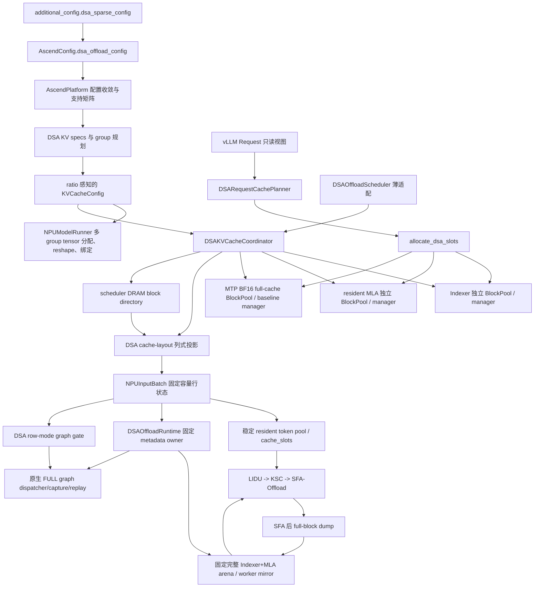
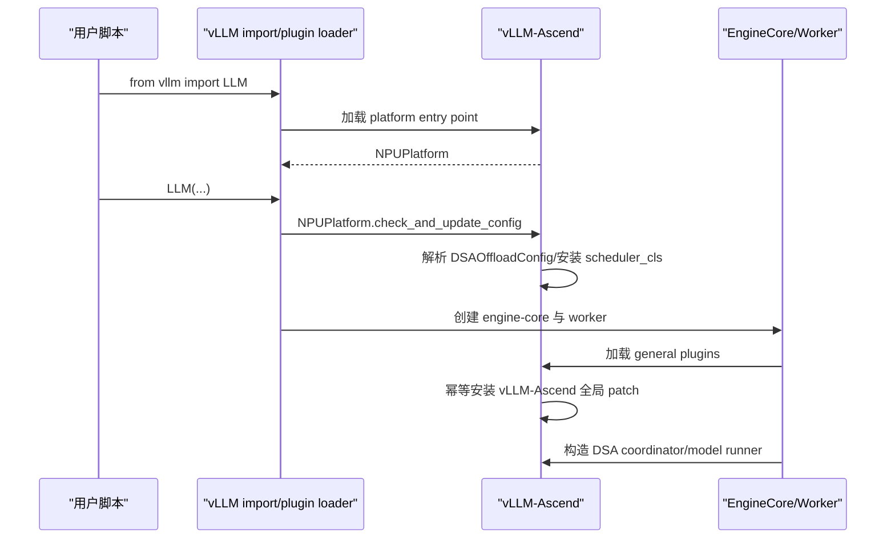
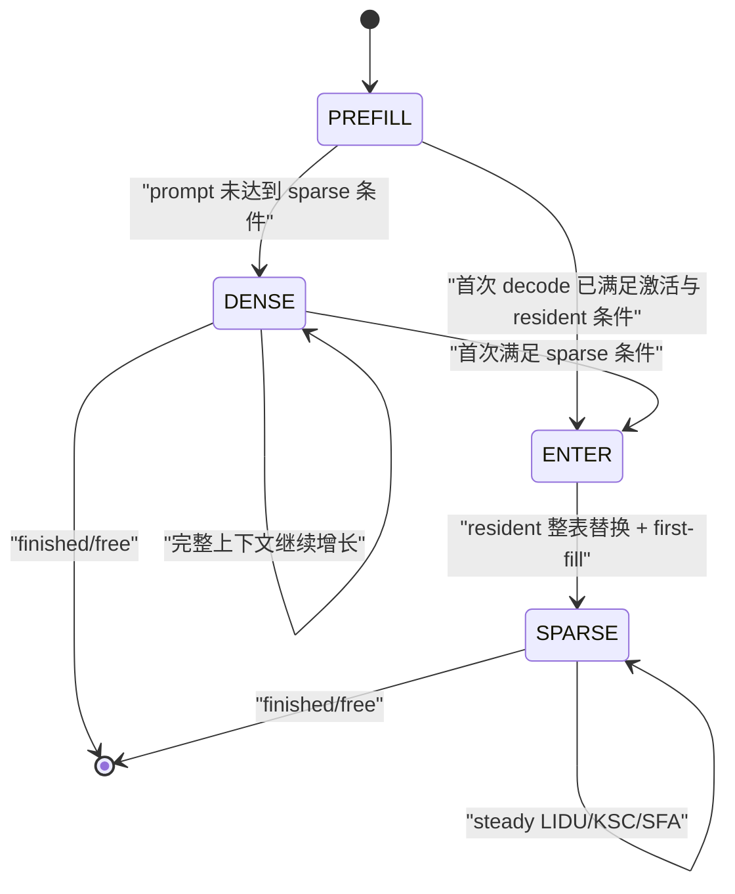
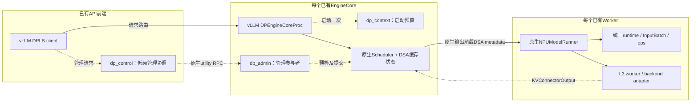

# DSA 稀疏卸载当前设计

> - 最后更新：2026-09-10（DP L3关闭已确认，剩余退出停留定界到TorchNPU native shutdown）
> - 目标基线：vLLM v0.23.0 + vLLM-Ascend v0.23.0 正式版
>   `5cb98caa`（CANN 9.1.0、TorchNPU 2.10.0.post4、
>   Triton Ascend 3.2.2）
> - 当前完成度：核心控制面、eager 和 FULL decode graph 已完成 910C 初验；
>   chunked prefill 已完成分段 prefill/首 token 初验，完整 sparse decode
>   验收待补；A5 packed C8 已完成 GLM-5.1 eager/graph 端到端初验；
>   GLM-5.2 MTP 已完成 UT、离线 eager/FULL graph 与在线 FULL graph 冒烟
> - 本地 DRAM complete-bundle prefix cache 已完成第一版上板；Mooncake
>   P1-W rank0 异步 write-behind 与 P1-R 同步 all-rank prefix loadback
>   已完成代码、UT 和 TP8 收缩验收；固定 MTP3 已完成 eager/FULL graph
>   单 40K 与 5K/8K/40K/70K 在线 FULL graph closeout；在线长稳、
>   DeepSeek-V3.2 与其余 P2 回归仍待补齐
> - 首要验收模型：GLM-5.1、GLM-5.2；兼容回归模型：DeepSeek-V3.2
> - 单机DP进展：DP2/TP4/EP8的基础、Local prefix、MTP Local及共享L3
>   主路径已有A5验证；P6-A单40k和8k/70k并发通过功能验证。P6-B在线
>   正常管理八请求闭环也已通过；数值等价、管理故障/退出/长稳与跨机不据此宣称通过。
> - 单机offline SPMD的Graph+MTP3+L3十二请求三阶段及逻辑IO排空已通过；
>   后续六请求复测已确认所有worker完成L3资源关闭，原生进程退出仍升级SIGKILL，
>   已定界为TorchNPU `_C._npu_shutdown(success)`在原生等待窗口内未返回。
>   单列为已知生命周期限制，不阻塞DP正常功能阶段性收口；不宣称干净退出通过或根因与DSA完全无关。

## 1. 文档定位

本文描述 **v0.23 分支当前已经落地的设计**，是公开项目中关于 DSA
“当前代码是什么结构、谁持有什么真源、稳定不变量是什么”的唯一设计真源。
后续每完成一个扩展场景，都应先按实际代码更新本文，再更新对应 demo 和
验收矩阵。尚未实现的能力只列接口边界，不写成可运行能力。

## 2. 目标与当前边界

DSA 稀疏卸载最终目标是在长上下文 decode 中实现：

1. Indexer K 保存完整上下文并驻留 HBM；
2. target Indexer+MLA 完整满块卸载到 worker 本地 hot DRAM；
3. HBM MLA 只保留有界 resident budget 与固定尾区；普通 decode 为一块，
   固定 MTP3 为两块 parity tail；
4. LIDU 选择重要 token 并更新 resident 映射；
5. KSC 只换入本轮 miss token；
6. SFA-Offload 消费重要 token 与尾块完成注意力计算。

当前代码已经完成：

- `additional_config["dsa_sparse_config"]` 的类型化解析和支持矩阵校验；
- 模型能力判断；
- Indexer/MLA HBM spec、容量、tensor、block pool 和绑定解耦；
- scheduler/core 侧请求 cache 布局规划；
- PREFILL、DENSE、ENTER、SPARSE 的 component-wise block 分配；
- prefill 输出返回后的 resident 满块释放时序；
- 不复制上游 `Scheduler.schedule()` 的薄调度适配；
- scheduler/core 已提交状态到 worker 最终 `InputBatch` 行序的列式投影；
- ENTER 的 resident MLA block table 全量替换；
- 稳定 resident token pool 与逐 selection group 的 `cache_slots`；
- 固定容量 hot DRAM arena 和请求逻辑块 ledger；
- prefill/dense/sparse 共用的双 plane slot mapping；
- 基于 v0.23 原生调度状态的 chunked prefill、增量双 plane 分配与逐 chunk
  满块 dump；
- eager LIDU→KSC→SFA-Offload 与 full-block dump 数据面；
- 复用原生 FULL decode capture/replay 的 row-mode 图数据面；
- A5 C8 的独立 Indexer key/scale、packed resident/DRAM、decode 融合
  Quant-LI/resident manager、纯 IO packed KSC、社区 QSFA 与 packed dump
  源码集成；prefill 仍复用社区 Quant-LI。
- GLM-5.2 IndexShare：78 个 resident MLA 层中仅 21 个 full 层创建
  Indexer cache/LIDU 持久状态，57 个 shared 层复用所属 full 层的 topK、
  copy plan 与 resident slot 映射，同时保留本层独立 MLA HBM/DRAM payload。
- A5 packed-C8 固定 MTP3：target 使用多 query LIM、请求级去重 KSC 和
  原生 QSFA，并使用固定双尾 parity 布局；MTP proposer 保持基线 BF16
  Indexer+MLA forward，其 Cache 作为第三个原生 full-cache group 全量驻留
  HBM，不创建 DSA selection state；启用多级 prefix 时仅为 verified full
  block 创建 opaque-byte DRAM arena，不改变 active decode cache/attention。
- ENTER 将尚未 first-fill、无 prefix hash 的 sparse budget blocks 按物理 ID
  升序规范化，再由 KSC 按最终 block table 写入；普通单尾和 MTP parity
  双尾不参与排序，始终保留在 budget 后的固定逻辑列。该规则避免 free-list
  回卷后 budget 从升序切换为降序而触发 A5 QSFA 数值路径变化，同时不移动
  任何已有有效 KV 的 block。
- worker block table 的 add、ENTER replace、batch condense move 与 clear
  都清空非活动列，固定宽算子因此不会观察到前一条长请求遗留的物理 block
  ID；这些操作只发生在请求/行生命周期冷路径，不增加 steady forward 开销。
- scheduler-owned DRAM complete bundle 的 hash-ready、LRU/refcount、
  请求结束保留、最长连续命中、target 分平面 restore，以及可选 MTP
  full-HBM EAGLE 公共命中第一版；
- `DSAL3Connector` 的 Mooncake Store-owned TCP：TP0 异步上传完整 L2
  Indexer/MLA/可选 MTP component、physical-id reuse fence、完成回报与
  shutdown drain；
- L2 命中后的 L3 连续 suffix lookup、联合 HBM/L2 admission、all-rank
  `L3 -> L2` 同步恢复、TP success consensus 和既有 `L2 -> HBM` restore；
- no-MTP 下成对 HBM Indexer+dense-MLA prefix 独立参与本地最长命中，允许
  越过 L2 complete bundle，并在首个 prefill forward 中补齐 L2 gap。
- 单机DP资源预算协调、各域独立L1/L2、共享L3与MTP/dummy组合；复用原生
  EngineCore、调度、DP模式同步和KVConnector，不另建全局推理scheduler。

正式版基线同时提供并由 DSA 原样继承：

- MTP draft slot mapping 的固定容量补偿，覆盖 BlockTable 与 proposer buffer；
- spawn 后 `enable_npugraph_ex`、static-kernel 等最终图配置回写；
- AscendStore layerwise MTP 层注册与 PCP/DCP/PP/rank 隔离 GVA key；
- MemCache lazy-init 查询保护、在线 `shm_broadcast` 槽位释放修复；
- async accepted-token/SWA 生命周期修复。DSA 当前仍显式拒绝 async
  scheduling，但不能绕开或覆盖这些基线补丁。

当前尚未完成：

- Indexer-only/MLA-only 的 component-wise source mask 与精细 IO 去重；
- L3 FD/连接长稳、layerwise async load、HBM 直通、跨机DP/非Mooncake后端；
- 单机DP完整精度/故障矩阵及P6-B管理异常、暂停期间退出、长稳的实机验收；
- prefill/decode mixed、preemption/resume、P/D 分离、非 MTP speculative
  method、MTP draft 数不等于 3/非 greedy MTP、MTP proposer graph、
  async scheduling、KV-cache metrics/events；
- GLM-5.2 A5 正式 QA/性能验收、A5 BF16 算子链和 DeepSeek-V3.2 回归。

当前已在 Linux + Ascend 环境完成 DSA UT，并取得 GLM-5.1 W4A8/W4A4C8、
TP16/EP 的 disabled、cache-init、eager 与 FULL decode graph 初验证据。
graph 已覆盖 bsz=4 的同长度约 8K prompt，以及约
5K/20K/8K/40K 的混合长度与不同 resident budget。该结果证明
capture/replay 主路径可运行，但仍不替代完整 QA 数据集、长时间连续调度、
请求结束/行复用和 DeepSeek-V3.2 回归。chunked prefill 已在
`max_num_batched_tokens=4096/8192/16384` 下完成四条长短混合请求的
baseline/DSA 首 token 对照；由于该组测试只生成一个 token，它尚不能证明
后续 sparse decode 的完整正确性。

### 2.1 妥协版 MTP 后续 RoadMap 位置

当前实现已将 no-MTP L3/P1-HOT 数据路径阶段性收口并进入 MTP 多级 prefix：
scheduler-owned DRAM、完整本地 prefix 和 L2/L3 第一版读写闭环已经打通；
graph token 确定性与 L3 长稳作为遗留继续跟踪，不能直接把项目状态描述成
已经进入 P/D 分离。

| RoadMap 工作项 | 当前状态 |
|---|---|
| scheduler 统一管理 DRAM physical block | 已完成 |
| 完整 durable bundle、block hash 与 LocalDRAM prefix | no-MTP 已上板；MTP 增加 BF16 component |
| L2→L3 异步 write-behind | P1-W 已完成并初验 |
| L3→L2→HBM prefix loadback | P1-R 同步版已完成并初验 |
| HBM target prefix 与 L2/L3 component-wise source | 完整 pair 已上板；单 component mask 后移 |
| MTP 多级 prefix | 三 component UT、A5 TP8 eager/FULL graph 单 40K、混合 graph 与在线 closeout 通过；长稳/DeepSeek 待回归 |
| 单机DP与多级缓存组合 | P0-P6-A及P6-B正常管理主闭环已上板，不等于完整精度/故障/退出矩阵已验收 |
| preemption/resume | 未实现，scheduler 显式失败 |
| P/D 分离 | 未开始 |
| 理想版动态 MTP | 未开始；当前固定 MTP3 可用 |
| MTP proposer graph | 未实现；target uniform Q=4 FULL graph 已完成 |

当前优先收口单机DP管理和已实现组合的门禁，随后再讨论和适配
preemption/resume及P/D分离。独立 component source
mask、L3 layerwise/direct 与理想版 MTP 属于性能或高风险扩展，不应阻塞上述
主线。详细阶段门禁见
{doc}`dsa_offload_roadmap`。

## 3. 当前总体架构



当前有三个不同层次的真源：

| 层次 | 真源 | 当前所有者 |
|---|---|---|
| 用户配置 | 解析后的不可变 DSA 配置 | `AscendConfig.dsa_offload_config` |
| 请求 cache 布局 | 阶段、冻结预算、resident 有效长度 | `DSARequestCachePlanner` |
| 物理块表 | target 两 plane 与可选 MTP full group 的 request→blocks 映射 | `DSAKVCacheCoordinator` 下的各 group manager |
| worker resident 映射 | request→稳定 pool row、逐层 token→slot | `DSAResidentTokenPool` |
| DRAM 逻辑真源 | request→logical full block→DRAM block | `DSAKVCacheCoordinator` |
| DRAM worker 镜像 | pool row→logical full block→DRAM block | `DSAWorkerDRAMStore` |

worker 行状态是上述 scheduler/core 真源的 **投影**，不是第二套请求阶段
账本。eager 与 graph 后续都必须消费这个投影和同一个 buffer owner。

## 4. 与 v0.23 基线的集成方式

### 4.1 Python 插件发现与安装时序

DSA 实现只修改 vLLM-Ascend，不修改配套 vLLM checkout。这里的“零修改”
不等于 vLLM 不参与：vLLM 提供硬件插件发现与若干扩展点，Python 提供
distribution metadata 和运行时导入机制。

vLLM-Ascend 安装时在 `setup.py` 注册：

```text
vllm.platform_plugins:
  ascend = vllm_ascend:register

vllm.general_plugins:
  ascend_* = vllm_ascend:register_*
```

`from vllm import LLM` 首次导入 vLLM 后，vLLM 通过
`importlib.metadata.entry_points()` 查询当前 Python 环境中已安装
distribution 的这些 entry point。平台插件的 `register()` 返回
`vllm_ascend.platform.NPUPlatform`，后续配置收敛、模型 runner 和
attention backend 才进入 Ascend 实现。

engine-core 子进程还会加载 general plugins。它们通过
`vllm_ascend._ensure_global_patch()` 调用原生 `adapt_patch()`；
`_GLOBAL_PATCH_APPLIED` 保证同一进程重复触发时幂等。patch 必须早于被替换
函数首次用于构造 scheduler/cache manager；仅早于一次普通函数调用还不够，
因为其他模块可能已经用 `from ... import ...` 缓存了旧引用。



### 4.2 扩展点与窄 patch 的边界

| v0.23 扩展点 | DSA 用法 |
|---|---|
| `AscendConfig` | 解析并持有 `DSAOffloadConfig` |
| `KVCacheSpecRegistry` | 注册 DSA Indexer/resident spec 与 manager |
| KV group/config hook | 构造 target 两组、可选 MTP 第三组和 ratio 容量 |
| coordinator factory | 创建 `DSAKVCacheCoordinator` |
| `scheduler_config.scheduler_cls` | 安装薄 `DSAOffloadScheduler` |
| `SchedulerOutput` dataclass | 浅包装为只增加一个 projection 的 Ascend 子类 |
| `NPUInputBatch` | 持有固定容量 DSA SoA 行状态 |
| `NPUModelRunner` cache 初始化 | 分配、reshape、绑定 target split plane 与原生 MTP full cache |
| common/SFA attention metadata | 在同一份 resident metadata 上附带 Indexer/DSA view |
| `AscendSFAImpl` | DSA 开启时执行 LIDU/KSC/SFA-Offload 和层后 dump |

能够直接修改 vLLM-Ascend 的位置都采用显式类型和普通调用，不再为 DSA
单独制造 patch 层。vLLM v0.23 尚未给出正式扩展点的少数位置，DSA 复用
vLLM-Ascend 已有 patch 模块：

| 现有 patch 模块 | DSA 窄适配 |
|---|---|
| `patch_kv_cache_utils.py` | 识别 DSA split spec/group，接管分组、ratio 容量和容量报告 |
| `patch_kv_cache_coordinator.py` | 识别 DSA group 创建 coordinator，并仅对 `DSAKVCacheCoordinator` 调用 `allocate_dsa_slots()` |

每个 wrapper 都先用类型化 spec/group/coordinator 判断是否为 DSA；不满足
时调用保存的上游原函数。不能再为同一目标函数叠加第二个 DSA wrapper，
因为 Python 属性替换遵循最后一次赋值，多个互不知情的 wrapper 会产生安装
顺序依赖。新逻辑应合并到现有 wrapper，并继续依赖 vLLM-Ascend 全局 patch
的进程内幂等安装。

DSA 没有 patch `Request`，没有复制或 patch
`Scheduler.schedule()`，也没有全局替换 `SchedulerOutput`。它通过
`scheduler_config.scheduler_cls` 安装薄 `DSAOffloadScheduler`，再用
vLLM-Ascend 自有的 `DSAOffloadSchedulerOutput` 子类附加一个类型化
projection。v0.19 的 patch 拓扑只作为历史参考，不是 v0.23 的实现范式。

## 5. 配置与模型能力

配置入口保持为：

```python
additional_config={
    "dsa_sparse_config": {
        "enabled": True,
        "split_indexer_cache": True,
        "indexer_mla_block_ratio": 3,
        "sparse_activation_tokens": 6144,
        "prompt_budget_thresholds": [32768, 65536],
        "resident_budget_tokens": [6144, 10240, 12288],
        "max_active_reqs": 256,
        "hot_cpu_block_multiple": 3.0,
        "enable_row_mode_decode_graph": True,
    }
}
```

`config.py` 在拉起期完成类型转换、未知字段拒绝和支持矩阵校验。当前支持
v0.23 原生显式 chunked prefill，以及
`long_prefill_token_threshold` 形成的固定上限 prefill chunk；两者都要求
`scheduler_reserve_full_isl=True`，在首个 chunk 入场前验证完整 prompt 能
同时容纳于所有启用的 full-context cache group。speculative decode 仅放行 A5 packed-C8
下的 `method=mtp`、固定 3 个 draft 和 greedy 请求；MTP resident 最低档为
8192。本地 DRAM complete-bundle prefix cache 已开放配置；当前仍显式拒绝
async scheduling、其他 speculative method、KV transfer、context/pipeline parallel、
KV-cache metrics/events 等未建立完整合同的组合。

| 字段 | 默认值 | 当前语义 |
|---|---:|---|
| `enabled` | `False` | DSA 总开关；关闭时不创建 DSA cache、scheduler 或 runtime |
| `split_indexer_cache` | `True` | 兼容性输入；DSA 开启时必须为真，解析后由 `enabled` 派生 |
| `indexer_mla_block_ratio` | `3` | Indexer HBM blocks 与 resident MLA base blocks 的容量比 |
| `sparse_activation_tokens` | `6144` | 完整上下文超过该值后允许进入 sparse 布局 |
| `prompt_budget_thresholds` | `[32768, 65536]` | admission 时按 prompt 长度选择 resident 档位 |
| `resident_budget_tokens` | `[6144, 10240, 12288]` | N 个 prompt 阈值划分 N+1 个区间，每个区间对应一个冻结 resident budget |
| `max_active_reqs` | `256` | 配置上界，必须覆盖 `max_num_seqs`；不是实际预分配行数 |
| `hot_cpu_block_multiple` | `3.0` | 期望 DRAM usable blocks 相对 Indexer HBM blocks 的浮点倍数，最终向上取整；单机内存不足可缩容但不得低于 1x Indexer blocks |
| `enable_row_mode_decode_graph` | `False` | 允许普通 Q=1 或 MTP3 uniform Q=4 decode 进入原生 FULL graph |
| `trace_points` | 关闭 | 拉起期解析的预留调测合同；当前仅接受 `first_sample`，尚无稳定日志 consumer |

实际 `DSAInputBatchCacheLayout` 列式状态按 `max_num_seqs` 分配；
`DSAResidentTokenPool.cache_slots` 额外增加一条共享 PAD 物理行，即
`max_num_seqs + 1`。两者都不按 `max_active_reqs=256` 分配。后者保留为
未来将 DRAM ledger 与 resident 活跃行生命周期解耦时的请求账本容量合同，
当前首先用于拒绝 `max_num_seqs > max_active_reqs` 的配置。

静态算子 ABI 还要求：

- `block_size=128`；
- `max_model_len <= 262144`；
- non-MTP resident budget 只能取 `6144/10240/12288`；MTP3 只能取
  `8192/10240/12288`，且都与 block size 对齐；
- LIDU caller-owned 输出列宽固定为 `16384`；
- Indexer head dim 为 128，MLA latent/rope 维度为 512/64；
- 当前 Indexer heads 支持 32 或 64。

模型支持采用能力判断，不仅依赖 architecture 名称。模型必须具备：

- MLA attention；
- sparse Indexer；
- 与当前 SFA 合同一致的 `index_topk`；
- DSA 所需的模型维度和 cache dtype。

模型若声明 `indexer_types`，其长度必须与 `num_hidden_layers` 相同且每项只能
为 `full/shared`。该列表是 checkpoint 物理拓扑的真源，不能只用
`index_topk_freq` 猜测哪些层缺少 Indexer 权重。GLM-5.2 的真实拓扑为：

```text
78 resident layers = 21 full Indexer layers + 57 shared followers
full layer ids      = 0, 1, 2, 6, 10, ..., 74
shared source       = 其前方最近一个 full layer
```

层 0、1 各自计算 topK；从层 2 开始，每个 full 层与后续三个 shared 层组成
一个四层 selection group。当前算子 ABI 仍限制 `max_model_len <= 262144`，
因此并不等同于已经开放 GLM-5.2 checkpoint 声明的 1M 最大上下文。

## 6. HBM 物理 Cache groups

### 6.1 Spec

`DSAIndexerKVSpec` 描述完整 Indexer K。每 token 只有一个 K 向量，因此覆盖
`FullAttentionSpec` 默认 K+V page 字节数。

`DSAResidentMLAAttentionSpec` 描述 resident MLA。它的
`sparse_head_dim` 不再包含 Indexer 维度，防止 MLA page 重复核算 Indexer。

两个不同的 DSA spec identity 让 v0.23 registry 将它们保留为独立 cache group。
普通模型两个 plane 的层集合相同；GLM-5.2 的 target Indexer group 只包含
full 层，是 target resident MLA 层的真子集。

启用 MTP3 后，模型自带 MTP layer 使用基线原生
`AscendMLAAttentionSpec`，`sparse_head_dim` 同时包含 BF16 MLA latent、RoPE
和 Indexer K。它不转换为 DSA spec，而是形成标记
`is_eagle_group=True` 的第三个 full-cache group。

### 6.2 容量与 group

finalized `KVCacheConfig.num_blocks` 表示 target resident MLA 的 base blocks。
Target Indexer 和可选 MTP full-cache 容量通过最终 `KVCacheTensor.size`
表达为：

```text
target indexer blocks = resident base blocks * indexer_mla_block_ratio
MTP full blocks       = resident base blocks * indexer_mla_block_ratio
```

KV group 顺序固定为 target Indexer、target resident MLA、可选 MTP full；运行期仍通过
`DSAKVCacheGroupIds` 按 spec identity 解析 group id，不在热路径假设固定
下标。

worker 的同层绑定顺序则固定为 resident MLA 在前、Indexer 在后。这是绑定
ABI，不等同于 group 顺序。

容量公式按最终 group 的真实层集合和 block multiplier 计费。增加一个 MTP
draft layer 会增加一份 `ratio * native BF16 full page` 成本，因而在固定 HBM
字节下自然降低 base block 数；容量报告、scheduler admission 和实际 tensor
分配使用同一结果，不会出现 target 可容纳请求数与 proposer cache 容量不一致。
启动容量报告会单独打印 MTP full group 的 layer 数、blocks、tokens、字节占用、
占总 KV HBM 比例及其 `max_model_len` 请求上限。

### 6.3 Worker tensor

每个 full 层的 Indexer plane 恢复为：

```text
[num_indexer_blocks, block_size, num_kv_heads, head_size]
```

它没有独立 attention backend 或 metadata builder，只作为对应 selection
group 的 full 层 LIDU cache 输入。shared 层不创建空壳 Indexer tensor。

resident MLA 继续复用 Ascend MLA backend 的 tensor 表示，但不再内嵌
Indexer K。两张 tensor 在初始化后分别绑定到共享模型层。

MTP full group 复用基线 allocation/reshape，得到恰好三项 BF16 tuple：

```text
(mla_nope_cache, mla_rope_cache, indexer_key_cache)
```

它使用独立 block table 与 slot mapping；物理 block ID 无需等于 target
Indexer，但 token coverage 必须相同。

## 7. 请求 cache 布局账本

### 7.1 为什么不是新的 request lifecycle

`request_cache_layout.py` 不接管 vLLM 的 waiting/running/finished/preempted
状态。它只记录 DSA cache 应采用的物理布局：

| 阶段 | Indexer plane | resident MLA plane |
|---|---|---|
| `PREFILL` | 完整 prompt | 完整 prompt，供 prefill 与后续 dump |
| `DENSE_DECODE` | 完整上下文 | 完整上下文 |
| `ENTER_SPARSE_DECODE` | 完整上下文继续增长 | 一次性替换为 budget + 固定尾区 |
| `SPARSE_DECODE` | 完整上下文继续增长 | 物理表稳定，只刷新有效长度/内容 |

可选 MTP full group 不参与上述阶段切换：PREFILL/DENSE/ENTER/SPARSE 均按
完整上下文增长，lookahead slot 复用基线 Eagle/MTP 分配语义。

### 7.2 持久状态

每个活动请求只持有一个 slotted `DSARequestCacheState`：

- `stage`；
- `target_resident_budget_tokens`；
- `sparse_budget_tokens`；
- `resident_valid_tokens`；
- `prefill_resident_released`。

目标 budget 在请求首次成功 admission 时按 prompt token 数选择，decode
期间不换档。`sparse_budget_tokens` 与 `resident_valid_tokens` 保留为
scheduler→worker 投影真源，避免 worker、eager 和 graph 各自重新计算。

### 7.3 Plan/commit

每次 `allocate_slots` 只创建一个 slotted、不可变
`DSARequestCachePlan`：

1. `plan()` 计算候选阶段和 target 两 plane 的需求，不修改持久 state；
2. manager 分别检查 target 两池与可选 MTP full-cache 池；
3. 容量满足后修改 block table；
4. `commit()` 原地刷新请求唯一 state；
5. 容量不足返回 `None`，state 与 resident 表不推进。

`tail_tokens` 和 ENTER 的 resident 整表替换标志是 plan 的派生属性，不额外
存储。planner 不在 steady decode 重建跨 step state。

## 8. 独立物理 pool 分配

`DSAKVCacheCoordinator` 为每个 group 持有独立 `BlockPool` 和 manager：

- `DSAIndexerKVCacheManager` 保存完整上下文块；
- `DSAResidentMLAKVCacheManager` 保存 dense 或 resident 布局块。
- 启用 MTP 时，原生 `FullAttentionManager` 保存 MTP BF16 full-cache 块。

这些 group 复用同一个基线 `BlockPool` 类型，但不是同一个实例：Indexer、
resident MLA 和可选 MTP 的物理 block 数及 id 空间彼此独立。当前所有 HBM
target Indexer 与 resident MLA pool 仍以 `enable_caching=False` 构造，尤其
resident MLA 的 budget/tail block 不代表完整上下文块，不能产生 prefix hash。
启用 prefix cache 时，DRAM complete-bundle pool 与可选 MTP full-HBM pool
启用原生 hash/LRU；MTP 继续使用基线 `FullAttentionManager`。

分配规则：

- PREFILL/DENSE 同时扩展 target 两 plane 与可选 MTP full cache；
- ENTER 先完成所有 pool 容量预检，再释放 target resident 旧满块、按预算重建表并
  保留原不满尾块；MTP3 同时补齐另一 parity tail，并把保留块放入与其
  logical block parity 对应的固定列；
- SPARSE 扩展 target Indexer 与可选 MTP full cache，target resident 物理块表
  必须与预期 `budget + tail_block_count` 容量一致；
- free 同时清理所有 group manager 和请求 cache state。

第一版 prefix hit 的 target 数据只来自 DRAM complete bundle；命中 token
通过 Request-aware DSA 分配事务处理，不开放通用 KV connector 的 external
computed tokens 或 delayed allocation。固定 MTP3 的三个 lookahead token
仍由同一个多 group allocator 处理，其他 speculative method 在配置边界拒绝。

## 9. 薄 Scheduler

`DSAOffloadScheduler` 继承上游 Scheduler，但不复制主循环。它只补充：

1. prefill/decode phase barrier；
2. waiting prefill 只有在所有物理 pool 都可 admission 时才阻塞 decode；
3. model output 返回后释放已同步 dump 的 prefill resident 满块；
4. preemption/resume 尚未支持时显式失败。

请求是否仍在 prefill 只由
`num_computed_tokens < num_prompt_tokens` 判定，不依赖 output 列表更新时序。
每个 chunk 都复用上游 token budget、`_inflight_prefills` 和
`_update_after_schedule()`；DSA 不复制 chunk 调度循环。中间 chunk 继续
保持 PREFILL，target 两 plane 与可选 MTP full cache 按本轮结束位置增量扩展。最后一个 chunk
仍以 PREFILL 数据面执行；output 返回后，scheduler 才释放已经在同一 stream
完成 dump 的 resident 满块。下一轮才进入 DENSE 或 ENTER decode。

waiting/skipped-waiting 为空且上游 `_inflight_prefills` 也为空的 steady
decode 直接进入 `super().schedule()` 快路径，不做额外 batch 扫描。

当前满块 dump 目标设计假设与模型 forward 位于同一 NPU stream，stream 内
保序。未来改为异步多 stream 时，必须新增 event/readiness 协议，不能只凭
host 输出返回释放 HBM 块。

## 10. Scheduler→worker 投影与执行接口

### 10.1 Scheduler→worker 投影

当前投影层实现以下合同：

- `DSARequestCacheLayoutProjection` 按 scheduled request 顺序列式承载
  stage、target/sparse budget、resident valid length；
- `DSAOffloadSchedulerOutput` 浅包装原生输出，基线字段继续共享原对象；
- coordinator 按已提交的 Indexer block table 扩展 DRAM directory，投影只
  携带本轮新增的连续 assignment 后缀，不重传完整 DRAM 表；
- 多进程 pickle 往返保留 projection 类型和内容；
- worker 先执行原生 `_update_states()` 的 remove/add/condense/reorder，
  再通过 `req_id_to_index` 投影到最终行序；
- `DSAInputBatchCacheLayout` 使用一个 `[7, max_num_reqs]` 的固定容量
  `CpuGpuBuffer`。四个 scheduler 投影列加 `row_mode`、
  `resident_pool_index`、`candidate_len`，七个 SoA 列在 device 侧均为
  连续向量；
- eager 后续使用 active-prefix，graph 使用 captured-prefix + PAD，
  二者共享同一个 owner；
- steady 行序与 scheduler projection 一致时，四个语义列批量写入；
  只有请求增删或重排才做一次 request-id 映射，并在同一结构刷新中同步
  resident/DRAM pool row；
- PAD 行在 owner 初始化时一次设置；batch 缩小时只清理由 active 退回
  PAD 的尾部，不在每个 step 重写整个剩余容量；
- 只有 ENTER 行携带 resident 全量 block IDs，并覆盖 worker request
  账本与对应 `MultiGroupBlockTable` 行；其他阶段不额外改写 block table。

该投影层明确不做：

- 在 worker 各 rank 根据长度重新决定阶段；
- 为 eager 和 graph 创建两套语义状态；
- 每 step 构造多份 request-id→scalar Python 字典。
- 为了消除 scheduler 的一次 O(B) projection 而复制上游
  `Scheduler.schedule()`；v0.23 输出构造处没有逐请求扩展钩子。

### 10.2 Eager 数据面

eager 路径按以下结构接通：

- `DSAResidentTokenPool` 为活跃请求分配与 InputBatch 行号解耦的稳定行；
- `cache_slots[selection_group, pool_row, position]` 是 LIDU 跨 step 原址更新
  的持久状态；普通模型一层一组，GLM-5.2 仅 full Indexer 层占一组；
  最后一列保存未初始化、first-fill 或 steady budget 标记；
- pool row 释放时只归还行号，下一次分配前执行唯一一次整行清理，避免
  request release 和 row reuse 重复写同一块大状态 tensor；
- `DSAWorkerDRAMStore` 按层持有固定地址 target MLA arena，并为 full Indexer
  层额外持有完整 Indexer plane；逻辑块表使用
  `pool_row × logical_block`，但只镜像 scheduler assignment，不在 worker
  分配 physical id；MTP prefix 开启时额外持有原生 BF16 full-cache byte
  planes，但不改变 proposer 的 HBM cache；
- `DSAOffloadRuntime` 是 eager/graph 共用的物理 metadata owner，持有
  resident positions、active DRAM table、dump 列和 LIDU scratch；
- LIDU 的 topK/slot/miss/tail 输出只在当前 selection group 内存活：full 层
  写入，shared follower 依次消费，下一 full 层再覆盖；所有 group 串行复用
  同一套固定地址 scratch；跨 step 持久状态只保留 `cache_slots`；
- target Indexer、target resident 与 MTP full group 继续复用基线
  `MultiGroupBlockTable`。target Indexer 和 MTP full 使用完整序列 position；
  target MTP3 sparse resident 使用 `budget + position % 256`，普通 decode
  resident 仍使用 `budget + position % 128`；
- target prefill 使用基线 lightning-indexer 读取独立 Indexer plane；target
  decode 对整 batch 执行 LIDU→KSC→SFA-Offload；MTP proposer 继续走基线
  BF16 lightning-indexer/SFA；
- 普通 prefill/decode 在 SFA 后同 stream dump 本轮新满块；MTP target 验算只在
  下一 outer step 按 scheduler 已确认长度推进 durable watermark，并在当前层
  写 KV 前 dump，避免 parity tail 复用覆盖源块；
- 满块边界判定使用 worker-lifetime NumPy scratch；steady 无 dump step
  不构造 job 列，DRAM 表版本未变化时不重复 H2D。

eager 只消费 active-prefix；graph 通过同一 owner 的 captured-prefix + PAD
扩展执行 view，没有改变 eager 的请求语义。

### 10.3 图模式

复用 v0.23 原生 FULL decode capture/replay：

- `graph_gate.py` 只读取统一 InputBatch 投影，允许普通 Q=1 或 MTP3
  uniform Q=4 的 DENSE/ENTER/SPARSE 混排；prefill、非 uniform query 和
  capture-size miss 正常走 true eager；
- chunked prefill 不创建独立图或图专属元数据。每个 multi-token chunk
  复用 eager 数据面；最后一个 chunk 完成后，后续 decode 继续复用原生
  FULL capture/replay；
- 原生 dispatcher 的最终 uniform FULL keys 是 capture 容量唯一真源，
  继续负责图形状与向上 padding；仅支持具有独立 decode routine 的模式
  （例如 `FULL_DECODE_ONLY`），不支持 mixed/decode 共用的精确 `FULL`；
- DP 以原生全局图模式决议为准：任一 replica 处于 prefill 或
  capture-size miss 时共同 true eager；DP=1 且没有原生动态 blocker 时，
  gate 允许却未选中 FULL 才视为合同破坏；
- `DSAInputBatchCacheLayout` 的 device view 提供 captured-prefix + PAD，
  CPU 请求真源不变；
- `DSAResidentTokenPool` 与 `DSAOffloadRuntime` 在 dummy warmup/capture
  期间临时安装合法 SPARSE first-fill，forward 后统一恢复；
- graph 的 full-block dump 固定为 captured-row 宽度，未使用行以
  `src=0, dst=-1` 空转；eager 仍提交紧凑 jobs；
- `_build_attention_metadata`、attention builder、模型 forward 和 ACLGraph
  wrapper 均复用基线，不维护 graph-only 元数据类。

### 10.4 扩展场景边界

chunked prefill 已复用当前 request ledger 和固定 runtime owner；它没有开放
prefill/decode mixed forward。固定 MTP3 的 target 验算复用原生 compact TND
与 uniform FULL graph，双尾块直接覆盖跨块边界，不降级 Q=1；GLM proposer
继续复用社区 eager 路径及其独立 BF16 full cache。理想版动态 query 截短仍未实现。
本地 DRAM prefix hit 在 prefill 前完成 restore，后续 decode 继续使用同一
block table 和 graph 元数据；它不把 restore 算子捕获进 decode graph。
preemption、mixed prefill/decode 和 KV transfer 仍会改变 ledger 或状态恢复
合同，应按独立能力继续设计。

### 10.5 固定 MTP3 的双尾块与 proposer cache

妥协版固定 `num_speculative_tokens=3`，target 每请求最多形成 4 个 query。
最小 resident budget 提升为 8192，从而严格覆盖四路 top-2048 的最坏并集。
它不实现理想版的动态 query 截短，也不修改 rejection sampler 的接受语义。

SPARSE resident block table 固定为：

```text
[budget blocks][tail parity 0][tail parity 1]
```

完整序列位置 `p` 的尾区逻辑槽位为：

```text
budget + ((p // 128) & 1) * 128 + p % 128
= budget + p % 256
```

scheduler 只在 ENTER 时一次性分配并排列两块 tail；后续不交换 current/next
地址。provisional draft 被拒绝后无需清零，下一轮只以 scheduler 已回滚的
confirmed length 作为可见边界，陈旧字节不会进入 LI candidate、attention
tail 或 dump。

MTP draft 模块保留独立 native BF16 full-cache group。它复用基线 MTP
proposer 的 `kv_cache_gid`、block table、每 draft step slot mapping、seq lens
与 query start 元数据，不调用 DSA resident position 映射，也不占用 target
`cache_slots` selection state 或 DRAM payload arena。该 group 始终按完整上下文
增长，只在请求结束时释放；target 从 DENSE 进入 SPARSE 时只收缩 target
resident group。

LIM 的请求级 `candidate_len` 在 SPARSE 行表示共享的 durable DRAM 完整块前缀 D。各 query 分别在同一候选域选 topK，只有 tail 的因果可见长度不同：

```text
visible_len(q)   = final_len - later_queries(q)
LI candidates    = [0, D)
causal tail(q)   = [D, visible_len(q))  # 最多 256 个 token
```

尚未进入 durable DRAM 的 token 全量走 causal tail，不再参与 LI 或 miss 判断。LIM 将这些 token 映射为 parity slots，追加在 top2048 之后，不为 KSC 生成 IO。各 query 的 DRAM miss 先做请求内去重，再一次性更新 `cache_slots` 和 copy plan；必须保护全部 query 的 topK 并集，不能逐行互相驱逐。

DENSE 不使用上述“完整块 + tail”拆分：其 KV 全在 HBM，每个 query 直接对完整
`visible_len` 排 top-2048；`visible_len<=2048` 时输出完整 causal prefix，超过
2048 时只输出 top-2048，不产生 DRAM IO，也不额外追加 tail。

MTP target 验算产生的 target 满块在下一 outer step 才成为 durable。runtime 比较请求级
`confirmed_full_blocks` 与 DRAM watermark，预先构造一份固定地址 dump plan；
每个 target 物理层在写入当前 KV 前，把同一 logical block 写到自己的 arena。
对应 DRAM id 也只在这个下一 outer step 分配；provisional query 即使跨过
128-token 边界并写满一块双尾区，也不会提前占用或写入 DRAM。MTP full
cache 不参与该 dump。当前实现保持单 stream 顺序；未来若改为异步
多流，必须增加 event 和逐层可见性协议。

启用 prefix cache 后，请求结束只释放 DRAM block 引用，已经 ready 的完整
bundle 保留 hash/LRU。MTP terminal flush 仍未实现：若最后一次验算新确认的
token 恰好补满 full block，而请求随后立刻 EOS/length finish，不会再有下一
outer step 执行 pre-write dump。第一版不会把该尾块标记 hash-ready，因此
保持正确但命中前缀少一块；后续再用显式 flush-only 数据面补齐。

## 11. Decode 数据面与算子 ABI

### 11.1 三种编号不要混用

| 名称 | 含义 | 典型消费者 |
|---|---|---|
| token position | token 在完整请求序列中的位置，范围 `[0, seq_len)` | Indexer、`topk_index`、DRAM logical block 推导 |
| resident logical slot | token 当前在该请求 resident 预算区中的逻辑槽位 | `cache_slots`、`topk_slots`、SFA-Offload |
| physical block id | HBM 或 DRAM arena 中的物理块编号 | block table、KSC、full-block dump |

`topk_index` 不是 HBM slot；`topk_slots` 也不是 token id。KSC 使用前者定位
DRAM 中的源 token，使用后者定位 resident HBM 的目标槽位。SFA-Offload
只消费换入完成后的 `topk_slots` 和尾块信息。

### 11.2 `cache_slots` 持久状态

每个 selection group 的状态形状为：

```text
[max_num_seqs + 1 PAD, aligned(max_model_len + 1)]
```

前 `W-1` 列是 `token position -> resident logical slot` 映射，最后一列
是该行的状态元数据：

- `0`：尚未建立 sparse resident；
- `-budget`：下一次 SPARSE 行执行 first-fill；
- `+budget`：该层 resident 映射已经建立，进入 steady update。

它是唯一按 selection group、跨 decode step 的 tokenwise 真源。
`DSAOffloadRuntime` 中的 LIDU 输出只是当前 group 的短生命周期 scratch，
不能替代 `cache_slots`。GLM-5.2 的 shared 层没有第二份映射真源。

### 11.3 LIDU 输出合同

下表是 A3 BF16 LIDU 使用的 caller-owned 固定地址输出；这些 buffer 由
runtime 按 selection group 串行复用：

| 输出 | 形状 | 语义 |
|---|---|---|
| `topk_index` | `int32[B, 1, 16384]` | 完整序列 token position；KSC 的源 token |
| `topk_slots` | `int32[B, 1, 16384]` | 对应 resident logical slot；KSC 目标与 SFA 稀疏索引 |
| `miss_count` | `int32[B]` | KSC 只消费 `[0, miss_count)` 前缀 |
| `tail_info` | `int32[B, 2]` | `[tail_slot_start, tail_token_count]` |

逐行语义：

| row mode | 行为 |
|---|---|
| `PAD=0` | 输出无效、`miss_count=0`，不修改持久状态 |
| `DENSE=1` | 计算完整 Indexer 序列的 top2048；`topk_slots=topk_index`、`miss_count=0`、无尾块追加；不修改 `cache_slots` |
| `SPARSE=2` 且 metadata<0 | first-fill：建立 target budget resident 映射，产生需要换入的 miss prefix |
| `SPARSE=2` 且 metadata>0 | steady：保留命中槽，只为 miss token 分配/复用槽并原址更新映射 |
| `SPARSE=2` 且 metadata=0 | 非法生命周期输入，不允许静默按 DENSE 处理 |

`ENTER_SPARSE_DECODE` 在 scheduler 仍是独立阶段，但映射到设备
`row_mode=SPARSE`，由负预算区分 first-fill。因此 DENSE、ENTER、steady
SPARSE 和 PAD 能共用同一条算子拓扑和同一张 captured graph。

“DENSE”表示 MLA 物理 cache 尚未收缩，完整上下文仍在 HBM 可寻址；它不
表示 SFA 做全量稠密 attention。DENSE 路径与模型原生 DSA 一样，由 Indexer
从完整序列选择 top2048。进入 SPARSE 卸载后，历史完整块仍按 top2048
选择，但当前尚不可卸载的不满尾块会作为额外 causal key set 全量追加。
因此 offload sparse decode 与原生 DSA 的 attention key 集合并非严格相同，
不能把二者生成 token 全序列完全一致作为正确性门禁；应分别校验 prefill、
Indexer 选择、尾块并集、KSC/cache bytes，并用同模式 eager/graph 与质量集
评估 decode 结果。

### 11.4 KSC 与 SFA-Offload

KSC 不重新判断命中，也不检查 `miss_count` 之后的输出：

```text
src_token_ids = topk_index[:, :, :miss_count]
dst_slots     = topk_slots[:, :, :miss_count]
```

因此“miss token 必须紧凑放在输出前缀”是 LIDU 与 KSC 的硬 ABI。host
不得用 `.item()` 读取 `miss_count` 后再拆请求；copy count 直接作为设备
tensor 交给 KSC。

SFA-Offload 读取每行前 2048 个 `topk_slots`，SPARSE 行再根据
`tail_info` 追加预算区之后的不满尾块有效 token。尾块保持全量参与的原因
是它尚未成为可卸载的完整 block。DENSE 行的 `tail_info=[-1, 0]`，其
top2048 slot 直接等于完整序列 position。

A5 C8 非 MTP 的物理 ABI 有一处受控差异：融合 LIDU 直接生成社区 QSFA 消费的固定
`int32[B,1,2176]` slot 行与 `resident_seq_lengths[B]`，同时生成 KSC 的
`copy_src_ids/copy_dst_slots/copy_counts`。packed KSC 只搬运有效 copy-prefix，
不再承担 attention metadata 构造。该差异没有引入新的 request 真源，也不改变
miss-prefix 合同；eager/graph 仍复用同一组固定 buffer。DENSE 行是零 IO，
resident length 保持完整 `actual_len`，因此 dense 序列长度不受 2176 限制。
A5 路径不消费 A3 的 `tail_info` scratch；融合算子已把有效尾部 slot 直接追加到
2176 列 QSFA 索引行中。

MTP 的 copy plan/`cache_slots` 仍为 `B` 行，`sparse_and_tail_slots` 与 `sparse_and_tail_src_ids` 均为 `int32[T,1,2304]`，`T=sum(Q_b)`，算子支持每请求 1～4 条 query 混合。SPARSE 的 `candidate_lens[B]` 是共享 durable DRAM prefix D：各 query 独立在 `[0,D)` 选 top2048，再追加自身因果可见的 `[D,V_q)`（最多 256 个 token），tail slot 为 `budget+token%256`。tail 不参与 LI、miss 判断或 union copy；两份输出逐元素配对，topK 区域保持 miss 在前、hit 在后，尾部空位为 -1，`per_query_miss_counts[T]` 只统计 durable-prefix miss。`resident_seq_lengths[B]` 为 `budget+256` 的物理可寻址 span，DENSE 为最终原始 KV 长度，PAD 为 0。

新版 MTP 不再把双尾区中新完成但尚未持久化的块加入 LI 候选域，而是将其因果可见部分全量纳入 Attention。这是明确的 Attention 语义升级；已有 durable-prefix 元数据和双 parity block 分配不变。非 MTP 仍使用 2176，不能全局替换成 2304。升级时必须同步 MTP 预分配 buffer、C++ shape 检查和 QSFA 输入检查，重新编译并重新捕获图；不支持复用旧 2176 graph。

2026-09-10迁移保持同事的七输出顺序；新增 query source/miss 输出供后续融合
使用，当前 KSC 仍只消费请求级去重 copy plan。KSC 保留错误 count/pair/table
的设备断言，错误 `-1` 不可当作正常零IO。packed-MTP L3指纹增加
`durable-prefix-topk-causal-dual-tail-v1`，隔离旧策略对象但不加入具体TP/DP rank。
2304版本的验收以独立的单卡及整网回归证据为准，已验证范围见下文；不将先前
2176版本的验收结果自动算作2304版本数值/性能验证通过。

MTP victim扫描策略不得依赖请求的物理metadata pool行号。2026-09-10单卡行置换
实验证实：相同逻辑初态和输入下，该依赖会改变resident slot布局，并在相同逻辑
选择集合和顺序时引出QSFA数值差异。快速victim扫描和精确补扫统一使用只依赖
candidate长度的seed，保留旧pool 0扫描规则；真实pool行号仍用于状态寻址，
不固定或合并请求行，不修改双尾、七输出ABI或KSC。2026-09-11单卡严格回归通过：
first-fill和两个steady步骤的映射、slots、copy counts及QSFA均一致。
同日整网Eager回归`simple-dp-cc0755dfaeb04b8daf4c67d31be33ddb`中，两域70k仍经历
R2/R3/R4的pool行1/0/1切换，但8k和70k各自的热路径128个输出token及返回top-5概率
全部一致，原A/B/A分叉消失；R4每个TP实际完成59块及520块L3读取，70k为53本地+520外部。
同日Graph回归`simple-dp-3ca6ff2eef804f59b86ea7ea8f2f05c0`也通过同一复现场景：
两域都有实际replay记录、70k行号仍为1/0/1、八组热比较128 tokens及返回top-5一致，
16条输出token/text与Eager对应记录相同，L3读取及排空计数一致。
这关闭了该行号依赖复现场景，不等于全量logits、冷算/复用、性能或其他模型认证；
修复后的全量算子门禁仍待反馈。R1/R2差异单独保留，不归因于硬件或豁免。
验证后移除临时行号trace及runner接线，simple-DP恢复三轮共享salt和末轮交换DP，
保留自动摘要与严格单卡行置换回归；不修改实际pool分配、native算子或Eager/Graph元数据。

2026-09-10跨特性复核增加以下生命周期约束：

- prefill结束时以已计算长度定位真实部分块，不能保留`req_blocks[-1]`，因为
  MTP lookahead可能已经分配了更靠后的空块。
- 首次ENTER前，按scheduler确认的DRAM ready水位到已计算长度保留尚未dump的
  已验证满块和部分块，装到其固定logical parity列；runtime仍在每层写新KV前
  执行原有dump。所保留的满块去除dense prefix hash，避免以后被当作只读前缀命中。
- 若待dump满块已被另一请求引用，不能直接变可写tail，也不能只清hash：本请求
  保持一轮DENSE完成dump，再尝试ENTER。该保守过渡可能改变一轮attention执行
  路径，但不引入第二套eager/graph元数据或跨层COW复制协议。
- ENTER容量预检只计释放后refcount真正归零的非null块，所有预检完成前不修改
  任何物理池或请求阶段。共享L2前缀可以同源读取，可写HBM resident必须独立。
- MTP即使关闭prefix，也会在成功forward返回后记录DRAM ready；关闭prefix只
  关闭hash校验/发布，不关闭源块保活所需水位。不会把已分配块数当成已完成dump。
- DSA dummy向更大native descriptor补齐时，query counts与seq_len覆盖相同的
  最终行数；capture行满足SPARSE first-fill合同，runtime idle行仍为PAD/零IO。

KSC的错误断言只保证错误传播，不会验证“物理块中是否确实是该请求的数据”。
真实请求的null-DRAM拒绝、上述源块保活和共享引用隔离仍由框架负责；七输出中
`per_query_miss_counts`也不能代替请求级`copy_counts`。KSC有效copy前缀内部
不允许空洞，只有前缀外scratch与正常0-count行可跳过。

LIM 为单次自定义 kernel 调用，所有 state/output 均 caller-owned；合法且不含 SPARSE first-fill 的 batch 统一走快路径，支持 PAD、短/长 DENSE 与 SPARSE-steady 混合。存在 first-fill 时沿用通用填充路径。DENSE 仍在完整因果可见 KV 上选 topK，可见长度不超过 2048 时直接发布连续索引；PAD 不访问缓存池。框架仍只配置固定 MTP3，非 uniform query 的 eager/graph 路由规则不因算子升级而改变。

GLM-5.2 的 full 层仍生成同一份输出。紧随其后的 shared 层不执行 LI/LIDU，
而是用该输出的 `copy_src_ids/copy_dst_slots/copy_counts` 对自己的 packed
MLA arena 执行 KSC，再用同一 `attention_slots/resident_seq_lengths` 执行
QSFA。所有操作在当前单 stream 内按层保序，所以下一 full 层覆盖 scratch
之前，三个 follower 已经完成消费；图模式捕获的也是这条固定地址依赖链。

这里没有复制基线的 IndexCache 元数据面：prefill、mixed forward 与非 DSA
路径仍使用模型初始化期已有的 `topk_indices_buffer`，full 层写入、shared 层
读取。DSA decode 才改用 LIDU scratch，因为基线 buffer 只保存 token topK，
无法表达卸载额外需要的 miss-prefix、resident slot 和 KSC copy plan。scratch
仍是 `DSAOffloadRuntime` 中 eager/graph 共用的一份固定地址 owner。

KSC 必须对四层中的每一层执行：四层只共享 token 选择，MLA KV payload 与
HBM/DRAM arena 仍逐层独立。现有 KSC ABI 一次只接收一层 arena，因此把三个
follower 的 KSC 提前塞到 full 层只会移动三次调用的位置，不会减少 launch
数或搬运字节，还会让 full context 越权持有后续层资源。当前选择在每层 SFA
前就地执行 KSC，保持基线的 layer-local 所有权和最短数据生命周期。若后续
开发可接收多层 arena 的 batched KSC，才值得评估每个 selection group 一次
批量换入及多流预取。

### 11.5 单行 first-fill 示例

假设 prompt admission 后冻结 `target_budget=6144`，当前完整长度为
`6500`：

1. scheduler 计算最后一个不满块之前共有 6400 个 token，提交 ENTER，
   resident MLA 表被替换成 6144 预算槽加一个尾块；
2. worker 写 `row_mode=SPARSE`，并将该请求所有层的 metadata 列设为
   `-6144`；
3. LIDU first-fill 选择并排列 6144 个 resident token，写
   `cache_slots[token_position]=resident_slot`；
4. `miss_count=6144`，KSC 将 miss-prefix 从 DRAM 换入对应 HBM slot；
5. 中间已经完成的 256 个 token 位于 DRAM，当前不满尾块有 100 个 token；
   A3 ABI 写 `tail_info=[6144, 100]`，A5 融合 ABI 则直接把这 100 个尾部 slot
   追加到 2176 列 attention row，二者都让 SFA 使用重要 top2048 加完整尾部；
6. LIDU 把 metadata 改为 `+6144`，下一 step 进入 steady。

后续若 top2048 只有 37 个 token 不在 resident，LIDU 只把这 37 个 miss
放在输出前缀，KSC 只搬 37 个 token；更大的 6144 resident budget 正是
用空间降低跨 step miss 的手段。

### 11.6 Attention 接入点

v0.23 不再保留 v0.19 的通用 `attention_begin/after_indexer/
attention_finished` hook 对象。当前接入直接落在 vLLM-Ascend 自有
`AscendSFAImpl` 的既有阶段：

| 位置 | DSA 行为 |
|---|---|
| model runner cache 初始化 | 为每个 SFA layer 绑定 `DSALayerOffloadContext` |
| `indexer_select_post_process()` prefill 分支 | 复用基线 lightning-indexer，但读取独立 Indexer plane/table |
| `indexer_select_post_process()` decode 分支 | 调用该层 context 的 LIDU→KSC，返回 `DSAOffloadSelectionOutput` |
| shared 层 `skip_topk` decode 分支 | 不执行 LIDU；复用所属 full 层输出，对本层 arena 执行 KSC |
| `_execute_sparse_flash_attention_process()` | 识别上述 selection，调用 SFA-Offload |
| SFA 返回后、`v_up_proj` 前 | 调用该层 full-block dump |

这里仍保留“选择/物化”和“attention 计算”两个清晰阶段，只是使用真实
`AscendSFAImpl` 调用点，而不再额外维护一套空的 hook 生命周期。层的
Indexer cache、layer id 和 runtime 在初始化期绑定，热路径不重复遍历
`static_forward_context`。

## 12. Hot DRAM 与满块卸载

### 12.1 Arena 和 ledger

EngineCore 在基线 HBM `KVCacheConfig` 已完成各 rank 收敛后，只观测一次
当前单机可用内存（同时考虑常见 cgroup 上限），生成
`DSADRAMCapacityPlan`：

该自动规划首版只承诺单机 TP（PP 仍由配置合同拒绝）；多机 TP 需要按节点
而非全局 TP 数切分内存，尚未开放。

```text
minimum = HBM Indexer blocks per rank
desired = ceil(minimum * hot_cpu_block_multiple)
per_rank_available = host_available / tensor_parallel_size
max_usable = floor(per_rank_available / complete_block_bytes) - 1
usable = max(minimum, min(desired, max_usable))
```

减一是因为所有 worker arena 都保留已清零的 block `0` 作为空映射。若完整
block 的最大可用数量小于 HBM Indexer blocks，启动直接失败；若只是不足
配置倍数，则统一缩容并在容量报告中打印实际倍数。计划随类型化
`DSAKVCacheConfig` 同时下发 scheduler 和所有 TP worker；worker 不允许自行
缩容，任一 swapped-memory arena 创建失败会终止启动。

一个逻辑 DRAM block 包含本 rank 的全部 target dense 语义 payload：

```text
A3: all full Indexer BF16 planes + all resident MLA NOPE/ROPE planes
A5: all full Indexer FP8-key/FP32-scale planes + all packed-C8 MLA planes
MTP: 上述 target payload + native BF16 MLA NOPE/ROPE/Indexer planes
```

GLM-5.2 只保存 21 个 full Indexer 的 payload，57 个 shared follower 只保存
自己的 MLA；它们复用所属 full 层的 Indexer 结果，不重复落一份 Indexer。
妥协版 MTP proposer 的 BF16 full cache 在 active decode 中仍独立全驻留 HBM；
启用 prefix 时，verified full blocks 同时进入 DRAM 容量和 payload bundle，
provisional tail 不进入。

`DSASchedulerDRAMBlockDirectory` 是 physical id 唯一分配者。它直接复用
vLLM 原生 `BlockPool(usable_blocks + 1)` 的 null block、refcount 和 free
queue，并按本轮确定可持久化的 durable full-block 前缀增量扩展；该前缀
始终受已提交 Indexer block table 覆盖：

durable block 数必须使用 finalized Indexer spec 的物理 block size。vLLM
通用 scheduler/hash 粒度在 hybrid group、context parallel 或显式 hash 配置
下允许与单个物理 group 不同，不能用于 DRAM 物理块计数。
此外，DSA projection 发生在基线 `_update_after_schedule()` 之后，此时
`request.num_computed_tokens` 已包含本轮 scheduled tokens：prefill/普通路径
直接使用该 end 值；MTP pre-write dump 则减回 scheduled tokens 得到本轮
开始时已确认的 durable 前缀，任何路径都不能再次把 scheduled 相加。

```text
request_id -> [logical block 0 -> dram id, logical block 1 -> dram id, ...]
```

只有新增连续后缀通过 scheduler output 发送。worker 的
`DSAWorkerDRAMStore` 使用 stable resident pool row 保存镜像：


```text
[resident_pool_storage_rows, ceil(max_model_len / block_size)]
```

worker 只校验越界和同一行内的重复 id，绝不在 dump 热路径补分配。prefix
命中允许多个 active request row 共享同一个只读 DRAM block；hash/refcount/LRU
唯一真源位于 scheduler 的原生 `BlockPool`，worker 只维护 active refcount。
请求结束后 worker 通过基线 `finished_req_ids` 清镜像行；scheduler 只释放
请求引用，ready block 的 payload/hash 保留到物理块真正被重新分配。

### 12.2 Dump 计划与执行时序

model-forward 元数据准备阶段仍只批量识别本轮新完成的 full block；对应
DRAM id 已由 scheduler 预先下发。逐层 attention 完成 SFA 后：

```text
resident MLA source block ids
dense Indexer source block ids
dst_dram_block_ids
```

每个 target 层把 MLA payload 写到同一逻辑 id；full Indexer 层还通过
`KvCacheFullBlockDumpBytes` 写入 Indexer plane。后者把初始化期建立的连续
cache byte view 当作 opaque payload，支持 A3 BF16 与 A5 FP8/FP32 的不同
dtype，而不在热路径执行转换或 `.contiguous()`。算子不感知请求、stage 或
token position；prefill 与 decode 使用相同 job 列。

当前所有 attention 和 dump 位于同一 NPU stream，stream 内严格保序：

```text
本层 SFA 读取 HBM -> 本层 MLA/可选 Indexer full-block dump -> 后续层
```

该 block 到下一 model-forward 才可能被 LIDU/KSC 消费。因此当前不需要
额外的“dump finished”状态、D2H polling 或 event。scheduler 在 prefill
model output 返回后释放已经 dump 的 resident 满块。未来引入异步多 stream
时必须重新设计 event/readiness 协议，不能沿用这一同步假设。

### 12.3 eager 与 graph 空转合同

- eager：没有新满块时直接跳过算子；有 job 时提交紧凑 src/dst 前缀；
- graph：为了保持 captured topology，始终传 captured-row 固定宽度；
  MLA 与 full Indexer dump 都使用同一组固定 src/dst owner，空行使用
  `src=0, dst=-1`；
- `dst=-1` 是 dump 算子的唯一空转哨兵，不能和 DRAM ledger 的空映射
  block `0` 混用。

### 12.4 本地 DRAM prefix cache 第一版

EngineCore 继续复用唯一 `Request.block_hashes`；DSA 不构造第二份 token hash
链。查询阶段只生成零引用 hit plan，不能提前 touch。HBM 三个 component 的
容量预检全部成功后，才一次提交：

```text
DRAM target hit -> touch complete bundle
MTP enabled     -> touch baseline full-HBM hit after EAGLE drop
target          -> allocate Indexer/MLA HBM destinations
worker          -> restore Indexer and MLA by independent destination columns
```

DRAM assignment 不等于 hash-ready。本轮所有 TP worker 在同一 stream 完成
全部 target layer dump，并成功返回 model output 后，scheduler 才为新增完整块
发布 hash。未 ready 的 assignment 在请求释放时放到 free queue 前端优先复用；
ready prefix 按基线 reverse-free 保持 tail-first eviction bias。

当前 phase barrier 会在 ready decode/ENTER step 隐藏 waiting prefill，因此
dense resident 释放/重分配与新请求 prefix lookup 不会同批交错。更根本的
安全性来自 scheduler 单线程事务和 `BlockPool.ref_cnt`：查询阶段不修改状态，
全组件 admission 成功后先 touch 命中块，再允许同物理 pool 分配新块。未来
开放 mixed batch 或 HBM 热层复用时必须保持该顺序，不能依赖调度遍历顺序。

命中请求通过同一个 `DSAOffloadSchedulerOutput` 获得：增量 DRAM assignment、
Indexer destination、MLA destination、可选 MTP destination 和 ready
watermark。worker 在基线
`_update_states()` 形成最终 HBM block table 后准备固定 restore buffer，并在
进入 model forward 前按已注册 target layer 恢复 DRAM payload。所有 copy 与
后续 forward 位于同一 stream；restore 不进入 attention hook，也不进入 decode
graph。prefix hit 水位同时初始化 worker durable watermark，避免同一 forward
把已恢复前缀重复 dump。

MTP proposer active cache 仍全驻留 HBM，但 prefix miss 可以从完整 L2/L3
bundle 恢复。MTP raw hit 复用基线 `is_eagle_group` 的“多检查一块、drop
最后一块”逻辑；L2/L3 raw bundle 也在合并前缀末端只 drop 一次，以重建
drafting hidden state。MTP terminal step 尚未 flush 的新满块不发布，只会让
可复用前缀略短。

最终目标不是固定“只查 DRAM”：后续应按每个逻辑块、每个 component 选择
`HBM > DRAM > L3` 中最热的可用副本，再在 Indexer、MLA、MTP 三个必需
component 之间取公共前缀。当前接口已把 Indexer/MLA restore 分列，避免锁死
未来的不等长回载。

当前功能验证阶段使用 INFO 日志 `DSA prefix lookup` 输出逐请求命中；容量
报告中的 prefix-enabled 状态和 vLLM 原生聚合 hit rate 同时保留。进入性能
验收后应将逐请求日志降为 DEBUG、采样或移除，避免在线高 QPS 日志放大。

### 12.5 Rank-local L2 与 AscendStore L3 对接状态

完整接口、异步 job/reuse-fence、component schema、支持矩阵和测试门禁见
{doc}`dsa_l2_l3_cache_design`。本节只保留总览。

RoadMap 中的 scheduler-owned DRAM pool 和完整 Indexer+MLA 本地 prefix bundle
已经落地；Mooncake Store-owned TCP 已通过 swapped L2 单卡、跨 NUMA、TP8
120-plane 逐字节门禁。P1-W rank0 异步 write-behind 与 P1-R 同步 prefix
loadback 均已接入当前代码；下一阶段不再重新设计 L2，而是关闭在线长稳，
再加入 HBM target hot tier。AscendDirect HBM 基线仍保留回归，但不作为
DSA Host H2H P1-W 数据面。

第一版采用以下读路径：

```text
scheduler 查询 rank-local L2 完整 bundle
    -> AscendStore 查询 L3 中更长的公共 Indexer/MLA 前缀
    -> 为 L3-only suffix 分配各 rank local L2 bundle
    -> Store-owned TCP 将 suffix 恢复到各 rank L2
    -> 为 L2 hit + L3-only suffix + 本轮新 token 一次完成 HBM admission
    -> worker 执行既有 L2 -> HBM restore
    -> model forward
    -> 既有 full-block dump 只物化本轮新满块
    -> worker 成功返回后发布新增 L2 hash
```

TCP 首版显式采用 `L3 -> L2 -> HBM`。这样对齐 LMCache 的固定 L2 registration
模式，不要求 TCP 识别 NPU HBM，并保证 L3 suffix 在 forward 前已经成为可供
KSC/prefix reuse 使用的完整 L2 bundle。外部 IO、L2 restore 都位于 model
forward / graph replay 之前，eager 与 graph 继续消费同一份最终 HBM block table
和 DSA metadata。
该路径是当前 P1-R/P1-HOT 的正式妥协版数据面。HBM pair 可以覆盖本地 L2
缺口，但所有 L3 suffix 仍先落 L2；请求释放 dense HBM 或进入 sparse decode
前必须提交完整 L2 ready 不变量。direct-HBM 仅保留为后续研究项。
chunked prefill 也沿用同一流程：首个有 external hit 的 chunk 完成恢复，后续 chunk
继续按当前 durable watermark 增量 dump。

L3 对同一个 token block 使用两个独立组件对象：

```text
dsa-target-indexer-v1(hash) -> 仅 full Indexer 层的全部物理 plane
dsa-target-mla-v1(hash)     -> 全部 target MLA dense plane
```

scheduler 只把二者最长连续公共前缀视为 L3 hit。本地 L2 仍保持一个 physical id
绑定完整 bundle；L3 不复用该 id，而以 block hash 为身份。这既保留本地原子
bundle 的简单性，也为后续 Indexer/MLA 从不同层级恢复留下空间。

L3 key 必须包含模型命名空间、DSA schema 版本、block size、层拓扑、plane
顺序/字节数和 component，不能直接复用 DSA-disabled 基线 key。A5 GLM-5.2
实测中，DSA packed-C8 完整 L2 block 为 6,904,320 bytes，而 DSA-disabled
AscendStore HBM block 为 12,189,696 bytes；即使 token hash 相同，payload ABI
也不同。

框架侧采用“DSA schema 适配器 + 既有 AscendStore Backend”的分层：

- DSA connector/scheduler 负责本地命中长度、外部增量命中、HBM admission、
  request 生命周期和 component 公共前缀；
- DSA worker 负责把 split HBM group 或 rank-local DRAM arena 映射为
  `keys/addrs/sizes`；
- Mooncake、MemCache 差异继续封装在现有 `Backend.exists/put/get/register_buffer`
  接口内，DSA 控制面不按 backend 分叉；
- Backend 的 put/get 必须返回可校验的逐 key 状态。DSA 初版固定 fail-fast，
  任何 rank、任何 component 失败都不能进入 forward 或静默 recompute。

L2 -> L3 使用异步 write-behind，而不是当前 AscendStore 非 layerwise 路径中的
每轮 `request_queue.join()`：

1. scheduler 在 L2 ready watermark 推进后生成尚未远端发布的 hash/component；
2. 仅 TP rank 0 提交共享 payload，其他副本 rank 不重复写；
3. scheduler 记录 physical block id -> pending job；该 id 即将被重新分配时，
   通过 `jobs_to_flush` 要求 worker 在 overwrite 前等待上传完成；
4. worker 返回明确完成状态后清理 reuse fence 并标记 remote-ready；
5. put 失败只损失 L3 副本，不破坏本地 L2；失败 key 不得对 lookup 可见。

当前 A5 使用 Store-owned TCP 连接 Mooncake，完整 L2 arena 直接作为 Host
source/destination；不引入 staging ring。AscendDirect/global_ub 与
direct-HBM 仅保留为后续研究，不属于当前部署合同。

当前阶段：

1. **P0 介质与 schema 门禁：完成**。21 个 full Indexer（key/scale）plane、
   78 个 packed MLA plane 和真实 6,904,320-byte bundle 已完成 TP8 门禁；
2. **P1-W rank0 异步写回：完成首版**。按 ready watermark 增量上传，具备
   reuse fence、完成聚合、去重、失败处理和 shutdown drain；
3. **P1-R 同步只读：完成首版**。`L2 local hit + Mooncake suffix -> all-rank
   L2 -> HBM -> forward` 已接入，保持 `kv_load_failure_policy=fail`；
4. **P2 稳态关闭：阶段性完成**。在线 continuous batching 已覆盖；graph
   确定性、FD 长稳和 external namespace GC 作为独立遗留继续跟踪；
5. **P1-HOT 妥协版：已完成上板闭环**。完整 HBM Indexer+MLA pair 可独立
   于 L2 命中并作为本地最长前缀；L3 suffix 固定 `L3 -> L2 -> HBM`，HBM-only
   L2 gap 由首个 chunk 的既有 dump 补齐，worker 返回后才推进 ready/hash；
6. **固定 MTP3 多级 prefix：首个上板闭环通过**。verified full blocks 进入
   L2/L3 三 component bundle；store 在 target `get_finished()` 只 stage，待
   proposer 完成 MTP dump 后由 `wait_for_save()` 发布。A5 TP8 eager/FULL
   graph 单 40K Local-L2/L3 replay 已严格一致，graph 三轮也与 cold 完全一致；
   8K/5K/70K/40K 混合 graph 的跨介质分叉已在 Local/Local 中以相同签名
   复现，并触发一次 decode prewrite durable block；在线仍待回归，
   preemption/resume、P/D、跨节点 TP 和 L3 eviction event 继续显式拒绝或后移。

## 13. 统一 metadata 与图模式

### 13.1 生命周期分层

| 生命周期 | 数据 | owner |
|---|---|---|
| 拉起期 | 类型化配置、spec、固定容量 tensor | `AscendConfig` / model runner |
| 请求跨 step | 阶段、冻结预算、resident 有效长度 | scheduler/core planner |
| scheduler 跨 step | 请求 DRAM logical block→physical id 目录 | `DSAKVCacheCoordinator` |
| worker 跨 step | InputBatch 七列投影、stable pool row、`cache_slots`、DRAM 目录镜像 | `NPUInputBatch` / resident pool / DRAM store |
| 单次 model forward | token row mode、slot mapping position、active DRAM table、dump jobs | `DSAOffloadRuntime` |
| 单层 | LIDU 四个输出和 SFA selection view | `DSALayerOffloadContext` |

这套分层防止把 request lifetime、step lifetime 和 layer lifetime 混进一个
大对象。`DSAOffloadRuntime` 不复制 scheduler 阶段账本，只从 InputBatch
投影构造本轮设备 view。

### 13.2 七列 InputBatch SoA

`DSAInputBatchCacheLayout` 持有一个 `[7, max_num_seqs]`
`CpuGpuBuffer`：

```text
stage
target_resident_budget_tokens
sparse_budget_tokens
resident_valid_tokens
row_mode
resident_pool_index
candidate_len
```

这里的 SoA（Structure of Arrays）表示同一种字段沿 batch 连续，而不是每个
请求保存一个 Python 对象。scheduler 输出前四列；worker 派生 row mode、
resident pool 行和本轮 LI 候选前缀长度。
原生 `_update_states()` 完成 add/remove/condense/reorder 后再刷新 DSA
active-prefix，因此最终行序与基线 `InputBatch` 完全一致。

### 13.3 eager 与 graph 的关系

eager 和 graph 并不是两套 DSA 元数据：

```text
同一个 CPU 真源 / 同一个 CpuGpuBuffer / 同一个 resident pool
                   |
        +----------+----------+
        |                     |
 active-prefix view   captured-prefix + PAD view
        |                     |
      eager             FULL graph replay
```

DSA 不另建完整图编译流程。原生 vLLM/vLLM-Ascend 继续负责：

- `VLLM_COMPILE` 与 piecewise 编译；
- FULL decode capture size 过滤、向上 padding 和 dispatcher；
- `_build_attention_metadata`；
- ACL graph capture/replay 和 DP 全局图模式决议。

DSA 只增加：

- 读取统一行状态的准入 gate；
- captured-prefix 的 PAD 行；
- capture dummy 所需的合法 SPARSE first-fill 临时状态；
- 固定地址的 LIDU/KSC/SFA/dump 元数据 view。

dummy capture 不代表真实请求。捕获前临时安装，捕获后在 `finally` 恢复，
不能推进 CPU 请求阶段、占用真实 DRAM ledger 或把 LIDU 原址更新遗留给首个
真实 replay。

### 13.4 DSA 图准入失败为什么是 true eager

vLLM/vLLM-Ascend 基线在 `VLLM_COMPILE` 下同时具备 piecewise compiled
forward 和 FULL ACL graph replay。不过当前 DSA 对预期的 row-mode gate
miss 会显式设置 `force_eager`，并在模型调用处设置
`skip_compiled_model_forward`，因此不会落到 piecewise：

- `enforce_eager=True`：全程 true eager；
- `VLLM_COMPILE + DSA gate miss`：跳过 compiled model，本轮 true eager；
- `VLLM_COMPILE + DSA gate hit`：FULL ACL graph replay。

prefill、multi-token、capture-size miss、cascade/encoder blocker，以及 DP
全局图模式决议降级，都是当前 DSA 的预期 true-eager 场景。piecewise
backend 仍属于基线编译体系的一部分，但不是 DSA gate miss 的执行后端。

## 14. 请求生命周期与资源回收



请求结束时：

1. 基线移除 InputBatch 行；
2. resident pool 归还 stable row，但不立即清大 tensor；
3. scheduler DRAM directory 释放请求引用；启用 prefix 时 ready block 留在
   hash/LRU 中，未 ready 后缀优先回收；worker 收到 `finished_req_ids` 后
   清除 stable row 镜像；
4. 该 resident row 下次 `acquire()` 时只做一次所有层整行清理；
5. scheduler/core 同时释放所有 HBM group manager 和请求 cache-layout state。

把大 `cache_slots` 清理延迟到 row reuse，避免 release 和 acquire 各写一次。
“临时未被本轮调度”不等于 request finished；persistent InputBatch 在
condense/reorder 时必须保留该请求的 resident/DRAM 所有权。

当前 preemption 明确失败。未来目标不是把全部状态绑死在一个生命周期：

- tokenwise resident row 按 `max_num_seqs + PAD` 分配，preempt 时可释放；
- DRAM ledger 应有独立、可跨 preempt 保留的请求行；
- resume 重新分配 resident row，并用 DRAM ledger 执行 first-fill。

该拆分尚未实现，因此当前文档不能把 `max_active_reqs` 描述成已经存在的
独立 DRAM 请求池。

## 15. 性能不变量与已知成本

热路径必须保持：

- 不按 DENSE/SPARSE 拆 Python 子 batch；
- 不用 `.item()`/`.to("cpu")` 读取 miss、stage 或 row mode；
- 不逐层创建大 tensor，LIDU 输出由所有层串行复用；
- DRAM table 版本不变时不重复 H2D；
- prefix 关闭时 restore 固定 buffer 只保留一个哨兵槽且不调用 prepare；
  prefix 开启但无命中时只在 `_update_states` 后执行一次空任务判断，不增加
  逐层 attention 热路径；
- 无 dump 的 eager step 不调用 dump 算子；
- graph 使用固定地址 view，不在 replay 前替换 owner；
- request-id 映射只在 InputBatch 结构变化时做，steady 行序批量刷新。

当前仍有三个已知成本：

1. scheduler 需要在 `super().schedule()` 返回后对最终 scheduled requests
   做一次 O(B) projection。vLLM v0.23 没有逐请求输出扩展钩子；为了消掉
   这一次遍历去复制 `schedule()` 得不偿失。
2. v0.23 的 fused Indexer 投影返回带行 stride 的 `weights` 后缀 view。
   A5 融合 LIDU 已通过 `weight_stride` 直接读取该 view，不再逐层执行
   `weights.contiguous()`；A3 路径继续沿用社区算子的既有布局合同。后续改动
   必须保留这一零临时拷贝性质。
3. 完整 bundle 使 full Indexer 层在 full-block dump 时增加一个或两个
   byte-plane copy kernel；graph 空转 step 也会保留这些节点。首版优先保证
   目录与 payload 语义完整，上板后必须单独比较无 dump steady step 和
   128-token 边界 step，再决定是否把同层 MLA/Indexer copy 融成单算子。

## 16. 代码索引

| 模块 | 当前职责 |
|---|---|
| `dsa_offload/config.py` | 类型化配置、算子 ABI 和支持矩阵校验 |
| `dsa_offload/contracts.py` | 框架与四个算子共享的静态常量 |
| `dsa_offload/model_support.py` | 模型能力判断 |
| `dsa_offload/kv_cache.py` | spec、HBM group、DRAM 容量合同、绑定顺序和报告 |
| `dsa_offload/kv_cache_coordinator.py` | HBM 多物理 pool、DRAM/MTP 公共命中与 scheduler DRAM directory |
| `dsa_offload/kv_cache_manager.py` | 阶段感知分配与 prefix-hit admission/commit 事务 |
| `dsa_offload/request_cache_layout.py` | 请求 cache 布局 plan/commit |
| `dsa_offload/scheduler.py` | 薄 phase barrier 与输出后释放 |
| `dsa_offload/scheduler_output.py` | scheduler→worker 最小列式投影 |
| `dsa_offload/input_batch.py` | worker 固定容量行状态与 ENTER 整表覆盖 |
| `dsa_offload/graph_gate.py` | 原生 FULL decode graph 的纯准入策略 |
| `dsa_offload/resident_pool.py` | stable pool row 与逐层 LIDU `cache_slots` |
| `dsa_offload/scheduler_dram_pool.py` | 单机容量计划、DRAM hash/LRU 与 scheduler physical-id 目录 |
| `dsa_offload/worker_dram_store.py` | 固定 payload arena、共享 active refcount 与 worker 逻辑表镜像 |
| `dsa_offload/runtime.py` | eager/graph 共用 metadata、preforward restore owner 与逐层上下文 |
| `dsa_offload/ops.py` | LIDU、KSC、SFA-Offload、双向 byte-block copy tensor ABI |
| `dsa_offload/dp_context.py` | EngineCore启动期已有DP group引用、同宿主身份与统一L2字节预算；不分配arena |
| `dsa_offload/dp_control.py` | API前端低频管理协调、全部DP结果确认、暂停/提交/恢复；不执行模型 |
| `dsa_offload/dp_admin.py` | EngineCore管理参与者、owner锁与本域prepare/commit；复用原生pause/resume |
| `dsa_offload/l3/connector.py` | 将DSA工作流接入原生KVConnector scheduler/worker回调 |
| `dsa_offload/l3/schema.py`、`metadata.py` | 完整组件布局与key语义，以及跨进程任务/结果合同 |
| `dsa_offload/l3/scheduler.py` | L3命中、任务规划、完成回报和namespace状态 |
| `dsa_offload/l3/worker.py` | 同步回载、TP共识、带event保护的后台上传 |
| `dsa_offload/l3/backend_adapter.py` | 复用AscendStore后端API、地址映射与IO批次约束 |
| `patch/platform/patch_dsa_data_parallel.py` | 上游类的窄挂接点，不在patch中建立第二套DP系统 |
| `core/kv_cache_interface.py` | DSA spec/manager registry 注册 |
| `worker/npu_input_batch.py` | 可选 DSA buffer owner |
| `worker/model_runner_v1.py` | cache 初始化、行投影、多 group slot mapping 与 runtime 绑定 |
| `attention/sfa_v1.py` | DSA attention 算子链和层后满块 dump |
| `platform.py` | 配置收敛、scheduler 类和启动期校验 |

### 16.1 模块数量与实际新增范围

2026-09-09按本地源码核对：DP开始前的`f56ca08ccc`已有24个Python文件，当前
`dsa_offload/`含`l3/`及两个`__init__.py`共27个。实际新增是`dp_context.py`、
`dp_control.py`和P6-B尚未提交的`dp_admin.py`；当时物理行数分别为348、213、150，
含注释与空行。另有目录外的`patch_dsa_data_parallel.py`。L3、runtime、pool和
request layout不是DP阶段新建的整套副本，但DP对其中已有实现有必要的增量修改。

整个目录约1.3万物理行，已经是一套带缓存控制面/数据面的运行时，不是几行插件。
三个新增文件不能掩盖已有大模块的维护成本，也不能把测试/文档/历史诊断文件计成
新增推理模块。文件数只能辅助判断；更重要的是状态唯一所有者、依赖方向和跨模块合同。

本轮决定保留三个DP模块，不为减少文件数把它们并入已经较大的scheduler/runtime。
`dp_control`与`dp_admin`合成一个文件在技术上可行，但不能消除跨进程协调协议；
当前分别定位API端异步流程与EngineCore端同步动作，更利于审查和测试。
后二者是共享缓存管理能力，不是“开启DP attention计算必然需要写的代码”。

### 16.2 v0.23基线如何组织这些职责

本轮只核对本项目使用的vLLM`0fc695fc6d`（v0.23.0）和Ascend`5cb98caa`，
未使用外层multi-version仓库或新版社区行为替代当前基线。下面是源码职责分布，
不是对社区历史PR新增文件数的统计；不能把一个通用文件的总行数都计为DP代码。

| 职责 | v0.23基线落点 | DSA复用/增量 |
|---|---|---|
| 创建多个EngineCore | vLLM `v1/engine/utils.py` 的 `launch_core_engines`、`CoreEngineProcManager` | 复用launcher，不自建DP启动器 |
| 请求路由和负载协调 | vLLM `core_client.py` 的 `DPLBAsyncMPClient`；`coordinator.py` | 复用路由/波次，不建DSA全局请求调度器 |
| DP执行/暂停/恢复 | vLLM `core.py` 的 `DPEngineCoreProc`、原生pause Future与DP共识 | 复用原语；补L2预算及共享L3管理协议 |
| NPU图模式与token对齐 | Ascend `worker/model_runner_v1.py` 的 `_sync_metadata_across_dp`、`_dummy_run` | 复用共同模式决议；补DSA PAD/no-op和MTP dummy资源合同 |
| TP/DP/EP组及专家通信 | vLLM/Ascend `distributed/parallel_state.py`、NPU communicator、MoE模块 | 复用分组与dispatch/combine，不自建DSA通信系统 |
| 前缀缓存及block生命周期 | vLLM `kv_cache_manager/coordinator`、`single_type_kv_cache_manager` | 独立Indexer/resident/L2/MTP所有权由DSA扩展 |
| 外部KV pool | Ascend `ascend_store` 的connector、pool_scheduler、pool_worker、coordinator、kv_transfer、backend | 沿用分角色Connector范式和后端API；DSA拥有bundle水位与L2源地址 |
| P/D直传 | Ascend `kv_p2p/mooncake_connector.py` 等专用Connector及传输线程/握手结构 | 后续参考握手/生命周期，不直接复制GPU或普通HBM数据布局 |
| 抢占与重算恢复 | vLLM `Scheduler._preempt_request`释放KV、清computed/spec tokens、重新排队 | DSA尚未支持；后续在同一生命周期挂接L2/L3恢复 |

基线同样有多个模块，也把不少DP逻辑放在已有大文件内；没有一份可直接复用的
“DSA多级缓存DP插件”替我们管理rank-local完整L2、稀疏resident和MTP verified水位。
官方有CPU offload等缓存实现，不能说它完全没有L2；只是它们不等于当前DSA这组
所有权与数据布局合同。AscendStore本身就按scheduler/worker/backend拆分，DSA的
分角色组织并不偏离这种范式。

下面按所在进程和生命周期理解模块，不代表新建了这些进程或线程：



特别注意两点：vLLM基线已提供DP pause/resume，但DPLB通用utility只返回首域
结果，不能直接当作统一namespace事务。另如`patch_dp_device_ids.py`虽然存在于
Ascend源码快照中，其代码由`not vllm_version_is("0.23.0")`控制，不能按文件名
把它算成当前0.23实际执行的DP适配。

### 16.3 后续扩展的收敛规则

**按所有权/协议扩展，不按功能组合复制模块。** 不创建
`dp_pd_mtp_runtime.py`、另一套Graph metadata或专用组合block manager。

- preemption/resume优先扩展现有`scheduler.py`、`request_cache_layout.py`、
  `kv_cache_coordinator/manager`和统一`scheduler_output`；worker沿现有runtime
  重建resident并恢复durable backing。暂停、请求中断、带L2恢复的抢占不是同一语义，
  不能通过重用管理pause来冒充抢占恢复，也不能直接照搬基线全量丢缓存重算。
- PD分离优先复用现有KVConnector、`l3/metadata/schema`、worker IO与L2目录。
  可先做经L3中转的handoff，再评估直传。若真正引入独立的对端握手、会话所有权、
  超时/重试协议，允许一个职责明确的适配模块；不因此复制整套scheduler/runtime。
- DP部署/管理能力横向复用：后续PD实例也使用同一节点预算和管理协调。
  不再各自增加`pd_dp_context`或`mtp_admin`等组合变体。
- 拆文件不能凭空减少状态复杂度；合文件也不能消除源块保护、完成回报和候选失效。
  新模块必须说明新增的资源所有者、独立协议或可替换策略，并列出复用了什么。
- 不把管理动作/状态塞进只负责算子ABI常量的`contracts.py`；管理RPC的动作/结果
  可以后续在现有管理模块内进一步类型化，不为少量字段再起一个协议模块。
- 优先复查大文件的职责漂移，尤其`runtime.py`、`kv_cache_coordinator.py`和
  `kv_cache.py`，而不是先把清晰的150行管理参与者并进去。需要拆/合时以实际
  依赖与测试边界为依据，不能为了目录视觉变短做全量import迁移。

P6-B正常管理主闭环已通过端到端验收，异常/退出矩阵尚未完成。结构梳理不移动
运行时代码；接口收敛应独立且保持行为，不把架构重排、功能新增和上板定位混在同一轮。

### 16.4 DP基线复用与元数据一致性复核

2026-09-09针对DP起点至当前工作区复核，未发现需要在P6-B上板前重写的第二套
请求调度、DP模式协商或Graph/eager元数据所有者。保留以下边界：

- 真实请求由同一个`DSAOffloadSchedulerOutput`投影进入`DSAInputBatchCacheLayout`，
  `prepare_execution_view()`统一选择真实行或固定宽度的Graph行；后者补PAD和
  `dst=-1`，不另建block目录。两种模式仍由同一个`_build_attention_metadata()`消费。
- capture dummy与runtime idle dummy不是两套真实请求语义。前者用于捕获计算路径，
  后者不能借用真实resident行或推进durable水位；二者复用设备缓冲区。
  runtime idle退出后恢复InputBatch的CPU真源，并使临时DRAM表签名失效，
  下一轮真实请求重新投影。已有UT检查地址不变、请求目录/水位不变及后续回填。
- `_sync_metadata_across_dp()`继续使用基线的token/mode协商。对端prefill导致
  FULL降级是原生共同模式选择，不等于DSA复制或分裂元数据；数值一致性仍需独立验证。
- 管理面复用原生utility RPC、pause Future、DP停波/resume共识及已有TCPStore。
  新增全部参与者确认、统一namespace epoch和失败关闭属于显式的管理语义扩展，
  不能宣称与基线行为完全相同；不把这套事务协议插入每轮forward。

本次仅删除无生产调用的`reset_local_prefix_cache_all_dp()`旧转发别名，UT改为
直接调用生产入口`call_dsa_dp_admin()`。不调整图捕获、算子、调度预算或真实请求IO时序。
私有方法patch仍绑定v0.23；管理操作不确定失败后仍需重启全部DP。这些是已知边界，
并非已经完成多机、进程故障恢复或任意抢占续推。CPU隔离UT不能替代真实多进程/NPU
端到端验收；P6-B正常管理上板结果记录如下，不能外推到未执行的故障场景。

同日上板发现管理拦截边界遗漏：API启动原生调用`AsyncLLM.reset_mm_cache()`，
P6-B早期版本把MM/encoder reset也列为禁止操作，导致API进程在启动期抛出
`DSA DP reset_mm_cache is not supported`。这属于DSA集成回归，不是NPU或Mooncake
传输失败，也说明上述结构检查没有覆盖完整启动调用链。已将这两个独立缓存接口
移出DSA拦截集合，保留原生广播与清理实现；新增1/2个API客户端到两个DP域的
原生AsyncMPClient入口、实际DPLB patch及EngineCore清理链UT，仅替代socket传输和
设备执行端。该测试修复前重现同一ValueError，修复后还检查未触发prefix reset或
DSA管理任务。后续增加管理拦截必须同时核对原生启动调用者，不能只测手工管理接口。

**P6-B正常管理验收（2026-09-09）**：运行
`dsa-dp-admin-08506ef24e1c4d88a1bad02c8163b1a3`的8个40k请求全部完成128 tokens。
首次local reset在DP1 `running=1/l3_pending=True`时进入pause，最后store完成后
两域才prepare/commit。external reset两域统一从`8ed58c365f5de72bb466fa9965da41f2`
切到`8be1c295fa8ea9ac60ec63bdd5d195d0`；不同salt的两域请求均变冷，随后双向
跨域回读命中41472 tokens。4个回读请求各有四TP的非零get及78主干层/1 MTP层
restore；23个store任务全部配对完成，其中4个为全部key已存在的去重。客户端
pause状态/请求未完成断言及resume后完成通过。详细日志证据与边界见示例README。
本轮未比较输出精度，过滤日志未独立证明每轮Graph模式，也未覆盖故障注入/退出。

### 16.5 e6aa62a5单机DP阶段审查

2026-09-09以`e6aa62a5`及父提交`f56ca08ccc`为边界复查，保留工作区上轮验收文档。
原生launcher、请求路由/波次、DP token/mode协商、专家通信及每域Scheduler仍为
原有职责；DP扩展未另建Graph/eager状态所有者。L2预算等额的是字节上限；本域
block ID/目录/完成水位独立，共享L3不把具体rank放入内容key。管理只接管DSA所属
动作，启动MM/encoder reset已恢复原生路径。没有发现本轮需要更改数据面/算子的
新阻断缺陷，但以下项目不能由现有在线PASS替代：

| 项目 | 当前证据和剩余工作 |
|---|---|
| P0-P2基础与dummy | A5在线eager/Graph主路径及资源/元数据UT已验；不扩展为任意拓扑 |
| P3-P4 Local/MTP | 在线两域独立冷暖、长短/idle及128token主路径通过；完整精度/长稳仍单列 |
| P5-P6-A共享L3 | 无MTP/MTP跨域load与并发主路径通过；partial/失败/重试以UT覆盖为主 |
| P6-B正常管理 | 八请求实机通过，已包含running及pending IO时local reset |
| 预先pause+排队中reset | A5扩展九请求通过；两次prepare均有DP0 waiting=1，显式resume后新epoch冷算并跨域回读 |
| 暂停时退出/共享segment释放 | offline已验证两域all drained及全部worker L3关闭回执，随后仍SIGKILL；在线暂停退出仍无正常证据 |
| offline SPMD | 新版A5 Graph+MTP3+L3十二请求cold/local/reset-cross通过，worker干净退出仍待解决 |
| 故障/数值/压力 | 不混同于正常功能收口；未证明双40k数值差异完全由基线引起 |

测试入口与完整命令见示例README“单机DP收口补测”。本轮不新增通信组/线程，
也不实现此前明确后移的多机DP、PD分离、preemption、async scheduling或MTP proposer
Graph。新增offline测试的父进程Barrier仅控制用例阶段，不能进入生产forward。

在线扩展运行`dsa-dp-admin-e0b3ef2e0aa5443680b25d720d153e92`已通过上述排队中reset
门禁。28个store任务全部完成，4次回读各有四TP的非零get及78主干/1MTP层restore；
六次reset均有两域一致commit。附件截止最终pause，不含shutdown，退出项不因
client打印PASSED而自动完成。明细与日志边界见示例README，离线反馈继续单列。

首次离线反馈显示L3 host reservation为0，四请求cold完成后external reset真实清理
本地pool，再触发脚本断言。未配置connector时基线允许该操作成功，不能推断为
DSA DP external-reset guard失效或Mooncake传输失败。已把离线示例改成独立构造
LLM参数并在请求前核验实际connector/namespace，移除昂贵推理中的external-reset
负例。新增真实EngineArgs/KVTransferConfig解析、缺配置早失败及无connector时
原生reset成功的UT；不修改框架策略。具体证据和剩余门禁见示例README。

新版运行`dsa-dp-offline-3be820f3181740a88bfaa70f49f25783`已完整验证12请求及4个
跨域L3回载，每请求目标域四TP成功get并restore主干/MTP。33个store全部完成，
两个scheduler inflight=0、全部worker pending_results=0；09:18:43两域all drained
通过。随后worker仍在基线4秒+4秒退出窗口后被SIGKILL，因此只收口离线推理与
逻辑IO排空，不把它当作backend已关闭或全部生命周期验收。关闭慢/卡住的根因未定，
下阶段聚焦注销/Store关闭/后续清理，不重扫已通过的数据面矩阵。数值精度仍独立。

### 16.6 单机DP收口与已知退出限制

2026-09-10以`999c9727`为收尾基点。限定A5单机DP2/TP4/EP8、GLM-5.2
W4A4C8、Mooncake TCP、固定MTP3/greedy/proposer eager，P0-P6正常功能主线
已实现，并有在线/离线主路径证据。基础eager/Graph、Local prefix、跨域L3、
MTP三组件及正常缓存管理可阶段性收口；不外推任意拓扑/模型/开关组合全矩阵通过。

**收口确认（cc328ec9）**：用户反馈最新UT与离线三轮均正常完成，并将预检修复
及相应测试合入`cc328ec9a2`。对比`ed2e5101`仅新增Master预检一致性修复、UT和
说明，生产模块与算子无差异。结合此前在线/离线IO实机证据，限定单机DP正常
功能正式阶段性闭环，目前没有新的必须修改项，不追加同配置模型复测。
本轮采用用户的通过反馈，未新增逐rank日志或数值统计，因此不扩展为完整精度、
长稳/故障或干净退出验收；下述已知退出限制继续单列。

**保留的退出协议**：

```text
原生停止admission并排空本域请求/IO
  -> 既有DP Store汇总全部域drained
  -> 原生collective_rpc(shutdown_dsa_l3_worker)，worker队列仍可用
       -> 同步当前模型流
       -> 原生ensure_kv_transfer_shutdown
            -> 注销L2地址、关闭backend、结束上传线程
            -> 清除原生KVConnector全局引用
  -> 检查本域全部TP返回True，汇总全DP关闭状态
  -> 原有最终CPU barrier
  -> 原生death-pipe、模型/通信组清理和进程退出
```

这是功能修复，不属于可随意删除的调试代码。它避免L3关闭仅在原生worker的
4秒+4秒进程终止窗口内执行。没有新增forward collective、第二套metadata、
通信组或Scheduler。当前模型流同步仅用于退出，不能改成等待SDK常驻通信流
的全设备同步。RPC使用已有shutdown_timeout，但不承诺每阶段独占完整超时预算。

零timeout的abort保留快速路径；异常、缺rank、False和超时均不能记为closed，
必须记录failed并交回原生终止。晚到的DSA管理动作在shutdown开始后拒绝；
status及必要的fail/release仍允许，MM/encoder等原生utility不受影响。
退出阶段耗时和全rank回执日志继续保留，供定位真正的资源释放失败。

**实机证据与边界**：

| 运行 | 已确认内容 |
|---|---|
| `3be820f3181740a88bfaa70f49f25783` | 离线Graph/MTP3/L3四长度12请求；33个store完成，16条TP get/restore，IO排空 |
| `9bedef1c841d4119b17e8230d47b7b61` | 8k/40k六请求；八worker全部注销123个regions、关闭backend，全DP成功回执 |
| `98e3407215834cb7af79b374a9e39f3f` | 再次确认数据与L3关闭完成；八worker在atexit后两次快照均停留于TorchNPU native shutdown |

最后一轮3秒快照在empty_cache/模型清理/HCCL registry release，约3.37秒均已
进入atexit；6秒和9秒快照则均在`runtime_lifecycle.py:15`。实机
`torch-npu 2.10.0.post6` git版本
`a8f2f4fda83732c0d02244a46815a81f21fe3439`的
[对应源码](https://github.com/Ascend/pytorch/blob/a8f2f4fda83732c0d02244a46815a81f21fe3439/torch_npu/_init/core/runtime_lifecycle.py#L15)
明确为`torch_npu._C._npu_shutdown(success)`。前面的退出同步和Python层通信组
清理已经返回，但栈不证明success=True，也不证明永久死锁。

对比Ascend基线`5cb98caa`，`_hccl_pg_registry.py`、`patch_distributed.py`、
`patch_torch_accelerator.py`与`NPUWorker.shutdown`未被DSA修改。
[原生shutdown绑定](https://github.com/Ascend/pytorch/blob/a8f2f4fda83732c0d02244a46815a81f21fe3439/torch_npu/csrc/InitNpuBindings.cpp)
内部仍包含通信句柄、host/device/swapped allocator和runtime清理；Python栈尚不能
定位内部具体步骤。swapped memory与DSA L2的资源类型有关，不能据停在依赖代码
就断言与DSA使用方式完全无关。现存plog的`NPU shutdown`阶段日志可以继续只读分析。

按用户资源约束，原生退出未在等待窗口内完成作为已知生命周期限制单列，
不再阻塞单机DP正常功能阶段性收口，也不标为干净退出通过。不得删同步、
跳过析构、绕过atexit或修改CANN/HCCL来伪造成功。完整数值等价、故障/压力/长稳、
部分定向缓存组合和在线暂停退出仍单列；跨机DP、PD、preemption、async scheduling
与MTP proposer Graph是后续独立任务。

**收尾范围**：正式offline示例移除临时faulthandler探针、诊断RPC、zip打包及
专用pickle开关，仅保留原有配置检查、三阶段推理、本地reset、结果落盘与原生退出。
已验证的诊断实现可由`999c9727`溯源；正常用例不依赖它。
本次不更改生产模块、算子、DP模式协商或eager/Graph状态。必要回归为DSA框架UT与
示例自测，不要求原样重复大模型矩阵；具体命令见示例README“单机DP收尾回归”。

## 17. 当前验证状态

已获得的 910C 证据：

- `python -m pytest tests/ut/dsa_offload -vv --tb=short` 共 114 项通过；
- DSA disabled GLM-5.1 回归通过；
- DSA `cache-init` 成功，HBM 容量报告只打印一次；
- `async_scheduling=True` 按支持矩阵拒绝；
- Indexer/MLA 3:1 容量和双 tensor 初始化符合预期；
- GLM-5.1 W4A8、bsz=4、约 8K prompt 的 eager 生成初验通过；
- FULL decode graph 已覆盖 bsz=4 的四条相同约 8K prompt；
- FULL decode graph 已覆盖约 5K/20K/8K/40K 混合长度和不同预算档位。
- chunked prefill 的配置、阶段、增量 component-wise 分配、连续 chunk dump 和
  phase barrier 已补 UT；
- 约 70K/40K/8K/5K 的四条混合请求在
  `max_num_batched_tokens=4096/8192/16384` 下，DSA 与 baseline 的
  首 token 均对齐。

已获得的 A5 packed-C8 证据：

- `vllm_a5_li_manage_nomtp_c8` 的 DENSE、三档 SPARSE budget、PAD、
  first-fill/steady 与 graph replay 算子用例通过；
- packed KSC 的独立搬运及 LIDU→KSC 可见性用例通过；
- GLM-5.1 W4A4C8 的 eager 与 FULL decode graph 端到端初验通过；
- GLM-5.2 的 21 full + 57 shared 拓扑、紧凑 selection state、
  full→shared→next-full 固定地址 graph 链已有 UT/E2E 算子覆盖。
- DSA+MTP 全量 UT 通过；GLM-5.2 W4A4C8 已通过离线 eager、离线 FULL
  graph 和在线 FULL graph 冒烟。FULL graph 覆盖单请求约 40K，以及
  8K/5K/70K/40K 的 bsz=4 混合长度。
- scheduler-owned complete DRAM pool 的 Python UT 与新增 byte-dump A5
  eager/graph 算子 UT 通过；GLM-5.2 容量报告确认 21 个 full Indexer、
  78 个 resident MLA，完整 bundle 未为 shared Indexer padding；
- no-MTP 已覆盖 bsz=4 的约 8K/5K/70K/40K eager/FULL graph，以及
  active=2（约 5K/40K）、capture sizes 仅 1/4 的向上 padding和 eager；
- MTP3 已覆盖约 8K/5K/70K/40K 的 bsz=4 FULL graph，以及单请求约 40K
  的在线推理；优化版 LIM 的 32/64 heads、shared durable-prefix、miss union、
  双尾与严格单调 TopK 共 24 项 A5 算子用例通过。上述结果作为 scheduler
  DRAM pool 与妥协版 MTP 第一版常见场景门禁。

本地 DRAM 与 L3 prefix cache 第一版的当前证据：

- Windows 隔离环境中，新增 hash-ready/LRU/shared-ref、MTP 公共命中、
  prefix allocation、restore metadata 和既有 DSA 回归共 171 项通过；
- Ascend 服务器上的 DSA 全量 Python UT、A2 SFA UT 与 A5 C8 算子 E2E
  已通过；generic byte-copy 的 HBM→swapped DRAM 和 swapped DRAM→HBM
  round-trip 实测为 `2 passed, 3 skipped`，A5 跳过项均为不适用的 BF16
  paired-plane 算子；
- Python `compileall`、Ruff、`git diff --check` 与在线脚本 `bash -n` 通过；
- Mooncake P1-W 已覆盖 TP8 eager/graph、chunked prefill、混合长度和在线
  graph，rank0-only put、remote-ready key、reuse fence 与 shutdown drain
  均有成功日志；
- P1-R 已覆盖 all-rank `L3 -> L2` get、TP consensus、既有 restore 和
  Local-L2/L3 replay 对照；bsz=1/eager 保持严格 token 门禁，多请求 graph
  的数值变化已通过 Local-L2/Local-L2 与启停 L3 对照归因。
- 固定 MTP3 的 generic BF16 三 plane byte round-trip、全量 DSA UT 与 A5 TP8
  eager/FULL graph 单 40K 三轮闭环通过；修复 target `get_finished()` 早于
  proposer dump 提交 L3 store 的竞态后，MTP component 会在 proposer dump
  与 epoch 校验完成后才提交。graph 输出采用 Local-L2/Local-L2、L3/L3
  同源波动包络门禁，不再把近邻数值分支写成逐 token 绝对一致。
- MTP3 混合 8K/5K/70K/40K graph 中，L3 轮完成 4 个 all-rank load、940
  blocks/rank；两处严格输出分叉在禁用 L3 load 的 Local/Local 控制中以相同
  request、common-prefix 和 token 对复现。该轮还完成一个 `timing=prewrite`
  的新 durable block store，因此混合与跨块路径按配对控制门禁通过。

这些结果证明当前核心控制面、eager、graph、L2 与 L3 P1 主路径可运行。
尚需补齐：

- QA 数据集 disabled/eager/graph 精度对照；
- bsz=1 与 bsz>1、全 DENSE、全 SPARSE、ENTER mixed；
- active rows 小于 captured rows 的 PAD；
- 请求完成、行复用和长时间 continuous batching；
- chunked prefill 在 `max_tokens>=32` 或正式 QA 数据集上的 eager/graph、
  bsz=1/bsz>1、ENTER/steady sparse decode 与并发调度回归；
- DeepSeek-V3.2 强制回归；
- profiling 性能基线；
- LocalDRAM/L3 prefix 的在线长稳 FD/连接、更长 continuous batching 与
  故障注入；基础 request finish、row/physical-id reuse 和 load/store drain
  已由在线 closeout 覆盖；
- HBM/MTP 多级 prefix 的长稳与 DeepSeek-V3.2 回归、L3 layerwise/direct
  与故障恢复；
- GLM-5.2 W4A4C8 的完整 QA、长稳并发、请求结束/行复用压力与性能回归。

完整测试命令和验收要求维护在 `examples/dsa_demo/README.md`。

## 18. v0.19 知识归档说明

本设计文档已经吸收 v0.19 原型中仍有价值的内容：插件/patch 时序、双 HBM
plane、hot DRAM、四阶段请求布局、列式元数据、stable resident row、
LIDU/KSC/SFA ABI、full-block dump、eager/graph 共用 owner、生命周期和
测试矩阵。以下旧形态有意不保留为当前实现：

- 全局 Scheduler monkey patch 与输出类重绑定；
- 复制 `_update_states()`、`_prepare_inputs()` 或图 dispatcher；
- packed MLA+Indexer page-size 补丁；
- 旧 GatherSelection 算子链和兼容 fallback；
- 运行时环境变量式 DSA trace 开关；
- 已无消费方的异步 dump 状态。

因此 v0.19 checkout 不再是理解、运行或测试 v0.23 DSA 的必要依赖；它只
保留历史提交溯源价值。
