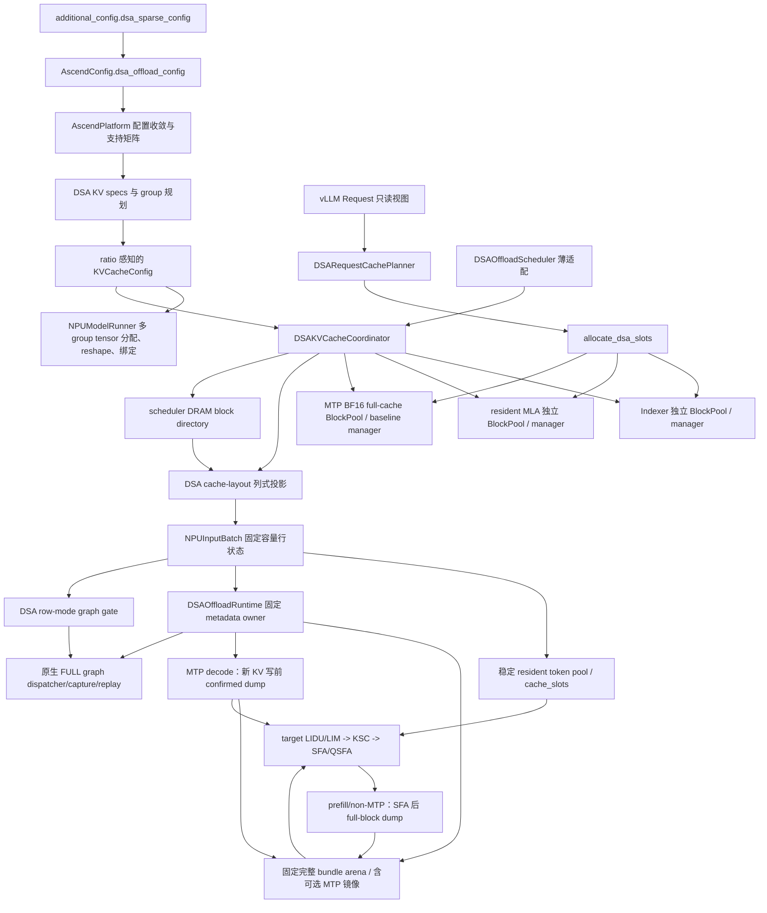
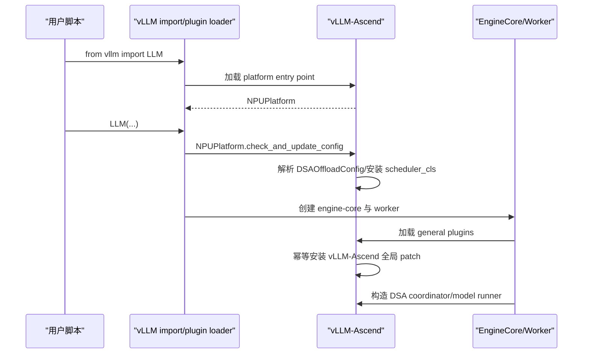
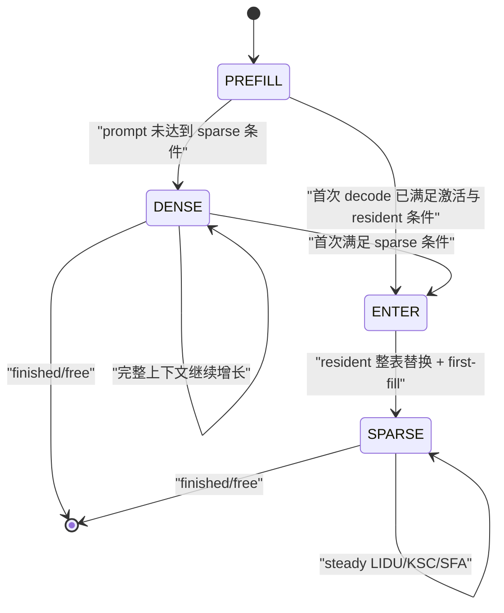
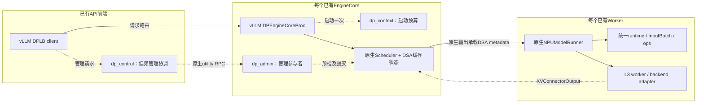

# DSA 稀疏卸载系统架构

> 设计状态：已确认。实施状态：下述主路径已适配；支持范围见本页及[特性路线图](feature_roadmap.md)。
> 基于vLLM/vLLM-Ascend v0.23.0，不把其他社区版本的能力自动计入本分支。

## 1. 目标与边界

DSA稀疏卸载保留完整Indexer上下文，把target MLA的HBM开销限制为resident budget和固定尾区，并用本地DRAM保存可随时换入的完整durable数据。多级prefix在此之上复用L1/L2/L3，DP在不改变请求所有权的前提下扩展吞吐。

已适配的主要组合是A5 packed-C8、GLM-5.1/GLM-5.2、同步调度、chunked prefill、Eager/FULL decode Graph、固定MTP3和单机DP2/TP4/EP8。A3/BF16早期路径与DeepSeek兼容目标不等于所有组合都已回归。各专题分别限定组合，不能将“每项单独支持”视为任意笛卡尔积都已验证。

当前不开放async scheduling、请求抢占恢复、PD、跨机DP/节点内存规划、PP/PCP/DCP、动态MTP、proposer Graph和任意外部connector组合。已有L3是DSAL3Connector/Mooncake Store-owned TCP，不是通用KV transfer能力全开放。

PD首版范围已讨论，详细合同见[P/D分离设计草案](proposals/prefill_decode_disaggregation.md)。
该草案尚待评审、编码和设备验证，不改变本页现有支持矩阵；PD不以前置完成自动抢占恢复为条件。

## 2. 文档层次与阅读方式

本文保留系统级的实现推导、接口、例子和代码地图；专题文档展开多级缓存、MTP和DP。设计状态与实施进展分开，实验流水不作为当前合同。

建议先读第3、4节总体架构与基线接入，再读第6至10节的分配和投影；第11、12节给出公共/A5算子及dump详细说明，第13至17节解释图、生命周期、代码组织与验证，第18节列原生Quant-LI/QSFA调用边界，第19至23节独立说明A3非MTP接口和算法。

专题入口：[多级缓存](features/multilevel_kv_cache.md)、[固定MTP设计](features/speculative_decoding.md)、
[DP基线与适配详解](features/data_parallel_inference.md)。[特性路线图](feature_roadmap.md)只维护
特性状态；[工程经验](engineering/diagnostics_and_lessons.md)保存问题分析与实验证据。

## 3. 当前总体架构



本图聚焦target执行、L2和元数据所有权；MTP proposer及L3的完整时序分别见专题。
Prewrite与postwrite是按场景选择的时机，不是同层同轮执行两次相同dump。
当前需要区分以下配置、布局、物理目录与worker镜像层次：

| 层次 | 真源 | 当前所有者 |
|---|---|---|
| 用户配置 | 解析后的不可变 DSA 配置 | `AscendConfig.dsa_offload_config` |
| 请求 cache 布局 | 阶段、冻结预算、resident 有效长度 | `DSARequestCachePlanner` |
| 物理块表 | target 两 plane 与可选 MTP full group 的 request→blocks 映射 | `DSAKVCacheCoordinator` 下的各 group manager |
| worker resident 映射 | request→稳定 pool row、逐层 token→slot | `DSAResidentTokenPool` |
| DRAM 逻辑真源 | request→logical full block→DRAM block | `DSAKVCacheCoordinator` |
| DRAM worker 镜像 | pool row→logical full block→DRAM block | `DSAWorkerDRAMStore` |

worker 行状态是上述 scheduler/core 真源的 **投影**，不是第二套请求阶段
账本。eager 与 graph 后续都必须消费这个投影和同一个 buffer owner。

## 4. 与 v0.23 基线的集成方式

### 4.1 Python 插件发现与安装时序

DSA 实现只修改 vLLM-Ascend，不修改配套 vLLM checkout。这里的“零修改”
不等于 vLLM 不参与：vLLM 提供硬件插件发现与若干扩展点，Python 提供
distribution metadata 和运行时导入机制。

vLLM-Ascend 安装时在 `setup.py` 注册：

```text
vllm.platform_plugins:
  ascend = vllm_ascend:register

vllm.general_plugins:
  ascend_* = vllm_ascend:register_*
```

`from vllm import LLM` 首次导入 vLLM 后，vLLM 通过
`importlib.metadata.entry_points()` 查询当前 Python 环境中已安装
distribution 的这些 entry point。平台插件的 `register()` 返回
`vllm_ascend.platform.NPUPlatform`，后续配置收敛、模型 runner 和
attention backend 才进入 Ascend 实现。

engine-core 子进程还会加载 general plugins。它们通过
`vllm_ascend._ensure_global_patch()` 调用原生 `adapt_patch()`；
`_GLOBAL_PATCH_APPLIED` 保证同一进程重复触发时幂等。patch 必须早于被替换
函数首次用于构造 scheduler/cache manager；仅早于一次普通函数调用还不够，
因为其他模块可能已经用 `from ... import ...` 缓存了旧引用。



### 4.2 扩展点与窄 patch 的边界

| v0.23 扩展点 | DSA 用法 |
|---|---|
| `AscendConfig` | 解析并持有 `DSAOffloadConfig` |
| `KVCacheSpecRegistry` | 注册 DSA Indexer/resident spec 与 manager |
| KV group/config hook | 构造 target 两组、可选 MTP 第三组和 ratio 容量 |
| coordinator factory | 创建 `DSAKVCacheCoordinator` |
| `scheduler_config.scheduler_cls` | 安装薄 `DSAOffloadScheduler` |
| `SchedulerOutput` dataclass | 浅包装为只增加一个 projection 的 Ascend 子类 |
| `NPUInputBatch` | 持有固定容量 DSA SoA 行状态 |
| `NPUModelRunner` cache 初始化 | 分配、reshape、绑定 target split plane 与原生 MTP full cache |
| common/SFA attention metadata | 在同一份 resident metadata 上附带 Indexer/DSA view |
| `AscendSFAImpl` | DSA开启时执行选择/复制/attention链，按场景接入prewrite或postwrite dump |

能够直接修改 vLLM-Ascend 的位置都采用显式类型和普通调用，不再为 DSA
单独制造 patch 层。vLLM v0.23 尚未给出正式扩展点的少数位置，DSA 复用
vLLM-Ascend 已有 patch 模块：

| 现有 patch 模块 | DSA 窄适配 |
|---|---|
| `patch_kv_cache_utils.py` | 识别 DSA split spec/group，接管分组、ratio 容量和容量报告 |
| `patch_kv_cache_coordinator.py` | 识别 DSA group 创建 coordinator，并仅对 `DSAKVCacheCoordinator` 调用 `allocate_dsa_slots()` |

每个 wrapper 都先用类型化 spec/group/coordinator 判断是否为 DSA；不满足
时调用保存的上游原函数。不能再为同一目标函数叠加第二个 DSA wrapper，
因为 Python 属性替换遵循最后一次赋值，多个互不知情的 wrapper 会产生安装
顺序依赖。新逻辑应合并到现有 wrapper，并继续依赖 vLLM-Ascend 全局 patch
的进程内幂等安装。

DSA 没有 patch `Request`，没有复制或 patch
`Scheduler.schedule()`，也没有全局替换 `SchedulerOutput`。它通过
`scheduler_config.scheduler_cls` 安装薄 `DSAOffloadScheduler`，再用
vLLM-Ascend 自有的 `DSAOffloadSchedulerOutput` 子类附加一个类型化
projection。v0.19 的 patch 拓扑只作为历史参考，不是 v0.23 的实现范式。

## 5. 配置与模型能力

配置入口保持为：

```python
additional_config={
    "dsa_sparse_config": {
        "enabled": True,
        "split_indexer_cache": True,
        "indexer_mla_block_ratio": 3,
        "sparse_activation_tokens": 6144,
        "prompt_budget_thresholds": [32768, 65536],
        "resident_budget_tokens": [6144, 10240, 12288],
        "max_active_reqs": 256,
        "hot_cpu_block_multiple": 3.0,
        "enable_row_mode_decode_graph": True,
    }
}
```

`config.py` 在拉起期完成类型转换、未知字段拒绝和支持矩阵校验。当前支持
v0.23 原生显式 chunked prefill，以及
`long_prefill_token_threshold` 形成的固定上限 prefill chunk；两者都要求
`scheduler_reserve_full_isl=True`，在首个 chunk 入场前验证完整 prompt 能
同时容纳于所有启用的 full-context cache group。speculative decode 仅放行 A5 packed-C8
下的 `method=mtp`、固定 3 个 draft 和 greedy 请求；MTP resident 最低档为
8192。本地 DRAM complete-bundle prefix cache 已开放配置；当前仍显式拒绝
async scheduling、其他 speculative method、未经适配的 KV connector 组合、context/pipeline parallel、
KV-cache metrics/events 等未建立完整合同的组合。

| 字段 | 默认值 | 当前语义 |
|---|---:|---|
| `enabled` | `False` | DSA 总开关；关闭时不创建 DSA cache、scheduler 或 runtime |
| `split_indexer_cache` | `True` | 兼容性输入；DSA 开启时必须为真，解析后由 `enabled` 派生 |
| `indexer_mla_block_ratio` | `3` | Indexer HBM blocks 与 resident MLA base blocks 的容量比 |
| `sparse_activation_tokens` | `6144` | 完整上下文超过该值后允许进入 sparse 布局 |
| `prompt_budget_thresholds` | `[32768, 65536]` | admission 时按 prompt 长度选择 resident 档位 |
| `resident_budget_tokens` | `[6144, 10240, 12288]` | N 个 prompt 阈值划分 N+1 个区间，每个区间对应一个冻结 resident budget |
| `max_active_reqs` | `256` | 配置上界，必须覆盖 `max_num_seqs`；不是实际预分配行数 |
| `hot_cpu_block_multiple` | `3.0` | 期望 DRAM usable blocks 相对 Indexer HBM blocks 的浮点倍数，最终向上取整；单机内存不足可缩容但不得低于 1x Indexer blocks |
| `enable_row_mode_decode_graph` | `False` | 允许普通 Q=1 或 MTP3 uniform Q=4 decode 进入原生 FULL graph |
| `trace_points` | 关闭 | 拉起期解析的预留调测合同；当前仅接受 `first_sample`，尚无稳定日志 consumer |

实际 `DSAInputBatchCacheLayout` 列式状态按 `max_num_seqs` 分配；
`DSAResidentTokenPool.cache_slots` 额外增加一条共享 PAD 物理行，即
`max_num_seqs + 1`。两者都不按 `max_active_reqs=256` 分配。后者保留为
未来将 DRAM ledger 与 resident 活跃行生命周期解耦时的请求账本容量合同，
当前首先用于拒绝 `max_num_seqs > max_active_reqs` 的配置。

静态算子 ABI 还要求：

- `block_size=128`；
- `max_model_len <= 262144`；
- non-MTP resident budget 只能取 `6144/10240/12288`；MTP3 支持
  `8192..16000` 内128的倍数，默认分档仍为 `8192/10240/12288`；
- LIDU caller-owned 输出列宽固定为 `16384`；
- Indexer head dim 为 128，MLA latent/rope 维度为 512/64；
- 当前 Indexer heads 支持 32 或 64。

模型支持采用能力判断，不仅依赖 architecture 名称。模型必须具备：

- MLA attention；
- sparse Indexer；
- 与当前 SFA 合同一致的 `index_topk`；
- DSA 所需的模型维度和 cache dtype。

模型若声明 `indexer_types`，其长度必须与 `num_hidden_layers` 相同且每项只能
为 `full/shared`。该列表是 checkpoint 物理拓扑的真源，不能只用
`index_topk_freq` 猜测哪些层缺少 Indexer 权重。GLM-5.2 的真实拓扑为：

```text
78 resident layers = 21 full Indexer layers + 57 shared followers
full layer ids      = 0, 1, 2, 6, 10, ..., 74
shared source       = 其前方最近一个 full layer
```

层 0、1 各自计算 topK；从层 2 开始，每个 full 层与后续三个 shared 层组成
一个四层 selection group。当前算子 ABI 仍限制 `max_model_len <= 262144`，
因此并不等同于已经开放 GLM-5.2 checkpoint 声明的 1M 最大上下文。

## 6. HBM 物理 Cache groups

### 6.1 Spec

`DSAIndexerKVSpec` 描述完整 Indexer K。每 token 只有一个 K 向量，因此覆盖
`FullAttentionSpec` 默认 K+V page 字节数。

`DSAResidentMLAAttentionSpec` 描述 resident MLA。它的
`sparse_head_dim` 不再包含 Indexer 维度，防止 MLA page 重复核算 Indexer。

两个不同的 DSA spec identity 让 v0.23 registry 将它们保留为独立 cache group。
普通模型两个 plane 的层集合相同；GLM-5.2 的 target Indexer group 只包含
full 层，是 target resident MLA 层的真子集。

启用 MTP3 后，模型自带 MTP layer 使用基线原生
`AscendMLAAttentionSpec`，`sparse_head_dim` 同时包含 BF16 MLA latent、RoPE
和 Indexer K。它不转换为 DSA spec，而是形成标记
`is_eagle_group=True` 的第三个 full-cache group。

### 6.2 容量与 group

finalized `KVCacheConfig.num_blocks` 表示 target resident MLA 的 base blocks。
Target Indexer 和可选 MTP full-cache 容量通过最终 `KVCacheTensor.size`
表达为：

```text
target indexer blocks = resident base blocks * indexer_mla_block_ratio
MTP full blocks       = resident base blocks * indexer_mla_block_ratio
```

KV group 顺序固定为 target Indexer、target resident MLA、可选 MTP full；运行期仍通过
`DSAKVCacheGroupIds` 按 spec identity 解析 group id，不在热路径假设固定
下标。

worker 的同层绑定顺序则固定为 resident MLA 在前、Indexer 在后。这是绑定
ABI，不等同于 group 顺序。

容量公式按最终 group 的真实层集合和 block multiplier 计费。增加一个 MTP
draft layer 会增加一份 `ratio * native BF16 full page` 成本，因而在固定 HBM
字节下自然降低 base block 数；容量报告、scheduler admission 和实际 tensor
分配使用同一结果，不会出现 target 可容纳请求数与 proposer cache 容量不一致。
启动容量报告会单独打印 MTP full group 的 layer 数、blocks、tokens、字节占用、
占总 KV HBM 比例及其 `max_model_len` 请求上限。

### 6.3 Worker tensor

每个 full 层的 Indexer plane 恢复为：

```text
[num_indexer_blocks, block_size, num_kv_heads, head_size]
```

它没有独立 attention backend 或 metadata builder，只作为对应 selection
group 的 full 层 LIDU cache 输入。shared 层不创建空壳 Indexer tensor。

resident MLA 继续复用 Ascend MLA backend 的 tensor 表示，但不再内嵌
Indexer K。两张 tensor 在初始化后分别绑定到共享模型层。

MTP full group 复用基线 allocation/reshape，得到恰好三项 BF16 tuple：

```text
(mla_nope_cache, mla_rope_cache, indexer_key_cache)
```

它使用独立 block table 与 slot mapping；物理 block ID 无需等于 target
Indexer，但 token coverage 必须相同。

### 6.4 A5 C8 的物理布局与真实字节数

以下 `N_res/N_idx/D` 分别为 resident HBM、Indexer HBM 和可用 DRAM block
数，block size 固定为 128，KV heads 为 1。DRAM 额外保留物理 block 0。

| 数据 | A3 split BF16 参考布局 | A5 packed-C8 布局 |
|---|---|---|
| target MLA HBM | NOPE `bf16[N_res,128,1,512]`；RoPE `bf16[N_res,128,1,64]` | `float8_e4m3fn[N_res,128,1,656]` |
| full Indexer HBM | `bf16[N_idx,128,1,128]` | key `float8_e4m3fn[N_idx,128,1,128]`；scale `float32[N_idx,128,1,1]` |
| target MLA DRAM，每层 | NOPE/RoPE 各一张，首轴为 `D+1` | packed 一张，`[D+1,128,1,656]` |
| full Indexer DRAM | 对应 key 的 opaque-byte plane | key、scale 两个 opaque-byte plane；shared 层不分配 |

`packed[...,656]` 是混合类型的字节记录，不是 656 个同语义 FP8 数值：

| byte 范围 | payload | 字节数 |
|---|---|---:|
| `[0,512)` | 512 个 FP8 NOPE 元素 | 512 |
| `[512,640)` | 64 个 BF16 RoPE 元素的原始字节 | 128 |
| `[640,656)` | 4 个 FP32 NOPE 反量化 scale，各覆盖 128 个 NOPE 元素 | 16 |

packed KSC/dump 必须完整复制 656 字节，不能只复制 NOPE、漏掉最后 16 字节，
也不能在搬运时解量化或重新量化。Python `_packed_byte_view()` 将连续 FP8
tensor 零复制地 `view(torch.int8)`；Torch/OpDef 的 copy ABI 是 INT8，kernel
以 `GlobalTensor<uint8_t>` 搬运。这里的 dtype 变化是同一 storage 的字节解释，
不是数值转换。QSFA 仍读取原 packed KV，key/value 指向同一 tensor。

Indexer key 与 scale 共享 block id、block table、slot mapping 和生命周期，
可以从同一对齐 raw allocation 切出两个不重叠 view，但层间只暴露 `(key,scale)`。
它们不增加第三套 scale manager。resident spec 使用
`sparse_head_dim=(656,0,0)`，不能把 Indexer 字节再混入 MLA page。

| 编码，每层每 token | MLA | Indexer | 两者合计 |
|---|---:|---:|---:|
| BF16 | `512*2+64*2=1152 B` | `128*2=256 B` | 1408 B |
| C8 | 656 B | `128+4=132 B` | 788 B |

C8 每层 MLA block 为 `128*656=83968 B`，Indexer block 为
`128*132=16896 B`。容量规划按真实层集合计算，不能用 BF16 page size 代占：

```text
每个 resident base block 的 HBM 成本
  = sum(group.page_size_bytes * len(group.layer_names) * group.block_multiplier)
target resident multiplier=1；target Indexer/MTP full multiplier=ratio

每个完整 L2 bundle 的成本
  = sum(启用 component 的 page_size_bytes * 真实物理层数)
```

L2 不乘 HBM ratio。以 GLM-5.2 target 为例，
`21*16896 + 78*83968 = 6904320 B/block`；若再包含一层 BF16 MTP，
增加 `128*(1152+256)=180224 B`，得到 `7084544 B/block`。
这些是布局算术，不是 allocator 对齐开销或实测占用。

### 6.5 C8 开关与写入合同

原生 `enable_sparse_sfa_c8` 与 `enable_sparse_li_c8` 可分别设置，不代表 DSA
继承全部四象限组合。DSA 关闭时交还基线；开启时 A3 仅用既有非 C8 路径，
A5 只接受两项 C8 同开，A5 全关或半开、A3 开启 C8 都在初始化期拒绝。
全局同开之后，仍需检查有 Indexer 的 target full 层实际 LI 量化过滤结果与
SFA 布局一致；shared 层没有 Indexer payload，不应伪造 key/scale 通过检查。

forward 将动态生成的 Indexer FP8 key/FP32 scale 同步 scatter 到独立 Indexer
slot mapping；packed MLA 写到 resident mapping。packed 结果来自基线 A5
prolog/pack，不在 DSA 再量化。prefill 读同一套 key/scale 并调用原生 Quant-LI，
decode 才使用融合 LIDU/LIM。设备、dtype 和 layer strategy 在初始化期绑定，
不以运行期 D2H 判断布局，不为 C8 创建另一套请求或图元数据。

## 7. 请求 cache 布局账本

### 7.1 为什么不是新的 request lifecycle

`request_cache_layout.py` 不接管 vLLM 的 waiting/running/finished/preempted
状态。它只记录 DSA cache 应采用的物理布局：

| 阶段 | Indexer plane | resident MLA plane |
|---|---|---|
| `PREFILL` | 完整 prompt | 完整 prompt，供 prefill 与后续 dump |
| `DENSE_DECODE` | 完整上下文 | 完整上下文 |
| `ENTER_SPARSE_DECODE` | 完整上下文继续增长 | 一次性替换为 budget + 固定尾区 |
| `SPARSE_DECODE` | 完整上下文继续增长 | 物理表稳定，只刷新有效长度/内容 |

可选 MTP full group 不参与上述阶段切换：PREFILL/DENSE/ENTER/SPARSE 均按
完整上下文增长，lookahead slot 复用基线 Eagle/MTP 分配语义。

### 7.2 持久状态

每个活动请求只持有一个 slotted `DSARequestCacheState`：

- `stage`；
- `target_resident_budget_tokens`；
- `sparse_budget_tokens`；
- `resident_valid_tokens`；
- `prefill_resident_released`。

目标 budget 在请求首次成功 admission 时按 prompt token 数选择，decode
期间不换档。`sparse_budget_tokens` 与 `resident_valid_tokens` 保留为
scheduler→worker 投影真源，避免 worker、eager 和 graph 各自重新计算。

### 7.3 Plan/commit

每次 `allocate_slots` 只创建一个 slotted、不可变
`DSARequestCachePlan`：

1. `plan()` 计算候选阶段和 target 两 plane 的需求，不修改持久 state；
2. manager 分别检查 target 两池与可选 MTP full-cache 池；
3. 容量满足后修改 block table；
4. `commit()` 原地刷新请求唯一 state；
5. 容量不足返回 `None`，state 与 resident 表不推进。

`tail_tokens` 和 ENTER 的 resident 整表替换标志是 plan 的派生属性，不额外
存储。planner 不在 steady decode 重建跨 step state。

## 8. 独立物理 pool 分配

`DSAKVCacheCoordinator` 为每个 group 持有独立 `BlockPool` 和 manager：

- `DSAIndexerKVCacheManager` 保存完整上下文块；
- `DSAResidentMLAKVCacheManager` 保存 dense 或 resident 布局块。
- 启用 MTP 时，原生 `FullAttentionManager` 保存 MTP BF16 full-cache 块。

这些 group 复用同一个基线 `BlockPool` 类型，但不是同一个实例：Indexer、
resident MLA 和可选 MTP 的物理 block 数及 id 空间彼此独立。当前所有 HBM
target Indexer、dense resident MLA 与可选 MTP full-HBM pool 在启用prefix时参与
hash/LRU；resident MLA 只有完整dense上下文块可发布prefix。ENTER之后的
budget/tail block不代表连续完整上下文，不能保留为可复用的dense prefix。
DRAM complete-bundle pool独立维护hash/LRU；MTP继续使用基线`FullAttentionManager`。

分配规则：

- PREFILL/DENSE 同时扩展 target 两 plane 与可选 MTP full cache；
- ENTER 先完成所有 pool 容量预检，再释放 target resident 旧满块、按预算重建表并
  保留原不满尾块；MTP3 同时补齐另一 parity tail，并把保留块放入与其
  logical block parity 对应的固定列；
- SPARSE 扩展 target Indexer 与可选 MTP full cache，target resident 物理块表
  必须与预期 `budget + tail_block_count` 容量一致；
- free 同时清理所有 group manager 和请求 cache state。

ENTER 新建、尚未 first-fill 且无 prefix hash 的 budget blocks 按 physical ID
升序规范化；保留有效 KV 的单尾或双 parity tail 不参与排序，始终留在固定逻辑列。
该规范化不移动已有有效 KV。worker block table 的 add、ENTER replace、condense
move 和 clear 同时清空非活动列，防止固定宽度算子读到前一条长请求遗留的 ID；
这些是生命周期冷路径动作，不在每轮 steady forward 重做。

当前prefix同时支持HBM完整pair/triple、L2 complete bundle与L3连续suffix；命中token
通过Request-aware DSA事务统一处理。只向已适配的DSAL3Connector开放同步external
computed tokens，不开放通用delayed allocation。固定 MTP3 的三个 lookahead token
仍由同一个多 group allocator 处理，其他 speculative method 在配置边界拒绝。

## 9. 薄 Scheduler

`DSAOffloadScheduler` 继承上游 Scheduler，但不复制主循环。它只补充：

1. prefill/decode phase barrier；
2. waiting prefill 只有在所有物理 pool 都可 admission 时才阻塞 decode；
3. model output 返回后释放已同步 dump 的 prefill resident 满块；
4. preemption/resume 尚未支持时显式失败。

请求是否仍在 prefill 只由
`num_computed_tokens < num_prompt_tokens` 判定，不依赖 output 列表更新时序。
每个 chunk 都复用上游 token budget、`_inflight_prefills` 和
`_update_after_schedule()`；DSA 不复制 chunk 调度循环。中间 chunk 继续
保持 PREFILL，target 两 plane 与可选 MTP full cache 按本轮结束位置增量扩展。最后一个 chunk
仍以 PREFILL 数据面执行；output 返回后，scheduler 才释放已经在同一 stream
完成 dump 的 resident 满块。下一轮才进入 DENSE 或 ENTER decode。

waiting/skipped-waiting 为空且上游 `_inflight_prefills` 也为空的 steady
decode 直接进入 `super().schedule()` 快路径，不做额外 batch 扫描。

当前满块 dump 目标设计假设与模型 forward 位于同一 NPU stream，stream 内
保序。未来改为异步多 stream 时，必须新增 event/readiness 协议，不能只凭
host 输出返回释放 HBM 块。

## 10. Scheduler→worker 投影与执行接口

### 10.1 Scheduler→worker 投影

当前投影层实现以下合同：

- `DSARequestCacheLayoutProjection` 按 scheduled request 顺序列式承载
  stage、target/sparse budget、resident valid length；
- `DSAOffloadSchedulerOutput` 浅包装原生输出，基线字段继续共享原对象；
- coordinator 按已提交的 Indexer block table 扩展 DRAM directory，投影只
  携带本轮新增的连续 assignment 后缀，不重传完整 DRAM 表；
- 多进程 pickle 往返保留 projection 类型和内容；
- worker 先执行原生 `_update_states()` 的 remove/add/condense/reorder，
  再通过 `req_id_to_index` 投影到最终行序；
- `DSAInputBatchCacheLayout` 使用一个 `[7, max_num_reqs]` 的固定容量
  `CpuGpuBuffer`。四个 scheduler 投影列加 `row_mode`、
  `resident_pool_index`、`candidate_len`，七个 SoA 列在 device 侧均为
  连续向量；
- eager 后续使用 active-prefix，graph 使用 captured-prefix + PAD，
  二者共享同一个 owner；
- steady 行序与 scheduler projection 一致时，四个语义列批量写入；
  只有请求增删或重排才做一次 request-id 映射，并在同一结构刷新中同步
  resident/DRAM pool row；
- PAD 行在 owner 初始化时一次设置；batch 缩小时只清理由 active 退回
  PAD 的尾部，不在每个 step 重写整个剩余容量；
- 只有 ENTER 行携带 resident 全量 block IDs，并覆盖 worker request
  账本与对应 `MultiGroupBlockTable` 行；其他阶段不额外改写 block table。

该投影层明确不做：

- 在 worker 各 rank 根据长度重新决定阶段；
- 为 eager 和 graph 创建两套语义状态；
- 每 step 构造多份 request-id→scalar Python 字典。
- 为了消除 scheduler 的一次 O(B) projection 而复制上游
  `Scheduler.schedule()`；v0.23 输出构造处没有逐请求扩展钩子。

### 10.2 Eager 数据面

eager 路径按以下结构接通：

- `DSAResidentTokenPool` 为活跃请求分配与 InputBatch 行号解耦的稳定行；
- `cache_slots[selection_group, pool_row, position]` 是 LIDU 跨 step 原址更新
  的持久状态；普通模型一层一组，GLM-5.2 仅 full Indexer 层占一组；
  最后一列保存未初始化、first-fill 或 steady budget 标记；
- pool row 释放时只归还行号，下一次分配前执行唯一一次整行清理，避免
  request release 和 row reuse 重复写同一块大状态 tensor；
- `DSAWorkerDRAMStore` 按层持有固定地址 target MLA arena，并为 full Indexer
  层额外持有完整 Indexer plane；逻辑块表使用
  `pool_row × logical_block`，但只镜像 scheduler assignment，不在 worker
  分配 physical id；MTP prefix 开启时额外持有原生 BF16 full-cache byte
  planes，但不改变 proposer 的 HBM cache；
- `DSAOffloadRuntime` 是 eager/graph 共用的物理 metadata owner，持有
  resident positions、active DRAM table、dump 列和 LIDU scratch；
- LIDU 的 topK/slot/miss/tail 输出只在当前 selection group 内存活：full 层
  写入，shared follower 依次消费，下一 full 层再覆盖；所有 group 串行复用
  同一套固定地址 scratch；跨 step 持久状态只保留 `cache_slots`；
- target Indexer、target resident 与 MTP full group 继续复用基线
  `MultiGroupBlockTable`。target Indexer 和 MTP full 使用完整序列 position；
  target MTP3 sparse resident 使用 `budget + position % 256`，普通 decode
  resident 仍使用 `budget + position % 128`；
- target prefill 使用基线 lightning-indexer 读取独立 Indexer plane；target
  decode 对整 batch 执行 LIDU→KSC→SFA-Offload；MTP proposer 继续走基线
  BF16 lightning-indexer/SFA；
- 普通 prefill/decode 在 SFA 后同 stream dump 本轮新满块；MTP target 验算只在
  下一 outer step 按 scheduler 已确认长度推进 durable watermark，并在当前层
  写 KV 前 dump，避免 parity tail 复用覆盖源块；
- 满块边界判定使用 worker-lifetime NumPy scratch；steady 无 dump step
  不构造 job 列，DRAM 表版本未变化时不重复 H2D。

eager 只消费 active-prefix；graph 通过同一 owner 的 captured-prefix + PAD
扩展执行 view，没有改变 eager 的请求语义。

### 10.3 图模式

复用 v0.23 原生 FULL decode capture/replay：

- `graph_gate.py` 只读取统一 InputBatch 投影，允许普通 Q=1 或 MTP3
  uniform Q=4 的 DENSE/ENTER/SPARSE 混排；prefill、非 uniform query 和
  capture-size miss 正常走 true eager；
- chunked prefill 不创建独立图或图专属元数据。每个 multi-token chunk
  复用 eager 数据面；最后一个 chunk 完成后，后续 decode 继续复用原生
  FULL capture/replay；
- 原生 dispatcher 的最终 uniform FULL keys 是 capture 容量唯一真源，
  继续负责图形状与向上 padding；仅支持具有独立 decode routine 的模式
  （例如 `FULL_DECODE_ONLY`），不支持 mixed/decode 共用的精确 `FULL`；
- DP 以原生全局图模式决议为准：任一 replica 处于 prefill 或
  capture-size miss 时共同 true eager；DP=1 且没有原生动态 blocker 时，
  gate 允许却未选中 FULL 才视为合同破坏；
- `DSAInputBatchCacheLayout` 的 device view 提供 captured-prefix + PAD，
  CPU 请求真源不变；
- `DSAResidentTokenPool` 与 `DSAOffloadRuntime` 在 dummy warmup/capture
  期间临时安装合法 SPARSE first-fill，forward 后统一恢复；
- graph 的 full-block dump 固定为 captured-row 宽度，未使用行以
  `src=0, dst=-1` 空转；eager 仍提交紧凑 jobs；
- `_build_attention_metadata`、attention builder、模型 forward 和 ACLGraph
  wrapper 均复用基线，不维护 graph-only 元数据类。

### 10.4 扩展场景边界

chunked prefill 已复用当前 request ledger 和固定 runtime owner；它没有开放
prefill/decode mixed forward。固定 MTP3 的 target 验算复用原生 compact TND
与 uniform FULL graph，双尾块直接覆盖跨块边界，不降级 Q=1；GLM proposer
继续复用社区 eager 路径及其独立 BF16 full cache。理想版动态 query 截短仍未实现。
本地 DRAM prefix hit 在 prefill 前完成 restore，后续 decode 继续使用同一
block table 和 graph 元数据；它不把 restore 算子捕获进 decode graph。
preemption、mixed prefill/decode 和未适配的KV transfer组合仍会改变ledger或状态恢复
合同，应按独立能力继续设计。

### 10.5 固定 MTP3 的双尾块与 proposer cache

妥协版固定 `num_speculative_tokens=3`，target 每请求最多形成 4 个 query。
最小 resident budget 提升为 8192，从而严格覆盖四路 top-2048 的最坏并集。
它不实现理想版的动态 query 截短，也不修改 rejection sampler 的接受语义。

SPARSE resident block table 固定为：

```text
[budget blocks][tail parity 0][tail parity 1]
```

完整序列位置 `p` 的尾区逻辑槽位为：

```text
budget + ((p // 128) & 1) * 128 + p % 128
= budget + p % 256
```

scheduler 只在 ENTER 时一次性分配并排列两块 tail；后续不交换 current/next
地址。provisional draft 被拒绝后无需清零，下一轮只以 scheduler 已回滚的
confirmed length 作为可见边界，陈旧字节不会进入 LI candidate、attention
tail 或 dump。

MTP draft 模块保留独立 native BF16 full-cache group。它复用基线 MTP
proposer 的 `kv_cache_gid`、block table、每 draft step slot mapping、seq lens
与 query start 元数据，不调用 DSA resident position 映射，也不占用 target
`cache_slots` selection state。其active attention缓存始终按完整上下文增长；
启用多级prefix时另有opaque-byte DRAM arena镜像verified满块，不能把“不做sparse swap”
读成“不参与DRAM”。Target从DENSE进入SPARSE时只收缩target resident group；请求结束
释放active引用，已缓存的完整prefix遵循原生hash/refcount生命周期。

LIM 的请求级 `candidate_len` 在 SPARSE 行表示共享的 durable DRAM 完整块前缀 D。各 query 分别在同一候选域选 topK，只有 tail 的因果可见长度不同：

```text
visible_len(q)   = final_len - later_queries(q)
LI candidates    = [0, D)
causal tail(q)   = [D, visible_len(q))  # 最多 256 个 token
```

若本轮前已确认长度为 C，成功准备 MTP prewrite dump 后计划中的
`D=128*floor(C/128)`，本轮 `Q<=4`，因此正常调度满足
`V_q-D <= C%128+Q <= 131 < 256`。256 是双尾物理/ABI容量，不表示每条 query
都读满两块。这里的 D 先体现同流 dump 计划，每层必须在 LIM/KSC 前兑现正确
源块复制；它不是已执行设备同步的时间戳，也不等于 scheduler 已发布 hash-ready。

尚未进入 durable DRAM 的 token 全量走 causal tail，不再参与 LI 或 miss 判断。LIM 将这些 token 映射为 parity slots，追加在 top2048 之后，不为 KSC 生成 IO。各 query 的 DRAM miss 先做请求内去重，再一次性更新 `cache_slots` 和 copy plan；必须保护全部 query 的 topK 并集，不能逐行互相驱逐。

DENSE 不使用上述“完整块 + tail”拆分：其 KV 全在 HBM，每个 query 直接对完整
`visible_len` 排 top-2048；`visible_len<=2048` 时输出完整 causal prefix，超过
2048 时只输出 top-2048，不产生 DRAM IO，也不额外追加 tail。

MTP target 验算产生的 target 满块在下一 outer step 才成为 durable。runtime 比较请求级
`confirmed_full_blocks` 与 DRAM watermark，预先构造一份固定地址 dump plan；
每个 target 物理层在写入当前 KV 前，把同一 logical block 写到自己的 arena。
对应 DRAM id 也只在这个下一 outer step 分配；provisional query 即使跨过
128-token 边界并写满一块双尾区，也不会提前占用或写入 DRAM。MTP full
cache不使用target的packed dump，而在proposer对应prewrite/postwrite边界执行自己的
BF16完整块dump。当前实现保持明确的stream顺序；未来若改为异步
多流，必须增加 event 和逐层可见性协议。

启用 prefix cache 后，请求结束只释放 DRAM block 引用，已经 ready 的完整
bundle 保留 hash/LRU。MTP terminal flush 仍未实现：若最后一次验算新确认的
token 恰好补满 full block，而请求随后立刻 EOS/length finish，不会再有下一
outer step 执行 pre-write dump。第一版不会把该尾块标记 hash-ready，因此
保持正确但命中前缀少一块；后续再用显式 flush-only 数据面补齐。

## 11. Decode 数据面与算子 ABI

### 算子阅读索引

| 算子家族 | 当前接口/设计入口 | 不能混用的边界 |
|---|---|---|
| A5 non-MTP LIDU | 本节11.7五输出、11.8地址、11.9分工 | 17 tensor、2176、单尾；不使用MTP batch fast/cold gate |
| A5 MTP LIM | 本节11.4、11.7至11.9及MTP专题 | 19 tensor、2048、全可见域TopK；入选tail为hit |
| A5 packed KSC | 本节11.10至11.11 | 七tensor、656B、双槽FIFO；不读query级miss |
| 三种满块复制 | 第12.6节 | 双plane、C8 packed、通用bytes的参数/平台/任务空间不同 |
| Native Quant-LI/QSFA | 第18节 | 本分支调用子集，不代替外部完整API或同名自定义adapter |
| A3 LIDU | 第20节 | 12 tensor、四输出、score多pass first-fill |
| A3 KSC | 第21节 | 九tensor、RoPE在前、1152B单槽；物理ID上界是caller责任 |
| A3 SFA-Offload | 第22节 | T=B、独立tail_info、返回新Tensor；Torch与ACLNN参数顺序不同 |

### 11.1 三种编号不要混用

| 名称 | 含义 | 典型消费者 |
|---|---|---|
| token position | token 在完整请求序列中的位置，范围 `[0, seq_len)` | Indexer、`topk_index`、DRAM logical block 推导 |
| resident logical slot | token 当前在该请求 resident 预算区中的逻辑槽位 | `cache_slots`、`topk_slots`、SFA-Offload |
| physical block id | HBM 或 DRAM arena 中的物理块编号 | block table、KSC、full-block dump |

`topk_index` 不是 HBM slot；`topk_slots` 也不是 token id。KSC 使用前者定位
DRAM 中的源 token，使用后者定位 resident HBM 的目标槽位。SFA-Offload
只消费换入完成后的 `topk_slots` 和尾块信息。

### 11.2 `cache_slots` 持久状态

每个 selection group 的状态形状为：

```text
[max_num_seqs + 1 PAD, W]
raw_width = max_model_len + 1
aligned_width = ceil(raw_width / 256) * 256
W = aligned_width if aligned_width - 1 <= 262144 else raw_width
```

通常按 256 个 INT32 补齐，最高容量附近则保留 raw width，避免物理 padding
超出 native `W<=262145` 检查。例如 `max_model_len=262144` 时 `W=262145`，
不是 262400。pool 行宽、可表示 token 数 `W-1`、模型有效长度、score workspace
行距与 resident budget 是不同量；不能将对齐 padding 当作有效候选 token。

前 `W-1` 列是 `token position -> resident logical slot` 映射，最后一列
是该行的状态元数据：

- `0`：尚未建立 sparse resident；
- `-budget`：下一次 SPARSE 行执行 first-fill；
- `+budget`：该层 resident 映射已经建立，进入 steady update。

它是唯一按 selection group、跨 decode step 的 tokenwise 真源。
`DSAOffloadRuntime` 中的 LIDU 输出只是当前 group 的短生命周期 scratch，
不能替代 `cache_slots`。GLM-5.2 的 shared 层没有第二份映射真源。

#### 容量与清理成本

持久映射的代价来自 token-position 直接寻址，而不由 resident budget 决定。令 `G` 为当前 worker 的 full selection-group 数，`B_max=max_num_seqs`，W 使用上式，则这张 INT32 表的 payload 字节数为：

```text
state_bytes = G * (B_max + 1 PAD) * W * 4
one_row_clear_bytes = G * W * 4
```

普通逐层选择模型的 G 等于本 worker 的 target 层数；shared follower 和原生 full-cache MTP proposer 不增加本池 G。公开配置 `max_active_reqs` 仍保留且默认256，启动校验要求 `max_num_seqs<=max_active_reqs`；它不是上述实际分配行数，不能把该值描述为已经独立分配的 DRAM 请求行池。稳定 pool row 使 InputBatch reorder 只刷新小行号，不搬运整条映射。动态 W 减少了无用 token 地址空间，但不能消除长上下文与高并发的乘法成本，也不能因为常见实测 batch 较小就少于配置上界分配。

以下仅为容量算例，不是设备内存或吞吐报告：

| G | B_max | max_model_len | W | 映射字节数 | 约 GiB |
|---:|---:|---:|---:|---:|---:|
| 61 | 24 | 16384 | 16640 | 101504000 | 0.09453 |
| 61 | 256 | 131072 | 131328 | 8235316224 | 7.66974 |
| 21 | 24 | 202752 | 203008 | 426316800 | 0.39704 |
| 78 | 24 | 202752 | 203008 | 1583462400 | 1.47471 |

后两行说明 shared Indexer 拓扑的影响，不能把相同 target 层数机械地当作 selection-group 数。以第一行为例，一次全 group 清理一个请求行就涉及 4060160 字节的映射区；当前 release 不立即清表、下次 acquire 才清理，避免在这两个边界重复写同一片大状态。该值是清理涉及的区域大小，不包含单独的 metadata 写入和运行库开销。

LIDU 输出则是另一类成本：当前 A3 四输出只有一套 runtime scratch，payload 为 `B_max * (2*16384*4 + 4 + 2*4) = 131084*B_max` 字节，不再乘 G。`B_max=24` 时为 3146016 字节，约 3 MiB。A5 non-MTP 五输出和 MTP 七输出另按请求/查询轴计费，不能套 A3 四输出公式；持久 pool、固定 scratch、算子 workspace、正常激活和 graph 内存都应分别统计。旧固定宽度/逐层 output 的估算不能作为当前常驻总量。

### 11.3 LIDU 输出合同

下表是 A3 BF16 LIDU 使用的 caller-owned 固定地址输出；这些 buffer 由
runtime 按 selection group 串行复用：

| 输出 | 形状 | 语义 |
|---|---|---|
| `topk_index` | `int32[B, 1, 16384]` | 完整序列 token position；KSC 的源 token |
| `topk_slots` | `int32[B, 1, 16384]` | 对应 resident logical slot；KSC 目标与 SFA 稀疏索引 |
| `miss_count` | `int32[B]` | KSC 只消费 `[0, miss_count)` 前缀 |
| `tail_info` | `int32[B, 2]` | `[tail_slot_start, tail_token_count]` |

逐行语义：

| row mode | 行为 |
|---|---|
| `PAD=0` | 输出无效、`miss_count=0`，不修改持久状态 |
| `DENSE=1` | 计算完整 Indexer 序列的 top2048；`topk_slots=topk_index`、`miss_count=0`、无尾块追加；不修改 `cache_slots` |
| `SPARSE=2` 且 metadata<0 | first-fill：建立 target budget resident 映射，产生需要换入的 miss prefix |
| `SPARSE=2` 且 metadata>0 | steady：保留命中槽，只为 miss token 分配/复用槽并原址更新映射 |
| `SPARSE=2` 且 metadata=0 | 非法生命周期输入，不允许静默按 DENSE 处理 |

上表是合法业务合同，不保证所有非法输入都会由device抛错。A3 LIDU当前对非法
budget、长度、pool行或row mode调用`CleanInvalidOutput`，清四输出而不按DENSE
处理；这不是可靠错误传播或恢复机制。合法生命周期仍由caller保证，具体见第20节。
A5错误哨兵与packed KSC断言另述，不能反向套用到A3。

`ENTER_SPARSE_DECODE` 在 scheduler 仍是独立阶段，但映射到设备
`row_mode=SPARSE`，由负预算区分 first-fill。因此 DENSE、ENTER、steady
SPARSE 和 PAD 能共用同一条算子拓扑和同一张 captured graph。

DENSE表示MLA物理cache尚未收缩，并非全量dense attention。A3在完整序列
`[0,L)`上执行LI Top2048；SPARSE在`D=128*floor((L-1)/128)`的历史前缀
选Top2048，并追加`[D,L)`的整个因果尾部。尾长为1至128，L恰好对齐128时仍
保留完整128-token tail，不能用“不满块”或`L%128`概括。因此offload sparse
decode与原生DSA的key集合不严格相同，应分开校验prefill、Indexer选择、尾部并集、
KSC/cache字节与同模式eager/graph及质量集结果。A5 MTP另用共同durable D和双尾。

### 11.4 KSC 与 SFA-Offload

KSC 不重新判断命中，也不检查 `miss_count` 之后的输出：

```text
src_token_ids = topk_index[:, :, :miss_count]
dst_slots     = topk_slots[:, :, :miss_count]
```

因此“miss token 必须紧凑放在输出前缀”是 LIDU 与 KSC 的硬 ABI。host
不得用 `.item()` 读取 `miss_count` 后再拆请求；copy count 直接作为设备
tensor 交给 KSC。

A3 SFA-Offload从物理行宽16384的输入中只消费前`min(L,2048)`项；合法SPARSE
时历史项固定2048，再按`tail_info=[budget,tail_count]`追加1至128个有效尾token。
DENSE的tail_info为`[-1,0]`。A3 first-fill可输出`min(D,16384)`个排名，但KSC
只消费前budget个、SFA只消费前2048个；非-1的额外排名不代表已物化resident slot。

A5 C8 非 MTP 的物理 ABI 有一处受控差异：融合 LIDU 直接生成社区 QSFA 消费的固定
`int32[B,1,2176]` slot 行与 `resident_seq_lengths[B]`，同时生成 KSC 的
`copy_src_ids/copy_dst_slots/copy_counts`。packed KSC 只搬运有效 copy-prefix，
不再承担 attention metadata 构造。该差异没有引入新的 request 真源，也不改变
miss-prefix 合同；eager/graph 仍复用同一组固定 buffer。DENSE 行是零 IO，
resident length 保持完整 `actual_len`，因此 dense 序列长度不受 2176 限制。
A5 路径不消费 A3 的 `tail_info` scratch；融合算子已把有效尾部 slot 直接追加到
2176 列 QSFA 索引行中。

MTP 的 copy plan/`cache_slots` 仍为 `B` 行，`topk_slots` 与 `topk_index` 均为 `int32[T,1,2048]`，`T=sum(Q_b)`，算子支持每请求 1～4 条 query 混合。各 query 独立在完整因果可见域 `[0,V_q)` 选 Top2048。SPARSE 的 `offloaded_lens[B]` 是共享 durable DRAM prefix D，仅用于分类、COPY 和淘汰，不限制 LI 搜索域。入选 tail 一律为 hit，slot=`budget+token%256`；不额外追加 tail，不为 tail 写反向表或生成 COPY。两份输出逐元素配对，保持 miss 在前、hit 在后；`per_query_miss_counts[T]` 只统计入选的 durable-prefix miss。`resident_seq_lengths[B]` 仍为 `budget+256` 的可寻址 span，DENSE 为最终原始 KV 长度，PAD 为 0。

当前从单算子仓 `1bc07a54edb8b7db98d439584a76092aa7800ea5` 同步全可见域 TopK2048，替换旧“durable Top2048+全部因果双尾”的 2304 策略。双 parity block 分配、写入、倒手和默认 budget 均不变；MTP预算范围放宽到8192..16000内128的倍数，slot14/token18编码不变。仅升级固定 MTP3 配置的 target 链，保留运行时 R=1～4；非 MTP 仍使用原算子和 2176。官方 MTP QSFA 使用 `sparse_mode=0`，因果性由 LIM 的逻辑 token 选择保证，不对重排后的 resident slots 再施加因果裁剪。升级必须联合重编译 host/kernel/ACLNN/Torch 扩展，重新启动并捕获图。

七输出顺序保持不变；query source/miss 供可选 CopySFA 使用，KSC 仍只消费请求级
去重 copy plan。KSC 保留错误 count/pair/table 的设备断言，错误 `-1` 不可当作正常
零 IO。packed-MTP L3 指纹更新为 `full-visible-topk2048-tail-hit-v2`，隔离旧策略对象，
不加入具体 TP/DP rank。非 MTP 指纹不变。本轮框架迁移仍需独立 A5 验收，不能把
单算子仓通过记录或旧 2304 框架结果当成新版本的整网精度/性能结论。

MTP victim扫描策略不得依赖物理metadata pool行号；快速扫描与精确补扫使用同一 `hash(final_seq_lengths_kv[b])` 种子，真实pool行号仅用于状态寻址。相关历史修复证据见[工程经验](engineering/diagnostics_and_lessons.md)。

当前跨特性集成必须保持以下生命周期约束：

- prefill结束时以已计算长度定位真实部分块，不能保留`req_blocks[-1]`，因为
  MTP lookahead可能已经分配了更靠后的空块。
- 首次ENTER前，按scheduler确认的DRAM ready水位到已计算长度保留尚未dump的
  已验证满块和部分块，装到其固定logical parity列；runtime仍在每层写新KV前
  执行原有dump。所保留的满块去除dense prefix hash，避免以后被当作只读前缀命中。
- 若待dump满块已被另一请求引用，不能直接变可写tail，也不能只清hash：本请求
  保持一轮DENSE完成dump，再尝试ENTER。该保守过渡可能改变一轮attention执行
  路径，但不引入第二套eager/graph元数据或跨层COW复制协议。
- ENTER容量预检只计释放后refcount真正归零的非null块，所有预检完成前不修改
  任何物理池或请求阶段。共享L2前缀可以同源读取，可写HBM resident必须独立。
- MTP即使关闭prefix，也会在成功forward返回后记录DRAM ready；关闭prefix只
  关闭hash校验/发布，不关闭源块保活所需水位。不会把已分配块数当成已完成dump。
- DSA dummy向更大native descriptor补齐时，query counts与seq_len覆盖相同的
  最终行数；capture行满足SPARSE first-fill合同，runtime idle行仍为PAD/零IO。

KSC的错误断言只保证错误传播，不会验证“物理块中是否确实是该请求的数据”。
真实请求的null-DRAM拒绝、上述源块保活和共享引用隔离仍由框架负责；七输出中
`per_query_miss_counts`也不能代替请求级`copy_counts`。KSC有效copy前缀内部
不允许空洞，只有前缀外scratch与正常0-count行可跳过。

LIM 为单次自定义 kernel 调用，所有 state/output 均 caller-owned；合法且不含 SPARSE first-fill 的 batch 统一走快路径，支持 PAD、短/长 DENSE 与 SPARSE-steady 混合。存在 first-fill 时沿用通用填充路径。DENSE 仍在完整因果可见 KV 上选 topK，可见长度不超过 2048 时直接发布连续索引；PAD 不访问缓存池。框架仍只配置固定 MTP3，非 uniform query 的 eager/graph 路由规则不因算子升级而改变。

GLM-5.2 的 full 层仍生成同一份输出。紧随其后的 shared 层不执行 LI/LIDU，
而是用该输出的 `copy_src_ids/copy_dst_slots/copy_counts` 对自己的 packed
MLA arena 执行 KSC，再用同一 `attention_slots/resident_seq_lengths` 执行
QSFA。所有操作在当前单 stream 内按层保序，所以下一 full 层覆盖 scratch
之前，三个 follower 已经完成消费；图模式捕获的也是这条固定地址依赖链。

这里没有复制基线的 IndexCache 元数据面：prefill、mixed forward 与非 DSA
路径仍使用模型初始化期已有的 `topk_indices_buffer`，full 层写入、shared 层
读取。DSA decode 才改用 LIDU scratch，因为基线 buffer 只保存 token topK，
无法表达卸载额外需要的 miss-prefix、resident slot 和 KSC copy plan。scratch
仍是 `DSAOffloadRuntime` 中 eager/graph 共用的一份固定地址 owner。

KSC 必须对四层中的每一层执行：四层只共享 token 选择，MLA KV payload 与
HBM/DRAM arena 仍逐层独立。现有 KSC ABI 一次只接收一层 arena，因此把三个
follower 的 KSC 提前塞到 full 层只会移动三次调用的位置，不会减少 launch
数或搬运字节，还会让 full context 越权持有后续层资源。当前选择在每层 SFA
前就地执行 KSC，保持基线的 layer-local 所有权和最短数据生命周期。若后续
开发可接收多层 arena 的 batched KSC，才值得评估每个 selection group 一次
批量换入及多流预取。

### 11.5 单行 first-fill 示例

假设 prompt admission 后冻结 `target_budget=6144`，当前完整长度为
`6500`：

1. scheduler 计算最后一个不满块之前共有 6400 个 token，提交 ENTER，
   resident MLA 表被替换成 6144 预算槽加一个尾块；
2. worker 写 `row_mode=SPARSE`，并将该请求所有层的 metadata 列设为
   `-6144`；
3. LIDU first-fill 选择并排列 6144 个 resident token，写
   `cache_slots[token_position]=resident_slot`；
4. `miss_count=6144`，KSC 将 miss-prefix 从 DRAM 换入对应 HBM slot；
5. 中间已经完成的 256 个 token 位于 DRAM，当前不满尾块有 100 个 token；
   A3 ABI 写 `tail_info=[6144, 100]`，A5 融合 ABI 则直接把这 100 个尾部 slot
   追加到 2176 列 attention row，二者都让 SFA 使用重要 top2048 加完整尾部；
6. LIDU 把 metadata 改为 `+6144`，下一 step 进入 steady。

A3内核同时可写出更多历史排名，但只有前budget项安装映射并计入miss_count；
消费范围不由输出中非-1项的总数决定。A5当前则以真实TopK和token顺序filler建槽。

后续若 top2048 只有 37 个 token 不在 resident，LIDU 只把这 37 个 miss
放在输出前缀，KSC 只搬 37 个 token；更大的 6144 resident budget 正是
用空间降低跨 step miss 的手段。

#### A3 steady 的映射更新例子

以 A3 单请求 steady 为例，设 `L=10000,C=6144`，因此历史候选为 `[0,9984)`，tail 为 16 个 token。当前映射有 `500->17,9000->31`，这两个 token 都属于本轮 top2048，必须保护。另有未入选的 resident token `600->88,700->93,850->104`。假设本轮只有 `[8001,8102,9200]` 三个 miss，合法 victim 扫描恰好选中上述 600/700/850，则更新为：

```text
cache_slots[600/700/850] = -1
cache_slots[8001] = 88
cache_slots[8102] = 93
cache_slots[9200] = 104
cache_slots[500] = 17，cache_slots[9000] = 31 仍不变

topk_index[:3] = [8001,8102,9200]
topk_slots[:3] = [88,93,104]
miss_count = 3，tail_info = [6144,16]
```

这是假定一种合法排序和 victim 结果的解释例子，不保证任意 score 都产生同一组槽。KSC 只搬前三对，A3 共复制 `3*1152=3456` 字节。例如 token 8001 从 DRAM logical block 62 的 offset 65 读取，写到 resident logical block 0 的 offset 88；两端都必须再查各自 block table，88 不是 physical block id。SFA 随后读取全部 2048 个配对 resident slots，并把 16 个 tail token 放入同一次 softmax。不能为了换入 miss 覆盖本轮 hit 的 17/31 槽，也不能把 miss-prefix 当成本轮完整 attention 集合。

### 11.6 Attention 接入点

v0.23 不再保留 v0.19 的通用 `attention_begin/after_indexer/
attention_finished` hook 对象。当前接入直接落在 vLLM-Ascend 自有
`AscendSFAImpl` 的既有阶段：

| 位置 | DSA 行为 |
|---|---|
| model runner cache 初始化 | 为每个 SFA layer 绑定 `DSALayerOffloadContext` |
| `indexer_select_post_process()` prefill 分支 | 复用基线 lightning-indexer，但读取独立 Indexer plane/table |
| `indexer_select_post_process()` decode 分支 | 调用该层 context 的 LIDU→KSC，返回 `DSAOffloadSelectionOutput` |
| shared 层 `skip_topk` decode 分支 | 不执行 LIDU；复用所属 full 层输出，对本层 arena 执行 KSC |
| `_execute_sparse_flash_attention_process()` | 识别上述 selection，调用 SFA-Offload |
| prefill/non-MTP：SFA 返回后、`v_up_proj` 前 | 执行该层 postwrite full-block dump |
| MTP decode：本层 prolog/KV 写入前 | 执行已 confirmed 满块的 prewrite dump；target 与 proposer 各自按物理层/epoch防重 |

这里仍保留“选择/物化”和“attention 计算”两个清晰阶段，只是使用真实
`AscendSFAImpl` 调用点，而不再额外维护一套空的 hook 生命周期。层的
Indexer cache、layer id 和 runtime 在初始化期绑定，热路径不重复遍历
`static_forward_context`。

### 11.7 A5 输入、七输出顺序与 Caller-Owned

以下按本轮 TopK2048 的 MTP LIM ABI 说明。`B` 是请求行数，`T` 是本次物理
TND query 行数，`H_idx=32/64`为Indexer head数，`P/W` 是 pool 行数/物理行宽，`M` 是 Indexer
block-table 列数。非 MTP 仍保留 `candidate_lens` 输入名和候选域语义，`T=B`，输出只有五项。

| Torch 位置，0 起 | 输入 | dtype / shape 与语义 |
|---|---|---|
| 0 | `index_weights` | BF16 `[T,H_idx]`，允许 query 行 stride，内层 stride=1 |
| 1 | `query` | FP8 E4M3FN `[T,H_idx,128]`，连续 |
| 2 | `query_dequant_scale` | FP32 `[T,H_idx]`，连续，不能沿用 weights 行距 |
| 3 | `actual_seq_lengths_query` | INT32 `[B]`，累计 query end，不是 query 数列表 |
| 4 | `index_key_cache` | FP8 `[N_idx,128,1,128]`，仅 block 轴允许 padding |
| 5 | `index_key_dequant_scale` | FP32 `[N_idx,128,1]`；Python 可将四维 singleton view `squeeze(2)`，不复制 |
| 6 | `index_block_table` | INT32 `[B,M]`，完整 Indexer 的物理表 |
| 7～10 | `offloaded_lens/final_seq_lengths_kv/row_modes/req_pool_entries` | 各 INT32 `[B]`，durable 前缀 D、最终长度 L、模式和稳定 pool 行；LI 逐 query 搜索 `[0,L-(Q_b-1-r))` |
| 11 | `cache_slots_pool` | INT32 `[P,W]`，可变持久输入，不计入七输出 |

native 静态检查要求 `B>0`、`B<=T<=4B`、`P>0`、`2<=W<=262145`、
`M>0` 且 `128*M<=262144`，key 物理块数为正、key/scale 首轴相同。
这不替代 candidate、query ends、pool 行号及 budget 的值级合同；host 不为检查
这些设备值增加 D2H。InferShape 负责按 T/B 推导输出，不是完整输入验证器；
Torch adapter 的输出 shape/device/contiguous 检查与 host tiling 的输入检查应分别保留。

| Torch 位置 | 七输出，顺序不可变 | INT32 shape | 当前消费方 |
|---|---|---|---|
| 12 | `topk_slots` | `[T,1,2048]` | QSFA/CopySFA，入选 token 的 resident logical slots |
| 13 | `topk_index` | `[T,1,2048]` | 与 slots 逐元素配对的原始逻辑 token ID |
| 14 | `per_query_miss_counts` | `[T]` | 每 query 的 durable-prefix topK miss 前缀长度；当前不传 KSC |
| 15 | `resident_seq_lengths` | `[B]` | QSFA 可寻址 span；SPARSE 为 budget+256，不是 2048 |
| 16 | `copy_src_ids` | `[B,1,16384]` | 请求内去重后的 KSC 源 token |
| 17 | `copy_dst_slots` | `[B,1,16384]` | 与 copy source 配对的目的 resident slot |
| 18 | `copy_counts` | `[B]` | KSC 有效前缀长度 |

非 MTP 位置 12～16 依次为 `sparse_and_tail_slots[B,1,2176]`、
`resident_seq_lengths[B]`、`copy_src_ids[B,1,16384]`、
`copy_dst_slots[B,1,16384]`、`copy_counts[B]`。A3 的四字段
`DSALightningIndexerOutputs` 仍保留；A5 将前三字段解释成请求 copy plan，
不消费其中的 `tail_info`，不能为新增 query miss 改掉其请求轴。

Torch 调用是 12 个输入加 7 个输出，返回 `()`，C++ 返回 `void`、Python 返回
`None`。ACLNN 次序则是 `12 tensors -> key_stride -> scale_stride -> weight_stride
-> 7 outputs`；三个 stride attrs 由 C++ 提取，不占 Torch schema 参数位置。
所有 metadata/output 同 device 且连续，输出必须由 runtime 预分配，即使当前
split KSC/QSFA 不读取新增 source/miss 输出，也不能省略、传 `None` 或使用旧五输出尾部。

schema 将 pool 标为 `Tensor(a!)`、七输出依次标为 `b!` 至 `h!`。这说明原址
mutation/alias 语义，不等于执行了 storage-overlap 检测：caller 必须提供互不
重叠的写区，也不能覆盖仍要读取的输入。source/slot 两张同形状表不能复用为同一
tensor。相反，QSFA 的只读 key/value 使用同一 packed KV 是有意别名；两者不能混同。

有效范围也属于 ABI：attention 两张表无效位置为 `-1`。
copy 表只保证 `[0,copy_counts[b])` 有效，suffix 不属于消费合同。
non-MTP 与 MTP fast 不整行清空两张 copy 表；MTP cold manager 每请求仍先
清两张 16384 列表（包括同 batch 的 PAD/DENSE 行）。因此约 128 KiB/请求的
清尾节省只适用于确实省去该写入的路径，不能概括到 cold first-fill batch。
同一 token 可被多个 query 选择，`sum(per_query_miss_counts)` 不等于 union
`copy_counts`；first-fill 的 copy count 还可能达到完整 budget。

七张输出本身需要 `16388*T + 131080*B` 字节；旧七输出 MTP/2304 为
`18436*T + 131080*B`，减少 `2048*T`，不含 pool、workspace 或 allocator
对齐。runtime 的 query owner 按 `max_num_seqs*4` 预留，但实际 eager 按 T 切片，
不能把每次 T 强制当成 `4B`；请求 copy owner 始终按 B 切片。

#### A5 non-MTP 的独立五输出合同

non-MTP 的 Torch 入口为 `npu_dsa_a5_li_manage_nomtp_c8_out`，全部 17 个
tensor 按以下顺序传入，返回 `()`：

    index_weights, query, query_dequant_scale, actual_seq_lengths_query,
    index_key_cache, index_key_dequant_scale, index_block_table,
    candidate_lens, final_seq_lengths_kv, row_modes, req_pool_entries,
    cache_slots_pool(a!), sparse_and_tail_slots(b!), resident_seq_lengths(c!),
    copy_src_ids(d!), copy_dst_slots(e!), copy_counts(f!)

输入前缀沿用本节 dtype/layout，但 T 必须等于 B，累计 query ends 必须为
`[1,2,...,B]`。五输出均为连续 INT32：slots `[B,1,2176]`、resident length
`[B]`、copy src/dst 各 `[B,1,16384]`、copy count `[B]`。ACLNN 在 12 输入
与五输出之间依次增加 `key_stride/scale_stride/weight_stride`，不改变 Torch
参数数目。该 OpDef 仅注册 ascend950/ND，不提供七输出 source/query-miss 表。

令 C 为 budget、F 为 final length、D 为 candidate。non-MTP budget 只允许
6144/10240/12288；8192 属于 MTP，不能混用。DENSE要求`D=F`且
`1<=F<=min(W-1,128*M)`，直接输出
完整 causal prefix（F<=2048）或完整可见域 top2048（F>2048），count=0，
resident length=F。SPARSE 满足 `D%128=0`、`C<=D<=min(W-1,128*M)`、
`1<=F-D<=128`，pool metadata 为 -C/first-fill 或 +C/steady。

正式 runtime 的 SPARSE candidate 为 `128*floor((F-1)/128)`，因此 F 恰为
128 的倍数时仍追加 128 个 tail token，不能改成 `floor(F/128)*128`。
SPARSE slots 前 2048 保留 QLI 发布顺序对应的 resident slot，不按 miss/hit
重排；其后 F-D 个 slot 为 `C+i`，其余为 -1。resident length=`C+F-D`，
不是 MTP 的 `C+256`，也不恒等于 `C+128`。独立 copy 表只包含有效前缀：
first-fill count=C，steady 为去重 miss 数（<=2048），PAD 为 0。

first-fill 先放入真实 top2048，再按源 token ID 升序补齐未选 token 到 C；
filler 不是精确 top-C，也不额外加入本轮 attention。steady 保护全部 hit，
从其他 resident token 复用 slot，copy src/dst 的排列不等于 attention 排列。
PAD 清 attention 为 -1、resident/count 为 0，不读取真实 pool。

### 11.8 Stride 与权重数值合同

`wk_weights_proj` 一次产生 key/weights，`weights=kw[:,128:]` 是 BF16 后缀 view，
不是需要归一化的概率分布。它可以含负数，不能因为 score 使用 ReLU 就擅自将
weights 截为非负或做 softmax。忽略有限精度舍入时，当前 Quant-LI score 可写成：

```text
score(q,j) = key_scale(j) * sum_h(
    float(weights(q,h)) * query_scale(q,h)
    * ReLU(sum_d(fp8_query(q,h,d) * fp8_key(j,d))))
```

ReLU 作用于各头 QK 点积，不作用于最终加权和。当前数值前端还包含 FP32
归约、BF16 舍入及 sortable uint16 key 编码，不能用无舍入的 Python 公式
宣称逐项 bit-exact。验证既要有严格单调分数样例，也要覆盖带符号权重、零分/
并列分数、逐 query 不同 scale；全一或只用正权重不能覆盖真实投影。NaN/Inf
不是受支持的正常模型输入，host 的 dtype/shape 检查也不证明输入值有限。

| 地址量 | 单位与计算 | 不能混用的量 |
|---|---|---|
| weights 行 | BF16 元素；`q*weight_stride`，`weight_stride>=H_idx` | 紧凑 query scale 的 `q*H_idx` |
| key block | FP8 元素；真实 `key_stride>=128*128` | 默认紧凑 block 字节数 |
| scale block | FP32 元素；真实 `scale_stride>=128` | key 的 FP8 stride |
| key 内层 stride | `(128,128,1)` | `IgnoreContiguous()` 不表示任意内层布局 |
| scale 内层 stride | `(1,1)` | 四维 squeeze 仅去 singleton 维，不会修复错误布局 |

三项 stride attrs 在 host 检查后以 UINT32 下发。weights 不新增“行距必须
32B 对齐”的公开约束：当前 fast QLI 在 `(weight_stride-H_idx)*2` 可按 32B 表达时
使用多行 DMA，否则逐行搬运，每个 AIV 最多处理两行。例：32 头生产后缀 view
stride `(160,1)` 为 320B/行；合法非对齐测试 `(33,1)` 为 66B/行。它们都不应
被 wrapper 强制 `.contiguous()`，更不能拿 160/33 的 stride 读取紧凑 scale。
四-query tile 将两行分给一个 AIV 时，BF16→FP32 和乘 query scale 也必须逐行
跨过 UB bank padding，不能只处理第一行或把 padding 当成第二行。

三个 stride 属性均为元素 stride，而非统一 byte stride。host tiling 检查
`H_idx<=weight_stride<=UINT32_MAX`、`16384<=key_stride<=UINT32_MAX`、
`128<=scale_stride<=UINT32_MAX`，检查后编码为 UINT32。non-MTP adapter
不提前检查 weights 行距下限，但 tiling 会检查；这不意味着支持 broadcast 行。
令 `p=index_block_table[b,j//128]`，key 的元素偏移为
`p*key_stride+(j%128)*128+d`，scale 为 `p*scale_stride+j%128`；weights
为 `q*weight_stride+h`，query scale 为 `q*H_idx+h`。首轴 padding 不允许改变
key/scale 的内层 strides `(128,128,1)` / `(1,1)`。

这些范围描述 host 接口检查，不替代设备值、物理存储和有效模型长度合同。
SPARSE 有效 table entry 必须指向本请求可读的 Indexer block；不同活动请求
必须拥有独立可写 pool 行，resident token->slot 映射须唯一。host 不通过
D2H 逐项验证这些设备值。

### 11.9 LIM Tiling、实际分支与计算覆盖

LIDU/LIM 是 `MIX_AIC_1_2`：一个 mixed group 含 1 AIC 和 2 AIV，score/topK
之后在同次 kernel launch 中完成 manager。当前 MTP host 的主要计算如下：

```text
mix_groups = min(AIC_count, AIV_count // 2)
tile = 4 if H_idx==32 and T>64 else 2
fast_tasks = B * (4 // tile)
used_groups = min(fast_tasks, mix_groups)
max_candidate_len = M * 128
token_capacity = W - 1
score_row_stride = ceil(token_capacity / 128) * 128
cold_score_stride_bytes = ceil(256 / H_idx) * max_candidate_len * 2
fast_score_stride_bytes = 4 * score_row_stride * 2
workspace = library_workspace + max(cold_score_stride_bytes * used_groups,
                                    fast_workspace_bytes)
```

fast workspace 为每请求固定四条 route 预留 score、`4*2048` 个双 INT32
pair、每 route 16 个 UINT16 threshold，以及四个 INT32 route count，末尾按
32B 对齐。固定 `B*4` workspace lane 与 compact TND 输出的 T 轴是不同布局；
replay 改 query ends 不应重新 tiling 或把 padding lane 误写为有效 query。
pool W 按 256 个 INT32 对齐的规则也不能代替 score 按 128 个元素对齐的行距。

| 合法输入分支 | 当前行为 | 验证时应证明什么 |
|---|---|---|
| PAD | 不访问真实 pool；attention 无效，query miss/copy count/span 为 0 | 是 producer 本轮发布 0，不是沿用上轮 count |
| DENSE，逐 query 可见长度≤2048 | 直接发布连续索引，无 KSC IO | 只验证发布，不算 LI 计算覆盖 |
| DENSE，可见长度>2048 | 完整 causal KV 上执行 LI；最后 partial block 必须裁掉无效 token | 2049/2177 等非 128 对齐边界 |
| 全 batch 无 SPARSE first-fill | 统一 fast QLI/union，可混 PAD、长短 DENSE、SPARSE-steady、R1～4 | 不能沿用旧版“仅全 SPARSE/Q4 才 fast”的说明 |
| 任一 SPARSE first-fill | 整 batch 走通用 QLI/manager，其他行仍按其模式处理 | cold entry 在首组/后组、短 Q、全 first-fill，随后再转 steady |
| 非法 metadata | 路由通用错误发布，不按合法 PAD/零 miss 使用 | 错误必须继续传到 KSC，不能以部分结果继续 QSFA |

累计 ends 的值合同为 `start=0或ends[b-1]`、`1<=ends[b]-start<=4`，当前正常
active/PAD 物理表示都预留正 query span，最终 end 等于物理 T。host 的
`B<=T<=4B` 仅是必要 shape 条件，不验证 ends 值；重复 ends、下降/越界 ends、
未归属 `[ends[-1],T)` 尾行不能靠 shape PASS 获得支持。FULL 框架仍只准入
uniform Q4，ragged 单算子 graph 不等于生产 FULL 支持动态 query 截短。

当前 first-fill 先保护/收集各 query top2048 的并集，再按源 token 顺序从候选域
补充未选 token 直到 budget，发布完整 first-fill copy plan，并将 metadata
从 `-budget` 改为 `+budget`。**不能把旧 A5 实验的“多 pass 精确 top-budget”
目标写成当前 C8 manager 已实现的算法。** attention 只使用真实 query topK
及 causal tail；其余 resident filler 是降低后续 miss 的缓存内容，不新增本轮
attention keys。运行期清 pool 使用已分配 UB scratch 的
`Duplicate + DataCopyPad`，不能在 `TPipe::InitBuffer` 之后借
`InitGlobalMemory` 清理状态。QLI 与 manager 通过 `pipe.Reset()` 分阶段复用 UB。

入口 `RequiresColdPath()` 会读可变 `+/-budget`。所有 AIC/AIV 先完成判定，再由
`SynchronizePathDecision()` 的 READY/ACK 与 AIV-wide barrier 防止早到 manager
写回影响晚到核选择分支；这属于 LIM 内部配对同步。不能将这套 gate flag 搬到
AIV-only KSC，也不能只在某一侧额外加 `SetFlag/WaitFlag`，否则参与者/事件生命周期
不匹配。它与 kernel 之间的同流依赖是两个不同层次。

non-MTP 不使用本节 MTP 的 batch fast/cold gate。其 `U=min(B,AIC_count)`，
组 g 负责 `b=g+k*U`；AIC 按 128-token block 计算，偶 AIV 完成有效 topK
并在 `pipe.Reset()` 后管理同一请求，另一 AIV 参与配对同步。score workspace
每组为 `ceil(256/H_idx)*(128*M)*2` bytes，总 workspace 为 library workspace
加 U 倍该值。`ceil(256/H_idx)` 是 scratch 几何，不是支持的 query 数。

MTP fast 组 g 负责 `task=g+k*used_groups`，每请求 `4/tile` 个 task；
`request=task//(4/tile)`、`route_base=(task%(4/tile))*tile`。有效 a 条 route
分给偶/奇 AIV 的数量为 `ceil(a/2)` / `floor(a/2)`，部分 tile 使用真实 a。
Stage 1 不修改 pool，发布每 query 有序 miss pairs、hit slot 后缀及 kth threshold；
AIV 同步后，偶 AIV 按请求归并去重 miss，再统一选择 victim、更新映射及修复
公开 miss-slot 前缀。快速 victim 必须严格低于所有有效 route threshold；
ties/不足由精确保护全部 hit slots 的补扫处理，两次扫描只用 candidate 派生 seed。
不要把 fast 的升序 miss 或 victim 顺序强加给 cold manager。

令 `R=128*ceil((W-1)/128)`，MTP fast workspace 精确为
`align32(B*(8*R+65680))` bytes，其中 65680 为四路 pair、threshold 和 count。
它与全部已用mixed groups的cold workspace总量
`used_groups*cold_score_stride_bytes`取最大值，再加library workspace；
私有四路 workspace 不等于 compact TND 输出布局。

### 11.10 Packed KSC 的 Ownership、地址与 FIFO

#### Packed KSC 的静态接口合同

入口为 `torch.ops._C_ascend.npu_dsa_a5_kvcache_scatter_copy_c8_out`，
ACLNN 为 `aclnnVllmA5KvcacheScatterCopyC8`。下表位置从0起，顺序不可变：

| 位置 | Torch 参数 / OpDef 对应名 | dtype、shape、方向 |
|---|---|---|
| 0 | `hbm_kv_bytes / hbm_kv` | INT8 `[Nh,128,1,656]`，唯一原址写入参数，`Tensor(a!)` |
| 1 | `dram_kv_bytes / dram_kv` | INT8 `[Nd,128,1,656]`，只读 |
| 2 | `hbm_block_table` | INT32 `[B,H]`，resident slot block列到HBM物理块 |
| 3 | `dram_block_table` | INT32 `[B,D]`，完整序列token block列到DRAM物理块 |
| 4 | `source_token_ids / copy_src_ids` | INT32 `[B,1,16384]`，完整序列token ID |
| 5 | `destination_slots / copy_dst_slots` | INT32 `[B,1,16384]`，请求resident logical slot |
| 6 | `copy_counts` | INT32 `[B]`，各请求有效copy-prefix长度 |

所有tensor同一NPU、连续；没有attrs，也没有stride参数。Python
`_packed_byte_view`接受连续INT8或FP8 E4M3FN cache，后者仅无复制view成INT8，
不做数值转换；native接口本身只注册INT8。标准packed stride为
`(83968,656,656,1)`，单位为INT8元素，即字节；两表stride为`(H,1)/(D,1)`，
copy表为`(16384,16384,1)`，metadata stride单位为INT32元素，不是字节。
singleton轴的等价stride不影响寻址。LIM允许的weights/key带stride布局不能套到KSC。

Host要求`B>0`、`H>0`、`1<=D<=2048`、两份copy表和两张block table的B轴一致，
`1<=Nh,Nd<=UINT32_MAX`、AIV数非零。有效count范围为`0..16384`，仅消费
`[0,count)`；有效source满足`0<=s<128D`，目的slot满足`0<=t<128H`，随后还须
验证表内physical ID落在对应arena范围。KSC不检查实际seq_len、durable候选水位、
resident budget或payload身份，这些仍由producer/runtime负责。
B/H下发为UINT32而当前没有统一的极值截窄检查；physical ID值又是非负INT32，
因此不能把未拒绝的超大shape解释成任意UINT32 ID均可表达。

KSC不接收请求query ends、query级miss、2176/2048 attention表或多层arena列表。
框架non-MTP和MTP都传请求级copy src/dst/count，MTP的
`per_query_miss_counts[T]`不能替代`copy_counts[B]`。
non-MTP预算6144/10240/12288、MTP预算8192..16000（128对齐）属于框架/producer子集，
不是KSC仅允许这些count；底层count的整个0..16384范围均有copy-prefix语义。

OpDef仅注册ascend950，HBM以同名Input/Output声明ref；InferShape复制HBM输入shape，
输出dtype为INT8。Torch返回`()`、C++为void、Python为None；ACLNN业务参数仍只有
上述七tensor，mutable HBM不重复传入。kernel收到的`hbmKvOut`不用于另一份输出。

KSC为AIV-only，使用核数`U=min(B*16384,AIV_count)`；核c拥有`flat=c+kU`，
inactive suffix的跳过必须保留这一模U所有权。队列深度固定2，每槽672B，
实际DMA长度仍为656B；源/目的UINT64地址环各16B，总载荷及地址环1376B，
不含框架内部对齐/队列开销。队列跨batch时使用已解析的arena字节offset，
不能按新batch的table行基址重算。具体FIFO流程和64位地址公式见本节下文。

本算子源码不申请额外GM scratch，kernel不消费workspace，也没有显式tiling key；
生成ACLNN的实际workspaceSize仍以查询结果为准，不能据此声称所有运行库恒返回0。
count=0仍须合法shape/dtype/device/连续性；Init仍初始化小队列并绑定GM对象，
只是device不读pair、table entry和payload，不能等同于可省略输入tensor。

设 `U=usedCoreNum=min(B*16384,AIV_count)`、core id 为 c，则：

```text
flat = b*16384 + j
core c 拥有 flat=c+k*U，k>=0
FirstOwnedAtOrAfter(s) = c                     ，s<=c
                      = c+ceil((s-c)/U)*U     ，s>c
```

`FindNextValid` 在换 batch 时缓存 count 及两张 table 的行基址。若 j 已超出
有效 count，直接跳到 `FirstOwnedAtOrAfter((b+1)*16384)`，不能直接设成下一行
开头，否则会丢失该 core 的模 U ownership。count=0 行不读 pair/table entry/
payload；有效前缀恰由一个 core 处理，前缀后的旧 scratch 不参与工作。

`Resolve` 先检查 token/slot 非负、逻辑 block 列未越界、物理 ID 在 arena
范围内，再计算两个绝对 byte offset：

```text
src = (uint64(dram_table[b, source_token >> 7])*128
       + (source_token & 127))*656
dst = (uint64(hbm_table[b, destination_slot >> 7])*128
       + (destination_slot & 127))*656
```

必须在乘 block size 前转 UINT64，并全程保留 64 位 offset。物理 arena 可比
单请求逻辑上下文大很多：65536 块的最后一行 offset 为 `5502926192`，复制末端
exclusive end 为 `5502926848`，已经超过 4GiB。这个数值是数学边界检查，
不是已经分配并实测约 5GiB swapped arena 的证据。

队列深度固定为 2，每槽 UB 按 32B 取整为 `ceil(656/32)*32=672 B`；源/目的
地址环各为 `2*sizeof(uint64_t)=16 B`。payload UB 为 1344B，加地址环为 1376B，
不含框架内部对齐/队列开销。`CopyIn/CopyOut` 的 DMA `blockLen` 仍为 **656**，
不能把 UB 容量 672 当成传输长度，否则会读写邻行。

Process 维护读/写环下标和 inflight 数：空位存在时 Resolve 并入队；队列满或
没有后续任务时出队最老项，直至完全排空。地址环保存已 Resolve 的绝对 byte
offset，允许队列跨 batch 存活。`cachedBatch` 即使已切换到下一请求，也不能
用新的 table 基址重新推导旧项目的地址。`AllocTensor -> CopyIn -> EnQue ->
DeQue -> CopyOut -> FreeTensor` 保持 payload 与地址环一一对应。

KSC 不提供跨 core 重复目的写的全局 last-write-wins：请求内 union 必须产生唯一
目的 slot，框架还必须保证不同 active 请求的可写 HBM 物理范围不重叠。只读 L2
源可以共享，不能由“共享 source 合法”推出“共享 writable destination 合法”。
KSC 不排序 source、不重新去重，也不承担 source ready 或 payload 身份校验。

### 11.11 A5 Packed KSC 的错误、Null 与同流可见性

本节断言表只针对A5 packed KSC。A3双plane KSC也拒绝负pair、越界table列及
负physical ID，但没有physical ID对arena容量的上界检查，使用单槽1152B UB，
不能继承packed的双槽FIFO或五组断言结论；A3合同见第21节。

| 情况 | 正确含义与责任 |
|---|---|
| `copy_count=0` | 正常 PAD/DENSE/zero-miss，仅检查 count，跳过 pair、表 entry 和 payload |
| count<0 或 count>16384 | producer 错误或容量错误，KSC `ASSERT_MSG` 失败；不能截成零/上限后继续 |
| active pair 的 token/slot<0 | 前缀内损坏，不是合法空洞，必须失败 |
| logical column 越 table 宽度，或 physical ID 越 arena 范围 | 在计算 DMA 地址前失败 |
| physical DRAM block 0 | kernel range 层面合法地址；框架保留为 null，真实 SPARSE ready 前缀必须拒绝 null |
| dump `dst=-1` | full-block dump 的专用空转哨兵，不属于 KSC active pair 容错规则 |

当前 KSC 有五组断言：负 count、超 cap count、负 pair、表列越界、物理块越界。
其后的保护性分支不能解释成吞错策略；失败的设备执行不得继续作为成功请求返回。
断言不会证明物理块装的是该请求数据，也不承诺错误发生后整个 batch 原子回滚，
因此破坏性负例须独立进程运行。源块保活、ready 水位、共享引用隔离仍由框架保证。

正常路径是同一当前模型流内 `producer LIDU/LIM -> KSC -> QSFA`。无需 host
读取 count 或额外 synchronize；MTE 队列与 kernel 完成必须兑现这一可见性。
MTP prewrite dump 位于本层新 KV 写入前，且早于本层 LIM/KSC。未来引入多流
必须明确 event/readiness 协议，不能擅加 LIM gate 配对同步代替跨 kernel 依赖。

### 11.12 Shared 层的具体所有权

`DSALayerOffloadContext.layer_id` 索引全部 target MLA 层/arena；
`selection_state_id` 只索引 full 层的紧凑 `cache_slots`，两者不是同一编号。
full 层的 `indexer_cache` 是 tensor 或 `(key,scale)`，`selection_source_layer_id`
为 None；shared 层的 `indexer_cache/selection_state_id` 为 None，source 指向
前方最近 full 的 runtime layer id。shared 在任何 full 之前出现会初始化失败。

runtime 在新 execution view/dummy 生命周期重置 `_selection_source_layer`；
A5 full 层完成选择并发射 KSC 后公布来源，shared 消费前检查来源匹配，否则报
stale selection。该标记是固定调用顺序的防御，不是第二份 tokenwise 状态。
同一 group 共享七输出 scratch 的语义，但每个物理层拥有独立 MLA HBM/DRAM，
仍逐层 KSC、QSFA、dump/restore。prefix 恢复的是各层 payload，不恢复
`cache_slots`；新请求 ENTER 仍须负 budget first-fill。MTP proposer 使用独立
`DSAMTPFullCacheOffloadContext`，不借用 target selection state。

## 12. Hot DRAM 与满块卸载

### 12.1 Arena 和 ledger

EngineCore 在基线 HBM `KVCacheConfig` 已完成各 rank 收敛后，只观测一次
当前单机可用内存（同时考虑常见 cgroup 上限），生成
`DSADRAMCapacityPlan`：

该规划支持约定单机TP与单机DP：DP先汇总同host的保守可用量并形成等额字节配额，
扣除本域L3 client pool预留，再把结果作为下面公式的`host_available`。多机TP/DP
需要按节点划分预算域，尚未开放；PP仍由配置合同拒绝。

```text
minimum = HBM Indexer blocks per rank
desired = ceil(minimum * hot_cpu_block_multiple)
per_rank_available = host_available / tensor_parallel_size
max_usable = floor(per_rank_available / complete_block_bytes) - 1
usable = max(minimum, min(desired, max_usable))
```

减一是因为所有 worker arena 都保留已清零的 block `0` 作为空映射。若完整
block 的最大可用数量小于 HBM Indexer blocks，启动直接失败；若只是不足
配置倍数，则统一缩容并在容量报告中打印实际倍数。计划随类型化
`DSAKVCacheConfig` 同时下发 scheduler 和所有 TP worker；worker 不允许自行
缩容，任一 swapped-memory arena 创建失败会终止启动。

**容量例子（仅解释公式，不是机器报告）**：扣除本域L3预留后可用于L2的
`host_available=4 GiB`、TP=4、每个完整MTP bundle为7,084,544字节，Indexer需要128块，
配置multiple=1.5。每rank可用1 GiB，物理最多151块，扣null块后usable上限150；
期望192块因此收缩成150块，实际倍数150/128。若上限小于128则失败，不能创建一个
无法覆盖Indexer容量的L2。TP分摊在DP等额预算之后进行，不能重复除DP size。

一个逻辑 DRAM block 包含本 rank 的全部 target dense 语义 payload：

```text
A3: all full Indexer BF16 planes + all resident MLA NOPE/ROPE planes
A5: all full Indexer FP8-key/FP32-scale planes + all packed-C8 MLA planes
MTP: 上述 target payload + native BF16 MLA NOPE/ROPE/Indexer planes
```

GLM-5.2 只保存 21 个 full Indexer 的 payload，57 个 shared follower 只保存
自己的 MLA；它们复用所属 full 层的 Indexer 结果，不重复落一份 Indexer。
妥协版 MTP proposer 的 BF16 full cache 在 active decode 中仍独立全驻留 HBM；
启用 prefix 时，verified full blocks 同时进入 DRAM 容量和 payload bundle，
provisional tail 不进入。

`DSASchedulerDRAMBlockDirectory` 是 physical id 唯一分配者。它直接复用
vLLM 原生 `BlockPool(usable_blocks + 1)` 的 null block、refcount 和 free
queue，并按本轮确定可持久化的 durable full-block 前缀增量扩展；该前缀
始终受已提交 Indexer block table 覆盖：

durable block 数必须使用 finalized Indexer spec 的物理 block size。vLLM
通用 scheduler/hash 粒度在 hybrid group、context parallel 或显式 hash 配置
下允许与单个物理 group 不同，不能用于 DRAM 物理块计数。
此外，DSA projection 发生在基线 `_update_after_schedule()` 之后，此时
`request.num_computed_tokens` 已包含本轮 scheduled tokens：prefill/普通路径
直接使用该 end 值；MTP pre-write dump 则减回 scheduled tokens 得到本轮
开始时已确认的 durable 前缀，任何路径都不能再次把 scheduled 相加。

```text
request_id -> [logical block 0 -> dram id, logical block 1 -> dram id, ...]
```

只有新增连续后缀通过 scheduler output 发送。worker 的
`DSAWorkerDRAMStore` 使用 stable resident pool row 保存镜像：


```text
[resident_pool_storage_rows, ceil(max_model_len / block_size)]
```

worker 只校验越界和同一行内的重复 id，绝不在 dump 热路径补分配。prefix
命中允许多个 active request row 共享同一个只读 DRAM block；hash/refcount/LRU
唯一真源位于 scheduler 的原生 `BlockPool`，worker 只维护 active refcount。
请求结束后 worker 通过基线 `finished_req_ids` 清镜像行；scheduler 只释放
请求引用，ready block 的 payload/hash 保留到物理块真正被重新分配。

### 12.2 Dump 计划与执行时序

model-forward 元数据准备阶段批量生成新增完整块的 dump 计划，对应 DRAM id
已由 scheduler 预先下发。Prefill/non-MTP 根据本轮完成边界生成 postwrite 计划；
MTP decode 则根据已经 confirmed 的边界生成 prewrite 计划，不使用本轮尚待验算
的乐观长度提前持久化。两者复用同一组固定 job 列：

```text
resident MLA source block ids
dense Indexer source block ids
dst_dram_block_ids
```

每个 target 层把 MLA payload 写到同一逻辑 id；full Indexer 层还通过
`KvCacheFullBlockDumpBytes` 写入 Indexer plane。后者把初始化期建立的连续
cache byte view 当作 opaque payload，支持 A3 BF16 与 A5 FP8/FP32 的不同
dtype，而不在热路径执行转换或 `.contiguous()`。算子不感知请求、stage 或
token position；prefill 与 decode 使用相同 job 列。

当前所有 attention 和 dump 位于同一模型 NPU stream，按场景严格保序：

```text
prefill / non-MTP postwrite:
  本层 SFA 读取 HBM -> 本层 MLA/可选 Indexer full-block dump -> 后续层

MTP decode prewrite:
  本层旧 confirmed 满块 dump -> 本层新 KV 写入 -> 本轮 LIM/KSC/SFA
```

Postwrite 新块到下一 model-forward 才可能被 LIDU/KSC 消费；MTP prewrite
新就绪的历史块则可由本轮 LIM/KSC 消费。`claim_layer_dump()` 按时机和 epoch
保证每物理层只发射一次，不能把“都在同一 stream”当作任意移动 dump 的理由。
L2设备链本身不需要再加 D2H polling 或跨流 event；L3后台上传已有独立的
ready event，必须等 target 和适用的 proposer dump 都提交后才记录/消费。
Scheduler 仍在成功 model output 后提交可对外复用的 L2 ready/hash，并在 prefill
结束边界释放已 dump 的 resident 满块。未来引入异步多 stream 时必须重审
event/readiness 协议，不能沿用单流假设。

### 12.3 eager 与 graph 空转合同

- eager：没有新满块时直接跳过算子；有 job 时提交紧凑 src/dst 前缀；
- graph：为了保持 captured topology，始终传 captured-row 固定宽度；
  MLA 与 full Indexer dump 都使用同一组固定 src/dst owner，空行使用
  `src=0, dst=-1`；
- `dst=-1` 是 dump 算子的唯一空转哨兵，不能和 DRAM ledger 的空映射
  block `0` 混用。

#### Request 行与紧凑 Copy-Job 行

Copy-job 行不是 request 行。例如 non-MTP 本轮 active 请求为 4 行，只有 request row 2 新完成一个应 dump 的满块；假设其 MLA source 为 physical 37、Indexer source 为 physical 55，scheduler 已分配 DRAM destination 91。runtime 应把它们压到 `job 0=(37,55,91)`，eager 提交一个 job，不能切 request row 0 的源块充当第一个 job。

若本轮匹配 captured rows=8，graph 仍提交同一 job 0，其后 7 行写两种 source 均为 0、destination 为 -1。MLA 和 full Indexer 的各 plane 使用同一个 destination 91，但 source 空间彼此独立；shared 层没有额外 Indexer plane。无 dump 的下一轮则 8 行 destination 全为 -1，节点仍保留，各核只检查目的哨兵并跳过载荷。这样改变的是固定 owner 的内容，而不是图拓扑或请求行语义。

必须分别验证“job 0 确实来自 request row 2”和“PAD job 未触碰任一 payload”。MTP 复用紧凑 job/固定 target capture 原则，但 confirmed prewrite 的源块保活以及 proposer 的真实 job_count 仍按各自合同执行，不能把该 non-MTP 例子的 postwrite 时机推广到 MTP。

### 12.4 本地prefix的引用提交与DRAM恢复

EngineCore 继续复用唯一 `Request.block_hashes`；DSA 不构造第二份 token hash
链。查询阶段只生成零引用 hit plan，不能提前 touch。HBM 三个 component 的
容量预检全部成功后，才一次提交：

```text
L2 hit          -> touch complete bundle
HBM pair/triple -> touch已命中完整块，不重复分配或恢复
MTP enabled     -> 在联合命中边界应用一次EAGLE回退
missing HBM     -> 分配独立Indexer/MLA/可选MTP目的块
worker          -> 按各component目的列恢复，HBM-only gap另行backfill
```

DRAM assignment 不等于 hash-ready。本轮所有 TP worker 在同一 stream 完成
全部所需component dump（有MTP时还包括proposer的相应dump），并成功返回model output后，scheduler才为新增完整块
发布 hash。未 ready 的 assignment 在请求释放时放到 free queue 前端优先复用；
ready prefix 按基线 reverse-free 保持 tail-first eviction bias。

当前 phase barrier 会在 ready decode/ENTER step 隐藏 waiting prefill，因此
dense resident 释放/重分配与新请求 prefix lookup 不会同批交错。更根本的
安全性来自 scheduler 单线程事务和 `BlockPool.ref_cnt`：查询阶段不修改状态，
全组件 admission 成功后先 touch 命中块，再允许同物理 pool 分配新块。未来
开放mixed batch时仍必须保持该顺序；当前HBM热层复用也已遵循它，不能依赖调度遍历顺序。

命中请求通过同一个 `DSAOffloadSchedulerOutput` 获得：增量 DRAM assignment、
Indexer destination、MLA destination、可选 MTP destination 和 ready
watermark。worker 在基线
`_update_states()` 形成最终 HBM block table 后准备固定 restore buffer，并在
进入 model forward 前按已注册 target layer 恢复 DRAM payload。所有 copy 与
后续 forward 位于同一 stream；restore 不进入 attention hook，也不进入 decode
graph。prefix hit 水位同时初始化 worker durable watermark，避免同一 forward
把已恢复前缀重复 dump。

MTP proposer active cache 仍全驻留 HBM，但 prefix miss 可以从完整 L2/L3
bundle 恢复。MTP raw hit 复用基线 `is_eagle_group` 的“多检查一块、drop
最后一块”逻辑；L2/L3 raw bundle 也在合并前缀末端只 drop 一次，以重建
drafting hidden state。MTP terminal step 尚未 flush 的新满块不发布，只会让
可复用前缀略短。

最终目标不是固定“只查 DRAM”：后续应按每个逻辑块、每个 component 选择
`HBM > DRAM > L3` 中最热的可用副本，再在 Indexer、MLA、MTP 三个必需
component 之间取公共前缀。当前接口已把 Indexer/MLA restore 分列，避免锁死
未来的不等长回载。

当前功能验证阶段使用 INFO 日志 `DSA prefix lookup` 输出逐请求命中；容量
报告中的 prefix-enabled 状态和 vLLM 原生聚合 hit rate 同时保留。进入性能
验收后应将逐请求日志降为 DEBUG、采样或移除，避免在线高 QPS 日志放大。

### 12.5 Rank-local L2 与 AscendStore L3 对接状态

完整接口、异步 job/reuse-fence、component schema、支持矩阵和测试门禁见
{doc}`features/multilevel_kv_cache`。本节只保留总览。

RoadMap 中的 scheduler-owned DRAM pool 和完整 Indexer+MLA 本地 prefix bundle
已经落地；Mooncake Store-owned TCP 已通过 swapped L2 单卡、跨 NUMA、TP8
120-plane 逐字节门禁。P1-W rank0 异步 write-behind 与 P1-R 同步 prefix
loadback均已接入当前代码；HBM hot tier与MTP/DP组合继续复用同一L2目录，不另建本地块管理器。
AscendDirect HBM基线保留为独立能力参考，但不作为
DSA Host H2H P1-W 数据面。

当前采用以下读路径：

```text
查询HBM完整pair/triple与rank-local L2完整bundle，取最长本地前缀
    -> 查询L3中更长的公共Indexer/MLA/可选MTP后缀
    -> 联合检查并提交HBM/L2 admission，固定命中引用与目的块
    -> Store-owned TCP将suffix恢复到各rank L2，本域TP确认成功
    -> worker只恢复HBM未覆盖范围
    -> model forward
    -> full-block dump补齐HBM-only L2 gap和本轮新满块
    -> worker 成功返回后发布新增 L2 hash
```

TCP 首版显式采用 `L3 -> L2 -> HBM`。这样对齐 LMCache 的固定 L2 registration
模式，不要求 TCP 识别 NPU HBM，并保证 L3 suffix 在 forward 前已经成为可供
KSC/prefix reuse 使用的完整 L2 bundle。外部 IO、L2 restore 都位于 model
forward / graph replay 之前，eager 与 graph 继续消费同一份最终 HBM block table
和 DSA metadata。
该路径是当前 P1-R/P1-HOT 的正式妥协版数据面。HBM pair 可以覆盖本地 L2
缺口，但所有 L3 suffix 仍先落 L2；请求释放 dense HBM 或进入 sparse decode
前必须提交完整 L2 ready 不变量。direct-HBM 仅保留为后续研究项。
chunked prefill 也沿用同一流程：首个有 external hit 的 chunk 完成恢复，后续 chunk
继续按当前 durable watermark 增量 dump。

L3对同一个token block使用两个或三个独立组件对象（以下是语义示意，不是实际key字面格式）：

```text
dsa-target-indexer-v1(hash) -> 仅 full Indexer 层的全部物理 plane
dsa-target-mla-v1(hash)     -> 全部 target MLA dense plane
mtp(hash)                  -> 可选proposer BF16完整块plane
```

scheduler只把所有启用component的最长连续公共前缀视为L3 hit。本地L2仍保持一个physical id
绑定完整 bundle；L3 不复用该 id，而以 block hash 为身份。这既保留本地原子
bundle 的简单性，也为后续 Indexer/MLA 从不同层级恢复留下空间。

L3 key 必须包含模型命名空间、DSA schema 版本、block size、层拓扑、plane
顺序/字节数和 component，不能直接复用 DSA-disabled 基线 key。A5 GLM-5.2
实测中，DSA packed-C8 完整 L2 block 为 6,904,320 bytes，而 DSA-disabled
AscendStore HBM block 为 12,189,696 bytes；即使 token hash 相同，payload ABI
也不同。

框架侧采用“DSA schema 适配器 + 既有 AscendStore Backend”的分层：

- DSA connector/scheduler 负责本地命中长度、外部增量命中、HBM admission、
  request 生命周期和 component 公共前缀；
- DSA worker 负责把 split HBM group 或 rank-local DRAM arena 映射为
  `keys/addrs/sizes`；
- Mooncake、MemCache 差异继续封装在现有 `Backend.exists/put/get/register_buffer`
  接口内，DSA 控制面不按 backend 分叉；
- Backend 的 put/get 必须返回可校验的逐 key 状态。必需的 load 若有任何
  TP rank/component 失败，应在 forward 前 fail-fast，不静默 recompute；
  异步 store 失败则返回失败结果、保持本地 L2 有效，不撤销已经完成的推理。

L2 -> L3 使用异步 write-behind，而不是当前 AscendStore 非 layerwise 路径中的
每轮 `request_queue.join()`：

1. scheduler按本轮durable计划生成尚未发布的hash/component；worker必须等本轮所有dump真正就绪后才提交；
2. 仅 TP rank 0 提交共享 payload，其他副本 rank 不重复写；
3. scheduler 记录 physical block id -> pending job；该 id 即将被重新分配时，
   通过 `jobs_to_flush` 要求 worker 在 overwrite 前等待上传完成；
4. worker 返回明确完成状态后清理 reuse fence 并标记 remote-ready；
5. put 失败只损失 L3 晋升，不破坏本地 L2；不能将失败任务标为 remote-ready。
   已写出的部分 key 不等于完整 bundle 命中，lookup 仍检查所有必需 component。

当前 A5 使用 Store-owned TCP 连接 Mooncake，完整 L2 arena 直接作为 Host
source/destination；不引入 staging ring。AscendDirect/global_ub 与
direct-HBM 仅保留为后续研究，不属于当前部署合同。

特性支持进展集中于[特性路线图](feature_roadmap.md)，具体质量风险见[工程经验](engineering/diagnostics_and_lessons.md)。

### 12.6 满块复制接口与执行细节

#### 三个满块复制接口

三个Torch接口均返回`()`，C++为void，Python为None；无attrs、无OPTIONAL tensor。
OpDef按ND注册，目的cache用同名Input/Output声明ref；InferShape复制对应目的输入
的shape和dtype，kernel直接写输入目的GM，框架生成的output alias不是另一份存储。
ACLNN只传一次mutable目的tensor，不额外重复传输出。

所有payload和ID tensor都须在同一NPU且连续，不通过隐式contiguous副本修复。
Swapped DRAM也是同device的NPU-addressable tensor，不是普通CPU tensor。
ID表示物理block，不是token、resident slot或裸地址；dump不查询请求block table。
以下位置均从0起。

**C8 packed满块。** Torch入口`kv_cache_full_block_dump_c8`，
ACLNN为`aclnnKvCacheFullBlockDumpC8`：

| 位置 | 参数 | dtype、shape、方向 |
|---|---|---|
| 0 | `src_cache` | INT8 `[Ns,128,1,656]`，只读 |
| 1 | `dst_cache` | INT8 `[Nd,128,1,656]`，`Tensor(a!)` |
| 2 | `src_block_ids` | INT32 `[R]` |
| 3 | `dst_block_ids` | INT32 `[R]`，`-1`为空转 |

Ns/Nd/R均须为正，两份ID长度相同；Ns和Nd可不同。每块固定
`128*656=83968B`，完整复制latent、RoPE和scale，不解释数值。
标准cache stride为`(83968,656,656,1)`，单位为字节元素。
Python `dump_full_kv_cache_blocks_c8`依次传resident packed、DRAM packed、src IDs、
dst IDs；仅接受INT8/FP8 E4M3FN连续cache，FP8通过view变成INT8，不转换载荷。
OpDef仅注册ascend950。正式路径用于target packed MLA的HBM->DRAM dump。

**单plane bytes copy。** Torch入口`kv_cache_full_block_dump_bytes`，
ACLNN为`aclnnKvCacheFullBlockDumpBytes`：

| 位置 | 参数 | dtype、shape、方向 |
|---|---|---|
| 0 | `src_cache` | INT8 `[Ns,W]`，只读 |
| 1 | `dst_cache` | INT8 `[Nd,W]`，`Tensor(a!)` |
| 2 | `src_block_ids` | INT32 `[R]` |
| 3 | `dst_block_ids` | INT32 `[R]`，`-1`为空转 |

Ns/Nd/W/R均须为正，W和R分别源/目的相同；标准stride为`(W,1)`和`(1)`。
W是每个物理block的字节数，不是token数，也不是所有层合并后的bundle字节数。
Host另检查Ns/Nd/W/R不超过UINT32_MAX；其整数运算有效范围仍受下文限定。

初始化期`cache_block_byte_view`对连续cache执行
`cache.view(torch.int8).reshape(blocks,-1)`，检查正块数/宽度、连续性和data_ptr
不变；这不量化、不复制、不转换物理padding布局。直接
`copy_full_cache_plane_bytes(source_bytes,destination_bytes,src_block_ids,dst_block_ids)`
只按该顺序转发，不替调用方创建view。dump兼容包装仅将destination命名为dram_bytes。

注册ascend910b、ascend910_93和ascend950。当前正式数据面已经用它进行
HBM->DRAM dump和DRAM->HBM prefix restore；反向restore不是未来候选。
kernel头注释中的HBM->DRAM不能覆盖runtime现有反向调用。
它只知道两个GM地址与字节宽度，不验证源/目的实际所在内存tier或数据身份。

**双plane满块。** Torch入口`kv_cache_full_block_dump`，
ACLNN为`aclnnKvCacheFullBlockDump`：

| 位置 | 参数 | dtype、shape、方向 |
|---|---|---|
| 0 | `src_cache_0` | `[Ns,S,D0]`，只读 |
| 1 | `src_cache_1` | `[Ns,S,D1]`，只读 |
| 2 | `dst_cache_0` | `[Nd,S,D0]`，`Tensor(a!)` |
| 3 | `dst_cache_1` | `[Nd,S,D1]`，`Tensor(b!)` |
| 4 | `src_block_ids` | INT32 `[R]` |
| 5 | `dst_block_ids` | INT32 `[R]`，`-1`为空转 |

四个payload必须全部同dtype，注册组合为FP16、BF16或INT8，不能各plane任意混搭。
Ns/Nd均为正，每个tier内两plane块数一致；所有S相同且S>0；D0>0、D1>=0，
同一plane源/目的D相同；R>=0且两ID长度相同。
Host对payload元素数、地址范围和任务数执行int64乘法检查；这不是任意巨大内存
范围已验证的承诺。标准各plane stride为`(S*Dp,Dp,1)`，单位是对应dtype元素。

Python包装接受三维cache，或将`[blocks,S,1,D]` squeeze(2)为三维，不转换dtype。
正式A3 target子集为BF16、S=128、D0=512、D1=64，调用顺序是
`resident_nope,resident_rope,dram_nope,dram_rope,src_ids,dst_ids`：
NoPE在前、RoPE在后，不能照搬KSC的其他参数顺序。
底层注册FP16/INT8及允许其他S/D，不等于DSA框架所有场景都支持这些配置。

D1=0仅表示tiling不产生第二plane任务，不能传None省略plane1。
普通空tensor若源/目的data_ptr同为null，还可能被adapter首地址非别名检查拒绝，
因此不承诺Torch入口无条件接受零宽第二plane。
仅注册ascend910b/ascend910_93，没有ascend950；build列表也保持这一边界。

#### 正式调用子集与MTP路由

| 场景 | 当前实际调用 | 每block字节 |
|---|---|---|
| A3 target MLA dump | 双plane一次 | NoPE 131072、RoPE 16384 |
| A5 target packed MLA dump | C8一次 | 83968 |
| A3 full Indexer dump | bytes一次 | BF16 key 32768 |
| A5 full Indexer dump | bytes两次 | FP8 key 16384、FP32 scale 512 |
| A5 MTP proposer dump | bytes按原生三plane依次调用 | BF16 NoPE/RoPE/Indexer为131072/16384/32768 |
| 所有target/proposer prefix restore | bytes逐plane，DRAM->HBM | 取各plane的真实字节宽度 |

上述数字是当前block size=128及既定head维度的正式子集，不是bytes固定枚举。
Proposer full-cache保持原生三项BF16 tuple顺序；它使用bytes持久化，不要求
ascend950支持双plane dump或BF16 tokenwise KSC。
Target使用`dump_launch_count`，graph取captured-row并以dst=-1填空行；
proposer仍eager，使用真实`dump_job_count`，零作业直接返回，不额外发射三次空转copy。
prefix restore发生在model forward之前，不在decode graph内。

#### Dump的Tiling与搬运单位

三个kernel都是AIV-only，任务按`task=core+k*usedCoreNum`分配；
usedCoreNum为taskCount与AIV数的较小值，不是一核固定负责一个block。

| 实现 | 任务空间 | 队列和UB | Workspace |
|---|---|---|---|
| C8 | 展平[row,chunk]，每row三个task：32768+32768+18432B | 活跃核TQueBind深2，每buffer32KiB，共64KiB | 源码不声明额外GM scratch，kernel不使用workspace |
| bytes | 展平[row,chunk]，每row ceil(W/32768)个task | 同C8，即使W较小也按两个32KiB buffer配置 | 同C8 |
| 双plane | 展平[row,plane,chunk]；各plane独立分块 | TQueBind深1，最大chunk字节按32B对齐 | 显式workspace[0]=0、tilingKey=0 |

双plane查询UB，预算为`copyBudget=AlignDown(min(32768,UB/2),32)`，须至少32B。
令`Ep=S*Dp`、`Cp=min(Ep,copyBudget/sizeof(dtype))`；非空plane的任务数为
ceil(Ep/Cp)，空第二plane直接记0，不做除零。总任务数为两plane任务数之和乘R。
常规BF16 128x512/64布局为四个32KiB NoPE task加一个16KiB RoPE task。
C8/bytes不查询UB来动态缩小其固定64KiB队列预算。

C8/bytes按`uint64(block_id)*bytesPerBlock+chunkByteOffset`寻址。
双plane的GlobalTensor<T>索引为`int64(block_id)*Ep+chunkElementOffset`，
单位为T元素；仅DMA blockLen乘sizeof(T)成为字节数。三个kernel的DMA
srcStride/dstStride都填0，不表示可以接受非连续Torch tensor。
最后chunk只复制剩余有效字节，不把UB对齐空间写回相邻block。

C8/bytes每chunk入队后立即出队，没有KSC的inflight地址环；不能把两者深2队列
都描述成KSC同款跨batch FIFO预取。三个dump均在Init先检查本核的目的ID，
全no-op核不初始化payload队列、不绑定或读取source ID/payload。
双plane的R=0令usedCoreNum=0、blockDim=1，kernel先返回；C8/bytes原生tiling拒绝R=0。
Python三个dump/copy wrapper在source IDs为空时已提前返回，早于其余参数校验。

C8/bytes未显式设置workspace大小或tiling key，kernel也不消费workspace；
生成ACLNN实际workspaceSize仍以运行库查询为准，不从“无需GM scratch”推断恒零。
调用宏先传业务tensor及workspaceSize*/executor**查询，再用
`workspace,workspaceSize,executor,current_stream`执行，未新增host同步或跨流event。

#### 空转、所有权与有效范围

dst=-1是三个dump唯一正常空转值，对应source ID的值不读取；真实作业要求
`0<=src<Ns`、`0<=dst<Nd`。block0在算子范围内合法，DSA DRAM ledger另将0
保留为null，真实SPARSE的durable候选前缀必须由runtime拒绝null映射。
KSC的正常count=0、dump的dst=-1、框架null block0是三种不同语义。

A5 packed KSC对非法count、有效前缀内负pair、越界table列及physical ID断言失败。
A3 KSC仅检查physical ID非负，其arena上界仍是caller前提，见第21.2节。两路径
均不读取有效copy前缀外scratch，断言后的保护分支不构成公开容错能力。
Dump对dst<-1及active src/dst越界使用ASSERT；不能认为非法ID会安全静默跳过。
任何失败都不承诺整块、两plane、batch或跨层原子回滚，不得发布半完成bundle。

count=0/dst=-1不豁免合法shape/dtype/device/连续性，也不提供None/null API。
Adapter的data_ptr不等检查仅比较对应源/目的首地址，不是storage区间重叠检测；
调用方还须保证不覆盖仍要读取的源、metadata或其他plane。
重复source可只读复用，但重复目的block没有跨核last-write-wins或memmove保证。

Host的形状检查只是有效范围的一部分。C8将R/物理块数下发UINT32前未统一校验上限；
C8/bytes的kernel又将物理容量转INT32比较，不能将超过INT32_MAX的物理块数宣称受支持。
Bytes的`W+32767`使用UINT32，按当前表达式不回绕需
`W<=4294934528 (=2^32-32768)`；更大W虽可能通过形状检查，不属于可声明的有效范围。
这些是当前实现的整数表达边界，不是框架正式plane尺寸，更不是本轮上板通过范围。

## 13. 统一 metadata 与图模式

### 13.1 生命周期分层

| 生命周期 | 数据 | owner |
|---|---|---|
| 拉起期 | 类型化配置、spec、固定容量 tensor | `AscendConfig` / model runner |
| 请求跨 step | 阶段、冻结预算、resident 有效长度 | scheduler/core planner |
| scheduler 跨 step | 请求 DRAM logical block→physical id 目录 | `DSAKVCacheCoordinator` |
| worker 跨 step | InputBatch 七列投影、stable pool row、`cache_slots`、DRAM 目录镜像 | `NPUInputBatch` / resident pool / DRAM store |
| 单次 model forward | token row mode、slot mapping position、active DRAM table、dump jobs | `DSAOffloadRuntime` |
| 当前 selection group，逐层消费 | A3 四输出、A5 non-MTP 五输出或 MTP 七输出 scratch；SFA selection view | runtime 分配，`DSALayerOffloadContext` 引用 |

这套分层防止把 request lifetime、step lifetime 和 layer lifetime 混进一个
大对象。`DSAOffloadRuntime` 不复制 scheduler 阶段账本，只从 InputBatch
投影构造本轮设备 view。

### 13.2 七列 InputBatch SoA

`DSAInputBatchCacheLayout` 持有一个 `[7, max_num_seqs]`
`CpuGpuBuffer`：

```text
stage
target_resident_budget_tokens
sparse_budget_tokens
resident_valid_tokens
row_mode
resident_pool_index
candidate_len
```

这里的 SoA（Structure of Arrays）表示同一种字段沿 batch 连续，而不是每个
请求保存一个 Python 对象。scheduler 输出前四列；worker 派生 row mode、
resident pool 行和本轮 LI 候选前缀长度。
原生 `_update_states()` 完成 add/remove/condense/reorder 后再刷新 DSA
active-prefix，因此最终行序与基线 `InputBatch` 完全一致。

### 13.3 eager 与 graph 的关系

eager 和 graph 并不是两套 DSA 元数据：

```text
同一个 CPU 真源 / 同一个 CpuGpuBuffer / 同一个 resident pool
                   |
        +----------+----------+
        |                     |
 active-prefix view   captured-prefix + PAD view
        |                     |
      eager             FULL graph replay
```

DSA 不另建完整图编译流程。原生 vLLM/vLLM-Ascend 继续负责：

- `VLLM_COMPILE` 与 piecewise 编译；
- FULL decode capture size 过滤、向上 padding 和 dispatcher；
- `_build_attention_metadata`；
- ACL graph capture/replay 和 DP 全局图模式决议。

DSA 只增加：

- 读取统一行状态的准入 gate；
- captured-prefix 的 PAD 行；
- capture dummy 所需的合法 SPARSE first-fill 临时状态；
- 固定地址的 LIDU/KSC/SFA/dump 元数据 view。

dummy capture 不代表真实请求。捕获前临时安装，捕获后在 `finally` 恢复，
不能推进 CPU 请求阶段、占用真实 DRAM ledger 或把 LIDU 原址更新遗留给首个
真实 replay。

### 13.4 DSA 图准入失败为什么是 true eager

vLLM/vLLM-Ascend 基线在 `VLLM_COMPILE` 下同时具备 piecewise compiled
forward 和 FULL ACL graph replay。不过当前 DSA 对预期的 row-mode gate
miss 会显式设置 `force_eager`，并在模型调用处设置
`skip_compiled_model_forward`，因此不会落到 piecewise：

- `enforce_eager=True`：全程 true eager；
- `VLLM_COMPILE + DSA gate miss`：跳过 compiled model，本轮 true eager；
- `VLLM_COMPILE + DSA gate hit`：FULL ACL graph replay。

prefill、非 uniform decode 或不满足配置 query 宽度的形态、capture-size miss、
cascade/encoder blocker，以及 DP 全局图模式决议降级，都是当前 DSA 的预期
true-eager 场景。固定 MTP3 的 uniform Q4 是合法 FULL decode，不因 multi-token
本身降级；non-MTP 的 uniform 宽度为 Q1。
Piecewise backend仍属于基线编译体系的一部分，但不是DSA gate miss的执行后端。

### 13.5 Capture、真实 Replay 与 Runtime Idle

三者共用 buffer 不等于使用相同的临时值：

| 场景 | query/request 物理视图 | 状态和 IO 合同 |
|---|---|---|
| capture | 按最终 native descriptor 的 Bp/Tp/Q 构造，non-MTP Q1、MTP Q4 | 取配置首档 C0，安装合法 SPARSE first-fill：candidate=C0、final=C0+Q、metadata=-C0；例如默认 non-MTP 为 6144/6145/-6144，首档 8192 的 MTP 为 8192/8196/-8192。刻意捕获计算，不要求零 KV IO；不推进真实请求状态 |
| 真实 replay | active B≤captured Bp；query 和输出仍覆盖 Tp | 真实行保持请求语义；新增行 PAD，dump `dst=-1`；不替换 owner |
| runtime idle | 为原生 DP 对齐提供合法 query span，但全行为 PAD | 不借真实 resident 行，不推进 forward/durable epoch，KSC count=0、dump no-op、禁止 KV transfer；退出恢复 CPU 镜像并使临时 DRAM 表签名失效 |

例如 MTP active B=2、Bp=4 时，累计 ends 为 `[4,8,12,16]`，不是将已有两行
counts `repeat(4)` 成八行。`query_lens/ends/seq_len` 和三个 dummy owner 都必须
按同一最终 Bp 构造。capture 的四个有效 SPARSE 行都要有合法 final length；
不能只填原 B 行再给新增行 final=0。runtime idle 的 final=0 则因 PAD 合法，
不能将这两个生命周期的判断互换。

capture 临时 DRAM 表可以使用保留的 null block；真实 SPARSE ready 前缀不能。
runtime idle 的零 IO 来自 `PAD -> producer 发布0 count -> KSC no-op`，再加
dump no-op 和 `skip_kv_transfer`，不是“block0 不可访问”。proposer idle 仍
走原生 eager、限制本域请求容量并抑制 KV transfer。peer prefill 使全域降为
NONE 时，target 使用 no-attention dummy，不按 peer 的大 token 数构造真实请求。

上述元数据例子不能代替生产 owner 构造的 active→PAD→active、full→shared
设备链验证。额外 SP/细粒度 TP 等 padding 组合若令物理 Tp 与 `ends[-1]`
不同，需要独立证据，不能只凭 `RUN_MODE=eager` 推断没有物理 padding。

### 13.6 图模式入门：执行程序与记录设备任务

先把“动态图”里的两个“动态”分开。PyTorch eager 的 **define-by-run** 是
Python 每次沿 `forward()` 执行，走到哪一个 tensor 操作，就调度对应操作；
Python 分支可以影响本次要执行的程序。推理即使关闭 autograd，也仍可按这种
方式执行，不能把 eager 等同于“每轮都建立反向传播图”。

设备图 capture 则真实执行一次 callable，记录其提交的设备任务及依赖。
以后 replay 重放这些任务，不重新运行模型的 Python layer loop，也不是缓存
上一次的数值结果。kernel 仍重新计算，只是从约定的地址读取本轮新内容。
因此它不是“每轮把任意 Python 请求打包给 NPU”，也不是必须手写一个
define-and-run 模型才能使用。

这里至少有两种不同层次的图：

```text
程序表示层：Python/PyTorch -> TorchDynamo -> FX graph
                                          -> 编译/融合后的 callable
设备任务层：callable 真正运行 -> ACL capture -> NPUGraph -> replay
```

Dynamo “capture graph”指提取程序表示；ACL capture 指记录设备执行。
`torch.compile(fullgraph=True)` 约束 Dynamo 不发生 graph break，既不表示
只有一个 kernel，也不等于运行时 `CUDAGraphMode.FULL`。FX 中的一个 opaque
custom op 仍可在真实执行时提交多个设备任务。

| 阶段 | 做什么 | 不意味着什么 |
|---|---|---|
| compile | Dynamo/FX 加平台 backend 得到可运行的优化程序；常在首次 profile/dummy 调用时惰性触发 | 创建 callable 的那一行已完成全部编译；已生成 NPUGraph |
| warmup | 在 capture 外运行，准备 lazy kernel、通信、workspace、编译缓存 | 自动枚举所有输入值或所有 Python 分支；已经验证正确性 |
| capture | 对确定 descriptor、固定 buffer 执行 callable，记录设备任务 | 为每个真实请求重新录制；自动理解 DSA 请求语义 |
| replay | 使用本轮 buffer 内容重放已捕获任务，复用输出 storage | 再执行原始 Python；复用 capture 时的输出值 |

CUDA 和 Ascend 共享这一分层及 vLLM dispatcher：CUDA 侧常见
Inductor/CUDAGraphWrapper/`torch.cuda.CUDAGraph`，本路径对应
AscendCompiler/ACLGraphWrapper/`torch.npu.NPUGraph`。这是职责对应，不是
编译器、算子、通信或硬件支持矩阵完全相同。字段名 `cudagraph_*` 在 NPU
路径沿用上游命名，并不表示调用 CUDA。

### 13.7 编译模式、运行时模式与 npugraph_ex

运行时图与编译是两个维度：优化后的 callable 可以逐算子直接执行，也可以
被设备图捕获；原理上设备图还可捕获未经过 `torch.compile` 的 callable。
但当前 DSA 图配置明确要求 `VLLM_COMPILE`，不能把这种原理上的正交性当成
本项目放开任意配置的承诺。

| `cudagraph_mode` 配置 | uniform decode 的策略 | prefill/mixed 的策略 |
|---|---|---|
| `NONE` | 不使用设备图 | 不使用设备图 |
| `PIECEWISE` | 安全部分分段入图 | 安全部分分段入图 |
| `FULL` | 尝试复用同 token bucket 的通用 FULL 图 | 尝试通用 FULL 图 |
| `FULL_DECODE_ONLY=(FULL,NONE)` | 独立 FULL decode 图 | 不使用设备图 |
| `FULL_AND_PIECEWISE=(FULL,PIECEWISE)` | 独立 FULL decode 图 | PIECEWISE 图 |

最终写入 ForwardContext 的只有 `NONE/PIECEWISE/FULL`。上表是分派策略，
不是每个 batch 都保证命中；backend 能力、动态 blocker、合法 key、容量和
DP 决议仍可能收窄路径。attention 能力从高到低为 `ALWAYS > UNIFORM_BATCH >
UNIFORM_SINGLE_TOKEN_DECODE > NEVER`；SFA 声明 `UNIFORM_BATCH`，runner 取
所有 attention group 的最低能力后决议。当前 DSA 最终必须有独立 uniform FULL routine，
不接受 mixed/decode 共用的精确 `FULL`；预期 gate miss 的 **true eager**
合同见 13.4，不按上表推导为 DSA 自动执行 PIECEWISE。

基线 `FULL_AND_PIECEWISE` 可用同一套 piecewise 编译产物加内外两层 wrapper：

```text
FULL wrapper
  -> compiled piece + PIECEWISE wrapper
  -> attention/custom op
  -> compiled piece + PIECEWISE wrapper ...

runtime FULL：外层 capture/replay；capture 时内部 PIECEWISE wrapper 透传
runtime PIECEWISE：外层透传；内部各段 capture/replay
runtime NONE：两层都透传，但 callable 是否编译过要另看 skip_compiled
```

所以分段编译不等于一定只执行分段设备图，也不需要为两种 runtime 模式
分别编译两份完整模型。当前 `platform.py` 不再无条件把
`FULL_AND_PIECEWISE` 改成 `PIECEWISE`。其需要 piecewise 编译的分支设置
splitting ops（包括 `vllm::dsa_forward`）并关闭 npugraph_ex/static kernel；
纯 FULL/FULL_DECODE_ONLY 分支设置 `splitting_ops=[]`。最终结果仍需经过
attention backend 的二次决议，不能只看用户输入字符串。

`AscendCompiler.compile()` 根据有效 `enable_npugraph_ex` 选择两条内层路径：

- 关闭时，经 AOTAutograd 和当前 fusion pass manager 返回 FX callable。
- 开启时，优先独立 `npugraph_ex` 包，ImportError 时兼容回退 TorchAir。
  独立包通过 options 配置 `force_eager=True`、`inplace_pass=False`、
  `clone_input=False`、`clone_output=False`；TorchAir 分支使用
  `mode="reduce-overhead"`、`debug.run_eagerly=True` 并禁用对应 reinplace pass。
  在这个集成中，内层负责优化后的直接执行，外层 ACLGraphWrapper 管理最终捕获。

当前 DSA 配置校验没有旧版“DSA 图一律强制关闭 npugraph_ex”的专属规则；
是否启用取决于有效模式与配置。这只说明代码分支，不能代替特定模型、
量化与 NPU 软件栈的组合回归。

npugraph_ex 的教学价值还在于区分两类优化：一类尝试把 functionalization
产生的非原址操作加 copy 恢复为原址操作，减少搬运；另一类用模式匹配融合
算子，例如 `add + npu_rms_norm -> npu_add_rms_norm`。当前配置主动关闭的
pass 不能写成已经生效。自定义融合也须验证 search/replace 的语义、输出
别名及 shape/device/stream 等额外条件；例如 `last_dim == 7168` 可以是
某个示例的匹配条件，但不是通用 RMSNorm 合同。打印 backend **输入** FX
只能说明送进了什么，不能证明后端已命中融合。

还有三种容易混淆的“eager”：

| 名称 | 本路径的含义 |
|---|---|
| `enforce_eager=True` | 模型配置层关闭编译和设备图；DSA 不得同时打开 row-mode graph |
| 某轮 runtime `NONE` | wrapper 不 capture/replay；基线 runnable 仍可能编译过，当前 DSA gate miss 另设 `skip_compiled=True` 才是 true eager |
| npugraph_ex `force_eager` / TorchAir `run_eagerly` | 内层优化程序直接执行，外层仍可 capture；不是关闭整条图管线 |

全局 Ascend `cudagraph_mode=NONE` 还会把 compilation mode 置为 NONE，
与“某一轮 dispatch 为 NONE”不可互换。Xlite 是另一可选执行路径，不是
这两层之外必须再套的一层，本节不声明 DSA 对它的支持。

### 13.8 从合法 Key 到可 Replay 的图

“key 已注册”只代表 dispatcher 允许选它，不代表设备图已经存在。
也不要把 Python 包的 entry point、FX 编译缓存与设备图 entry 混为一谈：

| 对象 | 职责 |
|---|---|
| 插件 entry point | 找到平台/插件，见第 4 节；不是运行时图索引 |
| 编译缓存 / compile range | 按编译配置、图分段及范围复用 callable；不是设备句柄 |
| `CudagraphDispatcher.cudagraph_keys` | 保存允许分派的 FULL/PIECEWISE descriptor 集合 |
| `BatchDescriptor` | Host 侧 frozen key：`num_tokens/num_reqs/uniform/has_lora/num_active_loras` |
| `ACLGraphEntry` | 保存该 key 的 NPUGraph、复用 output 和 DEBUG 输入地址列表 |
| `GraphParams` | attention 的 event/workspace/task handle/参数表，不是 graph entry，也不是 DSA 请求账本 |

模型权重、dtype、设备与并行拓扑通常由 runner 实例固定，不必全部塞进
descriptor。相反，descriptor 没有列出它们，不表示同一 entry 可以换模型
或换设备。当前 DSA 没有另加 `dsa_graph_phase`，没有为每个 native key 再
克隆一张 DSA 图，也没有独立的 graph-only metadata owner。

启动顺序可沿 `NPUWorker`、`NPUModelRunner` 与上游 capture loop 阅读：

```text
LLM/Engine 配置与插件初始化 -> load_model，安装外层 FULL wrapper
  -> profile/首次 dummy forward：触发 lazy compile
  -> KV cache、attention backend 与 DSA owner 就绪
  -> _check_and_update_cudagraph_mode：最低 backend 能力决议
  -> initialize_cudagraph_keys：确定合法 descriptor
  -> get_capture_descs：PIECEWISE 在前、FULL 在后，各自大 bucket 优先
  -> 每 descriptor：runtime NONE warmup -> 正式 capture
  -> 关闭意外 capture，在线只选已准备好的图或执行 fallback
```

当前 Ascend 将 warmup 次数设为 1。FULL warmup 带 `force_attention=True`；
DSA `_dummy_run()` 的准备条件包含 `force_attention`，因此 warmup 与 capture
都安装合法 first-fill dummy，并在作用域退出时恢复。其细节由 13.5 统一
定义，不能再沿用旧版“只在正式 capture 才进入 DSA”的时序。

较大的图先捕获便于共享 graph pool。这个 pool 中的中间结果和输出可以
复用，不代表不同图可任意并发覆盖同一缓冲区。每个 compile range 可能覆盖
多个 token 数，但每个 ACL capture bucket 是确定的物理 shape；一份覆盖
1～64 token 的编译结果，不等于一张能任意变成 1～64 行的设备图。

在线命中必须同时满足：

```text
DSA row-mode 合同成立
AND 原生/DP 最终选择 FULL
AND descriptor 属于合法 native key 集合
AND 统一 owner 的内容、容量、地址与任务契约匹配
AND 对应 ACLGraphEntry 已完成启动捕获
```

正常 non-uniform/超范围 fallback 与“FULL 合法 key 没有已捕获 entry”性质
不同。后者会进入 wrapper capture 分支并检查捕获许可；服务期通常应报错，
不能依赖真实请求偷偷补录图。状态缺失、行数错位等合同破坏也不能伪装成
正常回退。

### 13.9 固定的是地址与拓扑，不是 Tensor 的值

对同一个 entry，默认静态契约至少是：

```text
shape + dtype + stride/layout + data address + task topology
```

未被设备 tensor 内容表达、也未由平台支持的 task-update 显式更新的属性，
必须符合 capture 时的约定。runner/DSA owner 提供稳定 storage，wrapper
自己不分配这套输入 buffer，也不替调用方 copy 新数据。

| 数据 | 本轮怎样变化 | 谁维持稳定性 |
|---|---|---|
| input IDs、positions、query ends、lengths | 写入当前 token、位置和有效边界 | runner 的持久缓冲区及固定前缀 view |
| block table、slot mapping | 改逻辑块到物理块/slot 的映射内容 | 原生多 group block table owner |
| RoPE cos/sin、DSA row mode、resident/DRAM view | 由本轮位置和统一投影更新 | 对应持久 owner；PAD 合同见 13.5 |
| 模型权重、KV/DRAM arena | 权重通常不变；cache payload 每轮可写 | 模型/cache 生命周期内固定基址和布局 |
| LIDU/LIM selection、copy plan、hidden states | 图内 kernel 每次重新计算/覆盖 | caller-owned scratch 或 graph pool |

`attention metadata` Python dataclass 只是组织 tensor 引用，不是把一个 Python
对象序列化后一把送入 NPU。在线改 dataclass 的 `num_actual_tokens`，不会
让 replay 重新执行曾依赖该 Python 整数的切片或分支。设备有效边界须通过
正确的 length/mask/slot tensor 或已支持的 update 机制体现。

新的 Python view 对象不必有新地址：同一 storage 的 `buffer[:Tp]`，若
offset、shape、stride 不变，可以复用 capture 指针。反过来，教学反例
`static_x = x.clone()` 只是让 Python 名字绑定了另一个 tensor，设备图仍
引用旧地址；正确更新是向原 buffer `copy_`。权重 `.to()`、换 Parameter
或更换 KV arena 也不能在捕获后任意进行。输出同样会被后续 replay 覆写，
需要跨轮保存时应在有序执行下另行复制。

地址稳定仍不能解决 Python 控制流问题。例如下列是**反例伪代码**：

```python
if seq_lens[2].item() > 500:
    return long_context_path(x)
return short_context_path(x)
```

capture 若看到 600，只记录 long path；以后把固定 length buffer 改为 100，
replay 也不会重新判断这个 Python `if`。实际还可能更早在 Dynamo fullgraph
阶段因数据依赖控制流失败。若只有一个全局状态，可分别建已知图变体；若
B 个请求各有两个状态，按全部排列建图会达到 `2^B`，应优先把差异放到固定
kernel 的 mask/row mode 内，或对不适合入图的 batch 回退。`torch.where`
等张量化可能增加计算；不能未经后端验证就假设 `torch.cond` 可用。

例如四请求的 row modes 可从 `[DENSE,SPARSE,DENSE,SPARSE]` 变为
`[SPARSE,SPARSE,DENSE,DENSE]`，仍由相同设备算子序列消费。当前 DSA 的
LIDU/LIM、KSC、SFA/QSFA 和固定 dump 节点用数据表达有效计算或 no-op，
不在 replay 时按 Python 子 batch 重拼算子。first-fill/steady、ENTER 与
dump 的当前语义见 10.3、13.5，不能套用旧 GS 回调模型。

也不能指望 Dynamo guard 自动修复这些错误。当前 non-STOCK wrapper 通常
跳过 guards；可选 `evaluate_guards` 只保留 shape guard，且 ACL replay 根本
不调用 compiled callable。形状相同但业务拓扑改变，仍必须由上层合同处理。

### 13.10 Bucket 与 Padding：从 7 行到 28 个 Token

先定义 Q 为本轮 uniform query 宽度，B 为真实请求数，Tp/Bp 为最终图的
token/request 容量。对没有额外并行 padding 的合法 uniform decode：

```text
Q  = 1 + num_speculative_tokens       # non-MTP: 1；当前 MTP3: 4
T  = B * Q
Tp = 最小的不小于 T 的合法 capture token bucket
Bp = Tp / Q                          # Tp 必须是 Q 的整数倍
```

Ascend 未显式配置 sizes/max 时，初始上界是
`M0=min(max_num_seqs*Q,512)`，之后还受 `max_num_batched_tokens`、size 生成、
spec/SP/backend 等后处理约束；不是最终尺寸保证。常规候选从 1/2/4 到
256 以下步长 8、256 起步长 16；`performance_mode=interactivity` 还会将
32 以内的小尺寸加密为逐整数分桶。显式 bucket、A5 的条件抽样和最终合法
keys 都可能改变集合，容量以最终 descriptor
为准，不能把旧 stream-budget 经验常数当成当前配置公式。

教学上若 Q=1、合法 buckets 为 `[1,2,4,8]`：

| 真实 token/request 数 | 结果 |
|---:|---|
| 1 | Tp=1，零 padding |
| 3 | Tp=4，增加 1 个 PAD request |
| 4 | Tp=4，复用同一个 size=4 entry |
| 5 | Tp=8，增加 3 个 PAD request |
| 9 | 没有足够 bucket，不 replay |

同样 3 个 token 若不是合法 uniform decode，也不能只因 size 能装下就进
FULL。当前 DSA 支持 PAD padding，不能沿用旧 exact-size gate 的“3 必须退图”。

再看固定 MTP3 的具体例子：7 个请求各验证 4 个 token，`T=7*4=28`。
假设最终合法集合包含 32，且请求容量允许，则选择：

```text
BatchDescriptor(num_tokens=32, num_reqs=8, uniform=True,
                has_lora=False, num_active_loras=0)

token 行 [0:28]  = 7 个真实请求的输入
token 行 [28:32] = 第 8 个 PAD 请求的 4 个安全输入
query_start_loc = [0,4,8,12,16,20,24,28,32]
query ends      =   [4,8,12,16,20,24,28,32]
```

最后一个累计边界要覆盖物理 Tp=32，而非停在 28。新增 request 的有效
seq length 为 0、slot mapping 为 -1，block-table 等须为各 owner 构造的
安全 PAD view；DSA row mode 为 PAD，copy count 为 0、dump dst 为 -1，
不能借真实 pool row。input IDs/positions 也要满足 kernel 的合法取值范围，
不能认为“结果丢弃”就允许越界输入。各请求的 block-table 列容量可理解为
`ceil(max_model_len/block_size)`，但 Indexer/resident/MTP 的具体物理表不能
互换，见第 6、10 节。

图依然执行 32 行的固定任务，图外只消费真实 `logits_indices`。因此这次
padding 占物理 token 槽位的 `4/32=12.5%`；它不等于全模型耗时也恰好浪费
12.5%。更密的 bucket 减少多算，却增加 capture 时间、图元数据和 pool/
workspace 压力。无 MTP 时相同 7 请求只是 7→8，不是 28→32；额外 SP/TP
padding 则须按实际 Tp/Bp 单独验证，不能直接照搬这个简化例子。

### 13.11 模型调用例子与 Host 的工作边界

以配套 vLLM `registry.py` 中的 DeepSeek-V3.2 为源码阅读例子：
`DeepseekV32ForCausalLM -> DeepseekV3ForCausalLM -> DeepseekV2ForCausalLM`，
内部 `DeepseekV2Model` 有 `@support_torch_compile`。这解释共享模型类的
调用结构，不扩展第 1 节限定的 DSA 模型回归范围。

```text
NPUModelRunner.execute_model
  -> 更新请求、InputBatch 投影、input IDs/positions/block tables
  -> DSA gate + _determine_batch_execution_and_padding + DP 决议
  -> _build_attention_metadata + runtime execution view/PAD/dump plan
  -> set_ascend_forward_context -> 上游 set_forward_context
       写入 runtime mode、BatchDescriptor、attn_metadata、skip_compiled
  -> _model_forward -> partial(self.model, **model_inputs)()
       -> ACLGraphWrapper(FULL)
            capture：运行外层 CausalLM.forward
              -> 编译后的 DeepseekV2Model
              -> embedding / decoder layers / final norm
            replay：直接 entry.aclgraph.replay()，返回 hidden states
  -> hidden_states[logits_indices] -> compute_logits/LM head
  -> sampling 或 rejection sampling -> proposer / 输出记账
```

compile 装饰内部 backbone，FULL wrapper 包外层 CausalLM forward，两者边界
不完全相同。LM head 在图外，是因为这个 forward 只返回 hidden states，
不是因为名称带 CausalLM 就把 logits 也捕获了。

当前 Ascend sparse 路径由 `ops/dsa.py` 的 `vllm::dsa_forward` opaque op
取得 context metadata 与绑定的 cache，进入 SFA 实现；DSA 启用后由该实现
接入 LIDU/LIM→KSC→SFA/QSFA 及相应 dump。capture 时相关 Python/OOT
实现提交实际设备任务，replay 不再调用这些 Python hook。算子接口及 A3/A5
差异仍以第 11、12、18～23 节为准。

Host 每轮仍处理 scheduler/request、投影和输入更新、block/slot、padding、
metadata 组织、模式协商、stream/event 及 replay 调用，图后还调度 logits、
采样、rejection 与 proposer。这里“图外”不等于“数学在 CPU 上计算”：
LM head 等仍可在 NPU 上执行，只是不属于这张 target graph。

当前 target MTP validation 图与 proposer 是两个执行边界；target Q4 入图
不代表 proposer 也入图。encoder 图同样有独立 manager/捕获边界，不能由
decoder 的 FULL 推出 encoder 已入图，更不能据此声称当前 DSA 支持它们的
组合。相关能力边界继续由本页与专题维护。

### 13.12 Attention 动态参数：Tensor 更新与 Task Update

固定图并不要求所有有效长度恒定。动态性可以由两种机制表达，但不能混用：

| 机制 | 改变什么 | 当前例子 |
|---|---|---|
| 原地址 tensor 内容更新 | kernel 每次从固定地址读取新的 length、block、row mode 等 | SFA 与 DSA 统一 metadata 路径 |
| 受支持的 task-group update | 用 capture 保存的 handle、workspace 和 event 更新指定 attention 任务参数 | 普通 `mla_v1.py` 的 FULL attention |

普通 MLA capture 记录 `GraphParams`，在 attention 前插入 ExternalEvent
等待，并取得 task-group handle。在线 update stream 通过
`graph_task_update_begin/end` 包住 attention 参数更新，再 `event.record`
放行。普通非 ENPU runner 的 Host 顺序是先调用 model/replay，再调用
`_update_full_graph_params_if_needed()`；设备图在 event 等待处保证 attention
消费本轮参数，并非“更新尚未结束就无保护地计算”。ENPU 分支则先 update
后调用 model，不能用同一张时序图概括全部分支。

```text
普通 MLA Host：enqueue replay -> enqueue task update -> record event
设备图：      已捕获任务 -> wait event -> 使用更新参数的 attention -> 后续任务
```

普通 target FULL wrapper 的同步还用于防止第 i 轮参数更新与第 i-1 轮 replay
交叠；ENPU/draft 特例由代码分别处理。这个同步不是让每个图内 kernel 都由
Host 重新发一次。task update 也不是任意换图内地址、shape 或拓扑的通行证，
只能在相应 backend/API 明确支持的参数范围内使用。

对本页 SFA，当前 `AscendSFAImpl.update_graph_params()` 明确为 `pass`，
runner 也在 `use_sparse` 时跳过通用 update。其正确性依靠 persistent tensor
内容、固定 cache/scratch 地址和当前算子合同，不能要求 DSA 每层执行普通
MLA 的 host 长度列表回调。DP 各 rank 仍须协调最终 mode、token padding
和 collective 数量/次序；一个 rank 局部满足 FULL，并不允许无视全局决议。

### 13.13 最小教学模型与伪代码

无需复制旧 demo 脚本，也可以用一个逐 token 行独立的小模型理解核心。
设输入 `x/residual` 为 `[T,H]`：

```text
z[t] = Linear(x[t]) + residual[t]
r[t] = z[t] / sqrt(sum_h(z[t,h]^2)/H + eps) * gamma
y[t] = SiLU(r[t])
```

它只沿 H 归约，不跨 token 行交互，所以给 T 增加 PAD 行不会改变原来的
真实行。真实 attention 不具备这种无条件独立性，必须另有有效长度、mask、
block table、slot mapping 与 DSA PAD 合同。

以下全部是**教学伪代码，不是当前现成可执行 API**；helper 名称只表示职责。
为突出机制，这里假定 Q=1、串行执行、固定模型/dtype/device、共享图池、每
bucket 一套强引用输入，输出需跨轮保留。生产 runner 的共享 owner、弱引用
和生命周期以实际实现为准。

```python
compiled = compile_for_teaching(tiny_model)  # Lazy FX optimization
legal_keys = declare_uniform_keys([1, 2, 4, 8])
entries = {}
for key in largest_first(legal_keys):
    static_inputs = allocate_fixed_inputs(key)
    run_and_finish_warmup(compiled, static_inputs)
    with device_capture(shared_pool) as graph:
        static_output = compiled(*static_inputs)
    entries[key] = keep_alive(graph, static_inputs, static_output)
disable_unexpected_capture()

def run(x, residual, uniform_decode):
    key = ceiling_dispatch(legal_keys, len(x), uniform_decode)
    if key is None:
        return tiny_model(x, residual)  # Teaching true-eager fallback
    entry = require_captured_entry(entries, key)  # Missing entry is an error
    wait_until_previous_use_finishes(entry)
    fill_safe_padding_and_copy(entry.inputs, x, residual)
    check_addresses_and_layout(entry)
    entry.graph.replay()
    return ordered_clone(entry.output[:len(x)])
```

这里 `copy_` 更新原地址，不能换绑输入；clone 须与本次输出完成及下次覆盖
有序。共享一套 buffer 的教学 runner 不支持并发 in-flight 请求，并发需要
独立 slot 或正确的串行化。它也没有模拟 KV cache、HCCL、MoE、attention
task update、LoRA 或 speculative rejection，不能把 toy 对齐结果作为完整
DSA 验证。教学 fallback 故意用原始模型；真实基线 wrapper 只透传 runnable，
DSA 的 true-eager 由 13.4 所述 `skip_compiled` 实现。

### 13.14 怎样判断图真的生效

编译/融合减少或优化“执行哪些 kernel”，设备图主要减少“Host 怎样逐个
下发 kernel”的开销；padding 还可能增加计算量。scheduler、metadata 准备、
LM head 或 proposer 若占主导，target forward 的加速不等于端到端同比加速。
旧版本的准备耗时和 GPU benchmark 不能当成本分支性能数据。

排查时先观察有效配置及 capture sizes，再记录 runtime mode/descriptor、
合法 key 与已捕获 entry 的对应关系、padding 数和命中率。尤其需要区分：

- 启动成功完成 capture，不等于每个在线 batch 都 replay。
- `Replaying aclgraph` 的一次日志，不等于所有请求、所有 rank 都命中。
- DEBUG 地址列表只检查 positional tensor；当前 target 经 kwargs/partial
  调用，列表可能为空。应检查真正 owner 的 input/metadata/KV/scratch 指针。
- 数值测试须覆盖同 key 改值、多次 replay、PAD→active、row reuse、ENTER、
  copy count 0→非0 和跨块 dump；不能只测试 capture 的 dummy 值。
- 计时须区分输入/metadata 准备、replay、图后处理；设备异步执行用 event
  或合适同步界定，普通 Host 函数耗时不等于 kernel 完成时间。性能测量时
  避免 D2H debug 和逐层打印干扰。

bucket 太多可能增加 pool/workspace 与 stream 资源压力。当前代码保留 A5
条件性 capture-size 抽样、stream-resource 错误提示，并拒绝图模式下的
`ASCEND_LAUNCH_BLOCKING=1`；具体可用规模需用实际 HDK/CANN/torch_npu
环境验证，不能引用旧约 1800 的经验预算作统一上限。更完整的生产验证矩阵
见第 17 节。本教程来自固定 v0.23 源码审读，没有新增设备执行或性能证据。

## 14. 请求生命周期与资源回收



请求结束时：

1. 基线移除 InputBatch 行；
2. resident pool 归还 stable row，但不立即清大 tensor；
3. scheduler DRAM directory 释放请求引用；启用 prefix 时 ready block 留在
   hash/LRU 中，未 ready 后缀优先回收；worker 收到 `finished_req_ids` 后
   清除 stable row 镜像；
4. 该 resident row 下次 `acquire()` 时只做一次所有层整行清理；
5. scheduler/core 同时释放所有 HBM group manager 和请求 cache-layout state。

把大 `cache_slots` 清理延迟到 row reuse，避免 release 和 acquire 各写一次。
“临时未被本轮调度”不等于 request finished；persistent InputBatch 在
condense/reorder 时必须保留该请求的 resident/DRAM 所有权。

当前 preemption 明确失败。未来目标不是把全部状态绑死在一个生命周期：

- tokenwise resident row 按 `max_num_seqs + PAD` 分配，preempt 时可释放；
- DRAM ledger 应有独立、可跨 preempt 保留的请求行；
- resume 重新分配 resident row，并用 DRAM ledger 执行 first-fill。

该拆分尚未实现，因此当前文档不能把 `max_active_reqs` 描述成已经存在的
独立 DRAM 请求池。

## 15. 性能不变量与已知成本

热路径必须保持：

- 不按 DENSE/SPARSE 拆 Python 子 batch；
- 不用 `.item()`/`.to("cpu")` 读取 miss、stage 或 row mode；
- 不逐层创建大 tensor，LIDU 输出由所有层串行复用；
- DRAM table 版本不变时不重复 H2D；
- prefix 关闭时 restore 固定 buffer 只保留一个哨兵槽且不调用 prepare；
  prefix 开启但无命中时只在 `_update_states` 后执行一次空任务判断，不增加
  逐层 attention 热路径；
- 无 dump 的 eager step 不调用 dump 算子；
- graph 使用固定地址 view，不在 replay 前替换 owner；
- request-id 映射只在 InputBatch 结构变化时做，steady 行序批量刷新。

当前仍有三个已知成本：

1. scheduler 需要在 `super().schedule()` 返回后对最终 scheduled requests
   做一次 O(B) projection。vLLM v0.23 没有逐请求输出扩展钩子；为了消掉
   这一次遍历去复制 `schedule()` 得不偿失。
2. v0.23的fused Indexer投影返回带行stride的weights后缀view。A5融合LIDU/LIM
   通过`weight_stride`直接读取，保持weights无额外打包；A3自定义LIDU则按紧凑
   `[B,H_idx]`寻址，wrapper明确执行`weights.contiguous()`，非连续时产生小输入
   拷贝。A3不顺带压紧cache/metadata/output，不能把A5零weights-copy写成A3
   当前性质。详细区别见第19至20节。
3. 完整 bundle 使 full Indexer 层在 full-block dump 时增加一个或两个
   byte-plane copy kernel；graph 空转 step 也会保留这些节点。首版优先保证
   目录与 payload 语义完整，上板后必须单独比较无 dump steady step 和
   128-token 边界 step，再决定是否把同层 MLA/Indexer copy 融成单算子。

另需单独测量 QSFA wrapper 的 `query.contiguous()`：输入已连续时它返回原
tensor，否则仍可能产生逐层拷贝。A5 weights 已消除临时拷贝，不代表所有 query
路径都已证明零分配。QSFA 读取 BF16 `[T,H,576]` 的 NOPE/RoPE，输出 BF16
`[T,H,512]`；当前参数固定 `sparse_block_size=1`，非 MTP `sparse_mode=3`、MTP `sparse_mode=0`，
`attention_mode=2`、`quant_scale_repo_mode=1`、`tile_size=128`、
`key_quant_mode=value_quant_mode=2`、`rope_head_dim=64`，布局为 TND/PA_BSND。
wrapper 原样传完整 2176/2048 sparse indices 和请求级 resident span，不截断或重排。

## 16. 代码索引

| 模块 | 当前职责 |
|---|---|
| `dsa_offload/config.py` | 类型化配置、算子 ABI 和支持矩阵校验 |
| `dsa_offload/contracts.py` | 框架与各算子家族共享的静态常量 |
| `dsa_offload/model_support.py` | 模型能力判断 |
| `dsa_offload/kv_cache.py` | spec、HBM group、DRAM 容量合同、绑定顺序和报告 |
| `dsa_offload/kv_cache_coordinator.py` | HBM 多物理 pool、DRAM/MTP 公共命中与 scheduler DRAM directory |
| `dsa_offload/kv_cache_manager.py` | 阶段感知分配与 prefix-hit admission/commit 事务 |
| `dsa_offload/request_cache_layout.py` | 请求 cache 布局 plan/commit |
| `dsa_offload/scheduler.py` | 薄 phase barrier 与输出后释放 |
| `dsa_offload/scheduler_output.py` | scheduler→worker 最小列式投影 |
| `dsa_offload/input_batch.py` | worker 固定容量行状态与 ENTER 整表覆盖 |
| `dsa_offload/graph_gate.py` | 原生 FULL decode graph 的纯准入策略 |
| `dsa_offload/resident_pool.py` | stable pool row 与逐层 LIDU `cache_slots` |
| `dsa_offload/scheduler_dram_pool.py` | 单机容量计划、DRAM hash/LRU 与 scheduler physical-id 目录 |
| `dsa_offload/worker_dram_store.py` | 固定 payload arena、共享 active refcount 与 worker 逻辑表镜像 |
| `dsa_offload/runtime.py` | eager/graph 共用 metadata、preforward restore owner 与逐层上下文 |
| `dsa_offload/ops.py` | LIDU、KSC、SFA-Offload、双向 byte-block copy tensor ABI |
| `dsa_offload/dp_context.py` | EngineCore启动期已有DP group引用、同宿主身份与统一L2字节预算；不分配arena |
| `dsa_offload/dp_control.py` | API前端低频管理协调、全部DP结果确认、暂停/提交/恢复；不执行模型 |
| `dsa_offload/dp_admin.py` | EngineCore管理参与者、owner锁与本域prepare/commit；复用原生pause/resume |
| `dsa_offload/l3/connector.py` | 将DSA工作流接入原生KVConnector scheduler/worker回调 |
| `dsa_offload/l3/schema.py`、`metadata.py` | 完整组件布局与key语义，以及跨进程任务/结果合同 |
| `dsa_offload/l3/scheduler.py` | L3命中、任务规划、完成回报和namespace状态 |
| `dsa_offload/l3/worker.py` | 同步回载、TP共识、带event保护的后台上传 |
| `dsa_offload/l3/backend_adapter.py` | 复用AscendStore后端API、地址映射与IO批次约束 |
| `patch/platform/patch_dsa_data_parallel.py` | 上游类的窄挂接点，不在patch中建立第二套DP系统 |
| `core/kv_cache_interface.py` | DSA spec/manager registry 注册 |
| `worker/npu_input_batch.py` | 可选 DSA buffer owner |
| `worker/model_runner_v1.py` | cache 初始化、行投影、多 group slot mapping 与 runtime 绑定 |
| `attention/sfa_v1.py` | DSA attention 链、postwrite及MTP prewrite满块dump接入点 |
| `platform.py` | 配置收敛、scheduler 类和启动期校验 |

### 16.1 模块数量与实际新增范围

`dsa_offload/`的职责不能仅按文件数判断。DP主要增加`dp_context.py`、
`dp_control.py`和`dp_admin.py`，分别承担启动预算、全域管理协调和本地参与方。
另有目录外的`patch_dsa_data_parallel.py`。L3、runtime、pool和
request layout不是DP阶段新建的整套副本，但DP对其中已有实现有必要的增量修改。

整个目录是一套带缓存控制面/数据面的运行时，不是几行插件。
三个新增文件不能掩盖已有大模块的维护成本，也不能把测试/文档/历史诊断文件计成
新增推理模块。文件数只能辅助判断；更重要的是状态唯一所有者、依赖方向和跨模块合同。

本轮决定保留三个DP模块，不为减少文件数把它们并入已经较大的scheduler/runtime。
`dp_control`与`dp_admin`合成一个文件在技术上可行，但不能消除跨进程协调协议；
当前分别定位API端异步流程与EngineCore端同步动作，更利于审查和测试。
后二者是共享缓存管理能力，不是“开启DP attention计算必然需要写的代码”。

### 16.2 v0.23基线如何组织这些职责

本轮只核对本项目使用的vLLM`0fc695fc6d`（v0.23.0）和Ascend`5cb98caa`，
未使用外层multi-version仓库或新版社区行为替代当前基线。下面是源码职责分布，
不是对社区历史PR新增文件数的统计；不能把一个通用文件的总行数都计为DP代码。

| 职责 | v0.23基线落点 | DSA复用/增量 |
|---|---|---|
| 创建多个EngineCore | vLLM `v1/engine/utils.py` 的 `launch_core_engines`、`CoreEngineProcManager` | 复用launcher，不自建DP启动器 |
| 请求路由和负载协调 | vLLM `core_client.py` 的 `DPLBAsyncMPClient`；`coordinator.py` | 复用路由/波次，不建DSA全局请求调度器 |
| DP执行/暂停/恢复 | vLLM `core.py` 的 `DPEngineCoreProc`、原生pause Future与DP共识 | 复用原语；补L2预算及共享L3管理协议 |
| NPU图模式与token对齐 | Ascend `worker/model_runner_v1.py` 的 `_sync_metadata_across_dp`、`_dummy_run` | 复用共同模式决议；补DSA PAD/no-op和MTP dummy资源合同 |
| TP/DP/EP组及专家通信 | vLLM/Ascend `distributed/parallel_state.py`、NPU communicator、MoE模块 | 复用分组与dispatch/combine，不自建DSA通信系统 |
| 前缀缓存及block生命周期 | vLLM `kv_cache_manager/coordinator`、`single_type_kv_cache_manager` | 独立Indexer/resident/L2/MTP所有权由DSA扩展 |
| 外部KV pool | Ascend `ascend_store` 的connector、pool_scheduler、pool_worker、coordinator、kv_transfer、backend | 沿用分角色Connector范式和后端API；DSA拥有bundle水位与L2源地址 |
| P/D直传 | Ascend `kv_p2p/mooncake_connector.py` 等专用Connector及传输线程/握手结构 | 后续参考握手/生命周期，不直接复制GPU或普通HBM数据布局 |
| 抢占与重算恢复 | vLLM `Scheduler._preempt_request`释放KV、清computed/spec tokens、重新排队 | DSA尚未支持；后续在同一生命周期挂接L2/L3恢复 |

基线同样有多个模块，也把不少DP逻辑放在已有大文件内；没有一份可直接复用的
“DSA多级缓存DP插件”替我们管理rank-local完整L2、稀疏resident和MTP verified水位。
官方有CPU offload等缓存实现，不能说它完全没有L2；只是它们不等于当前DSA这组
所有权与数据布局合同。AscendStore本身就按scheduler/worker/backend拆分，DSA的
分角色组织并不偏离这种范式。

下面按所在进程和生命周期理解模块，不代表新建了这些进程或线程：



特别注意两点：vLLM基线已提供DP pause/resume，但DPLB通用utility只返回首域
结果，不能直接当作统一namespace事务。另如`patch_dp_device_ids.py`虽然存在于
Ascend源码快照中，其代码由`not vllm_version_is("0.23.0")`控制，不能按文件名
把它算成当前0.23实际执行的DP适配。

### 16.3 后续扩展的收敛规则

**按所有权/协议扩展，不按功能组合复制模块。** 不创建
`dp_pd_mtp_runtime.py`、另一套Graph metadata或专用组合block manager。

- preemption/resume优先扩展现有`scheduler.py`、`request_cache_layout.py`、
  `kv_cache_coordinator/manager`和统一`scheduler_output`；worker沿现有runtime
  重建resident并恢复durable backing。暂停、请求中断、带L2恢复的抢占不是同一语义，
  不能通过重用管理pause来冒充抢占恢复，也不能直接照搬基线全量丢缓存重算。
- PD分离优先复用现有KVConnector、`l3/metadata/schema`、worker IO与L2目录。
  可先做经L3中转的handoff，再评估直传。若真正引入独立的对端握手、会话所有权、
  超时/重试协议，允许一个职责明确的适配模块；不因此复制整套scheduler/runtime。
- DP部署/管理能力横向复用：后续PD实例也使用同一节点预算和管理协调。
  不再各自增加`pd_dp_context`或`mtp_admin`等组合变体。
- 拆文件不能凭空减少状态复杂度；合文件也不能消除源块保护、完成回报和候选失效。
  新模块必须说明新增的资源所有者、独立协议或可替换策略，并列出复用了什么。
- 不把管理动作/状态塞进只负责算子ABI常量的`contracts.py`；管理RPC的动作/结果
  可以后续在现有管理模块内进一步类型化，不为少量字段再起一个协议模块。
- 优先复查大文件的职责漂移，尤其`runtime.py`、`kv_cache_coordinator.py`和
  `kv_cache.py`，而不是先把清晰的150行管理参与者并进去。需要拆/合时以实际
  依赖与测试边界为依据，不能为了目录视觉变短做全量import迁移。

P6-B正常管理主闭环已通过端到端验收，异常/退出矩阵尚未完成。结构梳理不移动
运行时代码；接口收敛应独立且保持行为，不把架构重排、功能新增和上板定位混在同一轮。

### 16.4 类型关系与注册链

下列是源码中的具体类型，不是可互换的同名字典：

| 类型 | 源码形态与作用 |
|---|---|
| `DSAIndexerKVSpec(FullAttentionSpec)` | frozen、kw-only dataclass，单 K page/可选 C8 scale |
| `DSAResidentMLAAttentionSpec(AscendMLAAttentionSpec)` | frozen、kw-only dataclass，独立 resident spec identity |
| `DSAKVCacheGroupIds` | frozen dataclass，解析 group 角色，不让热路径散布固定下标 |
| `DSAKVCacheConfig(KVCacheConfig)` | dataclass，将已定稿 group/tensor 容量和 DRAM plan 一同交给 scheduler/worker |
| `DSARequestCacheStage` | IntEnum，cache 布局阶段，不接管上游 Request 生命周期 |
| `DSARequestCacheState/Plan` | 前者 slotted 可变持久状态，后者 frozen/slotted 单次候选计划 |
| `DSARequestCacheLayoutProjection` | frozen/slotted 列式投影；replacement/assignment/restore 同为类型化消息 |
| `DSAOffloadSchedulerOutput(SchedulerOutput)` | dataclass 浅包装，保留基线字段对象身份和多进程序列化 |
| `DSALightningIndexerOutputs/DSAOffloadSelectionOutput` | NamedTuple tensor view，分别表示 copy/selection scratch 和 attention 消费视图 |
| `DSALayerOffloadContext/DSAMTPFullCacheOffloadContext` | 逐层资源引用；target full/shared 与 proposer full-cache 各有明确绑定 |

`register_ascend_kv_cache_specs()` 分别注册两个 DSA spec 对应 manager，且各自的
`uniform_type_base_spec` 指向自身，防止基线按 FullAttentionSpec 合并。可选 MTP
保持原生 spec、Eagle group 和 full manager，不创建 DSA-MTP 组合版 manager。

模型 runner 先按 spec identity 识别 group、分配/reshape cache，再按真实 layer
拓扑绑定 context/arena；`layer_id` 与紧凑 `selection_state_id` 分开。attention
入口消费共同 metadata，Python `ops.py` 再进入 `_C_ascend` 的 PrivateUse1
实现，C++ adapter 经 ACLNN 调用 host tiling/kernel。查问题应沿该链核对真实
类型/实参，而不是只按文件名或某个历史分支的行号认定调用已经发生。

### 16.5 构建产物与版本边界

| 链路节点 | 仓库路径 | 必须同步的合同 |
|---|---|---|
| Python/owner | [ops.py](../../../../../vllm_ascend/dsa_offload/ops.py)、[runtime.py](../../../../../vllm_ascend/dsa_offload/runtime.py)、[contracts.py](../../../../../vllm_ascend/dsa_offload/contracts.py) | 七输出次序、T/B 切片、2176/2048 分离及固定地址 |
| Torch schema/dispatch | [torch_binding.cpp](../../../../../csrc/torch_binding.cpp) | mutation 标记、参数数目、PrivateUse1 adapter，不只检查符号存在 |
| LIM adapter | [vllm_a5_li_manage_c8_torch_adpt.h](../../../../../csrc/attention/vllm_a5_li_manage_c8/vllm_a5_li_manage_c8_torch_adpt.h) | dtype/shape/device/stride 检查，12+3 attrs+7 ACLNN 顺序 |
| OpDef/推形/tiling | [LIM OpDef](../../../../../csrc/attention/vllm_a5_li_manage_c8/op_host/vllm_a5_li_manage_c8_def.cpp)、[InferShape](../../../../../csrc/attention/vllm_a5_li_manage_c8/op_host/vllm_a5_li_manage_c8_infershape.cpp)、[Tiling](../../../../../csrc/attention/vllm_a5_li_manage_c8/op_host/vllm_a5_li_manage_c8_tiling.cpp) | `_def.cpp` 注册输入/attrs/输出；`_infershape.cpp` 由 T/B 推导七输出；`_tiling.cpp` 检查输入并分配 workspace |
| kernel/tiling struct | [LIM kernel](../../../../../csrc/attention/vllm_a5_li_manage_c8/op_kernel/vllm_a5_li_manage_c8.cpp)、[KSC kernel](../../../../../csrc/attention/vllm_a5_kvcache_scatter_copy_c8/op_kernel/vllm_a5_kvcache_scatter_copy_c8.cpp) | struct 字段布局、容量、实际计算/搬运，同版 host 与 device |
| A5 构建 | [build_aclnn.sh](../../../../../csrc/build_aclnn.sh)、[LIM CMakeLists.txt](../../../../../csrc/attention/vllm_a5_li_manage_c8/op_host/CMakeLists.txt) | ascend950 的 op 列表、生成 API、infer/tiling 对象库、自定义 OPP 与 Torch 扩展 |
| A5 non-MTP | [adapter](../../../../../csrc/attention/vllm_a5_li_manage_nomtp_c8/vllm_a5_li_manage_nomtp_c8_torch_adpt.h)、[kernel](../../../../../csrc/attention/vllm_a5_li_manage_nomtp_c8/op_kernel/vllm_a5_li_manage_nomtp_c8.cpp) | 17参数、五输出、2176、单尾与独立预算/工作分配 |
| A3 LIDU | [adapter](../../../../../csrc/attention/lightning_indexer_decode_update/lightning_indexer_decode_update_torch_adpt.h)、[ACLNN](../../../../../csrc/attention/lightning_indexer_decode_update/op_host/op_api/aclnn_lightning_indexer_decode_update.h) | 8输入+4 caller-owned输出、无attrs、score排名/有效前缀 |
| A3 KSC | [adapter](../../../../../csrc/attention/kvcache_scatter_copy/kvcache_scatter_copy_torch_adpt.h)、[kernel](../../../../../csrc/attention/kvcache_scatter_copy/op_kernel/kvcache_scatter_copy_kernel.h) | RoPE在前九tensor、INT64地址、单槽、caller物理上界 |
| A3 SFA-Offload | [adapter](../../../../../csrc/attention/sparse_flash_attention_for_offload/sparse_flash_attention_for_offload_torch_adpt.h)、[ACLNN](../../../../../csrc/attention/sparse_flash_attention_for_offload/op_host/op_api/aclnn_sparse_flash_attention_for_offload.h) | Torch/ACLNN参数重排、T=B、原始L、V_TEMPLATE及返回Tensor |

Host 文件按 `_def.cpp/_infershape.cpp/_tiling.cpp` 分离；CMake 显式挂载 def，
`add_modules_sources()` 再按约定后缀收入推形和 tiling。仅复制一个普通 `.cpp`
或在开发环境能 import，不能证明打包后的部署链完整。当前 ascend950 列表包含
non-MTP LIDU、MTP LIM、packed KSC、packed dump 和通用 byte dump。
worker required-op set 按 A3/A5 和是否启用 MTP 选择，A5 还检查原生 Quant-LI/QSFA，
不要求部署未接通的 A5 BF16 链。通用 byte dump 不能因迁入旧算子分支而丢失。

以下版本是部署不兼容边界，不是当前 bug 清单：

| MTP 版本 | Torch tensor 数 / 输出数 | attention 宽度 |
|---|---:|---:|
| `43a533145f`、迁移前 `d77f8a383c` | 17 / 5 | 2176 |
| 候选 `d44387d3a9` | 19 / 7 | 2176 |
| 候选 `3f644e34ec`、`3b5d0ecdc0` 及迁移前的合同 | 19 / 7 | 2304 |
| 当前同步单算子仓 `1bc07a54ed`，全可见域 TopK、预算放宽 | 19 / 7；offloaded_lens、topk_slots/topk_index；MTP C=8192..16000、128对齐 | 2048 |

当前初始化检查 19 参数、新输入名及七输出名称顺序，可拒绝旧命名的 MTP schema。
但 schema 不含列宽，也不认证已加载 kernel 的构建哈希，不能据此接受新 binding
搭配旧 CANN 二进制。完整升级需同时生成/构建/部署 ACLNN API、host、kernel、
Torch extension 和 Python owner，重启 worker、重新捕获图，不支持只换一个 so。

KSC 同样存在内部 tiling ABI：`43a533145f/d77f8a383c` 以及候选
`d44387d3a9/3f644e34ec` 均为八个 UINT32 后接 UINT64 `totalPairSlots`；
候选 `3b5d0ecdc0` 才增加 `blockSize/blockRowBytes` 两个 UINT32，当前沿用此布局。
这个起点与 LIM 七输出的起点不同。在 UINT32=4B、UINT64=8B、UINT64 按 8B
自然对齐且无额外 packing 的前提下，struct 从 40B 变为 48B，`totalPairSlots`
offset 从 32 变为 40。
这两个新增字段当前虽不由 KSC kernel 消费，也会改变后续字段偏移，不能删除后
混用另一版 host。数值描述的是该历史布局反例，实际部署以目标编译器的
`sizeof/offsetof` 和配套产物为准，不把本机自然布局推算当成已完成 CANN 编译检查。

## 17. 内容对应的验证合同

本节LIM/KSC/QSFA、2176/2048、跨batch FIFO及A5 runner门禁主要属于A5。
A3三算子的完整合同见第19至23节；不能把A5通过记录自动计入A3验收，本轮A3
静态源码核验也不新增设备执行证据。

功能状态仍集中在[特性路线图](feature_roadmap.md)，历史运行与修复证据见
[工程经验](engineering/diagnostics_and_lessons.md)。本节定义架构变更应如何被验证，
不是宣布所有项目已通过。

| 层次 | 需要检查的内容 | 单独不能证明什么 |
|---|---|---|
| 静态 ABI/CPU UT | 参数 identity、T/B 分轴、scale squeeze 指针、所有 mutation、旧 schema 拒绝、pool 最大行宽、真实 BlockPool 引用与事务 | CANN 可编译、真实 DMA/设备因果与数值 |
| LIM 单算子 | DENSE 1/2048/2049/2176/2177/6144、partial block；32/64 heads；三档 budget；first-fill→steady、row reuse、R1～4、PAD；signed weights/scale/stride | framework FULL 准入、生产 dummy metadata、跨 DP IO |
| KSC/dump | count 0/1/部分/全量、连续INT32表中的乱序/非相邻physical ID、跨 batch FIFO、两 parity；真实 swapped-memory 656B 与完整 block 逐字节校验，含 scale/邻行 guard；dump `dst=-1` | 上游本轮 count 正确、L2 payload 属于该请求、重复目的写有定义 |
| 串联/graph | LIM→KSC→QSFA 不插入额外中间 host 同步；0→非0 copy、PAD 数变化、固定指针；full→shared→next-full 各层独立 payload | 所有 padding 组合、全模型精度/性能 |
| 框架 E2E | disabled、prefill/chunked、ENTER、跨块 prewrite、finish/row reuse、Local/L3 同新策略对照、单机 DP idle/共同模式 | 新旧 attention 策略逐 token 等价、完整 QA/故障/退出矩阵 |

**实际计算覆盖不是 shape 覆盖。** 32 头 T70 会选择 tile4，而默认 MTP demo
最多 T16 不会。T70 的 R2 若为 PAD 或 `DENSE final=16`，仍没有执行 R2 LI；
当前测试已新增无 first-fill 的 R2 SPARSE-steady 状态，才使 tile4 的 R2 部分 tile
进入 QLI。测试中只有一个请求 first-fill 也足以让整 batch 走 cold，不能把同时
存在的其他 steady 行计作 fast 覆盖。late-group cold、cold 短 Q、全 first-fill
大 batch 和 production-owner padding 链仍需分别确认执行证据。

独立 oracle 应从各 query 的完整 visible length 生成原生 R1 LI TopK，
检查完整 pool、source/slot 配对、prefix union count、入选 tail 和无效区；不能
只把被测 slots 再交给同一算子当唯一 golden。KSC 的 6708 组历史 CPU ownership/
FIFO 枚举仅验证算术模型，不替代 MTE、真实 swapped、邻行 guard 硬件验证。
同理，chunked prefill `max_tokens=1` 只证明首采样，不能证明 ENTER/steady decode。

服务器统一入口为仓库内 `python examples/dsa_demo/run_a5_mtp_operator_tests.py`。
它默认运行 DSA framework UT 和 native A5 单卡测试，native 出现 skip 或零 testcase
会报告 INCOMPLETE 并非零退出；framework 的 skip 仍需查看数量。破坏性负例默认
不开启，启用后在独立进程检查 READY、非零退出、错误文本及未出现 ACCEPTED，并
设超时。正常 framework/native 阶段没有整体超时，也不核验全部同签名二进制哈希。
该入口不涵盖所有 worker/spec_decode/examples UT，不能把一次 PASSED 当成全仓认证。

旧 MTP 2176/2304 与当前全可见 TopK2048 的 attention 策略不同，验收应分开；同一新策略下的
Local/External、eager/graph、pool 行置换才能作为相应等价关系的对照。单机 DP
正常功能已适配，但不据客户端 COMPLETED 外推每轮 graph replay、逐 rank 真实
L3 get、完整 logits、长稳或干净退出均通过。变更交付需保留有效配置、版本、
实际路径/IO 证据和测试报告，设备未执行项明确标为未执行。

non-MTP 对应源码链为 `vllm_a5_li_manage_nomtp_c8_torch_adpt.h`、该目录下
`op_host/*_def.cpp/*_infershape.cpp/*_tiling.cpp`、
`op_kernel/vllm_a5_li_manage_nomtp_c8.cpp`、`*_manager.h` 和 `*_tiling.h`。
其 17 参数、五输出及 2176 owner 需独立核对，不能只检查 MTP 的 19 参数链。

独立 non-MTP 门禁应覆盖：三档 6144/10240/12288，DENSE 2048/2049，SPARSE
`F%128=0/1/127`、first-fill C 个 copy 到 steady 0/部分/2048 miss、合法 weights
行 stride、PAD→active、B 跨 mixed-group 数及最高模型容量 W 回退。
MTP 默认三档为 8192/10240/12288，新范围8192..16000按128对齐；应分别确认 tile2/tile4、partial tile、cold
整 batch、最早 query 零 tail、正式 runtime 最多 131 tail 与下层 256 tail 容量。
以上是验证要求，不代表本次文档核验重新执行了设备测试。

## 18. 原生Quant-LI与QSFA调用边界

本节按本分支[ops.py](../../../../../vllm_ascend/dsa_offload/ops.py)与
[sfa_v1.py](../../../../../vllm_ascend/attention/sfa_v1.py)的实际调用说明。
它是DSA使用外部TorchNPU接口的合同，不是外部算子的完整产品支持表，也不以同名
仓库自定义adapter推断当前服务安装的native实现。

### 18.1 A5 prefill Quant-LI

`quant_lightning_indexer_topk()`调用`torch_npu.npu_quant_lightning_indexer`。
它只生成逻辑token TopK，不修改resident映射、不生成miss复制计划；DSA decode则
使用融合LIDU/LIM，不能把这条prefill调用误称为逐层decode仍有独立LI launch。

| 参数/结果 | 本分支实际传递 |
|---|---|
| `query` / `query_dequant_scale` | 按原始query shape恢复的FP8 query及FP32 scale，query轴为T |
| `key` / `key_dequant_scale` | 独立完整Indexer key/scale plane；scale的四维`[blocks,128,1,1]`经`squeeze(2)`变三维，无复制 |
| `weights` | 合并投影产生的权重后缀view，保留其行stride；不调用A3的紧凑化包装 |
| `actual_seq_lengths_query` | 请求轴累计query end |
| `actual_seq_lengths_key` | prefill本轮实际可见KV长度，来自完整Indexer metadata，不是MTP SPARSE共同D |
| `block_table` | Indexer物理块表，不是MLA resident表 |
| 属性 | `query_quant_mode=0`、`key_quant_mode=0`、`layout_query="TND"`、`layout_key="PA_BSND"`、`sparse_count=2048`、`sparse_mode=3` |
| 返回处理 | 接受直接Tensor，或返回序列中INT32且`numel=T*2048`的tensor；否则报错；规范为`[T,1,2048]` |

TopK结果再写入模型已有共享Indexer输出buffer供follower读取。此接口的返回值
组织兼容处理不改变TopK算法，也不保证其他dtype、布局、sparse_count或SoC可用。
其余输入合法性依赖native接口和上游生产者，Python wrapper不是完整参数验证器。

### 18.2 A5 decode QSFA

`sparse_flash_attention_for_offload_c8()`实际调用
`torch_npu.npu_kv_quant_sparse_flash_attention`，不是本仓库
`_C_ascend`同类adapter；后二者的返回/LSE约定不同，不能随意互换。

| 参数/结果 | 本分支实际传递 |
|---|---|
| `query` | 模型MLA query，NOPE+RoPE共576维；调用前`.contiguous()`，输入已连续时不复制 |
| `key` / `value` | 同一个packed-C8 cache对象；内容按656B record解释，不建立独立V副本 |
| `sparse_indices` | LIM/LIDU原样产出的INT32 `[T,1,2048]`或`[B,1,2176]`；无效槽为-1，不在wrapper重排或裁剪 |
| `block_table` | 本层MLA物理块表，与sparse slot共同寻址 |
| `actual_seq_lengths_query` | B行累计query end，不能用T行长度替代 |
| `actual_seq_lengths_kv` | B行`resident_seq_lengths`，是可寻址span，不是每query实际有效key数 |
| `scale_value` | 模型提供的attention scale，转为Python float属性 |
| 布局与稀疏属性 | TND/PA_BSND，`sparse_block_size=1`、`attention_mode=2`；MTP `sparse_mode=0`，非 MTP `sparse_mode=3` |
| packed量化属性 | `quant_scale_repo_mode=1`、`tile_size=128`、`key_quant_mode=value_quant_mode=2`、`rope_head_dim=64` |
| 返回处理 | 若返回tuple取第0项，否则直接返回Tensor；输出由native算子创建，通常为`[T,H,512]`的模型计算dtype |

Wrapper只显式检查最后一维是2176或2048，并不据此检查全部shape、dtype或source
identity。完整约束还依赖LIM输出、runtime固定owner及native接口。对MTP而言，
`budget+256`的KV span不意味着所有256个tail槽都参与计算；只有入选TopK的tail
参与计算，LIM在逻辑域排除未来token。短DENSE/PAD的无效后缀仍为-1。当前不要求把普通attention激活输出改为caller-owned out，
固定owner约束主要作用于metadata、持久映射和跨层复用scratch。

## 19. A3 非 MTP 算子边界

### 19.1 框架路径与底层注册范围

本节至第 23 节说明 A3 非 MTP 的 `LightningIndexerDecodeUpdate`、`KvcacheScatterCopy`、`SparseFlashAttentionForOffload`。框架链路为：

```text
AscendSFAImpl.indexer_select_post_process
  -> DSALayerOffloadContext.execute_decode_selection
  -> ops.lightning_indexer_decode_update
  -> npu_lightning_indexer_decode_update_out
  -> ops.kvcache_scatter_copy
  -> npu_kvcache_scatter_copy
  -> DSAOffloadSelectionOutput(topk_slots, tail_info)
  -> AscendSFAImpl._execute_sparse_flash_attention_process
  -> DSALayerOffloadContext.execute_sparse_attention
  -> ops.sparse_flash_attention_for_offload
  -> npu_sparse_flash_attention_for_offload
```

这里的 LIDU query 是 Indexer 的 128 维 query，SFA query 是 MLA 的 512 维 NOPE query，两者不是同一输入。Indexer table 指向完整 Indexer cache；KSC/SFA 的 HBM table 指向本层 resident MLA cache；DRAM table 指向本请求的完整历史源块。

| 层次 | 当前范围 |
|---|---|
| 本文正式路径 | A3、非 MTP、BF16 Indexer 和 NOPE/RoPE MLA 双 plane；每请求一个 decode query，`T=B` |
| 三算子的底层 dtype | 各自一次调用内所有浮点 tensor 同为 BF16 或同为 FP16；不是任意混合 dtype |
| 三算子的 OpDef | 均注册 `ascend910b` 和 `ascend910_93`，不注册 `ascend950`；构建脚本的 A2/A3 分支均列入三算子 |
| 框架非 A5 分支 | 拒绝任何一个 DSA C8 开关开启；保留 BF16/FP16 接线。不能将本文 BF16 核验写成 A2/FP16 已完成整网验收，也不能声称 worker 显式只放行 A3 |
| 框架 A5 分支 | 必须同时开启 `enable_sparse_sfa_c8` 和 `enable_sparse_li_c8`，使用独立 packed-C8 链；A5 BF16 offload 和混合 C8 未接通 |
| MTP target | worker 要求 A5 packed-C8；框架配置固定 `method=mtp`、3 个 draft。A3 三算子不是 MTP target 的候选替代接口 |
| MTP proposer | 仍为独立原生 BF16 full-cache 路径；不能因 proposer 为 BF16 就认定它调用本节 LIDU/KSC/SFA |

框架模型能力检查要求 MLA、sparse Indexer、`index_topk=2048`、Indexer head dim=128、Indexer heads=32/64、MLA latent=512、RoPE=64。非 MTP budget 为 6144/10240/12288；8192 是 MTP 集合中的档位，不是本节 A3 LIDU 的合法 budget。固定 block size=128，上下文 token 编码容量不超过 262144。

源码：`worker/model_runner_v1.py:384-407`、`dsa_offload/config.py:338-370,448-524,597-623`、`dsa_offload/contracts.py`；native 注册见三目录的 `op_host/*_def.cpp`，构建入口见 `csrc/build_aclnn.sh:92-108,147-162`。LIDU/SFA host 另显式拒绝非 910B/910_93 SoC；KSC host 只读取 AIV 核数，平台范围依据 OpDef/构建配置，不能臆造同样的 SoC 检查。

### 19.2 记号和所有权

| 记号 | 含义 |
|---|---|
| `B` | 本次传给算子的物理请求行数；eager 为 active prefix，graph 可含 PAD |
| `H_idx` | Indexer query heads，32 或 64 |
| `H_q` | 本 rank MLA query heads，1/2/4/8/16/32/64/128 |
| `P_idx/P_h/P_d` | Indexer、resident HBM、DRAM arena 的物理块数，不是请求数 |
| `M_idx/M_h/M_d` | 相应 block table 每请求物理存储列数，不是当前有效块数 |
| `P_pool/W` | `cache_slots` pool 行数/物理 INT32 行宽；最后一列是 metadata |
| `L_b` | 请求 b 的完整有效 KV 长度，包含本次 decode 输入 token 已写出的 KV |
| `C_b` | 冻结 resident budget，即 metadata 绝对值 |
| `K/O` | attention 历史选择数 2048 / LIDU 输出物理容量 16384 |

LIDU 写 caller-owned 四输出和 `cache_slots`；KSC 写 caller-owned 两个 HBM plane；SFA adapter 分配并返回新 attention Tensor。三者都没有 CPU miss-count 返回，也不需要 host 逐请求读回 count。schema 的 mutable alias 标记不检查 storage 重叠；调用者须保证独立写区、不同 active 请求的独立可写 resident 块及有效生命周期。

以下只列与 A3 易混淆的 A5 边界，完整 A5 参数表仍以第 11 节为准：

| 对象 | A3 BF16 非 MTP | A5 当前接线 |
|---|---|---|
| Indexer query/key | BF16 `[B,H_idx,128]` / `[P_idx,128,1,128]` | FP8 E4M3FN `[T,H_idx,128]` / `[P_idx,128,1,128]`，另有 FP32 query/key scales；非 MTP T=B |
| weights | BF16 `[B,H_idx]`；wrapper 压紧行 stride，不转换 dtype | BF16 `[T,H_idx]`；保留行 stride、内层 stride=1，adapter 向 ACLNN 传 weight_stride，不做 A3 的 `.contiguous()` |
| Indexer scale/cache view | 无独立 scale 输入，所有 LIDU 输入连续 | key scale 可从 `[P_idx,128,1,1]` squeeze 成 `[P_idx,128,1]`；底层 adapter 允许 key/scale block 轴 padding，但当前 worker 绑定检查仍要求连续 cache |
| MLA 与 attention metadata | 两张 BF16 NOPE/RoPE plane；16384 列 slots 加独立 tail_info；SFA 传原始 L | packed cache `[P_h,128,1,656]`；non-MTP 2176、MTP 2048 列 attention owner，与请求级 copy plan 分离；QSFA 传 resident span |

A5 query 的 Hadamard/动态量化发生在 `sfa_v1.py` 的 C8 分支；不能把“量化 query/key”理解成“weights 也转 FP8”。A5 key scale 的 squeeze 与 KSC packed byte view 也不是数值重算。上述区别由 `sfa_v1.py:1681-1730`、`ops.py:117-177,203-371`、两份 A5 Torch adapter 及 `model_runner_v1.py:5063-5087` 交叉核定。

### 19.3 DENSE 阈值与 tail 定义

2048 是 LI/SFA 的选择宽度，16384 是 copy/ranking 输出容量，6144 是默认 sparse activation，三者不可互换。非 MTP planner 在以下条件同时满足时才生成 ENTER/SPARSE：

```text
decode_ready = 已有输出 token 且完整 prompt 已计算
logical_context_tokens > sparse_activation_tokens
128 * floor((logical_context_tokens - 1) / 128) >= target_budget
```

budget 由 admission 时的 prompt 长度冻结：默认 `prompt<=32768` 取 6144，`32768<prompt<=65536` 取 10240，之后取 12288。物理分配提交仍由 manager 负责。内核直接消费 row mode，不从 activation 重新推导阶段。

所以长度 2049、2177、6144 仍可处于合法 DENSE；底层 DENSE 甚至不以 6144 为长度上界。A3 LIDU 对所有正长度 DENSE 都走 QK/排序流程，**没有 A5 的 `L<=2048` 连续索引快速发布分支**。短 DENSE 的选择集合是完整 `[0,L)`，但输出顺序仍来自排序。

对合法 A3 SPARSE，内核使用：

```text
tail_b = ((L_b - 1) % 128) + 1          # 1..128
D_b    = L_b - tail_b                 # 128 对齐，LI 历史候选长度
LI 候选 token = [0,D_b)
tail 原始 token = [D_b,L_b)
tail resident slot = [C_b,C_b+tail_b)
```

`C_b<=D_b`，因此合法 tail slot 同时小于 `C_b+128` 且小于 `L_b`。序列对齐边界仍保留一整块：例如 `L=6400` 时 `D=6272,tail=128`，`L=6401` 才变为 `D=6400,tail=1`。不能把所有 tail 都称为“不满块”，也不能把 tail 改成零。

DENSE 不追加尾块，SFA key 集合为完整序列的 TopK；SPARSE 使用历史 Top2048 与整个有效 tail 的并集，二者不承诺与原生不卸载 DSA 逐 token 等价。A5 MTP 则使用完整可见域 Top2048，其 durable D、双 parity tail 存储和输出合同另见第 11 节及 MTP 专题，不用本节单尾公式代替。

源码：`dsa_offload/request_cache_layout.py:129-141,149-240`，`dsa_offload/runtime.py:726-792`，LIDU `op_kernel/lightning_indexer_decode_update_kernel.h:197-264`。

## 20. A3 LIDU 详细接口与算法

### 20.1 Torch、ACLNN 与输出顺序

Python `lightning_indexer_decode_update` 为 keyword-only wrapper，返回 `None`。它先对 weights 执行 `.contiguous()`，然后按下列 Torch schema 次序传入 12 个 tensor。没有可选 tensor、attr、query end 或 `candidate_lens` 参数。

```text
npu_lightning_indexer_decode_update_out(
    query, key, weights, req_pool_entries,
    cache_slots(a!), row_modes, actual_seq_lengths_key, block_table,
    topk_index_out(b!), topk_slots_out(c!),
    miss_count_out(d!), tail_info_out(e!)
) -> ()
```

| Torch 位置，0 起 | 参数 | dtype / shape | 读写与含义 |
|---|---|---|---|
| 0 | `query` | BF16 `[B,H_idx,128]` | Indexer query；底层也允许 FP16 |
| 1 | `key` | 同 query `[P_idx,128,1,128]` | 完整 Indexer key cache |
| 2 | `weights` | 同 query `[B,H_idx]` | 各 Indexer head 的带符号权重 |
| 3 | `req_pool_entries` | INT32 `[B]` | SPARSE 请求到稳定 pool 行的映射 |
| 4 | `cache_slots` | INT32 `[P_pool,W]` | 原址更新的 token-to-resident-slot 映射，末列为带符号 budget |
| 5 | `row_modes` | INT32 `[B]` | PAD=0、DENSE=1、SPARSE=2 |
| 6 | `actual_seq_lengths_key` | INT32 `[B]` | 完整长度 `L_b`，不是请求间累计长度 |
| 7 | `block_table` | INT32 `[B,M_idx]` | 请求 logical block 到完整 Indexer physical block |
| 8 | `topk_index_out` | INT32 `[B,1,16384]` | 源 token position，caller-owned |
| 9 | `topk_slots_out` | INT32 `[B,1,16384]` | 对应 resident slot，caller-owned；有效区见后文 |
| 10 | `miss_count_out` | INT32 `[B]` | KSC copy-prefix 长度，caller-owned |
| 11 | `tail_info_out` | INT32 `[B,2]` | `[tail_slot_start,tail_token_count]`，caller-owned |

本目录保存的公开 ACLNN 头文件声明如下；所有 tensor 形参均为 `const aclTensor*`，这是描述符签名，不表示其底层 storage 不会写入：

```cpp
aclnnStatus aclnnLightningIndexerDecodeUpdateGetWorkspaceSize(
    const aclTensor *query, const aclTensor *key,
    const aclTensor *weights, const aclTensor *reqPoolEntries,
    const aclTensor *cacheSlots, const aclTensor *rowModes,
    const aclTensor *actualSeqLengthsKey, const aclTensor *blockTable,
    const aclTensor *topkIndexOut, const aclTensor *topkSlotsOut,
    const aclTensor *missCountOut, const aclTensor *tailInfoOut,
    uint64_t *workspaceSize, aclOpExecutor **executor);

aclnnStatus aclnnLightningIndexerDecodeUpdate(
    void *workspace, uint64_t workspaceSize,
    aclOpExecutor *executor, const aclrtStream stream);
```

公开实现只按原序转发到 `aclnnInnerLightningIndexerDecodeUpdate*`，没有手写数据变换或错误码映射。不能从通用 ACLNN 模板补出本目录不存在的返回码保证。InferShape 根据 query 第 0 维、key 第 2 维生成两张 `[B,N2,16384]`，另外两张为 `[B]`、`[B,2]`，dtype 全 INT32；真正的 `N2=1` 和其他输入约束由 adapter/tiling 检查。

源码：`csrc/torch_binding.cpp:2411-2422`、`dsa_offload/ops.py:464-504`，本目录 `*_torch_adpt.h`、`op_host/*_def.cpp`、`*_infershape.cpp`、`op_host/op_api/aclnn_lightning_indexer_decode_update.{h,cpp}`。

### 20.2 布局和检查边界

adapter 与 host 检查 `B>0`、`P_idx>0`、`P_pool>0`、`M_idx>0`、`H_idx=32/64`，以及全部关联 shape/dtype。容量关系为：

```text
2 <= W <= 262145
token_capacity = W - 1
128*M_idx <= AlignUp(token_capacity,128)
```

不能把最后一条改成 `128*M_idx<=W-1`，后者会错误拒绝只因物理 block padding 超出真实 token 容量的输入。反过来，`W-1` 的 padding 也不是模型允许选择的真实 token。

Torch adapter 要求 **12 个 tensor 全部同 device 且 `is_contiguous()`**。典型连续元素 stride 为 query `(H_idx*128,128,1)`、key `(16384,128,128,1)`、weights `(H_idx,1)`、pool `(W,1)`、block table `(M_idx,1)`、四输出分别 `(16384,16384,1)`、同前、`(1)`、`(2,1)`；singleton 轴以 PyTorch 连续性判定为准，不另加固定 stride 数字校验。

上游 `wk_weights_proj` 产生的 `kw[:,128:]` 在多请求时典型 stride 为 `(128+H_idx,1)`。A3 wrapper 将该小输入压紧，不改变 dtype、不做 softmax、不把负权重截零。它不会顺带修复 query、cache、metadata 或 output 布局。A5 的 `weight_stride` ABI 不存在于此接口。

OpDef 把所有输入包括可变 `cache_slots` 标为 `AutoContiguous()`；这不能用来推翻 Torch 的连续性检查，也不能宣传任意非连续可变 pool 可安全直调 ACLNN。手写公开 ACLNN 转发中没有可见的 pool `ViewCopy` 写回逻辑，调用者应提供原始连续可变 storage，避免把未知的生成 API 行为当成保证。

| 值级条件 | 当前实现与责任 |
|---|---|
| PAD | 在读取长度/pool metadata 前清输出；不要求 PAD pool entry 指向真实请求 |
| DENSE 正常长度 | `1<=L_b<=min(128*M_idx,W-1)`；不读取 pool entry/metadata |
| SPARSE 正常长度 | 满足同一长度界，且 `0<=req_pool_entries[b]<P_pool` |
| SPARSE metadata | 只能是 `+/-6144,+/-10240,+/-12288`，并要求 `abs(metadata)<=D_b` |
| 非法 mode、零/越界长度、非法 pool entry、零/不支持 budget、候选不足 | kernel 走 `CleanInvalidOutput`：两张 16384 行全 -1，miss=0、tail=`[-1,0]`；不是成功的业务输入，也不是可靠的 fail-fast 错误出口 |
| active Indexer table entries | caller 保证在 `[0,P_idx)` 且指向该请求正确 KV；cube 没有物理 ID 范围/身份校验 |
| pool 内容 | caller 保证未驻留为 -1、已驻留为 `[0,C_b)`、映射一一对应；不同 active SPARSE 行不可争写同一 pool 行 |
| first-fill 前置状态 | caller 在 acquire/reuse 清整行，并在 ENTER 写负 budget；内核 first-fill 不清理所有旧映射 |

因此第 11 节“metadata=0 非法”应理解为生命周期前提，不能解释成该内核必定抛异常。负 INT32 长度被 device 以 UINT32 读取后通常进入越界清空路径，也不是支持负长度的定义。

### 20.3 Score、first-fill 与 steady

对一个合法候选 token j，忽略硬件有限精度时：

```text
score_b(j) = sum_h weights[b,h] * ReLU(dot(query[b,h,:],key_b[j,:]))
```

cube 的 QK 累加输出 FP32，Fixpipe 对每 head 点积做 ReLU；vector 将 BF16/FP16 weights 转 FP32，加权后按 head 归约。**ReLU 不作用于最终加权和，weights 可负。** 分数以 FP32 参加排序，不用 A5 FP8 scale/BF16 sortable-key 前端。正常数值前提是不产生 NaN/Inf/溢出；代码没有有限值检查，不承诺并列分数跨不同后端具有同一 token 顺序。

DENSE 对 `[0,L_b)` 做流式 Top2048，输出 token ID 与 slot 相同，`miss=0,tail=[-1,0]`，不写持久 pool。短序列只输出实际有效 token，剩余位置为 -1。其 TopK 选择流程同样进行分数计算，不能将 A5 的短 DENSE fast path 写到这里。

SPARSE first-fill 先计算并落盘 `[0,D_b)` 的 score，然后执行：

```text
R = min(D_b,16384)
passes = ceil(R/2048)
每 pass：重新扫描 score，精确选择当前剩余的 Top2048
         发布该 pass token ID，把已选择 token 的 score 标为 -Inf
所有 pass 合计发布 R 个排名；不足 16384 的部分写 -1
排名 rank<C_b：cache_slots[token_id] = rank
topk_slots[rank] = rank，rank<R；其余为 -1
miss_count=C_b，tail_info=[C_b,tail_b]，metadata=+C_b
```

最多 8 pass。注意 `passes` 取决于 `R`，**不是** `ceil(C_b/2048)`；当 `D_b>C_b` 时可继续产生超过 budget 的排名，但只有前 `C_b` 项建立 resident 映射并交给 KSC。`[C_b,R)` 的 slot 数值只是排名输出，不保证对应已分配、已物化的 resident 空间，不能拿这段去 attention 或额外复制。本轮 SFA 始终只用第一组 Top2048 与 tail。

SPARSE steady 的步骤为：

1. 计算历史 score，同时读取 token-to-slot。payload 用低 18 位存 token ID，高 14 位存 slot；高 14 位全一表示 miss。合法 budget 最大 12288，小于 14 位无效 slot 编码 16383。
2. 流式选出历史 Top2048 后按 slot key 重排，使 miss 在前、hit 在后；因此输出不再保证按 score 降序。token/slot 两张表始终配对。
3. 保持 hit 的 slot 不变；按 `AlignUp(miss_count,512)`、最多 2048 个 victim 候选扫描已有 resident。候选 key 为负 score，优先收集严格低于 TopK 阈值的 resident；找到足够候选后默认再扫 8 个 512-token chunk，不保证全局精确最低分淘汰。
4. 扫描起点为 `HashEvictScanSeed(originalSeqLen,cacheRowIdx)%chunk_count`。**A3 当前种子包含物理 pool 行号**，不能承诺 pool 行置换后长期 resident/victim 完全一致。
5. 候选不足或并列阈值时，从头补扫未属于当前 Top2048 的 resident token。成功选择 victim 后将旧映射置 -1，把 miss token 指向腾出的 slot；不依赖 LRU 队列。
6. 发布配对的 2048 项、miss-prefix 长度及 `[C_b,tail_b]`，把 `[2048,16384)` 清成 -1。若 caller 提供了损坏映射，fallback 不保证能找到合法 victim；这不是自动修复能力。

first-fill 输出按 score 排名建槽，steady 输出为 miss/hit 重排，两种顺序不能混同。A5 当前 filler/victim/union 规则及其 pool 行置换要求只在 A5 章节成立。

源码：LIDU `op_kernel/*_service_cube.h:295-312`、`*_service_vector.h:58-67,338-358,474-651,688-849,852-973`、`*_vector.h:45-52,91-162,325-399`。

### 20.4 输出有效区

| 情形 | `topk_index/topk_slots` | KSC 读取区 | SFA 读取区 | 状态 |
|---|---|---|---|---|
| PAD/内核清空的非法行 | 全 16384 项 -1 | 空，count=0 | 正常 PAD 应另配 KV 长度 0、无 tail | 不改 pool |
| DENSE | 前 `min(L_b,2048)` 为真实配对 token/slot，其余 -1 | 空 | 前 `min(L_b,2048)` | 不改 pool |
| SPARSE first-fill | token 排名 `[0,R)`，slot 数值等于 rank；其余 -1 | 仅 `[0,C_b)` | 仅 `[0,2048)`，再按 tail_info 追加 | 负 budget 转正；只为前 C 个安装映射 |
| SPARSE steady | 前 2048 为 miss-first/hit-last 配对；其余 -1 | 仅 `[0,miss_count)`，count<=2048 | 前 2048，再追加 tail | victim/miss 原址更新，budget 不变 |

不要只根据输出列是否为 -1 来决定 first-fill copy 数；超过 C 的排名可以非 -1，但不是 copy job。也不要把 A5 copy scratch“不保证清尾”的性能合同照搬到 A3：本实现确实清理上述无效后缀。

### 20.5 Tiling、分工与同步

host 不读回设备 row mode/budget/miss 值决定 tiling。静态参数来自 shape，模板键只区分 FP16=1、BF16=27。入口声明 `MIX_AIC_1_2`，但实际 score/manager 只在每组的偶数 AIV 执行；奇数 AIV不分配 vector 工作 buffer、不做排序，仍参与配对的跨核握手。

```text
requested_groups = min(B, platform_AIC_count)
requested_AIV    = min(platform_AIV_count,2*requested_groups)
G = CalcTschBlockDim(requested_AIV,platform_AIC_count,platform_AIV_count)
tiling.usedCoreNum = G
A = min(G,B)

请求分配给逻辑 mixed core c：
q = B // A, r = B % A
start_c = c*q + min(c,r)
count_c = q + (c<r)
```

一组处理其连续请求范围；一个请求的长历史不拆给多个 mixed core。每次处理 512 个候选 token，QK 实际 M 为 H_idx，head dim=128；cube 的 key L1 子块为 256、L0 N 子块为 128。query L1 复用，key 三缓冲，L0 双缓冲；vector 将 32/64 heads 分成 16-head 组加权归约，512-token 排序块每 4 块合并并保留 Top2048。

host workspace 字节数为：

```text
S = 128*M_idx
score_stride = AlignUp(S,512)
workspace = library_workspace
          + G * 2 * 64 * 512 * sizeof(float)
          + B * score_stride * sizeof(float)
```

第一项自定义空间是每 core 两份 QK FP32 中间结果，第二项是每请求完整历史 score 行。后者虽对整个 batch 预留，但正常 DENSE 不落 score GM；SPARSE first-fill/steady 使用它进行多 pass 或 victim 选择。`W` 的 256-INT32 对齐和 score 的 512-FP32 行距没有互相替代关系。

cube/vector 通过 `syncV1C1/syncC1V1` 在 QK 双缓冲生产/消费之间配对；循环开始给出两个可用槽信号，结束等待回收。pool 行宽若不是 16 个 INT32 的倍数，相邻行共享 64B DCache 边界，`WriteCacheSlot` 使用单元素 DMA；对齐行使用 scalar store 并在需要处 clean/invalidate。`W=262145` 因而不是需要强行扩大成 262400 的非法布局。

`WriteRequestMetadata` 只是本 kernel 的 UB→GM 写出辅助函数，不是额外外部 request metadata 接口。`REQUEST_METADATA_TAIL_OFFSET=8`、`REQUEST_METADATA_SCALARS=10` 描述 UB 暂存区：miss 放 offset 0，tail 两数放 offset 8/9；分别 DMA 到独立的 `miss_count[B]`、`tail_info[B,2]`。不能据此增加 `[B,10]` 输入/输出、把它与 pool 末列混用，或写成一个通用 `RequestMetadata` 类。

源码：LIDU `op_host/*_tiling.cpp:248-281`、`*_tiling.h:58-67`，`op_kernel/*_kernel.h:83-157,186-285`、`*_service_vector.h:29-56,185-257,672-685`。

## 21. A3 KSC 详细接口与搬运算法

### 21.1 参数顺序和 mutation

Python wrapper 的 keyword 顺序以 NOPE 在前，但 native ABI 必须以 **RoPE 在前**：

```text
npu_kvcache_scatter_copy(
    hbm_k_rope(a!), hbm_kv_cache(b!), dram_k_rope, dram_kv_cache,
    hbm_block_table, dram_block_table,
    src_token_ids, dst_slots, copy_counts
) -> ()
```

| Torch 位置 | 参数 | dtype / native shape | 对应 Python wrapper |
|---|---|---|---|
| 0 | `hbm_k_rope` | BF16 `[P_h,128,64]`，可写 | `resident_rope_cache` |
| 1 | `hbm_kv_cache` | BF16 `[P_h,128,512]`，可写 | `resident_nope_cache` |
| 2 | `dram_k_rope` | BF16 `[P_d,128,64]`，只读 | `dram_rope_arena` |
| 3 | `dram_kv_cache` | BF16 `[P_d,128,512]`，只读 | `dram_nope_arena` |
| 4 | `hbm_block_table` | INT32 `[B,M_h]` | `resident_block_table` |
| 5 | `dram_block_table` | INT32 `[B,M_d]` | 同名 |
| 6 | `src_token_ids` | INT32 `[B,1,16384]` | LIDU `topk_index` |
| 7 | `dst_slots` | INT32 `[B,1,16384]` | LIDU `topk_slots` |
| 8 | `copy_counts` | INT32 `[B]` | LIDU `miss_count` |

四个 cache 底层也支持同为 FP16。`_squeeze_cache_head_dim()` 接受 `[blocks,128,1,dim]` 并 `squeeze(2)` 成上述三维，或原样接受三维；不改变 dtype，不进行 `.contiguous()`，也不复制 cache。adapter 要求全部 tensor 同 device 且连续。DRAM 在这里仍必须是同 NPU device 可访问的 swapped-memory tensor，不是普通 CPU Tensor。

典型 cache stride 为 `(128*dim,dim,1)`，table 为 `(M,1)`，pair 为 `(16384,16384,1)`，count 为 `(1)`。两层级 block 数可以不同，但每层级内 RoPE/NOPE 的物理块数必须相同。

`EXEC_NPU_CMD(aclnnKvcacheScatterCopy,...)` 原序传上表九个 tensor，无 attr、无额外 caller-out 实参。OpDef 将两个 HBM tensor 以同名 Input/Output 注册；InferShape/InferDtype 分别复制这两个输入的 shape/dtype。kernel 虽有 `hbmKRoPEOut/hbmKvCacheOut` 形式参数，却不使用它们，实际写入原 HBM 输入地址。

本目录没有手写/保存的 `aclnn_kvcache_scatter_copy.h`；CMake 使用 `ACLNNTYPE aclnn` 生成 API。依据实际 EXEC 调用可核定的两段调用次序为：

```text
aclnnKvcacheScatterCopyGetWorkspaceSize(
    hbm_k_rope, hbm_kv_cache, dram_k_rope, dram_kv_cache,
    hbm_block_table, dram_block_table, src_token_ids, dst_slots, copy_counts,
    workspaceSize, executor)
aclnnKvcacheScatterCopy(workspace, workspaceSize, executor, stream)
```

此处是调用合同，不伪造未保存在源码树中的生成头文件逐字 C 声明或 const 限定。不能给九 tensor 调用擅加两个输出实参。Python/C++ 均不返回新 cache，返回 `None/void`。

源码：`dsa_offload/ops.py:452-461,507-541`、`csrc/torch_binding.cpp:2424-2432`，KSC `*_torch_adpt.h`、`op_host/*_def.cpp`、`*_infershape.cpp`、`CMakeLists.txt`、`op_kernel/kvcache_scatter_copy.cpp:11-26`。

### 21.2 检查和有效范围

adapter/tiling 检查所有 rank、固定 128/64/512/16384 维、batch 一致、dtype 一致；tiling 另要求两张 table 至少一列。独立 KSC 明确支持 `B=0`：tiling 写 `usedCoreNum=0,totalPairSlots=0`，launch blockDim=1，kernel 无工作。这不能推出 LIDU/SFA 链支持 B=0，它们要求正 batch。

| 条件 | 当前行为 |
|---|---|
| `0<=copy_counts[b]<=16384` | device ASSERT；0 是正常零 IO |
| `j>=copy_counts[b]` | 不读取 pair/table entry/payload，直接跳到下一请求属于本 core 的任务 |
| 有效 pair 的 src/dst 非负 | device ASSERT，并有后续保护性 return |
| `src//128<M_d`、`dst//128<M_h` | device ASSERT，并有后续保护性 return |
| 源/目的 physical block 非负 | device ASSERT，并有后续保护性 return |
| `physical_src<P_d`、`physical_dst<P_h` | **caller 前提；当前 kernel 没有检查，tiling 也没有传 arena 物理块上限** |
| 完整请求的 DRAM block 0 | 设备寻址可访问；框架用作 null，真实有效源须由 ready/ledger 合同排除 |
| 目的唯一、跨请求写区独立、源 payload ready 且身份正确 | caller 前提；不排序、不去重、不检查 refcount 或 payload 身份 |

ASSERT 后的 return 不代表非法 pair 被正常容忍；也没有整 batch 失败回滚承诺。损坏 physical ID 即使通过非负检查仍可能越界，因此不能将 packed KSC 的物理上界保护写为本算子已有能力。

### 21.3 地址、工作分配和队列

对有效 pair `(s,d)`，寻址为：

```text
src_block = dram_block_table[b,s>>7]
dst_block = hbm_block_table[b,d>>7]
src_row   = int64(src_block)*128 + (s&127)
dst_row   = int64(dst_block)*128 + (d&127)
NOPE 元素地址 = row*512
RoPE 元素地址 = row*64
```

这里是 BF16/FP16 **元素 offset**；转换字节地址再乘 2。乘 block size 前已转换 INT64，不能写成 32 位乘完再转 64 位。每个 pair 原样搬运 NOPE 1024B 加 RoPE 128B，共 1152B；不计算 scale，不是 A5 的 656B packed row。

host 固定 tiling key=1，workspace=32B；不需要用户 score workspace。`U=min(B*16384,AIV_count)`，core c 的逻辑任务为：

```text
flat = c+k*U
b = flat//16384
j = flat%16384

FirstFlatPairAtOrAfter(start):
    c,                            start<=c
    c+ceil((start-c)/U)*U,         start>c
```

copy-prefix 用完后必须保持模 U ownership，不能直接跳到下一行开头，否则多个 core 的分配会重叠或漏项。它按静态最大 pair 网格分工，但零 count/无效后缀会跨行跳过；没有 host 读 count 再拆 batch。

kernel 只在 AIV 运行，AIC 入口直接 return。每 core 只有一个 `TQueBind<VECIN,VECOUT,1>`，深度 **1**，payload UB=1152B，前 1024B 放 NOPE、后 128B 放 RoPE：

```text
AllocTensor -> 两次 DRAM CopyIn -> EnQue -> DeQue
            -> 两次 HBM CopyOut -> FreeTensor
```

不存在 packed KSC 的双槽地址环或跨 batch inflight FIFO。它不复制 tail；tail 由正常 KV 写入路径维护，KSC 只物化历史 miss-prefix。多个 pair 争写同一目的没有定义好的全局 last-write-wins。

源码：KSC `op_host/*_tiling.cpp:40-159`、`*_tiling.h:17-24`，`op_kernel/*_kernel.h:28-163`。

## 22. A3 SFA-Offload 详细接口与算法

### 22.1 Torch 与 ACLNN 的不同顺序

Python wrapper 把 key 同时作为 value，固定 block/layout/mode，返回一个 Tensor；不是 `(attention,lse)`，也不是 out variant。

```text
npu_sparse_flash_attention_for_offload(
    query, key, value, sparse_indices, tail_info,
    scale_value, sparse_block_size,
    block_table, actual_seq_lengths_query, actual_seq_lengths_kv,
    query_rope, key_rope, layout_query, layout_kv, sparse_mode
) -> Tensor
```

| Torch 位置 | 参数 | dtype / shape 或属性 |
|---|---|---|
| 0 | `query` | BF16 `[B,H_q,512]`，MLA NOPE query |
| 1 | `key` | BF16 `[P_h,128,1,512]`，resident NOPE cache |
| 2 | `value` | 与 key 相同 Tensor；adapter 使用 `value.is_same(key)`，不只是 numel/data_ptr 一致 |
| 3 | `sparse_indices` | INT32 `[B,1,16384]`，LIDU resident slots |
| 4 | `tail_info` | INT32 `[B,2]`，LIDU tail 输出 |
| 5 | `scale_value` | Torch float / C++ double；host tiling 保存为 FP32 |
| 6 | `sparse_block_size` | int，固定 1 |
| 7 | `block_table` | INT32 `[B,M_h]`，resident HBM 物理表，`M_h>0` |
| 8 | `actual_seq_lengths_query` | INT32 `[B]`，正式单 query decode 为累计 end `[1,2,...,B]` |
| 9 | `actual_seq_lengths_kv` | INT32 `[B]`，完整原始 `L_b`，不是 A5 resident span |
| 10 | `query_rope` | BF16 `[B,H_q,64]` |
| 11 | `key_rope` | BF16 `[P_h,128,1,64]` |
| 12 | `layout_query` | str，固定 `TND` |
| 13 | `layout_kv` | str，固定 `PA_BSND` |
| 14 | `sparse_mode` | int，固定 3 |
| 返回 | `attention_out` | BF16 `[B,H_q,512]`，adapter `at::empty(query.sizes(),query.options())` 分配 |

所有浮点 tensor 底层也允许同为 FP16。`H_q` 只能取 1/2/4/8/16/32/64/128，key/value 只有一个 KV head。InferShape 直接复制 query shape，InferDtype 直接复制 query dtype；不替代 adapter/tiling 的完整检查。

ACLNN 顺序是 **十个 tensor 输入、五个 attrs、输出、workspace/executor**，与 Torch 把 scale/block-size 放在 table 前面的顺序不同：

```cpp
aclnnStatus aclnnSparseFlashAttentionForOffloadGetWorkspaceSize(
    const aclTensor *query, const aclTensor *key, const aclTensor *value,
    const aclTensor *sparseIndices, const aclTensor *tailInfo,
    const aclTensor *blockTable, const aclTensor *actualSeqLengthsQuery,
    const aclTensor *actualSeqLengthsKv, const aclTensor *queryRope,
    const aclTensor *keyRope,
    double scaleValue, int64_t sparseBlockSize,
    char *layoutQuery, char *layoutKv, int64_t sparseMode,
    const aclTensor *attentionOut,
    uint64_t *workspaceSize, aclOpExecutor **executor);

aclnnStatus aclnnSparseFlashAttentionForOffload(
    void *workspace, uint64_t workspaceSize,
    aclOpExecutor *executor, const aclrtStream stream);
```

公开实现原序转发到 `aclnnInnerSparseFlashAttentionForOffload*`。OpDef 的 attr 次序为 `scale_value`、`sparse_block_size`、`layout_query`、`layout_kv`、`sparse_mode`：前两项 REQUIRED，声明初值 1.0/1；后三项 OPTIONAL，默认 TND/PA_BSND/3。**Torch schema 的十五项都必须传入**，没有相应的可省略默认参数；本项目 wrapper 显式传齐。

源码：`dsa_offload/ops.py:544-573`、`csrc/torch_binding.cpp:2497-2506`，SFA `*_torch_adpt.h`、`op_host/*_def.cpp`、`*_infershape.cpp`、`op_host/op_api/aclnn_sparse_flash_attention_for_offload.{h,cpp}`。

### 22.2 连续性、可达范围与 caller 前提

与 LIDU/KSC 不同，SFA adapter 没有逐 tensor `device()`/`is_contiguous()` 联合检查；不能写成“三算子均通过相同检查”。OpDef 的十个只读输入都标 `AutoContiguous()`，kernel 本身没有 stride attrs，按紧凑布局寻址。正式调用应保持同一 NPU device，由框架提供正常只读 view；需要连续化时属于生成 API 路径的处理，不能承诺零拷贝或任意复杂 view 的实测支持。

典型紧凑 stride 为 query `(H_q*512,512,1)`、query_rope `(H_q*64,64,1)`、key `(65536,512,512,1)`、key_rope `(8192,64,64,1)`、indices `(16384,16384,1)`、tail `(2,1)`、table `(M_h,1)`、lengths `(1)`。

`CheckDecodeOnly()` 先于其余通用检查执行，要求 TND/PA_BSND、sparse_block_size=1、sparse_mode=3、N2=1、512/64 维、block=128、indices 宽 16384、`T=B`。模板选择也只生成 `FLASH_DECODE=0,LAYOUT_T=TND,KV_LAYOUT_T=PA_BSND,TEMPLATE_MODE=V_TEMPLATE`。因此通用代码中 BSND、sparse_mode=0、更大 block、split-KV、stage1/stage2、`sparseValidLengths/prevP/prevM/prevL` 都不能列为本入口支持项。kernel 入口给这些额外参数传 nullptr，STAGE_MODE 为 NORMAL。

| 条件 | 实现边界 |
|---|---|
| `B>0,P_h>0,H_q` 支持集合、shape/dtype/layout | adapter 和/或 host 检查；不能把某一层漏查说成整体允许 |
| 单 query 累计 ends `[1,...,B]` | caller 前提；host 查 shape/numel，device 主计算固定每请求 1 query，不验证 ends 相邻差分 |
| KV 长度 `L_b` | 完整原始长度；SPARSE 下可以远大于 `128*M_h`，不能新增 `L_b<=resident表容量` 约束 |
| 实际消费的 slot | caller 保证非负且落在本请求已物化空间；device 按 `<L_b` 裁剪，但未检查 table 列/物理块上界 |
| active table entries | caller 保证列可访问、physical ID 在 `[0,P_h)` 且正确属于本请求；payload 身份/ready 不由 SFA 检查 |
| 合法 tail | SPARSE 为 `[C_b,1..128]`，并有相应 HBM 内容；DENSE/PAD 为 `[-1,0]` |
| 非法 tail 数值 | device 只在 start>=0 且 count=1..128 时启用 tail，否则按无 tail 处理；不是报错承诺 |
| 有效 indices 前缀 | caller 保证无空洞、无重复 token、slot 配对正确；MergeKv 遇负索引会终止其当前扫描片段，不是任意稀疏空洞压缩器 |
| 浮点值和 scale | caller 提供正常有限且不溢出的模型输入；没有 scale 正值/有限性检查，也不提供任意 NaN/Inf 语义 |

同一个 Tensor 的 key/value 别名是算法要求，不是仅为节约参数：当前 V_TEMPLATE 先从 key/key_rope gather 到 workspace，第二次 matmul 的 V 也读取这份 gather 的 NOPE 数据。raw ACLNN 虽有独立 value 描述符，也不能据此宣传独立 K/V attention。

源码：SFA `op_host/*_tiling.cpp:1257-1348,1474-1495,1838-1882`，`op_kernel/*_template_tiling_key.h:18-32`、`sparse_flash_attention_for_offload.cpp:22-52`、`*_kernel_mla.h:304-343,666-709,891-899`、`*_service_vector_mla.h:768-1023`。

### 22.3 Attention 集合与数值流水

SFA 不接收 row_modes/cache_slots/miss_count，不重新判断命中。对合法调用：

```text
DENSE:
  slots = sparse_indices[b,0,:min(L_b,2048)]
  不追加 tail
SPARSE:
  slots = sparse_indices[b,0,:2048]
          + [tail_start,...,tail_start+tail_count-1]
正常 PAD:
  L_b=0，tail=[-1,0]，写出零 attention 行
```

`actual_seq_lengths_kv=L_b` 是 `sfa_v1.py` 显式保留的原始长度，不是 `C_b+tail_b` 或固定 2176/2304。合法 SPARSE 的 resident slot 都小于 L_b，因此与 mode=3 的限界检查相容；绝不能传原始 token ID 代替 resident slot。无 tail 时用 `min(L_b,2048)`，有合法 tail 时固定历史 2048 加 tail count。16384 只是每行输入地址步长，不能把全 16384 项送入 attention，也不能切出一个看似紧凑的 2048 列 view 改掉 ABI。

概念公式为：

```text
logit(h,s) = scale * (dot(q_nope[h],k_nope[s])
                     + dot(q_rope[h],k_rope[s]))
out[h] = sum_{s in slots} softmax(logit[h,:])[s] * k_nope[s]
```

实际流水为 `V0 gather -> C1 QK -> V1 scale/softmax/AMLA -> C2 PV -> V2 normalize/cast`：

- V0 按 resident table gather NOPE/RoPE；两 AIV 分担候选 pair，每次聚合最多 32 行，写入四槽 GM ring。物理地址允许非单调；配对 DMA 可能按地址顺序重排 pair，但 K/V 配对一致。无效区域补零，并记录两半有效长度供 softmax mask 使用。
- C1 合并 512 维 NOPE 和 64 维 RoPE 的点积。M/N L1 tile 上限为 128，K=576 分成两份 288，L0 K=96；FP32 累加。
- V1 先乘 scale、mask 无效列，再执行 `SoftmaxFlashV2` 在线 max/sum 更新。随后 AMLA 用 log2 指数分解、BF16/FP16 舍入及 nUpdate/coefficient 补偿，将中间概率转为 KV dtype。
- C2 从同一 gather 的 NOPE 读取 V；输出列每次 128，K L1=256、L0=128。非首个历史 tile 用受同步保护的 FP32 atomic add 累加，nUpdate 通过 INT32 视图修正中间表示。
- V2 在最后一个 tile 读取结果，执行源码中的幅值保护、按累计 AMLA sum 归一化，再转输出 dtype；BF16 使用 CAST_RINT，FP16 使用 CAST_ROUND。概念 softmax 公式不是逐 bit 相等承诺。

尾部计入同一个在线 softmax 的归一化，不是把历史 attention 与 tail attention 分别算完后简单相加。没有 LSE 输出、独立 attention mask 参数或 dropout 参数。多 query causal mask 不属于本 ABI，不能通过删掉 T=B 检查获得。

源码：`attention/sfa_v1.py:1863-1880`，SFA `op_kernel/*_service_vector_mla.h:415-665,768-1107,1202-1219,1392-1441`、`*_service_cube_mla.h:546-814,816-1079`。

### 22.4 Tiling、workspace 与分工

host 的 `splitKVFlag_` 默认 false，未开启 flash decode 跨核 split-KV。设平台 AIC 数为 A、resident table 静态可寻址长度 `S=128*M_h`：

```text
s = min(512,S)                       # S>=128，故本路径按 128 对齐
r = AlignUp(min(H_q*B,128),16)       # host buffer 估算中的 M
mmResUbSize  = s*r
bmm2ResUbSize = 512*r
innerSplit.mBaseSize = H_q          # 实际单请求 query-head tile
innerSplit.s2BaseSize = s
usedCoreNum = A
```

`s1Size` 在 parser 中取 T=B，故 host buffer 估算中的 `H_q*B` 不能误写成每请求有 B 个 query。device 的 `GetBalanceActualSeqLengths()` 固定返回 1，真实一请求一 query，通常每个请求在一组 mixed core 内顺序完成所有历史/tail tile。

分配逻辑等价于：`B<=A` 时前 B 个 core 各处理一行；`B>A` 时 `q=ceil(B/A)`，core c 处理 `[c*q,min((c+1)*q,B))`，尾部可无任务。与 LIDU 的商余数均衡方式不同，不能互相照搬。组内两个 AIV 在 gather 阶段都可工作；softmax/output 按 head 划分，`H_q<=16` 时第二 AIV 的计算 head 数为 0，仍参与需要的握手。

按当前 host 公式，每 AIC 对应的申请量为：

```text
workspace = library_workspace + A * (
    2*mmResUbSize*4                  # QK FP32 双缓冲
  + 2*mmResUbSize*2                  # softmax/KV dtype 双缓冲
  + 2*bmm2ResUbSize*4                # PV FP32 双缓冲
  + 2*128*4 + 2*128*4               # host 预留 nUpdate / sum
  + 4*512*(512+64)*2                 # gather NOPE/RoPE 四槽 ring
  + 4*128*4*2                       # 两 AIV 的 valid-size ring
)
```

这是 host 的申请上界表达式，不是用户可任意缩减的 workspace 最小值；q-preprocess 预留项系数为 0，split-KV 额外 workspace 在当前分支不增加。L1 为 4 份 Q/P 加 3 份 KV 的 72KiB block；L0 A/B 分别为两份 32KiB、L0C 为两份 64KiB。vector 的输入 ping-pong、softmax状态和 gather buffer 有独立固定分配。

kernel 用 3 个 RunInfo 槽缓存预加载任务、两级计算中间结果和四槽 gather ring，末请求额外两轮排空流水。V0/C1、C1/V1、V1/C2、C2/V2 及 nUpdate 均有成对跨核 flag。它是 kernel 内部流水同步，不等同于多 kernel 间可随意加减的 stream event 协议。

源码：SFA `op_host/*_tiling.h:321-353`、`*_tiling.cpp:237-243,252-348,394-449`，`op_kernel/*_kernel_mla.h:477-531,534-605,783-899`、`*_service_vector_mla.h:220-257,943-1067`、`*_service_cube_mla.h:286-302`。

## 23. A3 交接、历史与未保证边界

### 23.1 同流交接和资源寿命

四个 LIDU output 是 runtime 初始化时分配的一套固定地址 scratch，按 selection group 串行复用；persistent state 只有逐 full group 的 `cache_slots`。shared follower 不跑 LIDU，对自己的 NOPE/RoPE arena 使用同一 copy plan 做 KSC，再使用相同 selection 做 SFA。full→shared 的来源检查并不只存在于 A5；A3 同样设置并检查 `_selection_source_layer`。

单流顺序为 `LIDU 映射更新 -> 本层 KSC 物化 -> 本层 SFA`。先更新映射的正确性依赖 KSC 成功、同流顺序和 buffer 在消费完成前未覆盖；没有 KSC 失败后的映射回滚。非 MTP 满块 dump 在该层 SFA 之后，新 dump 内容最早由后续 forward 使用。multistream、跨层 batched KSC、提前预取均不是本接口已有能力。

SFA 输出和可能的只读输入连续化属于正常激活/算子分配，不能把 caller-owned metadata 扩大成全 forward 零分配。A3 weights 压紧也是当前实际成本，不能沿用 A5 的零 weights-copy 结论。

### 23.2 当前代码与历史/候选不能混用

| 说法 | A3 当前判定 |
|---|---|
| DENSE 大于 2048 仍可只发布连续前缀 | 不成立；A3 当前会算 LI，A5 早期该缺口是历史问题 |
| first-fill 只做 TopK 并集并按 token ID 补齐 budget | 不是 A3 算法；A3 当前是 score 多 pass 排名 |
| pool 物理行号不会影响 victim 策略 | 不适用于 A3 当前实现；A3 seed 包含该行号 |
| generic RequestMetadata tensor/object 属于三算子 ABI | 不存在；LIDU 只有独立的 pool、row metadata 输入和四输出，WriteRequestMetadata 是私有写出辅助函数 |
| SFA 通用代码有 BSND、stage1/2，故该入口支持这些模式 | 不成立；CheckDecodeOnly、模板选择和入口 nullptr 收窄了可达范围 |
| A3 原接口可直接支持 BF16 MTP | 不成立；LIDU 无 query ends，SFA 固定 T=B；框架 MTP target 另要求 A5 packed-C8 |
| ASSERT、形状检查等于数据 ready/身份/原子事务校验 | 不成立，调用方仍拥有 ready、共享引用和写区独占责任 |

### 23.3 构建与证据边界

三算子的 PrivateUse1 schema 位于 `csrc/torch_binding.cpp` 非 310P 注册分支。LIDU/SFA 使用公开手写 ACLNN forwarding 包装加生成的 Inner API；KSC 使用生成 ACLNN。改动 ABI 时需要分别核对 Python、schema/adapter、OpDef/InferShape、tiling struct、kernel 和部署产物；不能只凭 Python 符号存在证明二进制与工作区一致。

本章描述当前静态实现，不新增任何“设备已通过”结论。特别没有保证：任意非连续可变输入写回、任意 stride view 零拷贝、坏物理块 ID 被安全拒绝、异常 metadata 自动修复、重复目的写顺序、任意非标准 query ends、NaN/Inf/并列分数跨后端 bit-exact、pool 行置换后 A3 victim 一致，以及 A2/FP16/A3-MTP/A5-BF16 的整网可用性。
