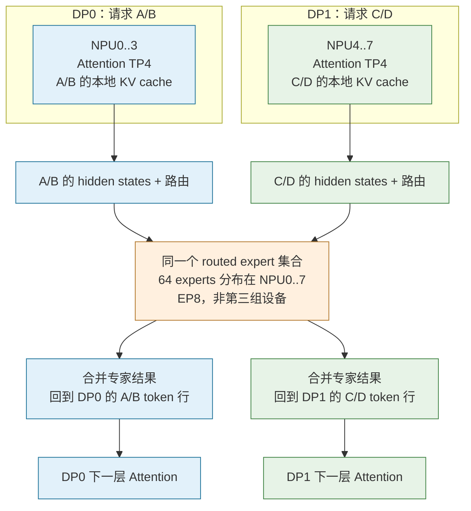
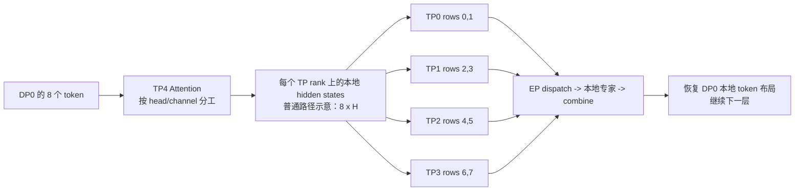
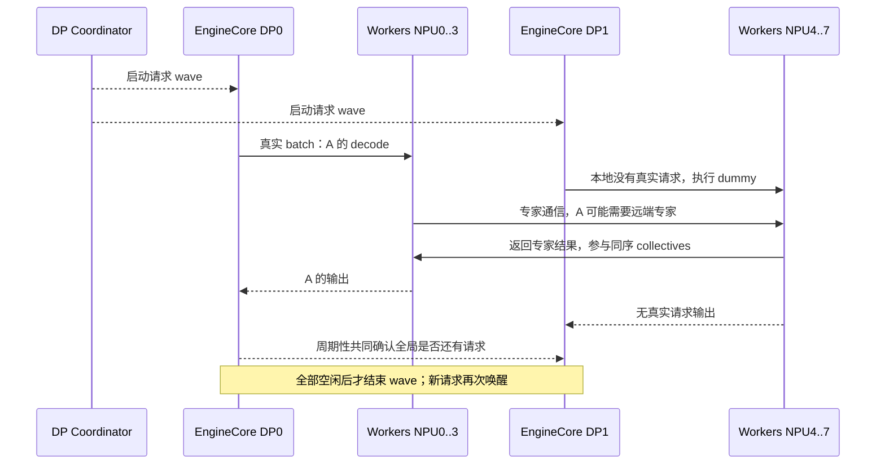
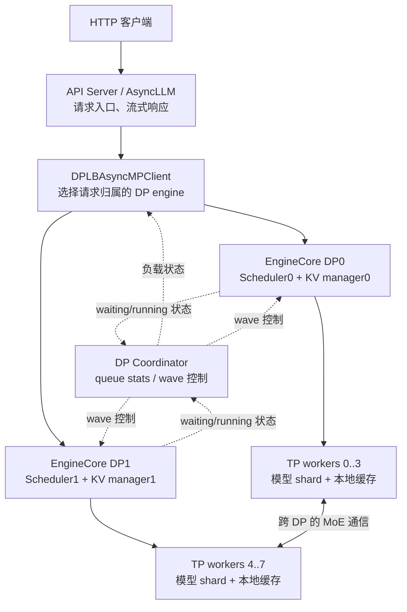
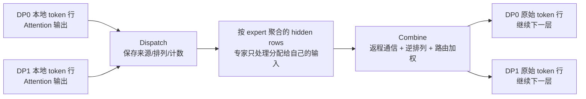

# 数据并行推理：基线机制与DSA集成

> 基线：v0.23。第一部分是逐层、逐token的教学说明；第二部分是已确认并适配的DSA单机合同。跨机仍是草案。

先分清DP请求副本、域内TP和跨域EP，再读资源预算和管理协议。下面的基线混合prefill/decode示例不是DSA本地phase barrier的实现规则。源码行号仅供定位，实际以符号和固定版本为准。

第一部分以 vLLM `0fc695fc6d`、Ascend 正式基点 `5cb98caa` 的机制为学习依据，
教学模型的 head、hidden size 和 expert 数不冒充 GLM-5.2 配置。第二部分按当前
`b9d12863c2` 的实现核验；早期“DP/MTP/L3 尚未开放”的阶段记录不再作为当前限制。

## 一、v0.23基线机制详解

### 1. DP 最基本的含义

#### 1.1 从只有一张卡开始

假设一个模型能放进一张卡：模型权重固定，每个请求有自己的 prompt、已生成 token 和 KV cache。

```text
请求 A: 8192-token prompt  --+
请求 B: 2048-token prompt  --+--> Scheduler --> NPU 上同一套模型权重
请求 C: 4096-token prompt  --+                   各请求各自的 KV cache
```

同一张卡一次可以处理多个请求的 token，这叫 batching，不叫 DP。`max_num_seqs=4` 也不表示四个模型副本。

#### 1.2 普通 Dense 模型的 DP

增加第二个副本：DP0 处理 A/B，DP1 处理 C/D。两个副本使用同一模型的权重，但输入请求不同。

```text
                         +--> DP0: 模型副本 0，处理 A/B，保存 A/B 的 KV
请求分流 / Load Balancer -+
                         +--> DP1: 模型副本 1，处理 C/D，保存 C/D 的 KV
```

**DP 分的是请求，不是把一个请求的前半段和后半段分给两个副本。**

例如 A 有 40,000 token，分到 DP0 后，普通 DP 不会自动让 DP1 帮算后 20,000 token。要划分单请求上下文，那是 context parallel 等另一类机制。

推理 DP 也不是训练 DDP：这里没有反向传播、梯度 all-reduce 或优化器更新。

#### 1.3 大模型放不进一张卡，就在每个 DP 副本内部继续 TP

在 8 张 NPU 上设置 `DP=2, TP=4, PP=1`，可以先理解成两个请求处理组，每组四张卡协作。

| 物理卡示例 | Attention 的 DP rank | Attention 的 TP rank |
|---|---:|---:|
| NPU0 / 1 / 2 / 3 | 0 | 0 / 1 / 2 / 3 |
| NPU4 / 5 / 6 / 7 | 1 | 0 / 1 / 2 / 3 |

这个编号假设可见设备按 `0,1,2,3,4,5,6,7` 排列，没有 PP/PCP 等额外维度。真正部署时要区分物理 device ID、进程看到的 local device ID 和通信 group rank。

**GLM/DeepSeek 是 MoE 模型，后面的专家层会打破“两个完整独立模型”的直觉。第 4 节单独讲。**

### 2. 把 DP、TP、EP、SP、CP 分开

| 机制 | 主要划分什么 | 用本例解释 | 是否意味着把 A 的 KV 分给不同 DP rank |
|---|---|---|---|
| DP | 请求集合 / 独立调度队列 | A/B 给 DP0，C/D 给 DP1 | 否 |
| TP | 张量的 head/channel/矩阵维度 | Attention 的 32 个 head 分给四张卡 | 否 |
| EP | 不同 routed expert 的权重与计算 | expert 0 在一张卡，expert 48 在另一张卡 | 否 |
| SP | 某些算子边界上的 activation token 行 | MoE 前把本地 hidden states 分成四份 | 否 |
| CP、PCP、DCP | 单请求的上下文计算/缓存工作 | 需要另行指定策略和通信 | 与普通 DP 是不同问题 |
| PP | 不同模型层 | 前半层、后半层放不同 stage | 与普通 DP 是不同问题 |

本文固定 `PP=PCP=DCP=1`。SP/FlashComm 只在解释 Ascend 优化路径时引入。

还有两个不同的 top-k：

- **DSA Indexer top-k**：某个 query 选择哪些历史 token 的 KV 来做 Attention。
- **MoE router top-k**：某个 token 的 hidden state 选择哪些专家来做 FFN。

它们选择的对象、通信和缓存语义完全不同。

#### 2.1 同一个 worker 不是“换身份”，而是一直有多个坐标

固定 DP2/TP4、EP8、PP/CP 均为 1，假定物理卡与全局 worker 编号按 0..7 顺序对应：

```text
                     TP rank 0   TP rank 1   TP rank 2   TP rank 3
DP0 请求处理域          NPU0        NPU1        NPU2        NPU3
                        EP0         EP1         EP2         EP3

DP1 请求处理域          NPU4        NPU5        NPU6        NPU7
                        EP4         EP5         EP6         EP7
```

这不是 8 个 Attention worker 加上 8 个专家 worker，而是同一批八个 worker 的多个坐标。以 NPU5 为例，它始终同时具有：

- 请求处理归属：DP1，受 EngineCore1 的本地调度管理。
- Attention TP 坐标：TP rank 1，组成员 `[4,5,6,7]`。
- 跨 DP 通信坐标：DP rank 1，对应 TP 位置的 DP 通信组为 `[1,5]`。
- EP 坐标：EP rank 5，组成员 `[0,1,2,3,4,5,6,7]`。

**“DP1 请求处理域”与代码里的“DP 通信组”不是同一组设备：前者是图中的一行，后者通常是图中的一列。**

- 一行内的四张卡，是一个 DP engine 拥有的 TP workers。
- 一列内的两张卡，是相同 TP 位置、跨两个 DP 域的通信伙伴。
- 整个矩形的八张卡，构成本例的 EP group。

初始化阶段，vLLM 通过不同维度的 reshape/transpose 创建 TP、DP、EP groups。Ascend 还会创建成员覆盖相同 EP 范围的 MC2 等专用通信组。它们的 group 对象/通信句柄可同时存在，不需要走到 MoE 层才重新建进程、迁移设备或重新装载权重。vLLM 分组（源码位置：`vllm-v0.23/vllm/distributed/parallel_state.py:1759`）、DP/EP 分组（源码位置：`vllm-v0.23/vllm/distributed/parallel_state.py:1832`）、[Ascend MC2 分组](../../../../../../vllm_ascend/distributed/parallel_state.py#L85)

某次通信中说“八个 rank 交换路由计数”，指的是它传入的 **EP group 中的八个 EP rank**，不是八个 DP 域；而“跨 DP 同步本轮 token 数”的那次通信可能用的是本例的两成员 DP group。`rank` 的含义必须连同 group 一起看。

#### 2.2 沿着 NPU5 的一次模型层调用观察

假设 DP0 处理 A/B，DP1 处理 C/D。为说明 activation 变化，取普通无 SP 的 AllToAll prepare/finalize 路径；实际融合配置可以替换其中的通信步骤。

| 时刻 | NPU5 正在处理什么数据 | 与哪些伙伴协作 |
|---|---|---|
| 本轮准备 | DP1 的本地 batch、token 数、执行模式 | 本地 EngineCore；需要时通过 DP group `[1,5]` 交换元数据 |
| Attention | C/D 的当前 hidden、位置及本地 KV；计算自己的 head/channel 分片 | TP group `[4,5,6,7]` 完成相关投影归约 |
| MoE prepare | 从 DP1 的 hidden rows 中取得本 TP rank 负责发送的部分 | 按 TP rank 切分/整理，TP 坐标仍然有效 |
| EP dispatch | 发出负责的 C/D 路由行；接收发给本地专家的路由行 | EP group `[0..7]`，这时称自己为 EP rank 5 |
| 本地专家 MLP | 输入可混合来自 DP0 的 A/B 和 DP1 的 C/D | 用本卡已有专家权重做 grouped MLP；GEMM 本身不需要知道 DP 请求名 |
| EP combine | 把本地专家输出返还来源，同时取得自己发送行的专家结果 | EP group `[0..7]` |
| MoE finalize | 拼回 DP1 后续计算需要的 hidden rows | 普通路径用 TP group `[4,5,6,7]` gather/去 padding |
| 下一层 Attention | 再次只处理 DP1 的 C/D 上下文 | 本地 KV 与 TP group |

例如本地 Attention 输出是 8 行，TP4 普通 prepare 切分后，TP rank 1 可负责发送其中第 2、3 行。它收到的本地专家输入却不局限于这两行，而是全 EP 范围路由到自己专家的所有行。Combine 之后拿回自己负责的行，finalize 再恢复后续需要的 DP1 布局。

可以把执行过程简化为：

```text
同一个 NPU5 worker，同一层内：

  self_attn(C/D)                  本地 Attention + TP 协作
  self.mlp(...):
      prepare                    使用本地 TP 坐标整理输入
      dispatch(group=EP)         使用 EP 通信组分发/接收
      grouped_mlp                计算本地专家，输入可来自多个 DP
      combine(group=EP)          用 EP 通信组返程
      finalize(group=TP)         恢复本 DP 后续所需布局
  下一层 self_attn(C/D)          回到本地请求的 Attention 数据
```

因此，所谓“变换时机”不是身份或进程改变，而是**调用进入了哪个模型子模块、通信调用选择哪个 group、输入 tensor 此刻代表什么**。TP/DP/EP 坐标一直存在，MoE 内部也可能继续使用 TP group，不能把 Attention/MoE 的边界误解成 TP 身份被删除后换成 EP 身份。

普通路径中，Attention 权重 shard 和本地专家权重始终在同一 worker/device 上。帮 DP0 的 A/B 算过专家，不代表 NPU5 从 DP1 脱离，也不代表 A/B 的 KV 被迁到 DP1。

源码：模型层 Attention -> MLP（源码位置：`vllm-v0.23/vllm/model_executor/models/deepseek_v2.py:1189`）、[TP 输入切分](../../../../../../vllm_ascend/ops/fused_moe/prepare_finalize.py#L131)、[TP 输出恢复](../../../../../../vllm_ascend/ops/fused_moe/prepare_finalize.py#L194)。

### 3. TP 到底怎么拆权重，token 又在哪里

#### 3.1 教学 Attention：hidden size=4096，32 heads，TP=4

暂时不考虑 GQA/MLA 等特殊结构，每个 head 的维度取 128。输入：

```text
X: [T, 4096]，T 是这一轮新计算的 token 数

TP0: 相同的 T 个 token，负责 heads  0.. 7
TP1: 相同的 T 个 token，负责 heads  8..15
TP2: 相同的 T 个 token，负责 heads 16..23
TP3: 相同的 T 个 token，负责 heads 24..31
```

例如本轮算 A 的一个 4096-token chunk，概念上四个 TP worker 都处理这 4096 个位置，不是各处理 A 的连续 1024 个位置。

这里说的是普通 TP 的逻辑。某些 SP/融合实现会在算子边界暂时切 activation，不能据此推断请求或 KV 所有权已经改变。

#### 3.2 ColumnParallelLinear：切输出维度

采用数学上的 `Y=XW` 记法，不按 PyTorch weight 的存储转置命名：

```text
X: [T, 4096]
Wq: [4096, 4096]

Wq = [Wq0 | Wq1 | Wq2 | Wq3]
Wqi: [4096, 1024]

TPi 计算 Qi = X @ Wqi，得到 [T, 1024]
```

每张卡持有一部分投影权重，计算一部分 head。通常没有必要立刻把所有 Q 拼回每张卡，因为后续 Attention 可以直接计算本卡的 head。

#### 3.3 RowParallelLinear：切输入维度，输出相加

Attention 后每张卡有本地 head 对应的 `Zi: [T,1024]`，输出投影：

```text
Wo 按输入维度分四份，每份 [1024,4096]
TPi: Yi = Zi @ Woi，得到 [T,4096] 的部分和

完整 Y = Y0 + Y1 + Y2 + Y3
```

因此这里需要求和通信，普通路径是 all-reduce；配合 SP 时也可以把求和与 token 行分发合为 reduce-scatter。

**Attention 头的投影结果是拼接关系，输出投影的分块结果是求和关系，不能把两者混淆。**

#### 3.4 普通 FFN、Norm、Embedding 呢

Dense FFN 通常也是 gate/up 投影切 intermediate 维度，down 投影产生部分和。Norm 参数等较小参数通常复制。

Embedding/LM head 常有词表并行实现，也可能因模型和优化配置使用不同路径；不能简单说“除了专家，所有权重都完整复制”，也不能说“每张卡所有权重都恰好除以 TP”。

#### 3.5 加上 DP 后，哪些权重重复

对 Attention 来说，DP0 的 TP0 与 DP1 的 TP0 通常持有相同的那一份 Attention 权重，但分别处理 A/B 与 C/D。

```text
DP0: [attention shard0] [shard1] [shard2] [shard3]
DP1: [attention shard0] [shard1] [shard2] [shard3]
```

这是“每个 DP 组一套 Attention 权重”，不是“每张卡一套 Attention 权重”。

#### 3.6 权重文件需要手工拆吗

一般不需要。各 worker 使用同一个模型路径，模型层的 weight loader 根据 TP/EP rank 装载需要的逻辑分片。safetensors 的文件分片主要是存储组织，并不等于 TP 分片。

量化权重还涉及 packed layout 和 scale 的分片；它们由具体 loader/量化实现处理，不意味着用户应手动把模型目录分为 DP0、DP1 两份。

源码入口：DeepSeek Attention/MLP（源码位置：`vllm-v0.23/vllm/model_executor/models/deepseek_v2.py`）、Linear weight loaders（源码位置：`vllm-v0.23/vllm/model_executor/layers/linear.py`）。

#### 3.7 Attention 结束后是副本还是分片，谁负责发给 EP

“Attention 结束”需要指定边界。以本地 `T=8`、`H=4096`、32 heads、TP4 的教学模型说明，暂不考虑 CP 和特殊 o_proj 配置：

| 所处位置 | 每个 TP rank 的张量示例 | 是否已经是完整的 hidden 值 |
|---|---|---|
| Attention 核心输出，本卡 8 个 head | `[8,1024]` | 只有本卡 head 的输出 |
| 本地 o_proj 矩阵乘后、归约前 | `[8,4096]` | 维度完整，但数值只是本卡贡献的部分和 |
| 普通 TP AllReduce 后 | `[8,4096]`，四卡语义相同 | 完整输出，每卡一份副本 |
| SP/FlashComm ReduceScatter 后 | `[2,4096]`，各卡 token 行不同 | 所持行已是完整 hidden 值，只分 token 行 |

特别注意：**张量 shape 是 `[T,H]` 并不能证明数值已经完整。** o_proj 的各卡部分和还需要求和；专家不能把未归约的部分和直接当作完整 token hidden 来计算。

普通路径在 complete hidden 上完成残差/Norm 等衔接后进入 MoE。对于普通无 SP 的 AllToAll/MC2 prepare，代码会按本地 TP rank 切分 `hidden_states` 和 `router_logits`。以 DP1 的八个本轮 token 行为例：

```text
o_proj + AllReduce 后：
  NPU4 / TP0：完整 rows 0..7
  NPU5 / TP1：完整 rows 0..7
  NPU6 / TP2：完整 rows 0..7
  NPU7 / TP3：完整 rows 0..7

MoE prepare 分配发送工作后：
  NPU4 / TP0 / EP4：负责 rows 0,1
  NPU5 / TP1 / EP5：负责 rows 2,3
  NPU6 / TP2 / EP6：负责 rows 4,5
  NPU7 / TP3 / EP7：负责 rows 6,7
```

各 worker 为自己负责的 token 行参与 EP dispatch，目的地由 router 选择的专家决定。一行选多个专家时会有多条路由工作项，这是模型语义要求的展开；不是四个 TP rank 把同一 token 的同一专家任务重复发四遍。

这是一种按 token 行划分发送工作的机制，**不是 TP0 代理发送，也不是按链路实时压力或专家耗时动态挑选发送者**。均分发送行不能保证专家收包和计算均衡，专家倾斜与 DP 请求倾斜还是另外两类问题。

SP/FlashComm 可将“部分和 AllReduce -> 完整副本 -> token 切分”合为 ReduceScatter，使每个 rank 更早得到自己负责的完整 hidden 行。基线通过当前布局状态避免在 prepare 阶段再次错误切分，不能无条件对任意输入再除一次 TP。

AllGather 通信方法则是另一条路径：gather 所需 activation，再由各 rank 为本地专家筛选/归组计算，不应套用上面 AllToAll/MC2 的发送分工图。它同样不是 TP0-only。具体路径取决于 token 数、EP/量化/FlashComm 和 o_proj 等配置，单看 DP/TP 数值无法唯一确定。

上游普通 RowParallelLinear 的归约见 linear.py（源码位置：`vllm-v0.23/vllm/model_executor/layers/linear.py:1537`）；Ascend 的 AllReduce/ReduceScatter 分支见 [SequenceRowParallelOp](../../../../../../vllm_ascend/ops/linear_op.py#L511)；token 行切分见 [prepare_finalize.py](../../../../../../vllm_ascend/ops/fused_moe/prepare_finalize.py#L131)。

因此三句话必须同时成立：**本地 Attention head 输出是分片；普通 o_proj 归约后可以是副本；EP 发送前又可以按 token 行分工。** 这些是在不同算子边界发生的合法布局变化，不是请求 KV 在不同 DP 域间迁移。

### 4. GLM/DeepSeek 的关键区别：Attention DP + 专家 TP/EP

#### 4.1 打开 EP 后，专家层跨两个 DP 组

继续使用 `DP2 × TP4`，教学模型每个 MoE 层有 64 个 routed experts，启用 EP、没有冗余专家、按连续编号均分：

| 卡 | Attention 所属组 | 这个 MoE 层持有的完整 routed experts |
|---|---|---|
| NPU0 | DP0 / TP0 | E0..E7 |
| NPU1 | DP0 / TP1 | E8..E15 |
| NPU2 | DP0 / TP2 | E16..E23 |
| NPU3 | DP0 / TP3 | E24..E31 |
| NPU4 | DP1 / TP0 | E32..E39 |
| NPU5 | DP1 / TP1 | E40..E47 |
| NPU6 | DP1 / TP2 | E48..E55 |
| NPU7 | DP1 / TP3 | E56..E63 |

这个例子的专家组是 `EP=DP×TP=8`。**EP 使用现有八张卡，不是额外乘八，变成 64 张卡。**

每个 MoE 层都有自己的专家权重，上表不是说整个模型只有这 64 个专家矩阵。启用 EPLB、冗余专家或不同 placement 后，专家与卡的映射还会变化。



上图中专家框是八张现有 NPU 上的另一种分组视角，不是远端另起的服务。

#### 4.2 一个 token 穿过 MoE 的例子

假设 A 的某个 token 在 Attention 后得到 hidden vector `h: [4096]`，router 为它选中 E3 和 E50，权重是 0.7、0.3：

```text
A 的 h
  +--> NPU0 的 E3  --> y3 --+
  +--> NPU6 的 E50 --> y50 -+--> 0.7*y3 + 0.3*y50 --> 回到 A 的位置
```

实际权重是否归一化、是否另乘 routed scaling、如何加 shared expert，由模型定义决定。这里仅用加权和说明数据流。

**NPU6 算了 A 的一个专家，不意味着 A 迁到了 DP1。**

- 传过去的是当前层 token activation 和路由所需信息，不是 A 的 40K 历史 KV。
- A 的 block table、position、上下文长度仍由 DP0 管理。
- A 的下一层 Attention 仍在 DP0 内部完成。
- FFN/专家是 token-wise 的，不需要 A 的全历史上下文。
- 多个请求的 hidden vectors 可以合批送专家，但不会因此进行跨请求 Attention。

#### 4.3 不开 EP，不等于各 DP 完全独立

这版 vLLM 的 MoE 默认逻辑是：专家内部 TP 跨 `DP×TP` 展开。在本例中：

```text
Attention：两个 TP4 组，输入请求不同
Routed experts：每个专家的矩阵按 TP8 分片
```

不开 EP 时，每张卡通常持有各个专家的一部分矩阵；开 EP 后，每张卡持有一部分完整专家。两种模式都可能跨 Attention DP 组通信。

Shared experts、前几层普通 Dense FFN 等要单独看待，不能把 routed expert 的 EP8 分片规则套在它们身上。

源码证据：FusedMoEParallelConfig（源码位置：`vllm-v0.23/vllm/model_executor/layers/fused_moe/config.py`） 的 `flatten_tp_across_dp_and_pcp()` / `make()`；官方 DP 文档（源码位置：`vllm-v0.23/docs/serving/data_parallel_deployment.md`）。

### 5. 从一个请求看 Prefill 与 Decode

#### 5.1 用大家熟悉的 41,672-token prompt

假设关闭 prefix cache、MTP，不发生抢占，chunked prefill 打开，本地每轮 token budget 是 8192，只有这个请求：

| 本地 forward | 新计算的位置，左闭右开 | 本轮 query token 数 | forward 后已有 KV 的位置数 |
|---|---|---:|---:|
| P0 | `[0,8192)` | 8192 | 8192 |
| P1 | `[8192,16384)` | 8192 | 16384 |
| P2 | `[16384,24576)` | 8192 | 24576 |
| P3 | `[24576,32768)` | 8192 | 32768 |
| P4 | `[32768,40960)` | 8192 | 40960 |
| P5 | `[40960,41672)` | 712 | 41672 |
| D0 | 位置 `41672`，输入第一个生成 token | 1 | 41673 |
| D1 | 位置 `41673`，输入第二个生成 token | 1 | 41674 |

**第一个生成 token 由最后一次 prefill 的 logits 采样得到。** 它刚被采样出来时，还没有作为下一轮模型输入计算自己的 KV；下一次 decode 才完成这件事并预测第二个生成 token。

每个新 chunk 只计算新位置的 hidden states/Q/K/V，不把前面的 chunk 重新做一遍全部模型层。Attention 会使用此前保留的历史 KV，并对当前 chunk 应用适当的因果关系。

这是上下文使用语义，不表示 GLM 的每个 Attention 都一定 dense 读取全部历史：原生 DSA 的 Indexer/稀疏选择仍然存在，我们自研的稀疏卸载又是其上的另外一层机制。

#### 5.2 DP 在哪里起作用

如果这个请求归 DP0，那么上表每一行都由 DP0 内的 TP4 协作处理。DP1 不会自动接手 P3～P5。

但是每一行内部，每一个 MoE 层仍可能调用八张卡上的专家。于是“请求归 DP0”和“请求产生了 NPU4..7 的专家计算”可以同时成立。

#### 5.3 Prefix cache 命中后

假设本地已有前 41,600 token 的可用 KV，最终认可的复用水位为 41,600：

```text
复用 [0,41600) 的 KV
只计算 [41600,41672)，本轮 72 个 query token
然后采样第一个输出 token
```

是否还能复用更多、是否要保留末 token 重算、MTP 水位约束等，取决于缓存/模型路径。这个例子只解释已经确定的 41,600 水位。

前缀复用发生在**选中的那个 DP engine**。别的 DP rank 有同样前缀，不等于这个 rank 自动命中；跨副本复用需要显式共享缓存层/connector 等能力。

### 6. 两个 DP rank 同时运行：逐轮调度例子

#### 6.1 固定输入和参数

所有长度都是 tokenizer 后的 token 数，不是汉字数。为突出机制，假设无 MTP、无 prefix 命中、无抢占，生成尚未结束：

```text
DP0: A=8192，B=2048
DP1: C=4096，D=1024

每个 DP rank:
  max_num_seqs = 2
  max_num_batched_tokens = 4096
  chunked prefill = True
```

假定请求按上述顺序进入各自队列，KV 充足，调度没有额外 long-prefill 限制改变本例安排。下面是基线 running-first、剩余 budget 再接 waiting 请求的一种可行时序，不是所有配置下的唯一时序。

#### 6.2 调度表

| 对齐的模型轮次 | DP0 本地执行内容 | DP0 新 token 数 | DP1 本地执行内容 | DP1 新 token 数 |
|---|---|---:|---|---:|
| 0 | A prefill `[0,4096)`，B 等待 | 4096 | C prefill `[0,4096)`，D 等待 | 4096 |
| 1 | A prefill `[4096,8192)` | 4096 | C decode 1 + D prefill 1024 | 1025 |
| 2 | A decode 1 + B prefill 2048 | 2049 | C decode 1 + D decode 1 | 2 |
| 3 | A decode 1 + B decode 1 | 2 | C decode 1 + D decode 1 | 2 |

三个要点：

1. DP0/DP1 的请求数和新 token 数可以不同，并不要求各分一半完全等长的数据。
2. 一边长 prefill、另一边短 decode 可以出现在同一轮，内部 MoE 通信仍要一致。
3. 这描述的是**原生基线**。当前 DSA 对 prefill/decode 的分阶段调度限制不能反过来当成基线规则。

#### 6.3 `batch size` 和 `num_tokens` 不是同一个数

看轮次 2 的 DP0，活跃请求只有 2 个，但输入并不是 `[2,2049,4096]`：

```text
本轮扁平 token 顺序，示意:
  [A 的 1 个 decode token, B 的 2048 个 prefill token]

input_ids:       [2049]
hidden_states:   [2049, hidden_size]
query_start_loc: [0, 1, 2049]
query lengths:  [1, 2048]
KV seq lengths: [8193, 2048]
```

`query_start_loc`、各请求的 seq length、slot mapping、block table 告诉 Attention 哪些 token 属于哪个请求。物理上拼在一个张量，不代表它们可以互相看到上下文。

图模式或通信可能把实际输入进一步 padding；上述是**真实有效 token** 的逻辑布局。

#### 6.4 对应 KV block 数

以 `block_size=128` 为例，A prefill 完后是 64 个满块，B 是 16 个，C 是 32 个，D 是 8 个。

A 下一次 decode 写位置 8192，就开始第 65 个逻辑块。DP1 上的 C 与 A 不共享 block table；二者即便恰好都拿到物理 block ID 7，也属于不同 worker 的内存，并不冲突。

TP 组内部，scheduler 给的是同一请求的逻辑位置和分配计划；每个 worker 将其解释为自身缓存 tensor 内的物理地址。对于不同 Attention 结构，这些 tensor 的 head/latent 布局会不同。

### 7. 模型轮次不等长，Ascend 怎样让通信对上

#### 7.1 先区分四个数

```text
1. request context length：A 已有多少历史 token
2. real scheduled tokens：A 这轮新增计算几个位置
3. graph/communication padded tokens：底层为了形状一致补到多少行
4. expert assignments：token 被 top-k 路由后形成多少条专家工作项
```

例如两个请求本轮各 decode 1 token，是 2 个新 token。若 top-2 专家路由，则有 4 条逻辑专家工作项；如果通信需要补到 8 行，也不表示生成了 8 个 token，更不表示 KV 上下文增长了 8。

#### 7.2 Model runner 先交换小型元数据

Ascend 的 `_sync_metadata_across_dp()` 会同步各 DP rank 的本轮 token 数和 graph mode，再决定共同模式和 padding。

本地是 decode、小图可用，并不意味着整个 DP group 能独自选这张图。如果另一边在 prefill 或必须 eager，需要协商一致的执行方式。

这里交换的是少量整数，不是在广播所有请求的 KV cache。CPU/Gloo 组或 NPU/HCCL 组的选择取决于当前配置。

#### 7.3 一个具体实现：不启用 SP 的 AllGather 路径

源码 `PrepareAndFinalizeWithAllGather` 明确给出的流程：

```text
Attention
  -> TP AllReduce
  -> DP AllGather
  -> MoE 计算
  -> DP ReduceScatter
  -> TP AllReduce（依外层合并/归约安排）
```

以两个 DP rank 本轮真实 token 数 2049 与 2 为例，单看一条对应的 TP lane，例如 NPU0 与 NPU4：

```text
DP0: [2049,H]
DP1: [   2,H] -> padding -> [2049,H]

DP AllGather 后：
  [DP0 的 2049 行 | DP1 的 2 行 + 2047 行 padding]
  形状 [4098,H]

计算/归约后，各 DP rank 取回自己的部分，再去掉 padding。
```

真实输入共 2051 个 token，不是 4098 个；对应 TP lane 之间的复制也不能重复统计为独立请求。

这里的 DP group 通常连接相同 TP 位置：`[0,4]`、`[1,5]`、`[2,6]`、`[3,7]`，而 EP group 是 `[0,1,2,3,4,5,6,7]`。同一张卡可以同时属于多个不同通信组。

#### 7.4 A5 还会走 AllToAll/MC2，不是总走 AllGather

`ascend_forward_context.py::_select_a5_moe_comm_method()` 按 token 数、MC2 容量和模型每 token 专家数选择：

- 小 token 量且多卡满足条件：MC2。
- 否则，参与规模不大于每 token 专家数时：AllGather。
- 其他情况：AllToAll。
- 没启用 EP 等情况另外回落到 AllGather。

所以不能背成“A5 prefill 一定 AllToAll、decode 一定 MC2”。具体选择也受模型/配置/本轮 DP 最大 token 数影响；代码注释中的固定容量数字不能直接替代运行时容量。

AllGather 的直觉是先让参与者拿到较完整的输入，再按本地专家计算和归约。AllToAll/MC2 则围绕专家去向分派和收回 token 数据。MC2 是 Ascend 的通信融合实现路径，不是另一种 DP 分配规则。

#### 7.5 为什么源码里真的出现了按 token 切分

在普通 Attention TP 后，本地四张卡可能都拥有相同的 `[T,H]` 输出。如果八张卡再分别把重复的 hidden rows 全送专家，就会产生冗余。

因此 AllToAll/MC2 的 prepare 可以先按本地 TP rank 切分 hidden rows。以 DP0 本轮 T=8、TP4 为例：

```text
Attention 阶段（普通 TP 视角）:
  TP0/1/2/3 都处理本地 8 个 token，各负责一部分 head

Attention 输出完成归约后，专家分派前:
  TP0: hidden rows 0,1
  TP1: hidden rows 2,3
  TP2: hidden rows 4,5
  TP3: hidden rows 6,7

每张卡为自己负责的行进行 expert dispatch/combine。
之后 gather 或相应的融合通信恢复下一阶段要求的布局。
```

DP1 同样处理它自己的 hidden rows，再共同使用 EP8 专家。



SP/FlashComm 可把前面的 all-reduce + 切分等步骤合并或替换，减少通信与冗余 activation。这些都是算子边界的数据布局优化。

**这里切的是当前层 activation，不是把 A 的前四个 KV block 永久交给 TP0、后四个交给 TP1，更不是把 A 迁到 DP1。**

### 8. 一个 DP rank 没请求，为什么它还要算

对于完全独立的 Dense 模型副本，DP1 没请求可以直接空闲。

对于共享跨 DP 专家计算的 MoE，本例如果 DP0 还在计算 A，A 可能需要 NPU6 上的 E50。DP1 不能因为自己的 C/D 已结束，就让 NPU4..7 退出执行流程。



dummy 的作用是维持兼容的模型调用和通信序列，不是给用户编造一个请求。正确实现必须避免 dummy 写到真实请求的 KV，并屏蔽 padding 的业务输出。

`DPEngineCoreProc.run_busy_loop()` 中，无真实 forward 但 deployment 仍处于 running wave 时会执行 `execute_dummy_batch()`。该版本每 32 步做一次全局结束检查，不是每个 token 都让全体彻底停下再启动。

这里有**两种同步**，不能混在一起：

- EngineCore 级：这一波请求是否全部结束、是否该唤醒/暂停。
- Worker 级：当前 forward 的 token 数、graph mode、各 MoE 层的通信和结果归约。

idle/dummy不是请求preemption，也不是从L3恢复KV。DSA已经对此接入并隔离真实IO，具体合同见本文第二部分，而不只是“多开几个scheduler”。

### 9. vLLM 的在线进程关系

#### 9.1 Internal load balancing



这里每个 DP rank 的确有自己的 scheduler，而不是一个全局 scheduler 同时维护两份 TP block table。

原生 `DPLBAsyncMPClient.get_core_engine_for_request()` 的常规分流评分是：

```text
score = waiting_requests * 4 + running_requests
选择 score 较小的 engine
```

它还处理显式 rank 路由等情况。这个常规评分没有拿所有 prompt block hashes 去比较各 DP 的 prefix cache，也没有按每个请求剩余 token 工作量精确评分。

请求一旦正常进入某个 DP engine，其后续 prefill/decode 由这个 engine 调度，不是每一步又重新交给负载均衡器。

Coordinator 不是 node-wide KV block manager，也不是任意 DP 请求迁移器。

#### 9.2 参数作用范围

| 参数 | 本例含义 |
|---|---|
| `data_parallel_size=2` | 全 deployment 两个 Attention DP engine |
| `data_parallel_size_local=2` | 该节点运行两个 DP engine |
| `tensor_parallel_size=4` | 每个 Attention DP engine 内部 TP4 |
| `enable_expert_parallel=True` | routed experts 采用 EP，而非展平的 expert TP |
| `max_num_seqs=4` | 每个 DP engine 的请求数上限，不是全机总共四个 |
| `max_num_batched_tokens=8192` | 每个 DP engine 每轮的新计算 token budget |
| `max_model_len` | 单请求长度约束，不因 DP2 自动翻倍 |

因此 DP2、每 DP `max_num_seqs=4`，理论上本地请求槽位合计 8 个，但实际可运行数还受 KV 容量、阶段、调度约束等影响。

同理，两个 DP 都排满时，每轮真实 query token 上限可合计到 16,384；不能把它理解成单个 16,384-token chunk 被一个 scheduler 跨 DP 拆开。

#### 9.3 Internal、hybrid、external 的区别

- **Internal**：一个 HTTP 服务入口，框架内部分给多个 DP engine。
- **Hybrid**：各节点有入口，节点间外部路由，节点内再分流到本地 engine。
- **External**：每个 DP rank 有独立入口，外部系统决定请求发给谁；MoE 的跨 rank 协同仍需成立。

分别拉两个完全无关、DP=1 的完整 MoE 服务是另一种部署。它们可以真正独立，但不会自动形成这里的 EP8 专家组。

#### 9.4 两级决策：选哪个 DP，与这一轮算多少 token

当前普通静态 DP 部署中，存在上层负载观测和新请求分流，但**不存在一个每轮按全局计算预算给各 DP 下发 token 配额的统一 scheduler**。

| 决策 | 由谁负责 | 发生时机 | 决定什么 |
|---|---|---|---|
| 新请求分给哪个 DP | API/client 侧的 DP load balancer，或外部 router | 请求进入时 | 请求归属的 EngineCore |
| 本 DP 这一轮算哪些请求、每请求几个 token | 各自的 Scheduler | 每轮 schedule | 本地真实 batch、chunk、block 分配 |
| 本轮跨 DP 怎样协同执行 | Worker DP 元数据同步、MoE 通信、wave 协调 | forward 前/内及 wave 状态变化时 | 兼容的执行模式、padding、通信与全局活跃状态 |

后两行不能混淆：把 DP0/DP1 的执行形状协调一致，不代表把 DP0 的请求或 KV 重新分给 DP1。

例如每 DP token budget 为 8192，某轮 DP0 排出 8192 个真实 token，DP1 排出 2 个：

```text
Scheduler0 -> 自己的 8192-token batch
Scheduler1 -> 自己的    2-token batch
             ↓
         worker 协调后执行
```

DP1 剩下的预算不会自动借给 Scheduler0；Scheduler0 也不会因为另一边空闲，就把自己某个 chunk 的一半交给 Scheduler1 算。通信 padding 更不是这种重新分工。

##### 9.4.1 `out-of-order step` 统计警告的含义（2026-09-08）

该 warning 来自 vLLM `DPCoordinator.process_input_socket()`，检查对象是
`SchedulerStats` 的 `(current_wave, step_counter)`，不是算子执行、KV copy
或生成 token 的顺序。

- `wave` 表示 DP 引擎的一轮整体活跃期。全部进入空闲、结束一轮后，EngineCore 增加 wave 并把 step 置零；不等于 client replay 的轮号或请求 ID。
- `step` 是 EngineCore 执行轮次计数，包含需要陪跑的 dummy 轮，不是 attention 层号或 MTP 三次 drafting 的子步骤。
- 各 Engine 在执行 step 前后检查 waiting/running 数量，只有 counts 发生变化才把统计送入自己的 output queue；输出线程再通过 ZMQ 发往 Coordinator。
- 接收端只保存一套覆盖所有 engines 的 `last_stats_wave/last_stats_step` 高水位，不是每 engine 各自一份。因此跨进程统计汇合时，较早一轮的合法消息稍晚到达也会触发 warning。

例如 Coordinator 先收到 DP0 的 `(1,181)`，再收到 DP1 的 `(1,180)`，
后者会被报告为 out-of-order。这不要求任意单个 DP 的发送顺序发生倒退，
也不要求 NPU collective 发生乱序。GPU/NPU 的计算协同不能保证各 CPU
线程统计消息的全局接收先后。当前代码对等于高水位的消息允许通过，
日志里的 `expected > (...)` 不是严格拒绝同 step 的完整规则。

警告后代码仍写入该 engine 的 waiting/running counts，并标记 stats_changed，
没有丢弃消息、回滚 step、修改已有请求归属或清理 KV cache。内部 LB 因此
可能暂时参考不同执行轮的负载快照，它本身就是异步近似观测；带
`X-data-parallel-rank` 的请求则显式选域，不依赖这条负载评分。

2026-09-08 用户日志中的 `(1,180)` 对 `(1,181)` 和 `(2,0)` 对 `(2,1)`
均只相差一轮，且所有请求正常完成，属于当前可解释、非阻塞的统计警告。
不能据此保证所有同名 warning 都无害：若持续刷屏、差距扩大、单 engine
自身序号回退或请求不再推进，应进一步检查队列延迟、进程状态和 wave 协同。

源码：发送条件（源码位置：`vllm-v0.23/vllm/v1/engine/core.py:1856`）、
前后两次采集（源码位置：`vllm-v0.23/vllm/v1/engine/core.py:1876`）、
接收比较及后续计数更新（源码位置：`vllm-v0.23/vllm/v1/engine/coordinator.py:371`）。

#### 9.5 在线请求通常在 add_request 时选定归属

`DPAsyncMPClient.add_request_async()` 调用 `get_core_engine_for_request()`，再向选中的 engine 发送 `ADD`。Internal LB 的子类实现用等待/运行请求数评分，也允许显式选择 DP rank 等路径。add_request 入口（源码位置：`vllm-v0.23/vllm/v1/engine/core_client.py:1344`）、分流实现（源码位置：`vllm-v0.23/vllm/v1/engine/core_client.py:1398`）

```text
请求 A -> 选定 DP0 -> waiting0 -> prefill chunks -> decode -> 完成
请求 B -> 选定 DP1 -> waiting1 -> prefill chunks -> decode -> 完成
```

在普通路径中，后续 prefill/decode 不会每轮重新走 load balancer。请求即使被本地 scheduler 抢占、重新排队，也不等于被迁到另一个 DP。这里不讨论显式迁移、故障转移或弹性重配置等不同机制。

当前也不是一个全局 waiting 队列供各 scheduler 随时取任务：新请求已经放入选中 engine 的本地队列，默认没有另一个 DP 来窃取它的通用 work-stealing 流程。

但“归属固定”**不等于新请求只在启动时静态分配一次**。持续到来的每个新请求都会重新参考当时的负载信息：

```text
DP0: waiting=0, running=4 -> score=4
DP1: waiting=0, running=1 -> score=1
新请求通常选择 DP1
```

Coordinator 汇总 waiting/running，默认最小统计发布间隔为 100 ms。前端分流后还会本地增加预估等待量，减少统计更新之间一批请求全扎向同一 engine 的情况。多个前端仍使用近似的负载视图，不是全局逐请求原子优化器。

因此它能利用**未来的新到达请求**改善分布，却不会通过普通分流自动搬走已经归属于另一个 engine 的存量请求；也不精确评估上下文长度、prefix 命中与剩余生成时间。

#### 9.6 一个 DP 做真实 forward，另一个陪跑，是否经常可能发生

这是正常可达状态，不能当成 DP 不会出现的异常：

- 本来就只有一个请求，或请求数少于 DP 数。
- 长短请求按数量分配看似均衡，但短请求先完成。
- 离线各分片实际工作量不同，最后一部分任务形成长尾。
- 在线进入低流量/收尾期，没有新请求填补空闲域。

在持续且足量的在线流量下，新请求分流有机会填补空闲域；在有限离线任务或没有新流量时，这个机制就无法补平已经存在的长尾。

需要强调“陪跑”的准确含义：**该 DP 域没有真实的本地 Attention 请求，但它的 EP worker 仍可能在计算其他 DP 的真实专家输入。** 不是整组卡完全没有业务工作；具体闲置程度取决于 Attention/MoE 占比和专家路由。idle forward 分支（源码位置：`vllm-v0.23/vllm/v1/engine/core.py:1887`）

这也是后续 DP 学习/验证要区分的两件事：正确性上必须支持长短不均和 dummy 协同；性能上则要量化该部署是否因长尾、阶段不均或本地缓存割裂而损失收益。不能因为基线有 load balancer，就认为它已经具备全局 token-aware 的动态重调度。

#### 9.7 SchedulerOutput、graph 协调、元数据就绪是不同层次

两个 scheduler 各自生成 SchedulerOutput 后，会交给各自的 executor/TP workers，而不是先在 scheduler 层合并或等待一个全局 batch 审批。每个 DP 的请求和缓存元数据仍然独立。

| 层次 | 是否存在跨 DP 协同 | 它不代表什么 |
|---|---|---|
| SchedulerOutput 下发 | 各 engine 分别下发，没有常规合并步骤 | 不等于每轮重分配请求归属 |
| 本轮 token 数/graph mode | Ascend worker 有 DP 元数据同步和重新 dispatch | 不等于所有实际 metadata tensor 都已刷写完成 |
| 本地输入与缓存更新 | 本地流、事件和适用的同步保护 | 不要求不同 DP 的 block IDs/seq_lens 内容相同 |
| replay 内的 MoE collective | 必须有匹配的调用次序、协议和参与者 | 不要求各 DP 在 CPU 上同一时刻调用 replay |
| wave 完成/唤醒 | EngineCore/Coordinator 跟踪全局活跃状态 | 不负责每个算子的输入就绪 |

当前 Ascend runner 的 DP 模式协调发生在最终 attention metadata 构建之前。因此，一次 DP metadata all-reduce 成功，不能拿来证明后续的 H2D 或元数据更新在全体设备上已经完成。

具体 runtime mode 按枚举数值取最小：`NONE=0 < PIECEWISE=1 < FULL=2`。例如某 DP 的 mixed batch 只能选 PIECEWISE、另一 DP 的 uniform decode 选 FULL，则共同结果为 PIECEWISE；两边用该 mode 重新 dispatch。若 mixed 一侧只能 NONE，则两边都 eager。

因此“一个 DP 有 chunked-prefill+decode，另一个 DP 全 decode”不等于一定完全进不了图，取决于配置允许的 mixed mode：

| Compilation graph mode | mixed DP 本地通常选择 | pure-decode DP 本地选择 | DP 协调后的典型结果 |
|---|---|---|---|
| `FULL_DECODE_ONLY` | NONE | FULL | 两边 NONE/eager |
| `FULL_AND_PIECEWISE` | PIECEWISE | FULL | 两边 PIECEWISE |
| 通用 `FULL` 且捕获了匹配的 non-uniform descriptor | FULL | FULL | 两边可以 FULL |

“通常”假定 prefill chunk 的 query length 大于 decode query length。非 speculative 当前 `uniform_decode` 判断没有额外要求所有请求均已完成 prefill；若最后恰好是 1-token prefill、所有 query length 都相同，需按实际 descriptor 检查，不能仅凭请求名称推断 mode。

正确的要求是：**每个本地消费者开始执行前，它依赖的本地元数据和 KV 已经就绪；跨 DP 的 collective 调用必须兼容。** 若更新在独立 stream 上，必须建立本地等待依赖，而不是认为加一个 CPU 跨 DP barrier 就自动等完了所有异步拷贝。

当前 `ACLGraphWrapper` 的普通 FULL replay 分支确实有本地 current-stream synchronize，ENPU/draft 等有例外；它不是跨 DP barrier。SFA 的 `update_graph_params()` 为 no-op，其固定输入 tensor 的更新不能套用其他 Attention 后端的动态 task 参数刷新路径。

来源：EngineCore.step（源码位置：`vllm-v0.23/vllm/v1/engine/core.py:443`）、[DP 形状协调](../../../../../../vllm_ascend/worker/model_runner_v1.py#L3484)、[replay](../../../../../../vllm_ascend/compilation/acl_graph.py#L243)、[SFA 更新接口](../../../../../../vllm_ascend/attention/sfa_v1.py#L902)。当前runner含DSA修改，特有graph gate/fallback见本文第二部分，旧行号只作定位线索。

#### 9.8 跨机 DP 并不自动意味着必须使用 Ray

固定版本的官方文档已经给出逐节点启动的多机 DP：配置全局 DP 数、每节点本地 DP 数与起始 rank、共同的地址/端口，非 API 入口节点可以 headless。Ray 是另一个编排选项，可以便利地创建远端进程/actor、安排资源。

要区分：

1. 不同 DP engine 放在不同机器，各自 TP 留在本机。
2. 单个 DP engine 内部的 TP 本身还要跨机器。
3. MoE EP group 横跨多个 DP，因此专家通信需要跨机器。

三者不等价，DP backend 与 worker/executor backend 也不是同一个配置概念。Ray 不替代 NPU/HCCL 的实际通信，不解决 Attention 负载倾斜，也不自动提供请求 KV 迁移。

目前只确认基线有不强制 Ray 的部署方式，不把任意 A5 多机网络拓扑标记成已验证。本地版本部署文档（源码位置：`vllm-v0.23/docs/serving/data_parallel_deployment.md`）

#### 9.9 广播管理操作不等于跨 DP 事务

当前 `DPLBAsyncMPClient.call_utility_async()` 会向各 engine 发出 utility 调用，并等待结果，但只把第一个 engine 的结果返回给调用方。

因此对 `reset_prefix_cache` 这类返回 bool、各 engine 又可能因本地状态不同而拒绝的操作，不能仅凭 API 返回 True 就推断所有 DP 都同样成功。广播不提供“全部先检查、全部再提交、失败整体回滚”的事务语义。

这里的 bool 指内部 Python client 的结果。对外 HTTP 开发接口 `/reset_prefix_cache` 还明确忽略 reset bool，在 await 未抛异常时返回 200。因此 HTTP 200 不等于实际清理成功；接口参数 `reset_external` 会传给内部的 connector reset 路径。HTTP 实现（源码位置：`vllm-v0.23/vllm/entrypoints/serve/dev/cache/api_router.py:20`）

所审阅v0.23基线的AscendStoreConnector没有实现DSA式L3 namespace轮换，继承的`reset_cache()`默认返回None；上游Scheduler对非False继续按成功处理。不能据此认为external reset已物理删除远端对象。DSA全域epoch合同见本文第二部分。

这是所审阅基线控制面行为，不是说所有utility都应改成bool AND。部分namespace更新和pending IO处理属于DSA增加的管理合同，不在这里当作基线已解决的能力。

来源：DP utility 广播与首结果返回（源码位置：`vllm-v0.23/vllm/v1/engine/core_client.py:1428`）、EngineCore reset 转交 scheduler（源码位置：`vllm-v0.23/vllm/v1/engine/core.py:646`）。

#### 9.10 到底是谁创建并统筹多个 EngineCore

默认的在线 internal-DP、单 API worker 场景下，从上到下不是一个“全能总控类”，而是分成以下几层：

```mermaid
flowchart TB
    API["API server worker"] --> ALLM["AsyncLLM<br/>前端 engine 门面"]
    ALLM --> CLIENT["DPLBAsyncMPClient<br/>请求选 DP、RPC、输出汇聚"]
    CLIENT --> LAUNCH["launch_core_engines()<br/>启动流程"]
    LAUNCH --> MANAGER["CoreEngineProcManager<br/>创建/监控本机 EngineCore 进程"]
    LAUNCH --> COORD["DPCoordinator<br/>负载统计与 request-wave 协调"]
    MANAGER --> E0["DPEngineCoreProc DP0"]
    MANAGER --> E1["DPEngineCoreProc DP1"]
    E0 --> S0["Scheduler0"]
    E1 --> S1["Scheduler1"]
    E0 --> X0["Executor0 -> TP workers"]
    E1 --> X1["Executor1 -> TP workers"]
    CLIENT -. "ADD 请求路由" .-> E0
    CLIENT -. "ADD 请求路由" .-> E1
    E0 -. "waiting/running" .-> COORD
    E1 -. "waiting/running" .-> COORD
    COORD -. "stats / START_DP_WAVE" .-> CLIENT
    COORD -. "wave" .-> E0
    COORD -. "wave" .-> E1
```



几个容易混淆的“最上层”需要分别回答：

| 问题 | 对应对象 |
|---|---|
| API 侧持有的最高层 engine 对象是谁 | `AsyncLLM` |
| 谁把普通 client 工厂化成 internal-DP client | `EngineCoreClient.make_async_mp_client()`，DP>1 且非 external LB 时返回 `DPLBAsyncMPClient` |
| 谁直接创建多个本机 EngineCore OS 进程 | `CoreEngineProcManager` |
| 谁决定一个新请求送到哪个 DP rank | `DPLBAsyncMPClient` |
| 谁汇总 waiting/running 并协调 MoE DP request wave | 独立进程 `DPCoordinator` |
| 谁决定本 DP 本轮选择哪些请求、多少 token、哪些 block | 每个 EngineCore 内自己的 `Scheduler` |

因此，若 `DP=2, TP=4`，通常是两个 EngineCore 进程、两个 Scheduler、两个 Executor，每个 Executor 再管理自己的四个 TP worker。`DPCoordinator` 不合并两份 `SchedulerOutput`，也不持有一份全局 KV block manager；它的“协调”范围主要是负载状态和 request wave。请求一旦由 `DPLBAsyncMPClient` 选到某个 EngineCore，后续 token 级调度仍由该 EngineCore 的 Scheduler 独立完成。

对当前 DSA 分支而言，vLLM-Ascend 只是在配置阶段把每个 EngineCore 将要实例化的 scheduler class 替换成 `DSAOffloadScheduler`，没有重写上述顶层创建树。因此 DP2 会得到两份独立的 DSA scheduler/L2 状态，而不会天然出现一个 node-wide DSA scheduler。

“只有一个顶层对象”还要加部署边界：默认单 API worker 时可以把 `AsyncLLM` 看作前端根对象；多 API worker 会各有前端 `AsyncLLM`/client，其中只有管理端 client 启动 engines，其他 client 连接既有后端；offline DP 通常则是外层脚本按 DP rank 启动多个 `LLM`/client，每个只管理一个本地 EngineCore，并不存在同一种 internal-DP 总入口。

来源：在线创建 AsyncLLM（源码位置：`vllm-v0.23/vllm/entrypoints/openai/api_server.py:108`）、AsyncLLM 创建 EngineCoreClient（源码位置：`vllm-v0.23/vllm/v1/engine/async_llm.py:146`）、DP client 工厂（源码位置：`vllm-v0.23/vllm/v1/engine/core_client.py:108`）、client 启动后端资源（源码位置：`vllm-v0.23/vllm/v1/engine/core_client.py:477`）、后端启动流程（源码位置：`vllm-v0.23/vllm/v1/engine/utils.py:1049`）、本机 EngineCore 进程管理器（源码位置：`vllm-v0.23/vllm/v1/engine/utils.py:121`）、每个 EngineCore 创建 Scheduler（源码位置：`vllm-v0.23/vllm/v1/engine/core.py:95`）、DP Coordinator 职责（源码位置：`vllm-v0.23/vllm/v1/engine/coordinator.py:23`）、[DSA scheduler 注入](../../../../../../vllm_ascend/platform.py#L733)。

#### 9.11 不同 DP 的 L1 HBM block capacity 是否相同

在本文主要讨论的 online internal-DP、多进程 Executor 路径中，基线只在**一个 EngineCore 所属的 worker 集合内部**统一 KV 容量，不会再对 DP0、DP1 做一次全局取最小。

每个 EngineCore 独立执行：

```text
各 worker profile 可用于 KV 的 HBM bytes
  -> 分别生成 worker KVCacheConfig
  -> 取本 EngineCore 全部 worker 的 min(num_blocks)
  -> 按这个最小值收缩本 EngineCore 的全部 KV tensor
  -> 用统一后的 config 创建本 EngineCore 的 Scheduler
```

普通 `DP2 * TP4 * PP1` 可以抽象为：

```text
L1_blocks(DP0) = min(blocks of DP0/TP0..3)
L1_blocks(DP1) = min(blocks of DP1/TP0..3)
```

但基线没有继续计算：

```text
min(L1_blocks(DP0), L1_blocks(DP1))
```

所以两域的最终 block capacity 可以不同。例如 DP0 四卡规划结果为 `[2200, 2176, 2192, 2184]`，最终取 2176；DP1 为 `[2152, 2144, 2160, 2136]`，最终取 2136。两份 Scheduler 分别看到 2176 和 2136，不要求 block ID 空间、空闲队列或 prefix directory 等长。

这在功能上成立，因为两域的 Scheduler、L1 block table 和请求所有权彼此独立。`DPCoordinator` 只收集 waiting/running 与 request-wave 状态，不收集或归一 KV capacity；启动握手检查影响 collective 的配置 hash，也不比较各 EngineCore 的 `num_blocks`。代价是容量较小的 DP 可能更早发生 admission 受限或 preemption，而当前 internal LB 的 waiting/running 评分也没有显式按 KV capacity 加权。

vLLM-Ascend每个NPU worker独立profile `requested_memory - non_kv_cache_memory`，随后复用上游EngineCore内取最小。当前已适配的DSA split HBM同样通过此入口：本DP的TP ranks取最小，DP之间可以不同；L2统一字节配额并不反过来强制L1块数相等。

有两个例外/控制手段：

- 显式配置统一的 `num_gpu_blocks_override` 或 `kv_cache_memory_bytes`，在相同 cache schema 下通常会得到相同容量，但配置者要自己保证每张设备能容纳。
- `external_launcher` 使用的 `UniprocExecutor` 有跨其 world group 对可用内存执行 MIN all-reduce 的路径；它的进程拓扑与本文目标的 online internal-DP 多 EngineCore 路径不同，不能据此认为 internal-DP 也已经全局统一。

来源：EngineCore KV 初始化（源码位置：`vllm-v0.23/vllm/v1/engine/core.py:236`）、worker 配置取最小（源码位置：`vllm-v0.23/vllm/v1/core/kv_cache_utils.py:1956`）、Scheduler config 一致性要求（源码位置：`vllm-v0.23/vllm/v1/core/kv_cache_utils.py:1698`）、Executor world size 不含普通 DP（源码位置：`vllm-v0.23/vllm/config/parallel.py:308`）、external launcher MIN（源码位置：`vllm-v0.23/vllm/v1/executor/uniproc_executor.py:186`）、[Ascend worker profile](../../../../../../vllm_ascend/worker/worker.py#L529)、[Ascend/DSA 复用上游容量规划](../../../../../../vllm_ascend/patch/platform/patch_kv_cache_utils.py#L400)。

### 10. 离线与在线：模型内核不因 HTTP 而改变

#### 10.1 相同的部分

两者都经过 EngineCore、scheduler、model runner、Attention/MoE 和采样。不是在线用了另一套数学模型。

在一次可以产出 token 的 forward 末尾，相关请求的 hidden states 经过 LM head 与所需并行通信得到 logits，再采样出各请求的下一个 token。worker 执行结果回到所属 EngineCore，更新请求状态；在线再交给 API 输出，离线交给 `generate()` 的结果收集。

TP4 是共同计算同一请求的输出，不是四张卡分别向客户端返回四个独立答案。不同请求的结果按 request ID 对回去，也不是把两个 DP engine 的输出文本拼成一个回答。

#### 10.2 不同的部分

- 在线有 HTTP/API 入口和动态到达的请求，通常由 internal/hybrid/external LB 分流。
- 离线知道一批 prompts，通常由测试程序预先分给 DP ranks。
- 因此 batch 组成、空闲 rank、chunk 边界、KV 分配顺序和 padding 可能不同。
- `async_scheduling` 是配置能力，不是“有 HTTP 就必然开启”。CPU 调度是否异步与模型中需要的 collective 协同也不是同一概念。

#### 10.3 当前版本普通 `LLM()` 不能简单填 DP2

`vllm/entrypoints/llm.py` 明确拒绝一般单进程的 `LLM(data_parallel_size>1)`，`external_launcher` 等特殊情况除外，并指向官方离线多进程例子。

基线 `examples/features/data_parallel/data_parallel_offline.py` 的基本结构：

```text
主进程
  +--> 子进程 DP0：设置自己的 VLLM_DP_* 环境，创建 LLM，generate(A/B)
  +--> 子进程 DP1：设置自己的 VLLM_DP_* 环境，创建 LLM，generate(C/D)

两个子进程并发执行，并加入同一个 DP deployment 的通信环境。
```

不能先同步跑完 DP0 的 `generate()` 再启动 DP1：共享专家的 DP0 可能正在等还未启动的 DP1。

也不能根据“只有一个子进程有真实 prompts”就直接省略其他进程；官方示例还处理了空输入分片的参与问题。

Ascend 仓库的 `examples/run_dp_server.sh` 提供过 DP2/TP4/EP 的在线例子，但其中模型、IP、网卡都是该示例环境的设置，不应照搬为当前 GLM/A5 的可运行配置。

#### 10.4 官方离线例子如何分配数据

当前示例先按 `len(prompts) // dp_size` 及余数，将 prompt 列表切成数量尽量相等的连续子列表；每个 DP 子进程只对自己的子列表调用 `llm.generate()`。分片代码（源码位置：`vllm-v0.23/examples/features/data_parallel/data_parallel_offline.py:114`）

这不是在线 `DPLBAsyncMPClient` 根据运行状态分流，也不是按 token 总长度均分：

```text
如果原始列表恰好排列为：
  [70K,70K,70K,70K, 5K,5K,5K,5K]

按数量均分连续子列表可能得到：
  DP0: [70K,70K,70K,70K]
  DP1: [ 5K, 5K, 5K, 5K]
```

即使两边都提交四个请求，也不保证耗时相等；每个本地 scheduler 继续按自己的 budget 决定逐轮 batch，先完成的一边不能默认从另一边的 waiting 队列取请求。

因此这个官方示例首先证明的是离线 DP 的启动、通信和独立输入流程，不是最优的离线负载均衡算法。可以在应用层另外设计长度感知分片或持续喂请求，但那属于额外策略，不能当成示例已经提供的能力。

### 11. 对 GLM/DeepSeek MLA + Indexer，KV 为什么特别

普通 MHA/GQA 通常按 KV head 切分或在 head 数较小时复制，不能一概说所有 TP 都保存相同 KV。

但是当前讨论的 DeepSeek/GLM MLA + Indexer 路径，在没有 CP 等额外切分时，核心缓存是另一种结构：

- MLA 缓存 latent/compressed KV 以及 RoPE 相关部分，不是简单把完整 K/V heads 平铺保存。
- `DeepSeekV2FusedQkvAProjLinear` 设置 `disable_tp=True`；没有 fused A 的分支用 `ReplicatedLinear` 产生 latent KV。
- q_b/kv_b 按 head/channel 做 TP，o_proj 做行并行。
- Indexer 的 `wq_b` 是 `ReplicatedLinear`，融合 wk/weights 投影也显式 `disable_tp=True`。

因此：**Attention 的计算可以 TP4 分 head，但本请求的 MLA latent 与 Indexer cache 在这四个 TP worker 上仍是语义相同的副本。**

实际 Ascend C8/BF16、scale、融合算子等物理布局要继续按 cache spec 看，不能拿 GPU 的 FP8 字节布局直接代替。上述结论是在讲复制/分片关系，也不是所有跨 rank 字节天然 bitwise 相等的验收证明。

Ascend 对上游 MLA 初始化的调整可继续查看 [patch_deepseek_v2.py](../../../../../../vllm_ascend/patch/worker/patch_deepseek_v2.py)。GLM 的 Indexer 层间复用会影响真正实例化的 Indexer 层数，但不会把 Attention DP 变成对单请求上下文的 DP 切分。

#### 11.1 从 TP8 改成 DP2/TP4 的意义

对于同一组总请求，把某个请求的 Attention TP 范围从 8 缩到 4，意味着其 MLA/Indexer cache 的本地 worker 副本数从 8 降到 4。这个特点可能让 DP attention 对 MLA 模型有吸引力。

但代价是：每个 Attention TP worker 持有的权重 shard 变大，更多 common 权重被 DP 复制；不能仅凭卡数相同就保证权重和 KV 都装得下。

一个简化的无冗余 EP 权重估算：

```text
每卡权重约为
    可按 Attention TP 切分的 common 权重 / TP
  + 每卡复制的 common 权重
  + 全部 routed expert 权重 / (DP * TP)
```

Shared expert 特殊并行、量化 scale、workspace、激活峰值和 allocator 开销均需另算。公式只是解释“为什么 DP2/TP4 和 DP1/TP8 不等价”。

#### 11.2 为什么愿意复制权重：先固定比较对象

> 本节及以下 11.3～11.10 是 2026-09-03 针对“DP 究竟省什么”的补充。结构与接口结论来自当前本地源码；内存、FLOPs 和通信账本是明确假设下的推导，不是 A5 实测性能。

固定八张卡、相同模型、相同总请求负载，关闭 PP/CP、冗余专家和特殊 shared-expert 并行，比较：

| 项目 | A：DP1 / TP8 / EP8 | B：DP2 / TP4 / EP8 | C：两套互不相干的 TP4 / EP4 服务 |
|---|---|---|---|
| Attention 请求处理组 | 1 组八卡 | 2 组四卡 | 2 组四卡 |
| 按 TP 切分的 common 权重，全机逻辑份数 | 1 | 2 | 2 |
| Routed expert 权重，全机逻辑份数 | 1 | 1 | 2 |
| 专家集合能否合用全部请求的 token | 可以 | 可以 | 各服务只处理自身请求 |
| 单请求的 MLA/Indexer KV 副本数 | 8 | 4 | 4 |
| Engine 间需要 MoE 执行协同 | 单 engine 内部完成 | 两个 engine 必须协同 | 两个服务无此关系 |

“专家一份”的严格范围是**这个 EP 组内、每层的每个 routed expert 的逻辑权重**。它不包括其他独立部署，也不排除 EPLB 故意复制热门专家，不意味着 runtime 没有额外权重格式/workspace。

“非 MoE 权重复制”也稍嫌粗略。更准确地说，是 routed expert 集合之外的 common 部分按自己的 TP/DP 规则布置：Attention、Indexer、Norm、Embedding/LM head、Dense FFN、shared expert 不保证采用同一种切分方式。Shared expert 虽然属于 MoE 层，也不应直接套 routed expert 的单副本规则。

**B 相对 A 的主要收益不在专家权重。B 相对 C 才避免了整套 routed experts 被重复部署。** 两种比较不能混着算。

#### 11.3 第一笔收益：减少 MLA/Indexer 的上下文副本

纯 TP 最小化了很多矩阵权重的复制，却不代表它会按相同比例切开 MLA latent KV、Indexer KV 和所有 activation。

仍取八个等长 40K 请求，没有 prefix 共享，每个请求的完整 MLA+Indexer 缓存单副本为 `C` 字节：

```text
A：TP8
  八张卡，每张保存八个请求的 latent/Indexer KV
  全机：8 卡 * 8 请求 * C = 64C

B：DP2 * TP4
  每个 DP 组四个请求，每张卡保存本组四个请求的 KV
  全机：2 组 * 4 卡 * 4 请求 * C = 32C
```

如果教学上取 `C=2 GiB`，两者是 128 GiB 与 64 GiB；这个 C 只是方便算账，不代表当前 GLM 权重/config 的测量结果。

减少的是**有用上下文的物理副本数**。如果启动时都按相同的显存利用率预分配 cache arena，`npu-smi` 上已申请显存未必下降；收益可能表现为更多可容纳请求，而不是进程显存条立刻缩短。

容量减半也**不等于 Attention 时间或实际 HBM 读流量必然减半**。每张卡的 head 数变多，KV 的片上复用、tiling 和重复读行为取决于具体算子。这里能够直接确认的是存储副本关系。

#### 11.4 第二笔收益：减少没有被 TP 切分的重复计算

不能说“DP2 让整个模型 FLOPs 减半”。把计算分两类才准确。

**已经按 head/channel 切分的计算：**

```text
教学模型有 32 heads，全机这一轮 8 个真实 query token。

A：每卡 8 token * 4 heads = 32 个 token-head 工作单位
B：每卡 4 token * 8 heads = 32 个 token-head 工作单位
```

负载均衡且序列长度相当时，数学上需要的这部分工作总量基本不变。矩阵形状不同可能改变执行效率，但不是凭空少了一半模型工作。

**没有按 TP 切分的部分：**

当前 Indexer 的投影显式使用 `ReplicatedLinear` / `disable_tp=True`，MLA latent 的 A 投影也有复制路径。对于每个真实 token，在普通无 CP、无额外去重优化的路径上：

```text
A：该 token 的复制计算在 TP8 上做八份
B：该 token 只在所属 TP4 组做四份
```

这一类重复工作可以减少。Norm、位置处理等也可能有复制工作，但能省多少，要按 SP、融合算子和实际张量布局逐项核对。

因此，**DP 可以用更多权重副本，换掉更大 TP 带来的重复 activation/KV 工作**。权重只在启动时载入 HBM，不是每轮从磁盘重载；不过更大的权重 shard 仍可能增加每轮 HBM 到计算单元的读取开销。

#### 11.5 第三笔收益：Attention 的通信组更小

在 A 中，一次 Attention 输出归约可能是八卡之间为全部本地 token 做 all-reduce。B 中是两个四卡组各自处理一部分 token。

一个仅用于说明数量级的 ring all-reduce 发送量模型：

```text
p 个参与者、每卡归约 M 字节：
  每卡约发送 2 * (p-1)/p * M 字节

A：p=8，完整本轮 batch 的归约张量大小为 M
  每卡约 1.75M

B：p=4，每组 batch 是一半，归约张量为 M/2
  每卡约 0.75M
```

这个推导固定全机真实 token 数、假设均衡、忽略 padding；不是说 HCCL 实际一定用 ring，或能据此得出具体加速倍数。SP、融合通信、不同通信算法都会改变细节。

较小的 TP 组还更容易布置在高带宽局部连接内，但不会消除仍覆盖全部卡的 EP 通信。**Attention 通信下降，不能写成“系统总通信必然下降”。**

这也不是我们独有的猜想：DeepSeek-V3 技术报告第 3.4.1 节采用较小的 Attention TP4 配合 DP8，以及更大的 EP32，并明确把限制 TP 通信开销列为小 TP 的目的。其 GPU 集群实现与当前 A5/v0.23 不同，只用于解释设计动机，不作为本项目性能保证。[DeepSeek-V3 技术报告](https://arxiv.org/html/2412.19437v2#S3.SS4.SSS1)

#### 11.6 代价：更多 common 权重、更复杂的调度、不一定更快

固定总卡数 `N=D*T`。设：

- `P`：一份可以按 Attention TP 切分、按 DP 复制的 common 权重字节数。
- `R`：每卡都需要完整复制的权重字节数。
- `E`：全部 routed expert 权重字节数，无冗余，EP 覆盖全部 N 卡。
- `S`：全 deployment 所有请求实际保留的上下文 token 数之和，不是这一轮新计算 token 数。
- `K`：单 token 的完整复制型 MLA/Indexer cache 字节数。

忽略量化额外布局、碎片、prefix 共享、workspace、激活峰值、SP/CP 特殊路径，一个简化总量模型是：

```text
全机权重        = D*P + N*R + E
全机上下文缓存  = T*S*K
每卡权重        = P/T + R + E/N

八卡从 DP1/TP8 改成 DP2/TP4：
  common 权重多了 P
  上下文缓存少了 4*S*K
  简化总显存变化 = P - 4*S*K
```

这回答了“复制权重岂不是更浪费”：要看复制的权重和省下的上下文谁更大。短请求、小并发可能多花的权重占主导；长请求、大并发则可能是 KV 副本占主导。

不能仅按总显存判断能否运行：各 DP 的负载不一定均衡，一张卡的局部峰值或某个 engine 的 KV 池可能先不足。

其他代价包括：

- 单卡 common 权重 shard 变大，decode 小 batch 下权重读取压力可能增加。
- 两个 engine 的 batch 大小、阶段、graph mode 需要协同；长 prefill 与短 decode 搭配可能增加 padding 或等待。
- 本地 prefix cache 被分成两个独立域，路由不佳会损失命中率。
- 某个 DP 的同步 loadback 或慢 Attention 可拖住共享 MoE 轮次，不能视为完全隔离的服务。
- EngineCore/CPU 调度及管理开销增加；具体设备 kernel 次数不能直接按 engine 数推断。
- 单请求低并发时，另一个 DP 组的 Attention 可能没有真实工作，却仍要参加专家通信。

DP 的主要目标是改进**一定服务延迟约束下的整体吞吐和承载能力**，不是保证单请求 TTFT/TPOT 都更低。

#### 11.7 专家能吃到更大 batch，是相对谁说的

固定同一轮全局真实 token 数 `B`，每 token 路由 `k` 个专家，总共 `E_count` 个专家，均匀路由下每专家平均工作量为：

```text
B * k / E_count
```

这个数在 A（TP8/EP8）与 B（DP2/TP4/EP8）间不会仅因加了 DP 而增大：两种配置都让同一套专家服务全局 token。

相对于 C（两套独立 TP4/EP4 服务），B 的好处是专家集合不被复制成两套、每份专家可以汇集两个 Attention 组的输入。相对于 A，则只有当内存和通信改善让系统实际支持更大的全局 batch，专家 batch 才可能随之增大。

这正是组合策略的用意：**Attention 可以采用小 TP、多请求组，而 routed experts 保持大 EP；两类模块不必被迫使用同一个并行尺度。**

#### 11.8 专家怎样知道结果该发回哪里

用户的理解可以拆成两层：

1. **专家矩阵乘本身**不需要知道某行来自 DP0 还是 DP1，只按对应专家的权重处理输入 hidden rows。
2. **dispatch/combine 通信层**必须知道如何把结果送回并恢复行顺序。不能把来源信息丢掉。

教学上可以理解为每条路由带有一个“回程地址”：

```text
原始 token A：来源 worker/原始行 7，选 E3 与 E50
原始 token B：来源 worker/原始行 2，选 E50 与 E9

按专家重排后：
  E50 输入矩阵 = [A 的 hidden, B 的 hidden, ...]
  E50 只做自己的矩阵乘，输出行顺序对应输入行顺序

combine：
  把 E50(A) 与 E3(A) 加权合成，放回 A 的原始行 7
  把 E50(B) 与 E9(B) 加权合成，放回 B 的原始行 2
```

这里的“回程地址”是逻辑解释，不表示实现会给每条网络消息附上字符串 request ID。来源可以编码在发送者、split counts、排列索引和通信算子的辅助信息里；请求与本地 token 行的关系仍由 worker 的 InputBatch/attention metadata 管理。

当前 Ascend 的源码就有对应结构：

- `TokenDispatcherWithAll2AllV` 保存 `input_splits` / `output_splits`、`reversed_local_input_permutation_mapping`、`reversed_global_input_permutation_mapping`、`topk_weights`。
- 返回阶段反向交换 split counts，再 unpermute，将专家加权结果放回原始 token 行。
- MC2 的 dispatch 返回 `assist_info_for_combine`、`ep_recv_counts` 等辅助信息，combine 使用它们恢复结果。

参见 [token_dispatcher.py](../../../../../../vllm_ascend/ops/fused_moe/token_dispatcher.py#L214) 与 [AllToAll 路径](../../../../../../vllm_ascend/ops/fused_moe/token_dispatcher.py#L441)。这些都是基线 worker/model 路径的责任，**不是要求 DSA scheduler 为每一层、每个 token 新建一个专家 IO 任务表，然后逐条轮询结果**。



该图表示逻辑流程，不表示存在一个集中式 dispatch 进程或独立专家服务器。

#### 11.9 这套返程机制是不是 DP 额外增加的

**不是全部额外增加。** A 配置已经有 EP8，不同 worker 发送的 hidden rows 同样需要专家分派、反向通信、逆排列与合并。

无 SP 的普通 Attention TP 可能先在多卡上复制完整 activation；基线的 AllToAll/MC2 prepare 会按 TP 分配发送工作，避免每个 worker 把同一份 token 重复分派。这种 token 所有权与返程索引在 DP1+EP 时同样存在。

B 额外增加的是**多 EngineCore 的请求执行协同**，包括每轮元数据同步、独立调度导致的负载不均、dummy 参与和 wave 控制；具体通信路径变化还可能增加/减少 padding 或额外 gather。

所以合理的性能账本应该是：

```text
潜在收益：复制型 KV 更少 + 部分重复计算更少 + Attention TP 通信更小
潜在代价：common 权重更多/读取更重 + 多 engine 协同 + 负载不均/padding
EP 本身：保留；必须按原有成本与因路径变化产生的增量分别计量
```

不能把 B 的全部 EP 通信都算作 DP 新增成本，也不能把减少 TP 通信直接宣称为系统端到端加速。

#### 11.10 放到当前 DSA 稀疏卸载上，怎样理解

- 我们已经把 MLA 的 HBM 常驻量压到 decode budget，因此纯基线“完整 MLA HBM KV 减少”的收益不能原样照搬。
- Indexer HBM 仍保留 dense 上下文；各 TP 的 L2 完整 bundle 仍有副本。缩小 Attention TP 范围，对这两类资源仍有明确的潜在价值。
- MLA/Indexer 的实际 HBM 字节数、L2 arena 预算和完整上下文占用必须分别核算。L2 少了副本，也不代表已经预留的 arena 会自动收缩。
- 更大的 common 权重 shard 会挤占 HBM，可能改变 Indexer/MLA 可分配块数；不能只看 L2 省了多少。
- Prefill 大 token GEMM、decode 小 token/长上下文、不同 DP 阶段混合的收益可能不同，最终需要分别衡量 TTFT、TPOT、吞吐和容量。
- DP 内的请求/缓存管理可以沿用局部所有权；专家路由和结果回收尽量保持基线实现，不在 DSA 层另建一套。

因此当前适配 DP 的动机是合理的，但不能先承诺 DP2/TP4 一定比 TP8 快。需要学习并保留基线控制流，再用同等全局工作量核实收益。

#### 11.11 请求长度不均衡：快 DP 会不会每层等慢 DP

**会形成明显的跨 DP 等待，这是真实代价；但不能把它理解成每层都有一个独立的“全体 Attention 完成 barrier”。**

##### 实际的数据依赖

对包含跨 DP MoE 的某一层，基本依赖是：

```text
本 DP 的 Attention 完成
 -> prepare / dispatch，参与跨 DP 专家通信
 -> 本 worker 计算分配给自己的专家输入
 -> combine / finalize，得到本 DP 所需的输出
 -> 下一层 Attention
```

专家权重分布在所有 EP worker 上。慢 DP 的 worker 迟迟没有进入本轮通信，不仅会拖延它自己 token 的输出，也可能拖延其他 DP token 所需的专家计算和通信。

当前 Ascend `TokenDispatcherWithAll2AllV` 在 `async_all_to_all()` 后调用 `.wait()`，dispatch 和 combine 都如此；`MoECommMethod.fused_experts()` 顺序组织 dispatch、MLP、combine。[分发与回收](../../../../../../vllm_ascend/ops/fused_moe/token_dispatcher.py#L508)、[专家执行顺序](../../../../../../vllm_ascend/ops/fused_moe/moe_comm_method.py#L122)

`.wait()` 在设备后端上可以通过流依赖表达等待，不等价于“所有 Python 线程都阻塞到全体设备完成”。CPU 下发、设备真正执行、全局完成是不同概念。

两个需要避免的过度简化：

- 快 DP 可以先提交自己的 dispatch；通信可能已经有部分进展，不必等待一个单独的全局 Attention barrier 才允许发出第一个字节。
- 本 DP 所需的 combine/finalize 完成，就具备进入下一层的依赖条件；不存在通用要求“所有 DP 都确认拿回结果后，任何 DP 才能开始下一层”。但快者后续仍会受到 collective 顺序和慢者依赖的限制。

MC2、AllGather、SP、图执行和多流优化会改变等待落在哪个位置。它们不意味着 engine 可以完全独立地跑任意轮数。普通 Dense FFN 层则不能凭空套上跨 DP EP 同步，跨 DP MoE 层的依赖才是这里讨论的重点。

##### 一个只表达趋势的时间线

假设同一层中 DP0 Attention 需要 5 ms，DP1 只需要 1 ms：

```text
DP0: [ Attention 0..5ms ] [ dispatch / experts / combine ] [下一层]
DP1: [Attn 0..1ms][提交通信并等待相关依赖.................] [下一层]
```

上图没有承诺完全相同的结束时刻，也没有建模实际通信重叠。它要表达的是：DP1 空出的几毫秒不能自动拿去替 DP0 计算剩余的 Attention。

在简化的分阶段模型中，一层 Attention 的并发利用率可粗略写成：

```text
sum(各 DP 的 Attention 时间) / (DP 数 * 最慢 DP 的 Attention 时间)
例子：(5+1)/(2*5) = 60%
```

这不是整网 NPU 利用率，更不是实际 HCCL 的性能公式；它只是说明负载倾斜怎样吃掉 DP 收益。

##### 为什么请求数相等也可能很不均衡

```text
DP0: 四个 70K 请求
DP1: 四个  5K 请求
```

两边 `running=4`，但工作量可能差很多。当前原生 internal LB 常规评分是 `waiting*4 + running`，不根据每条请求的上下文长度和预计本轮计算时间精确分配。分流代码（源码位置：`vllm-v0.23/vllm/v1/engine/core_client.py:1398`）

- Prefill：chunk budget 能限制每轮新 token 数，不会强制两个 DP 一轮分别吞下完整 280K 与 20K；但历史 KV 长度、prefix 命中、当前 chunk 大小仍会造成耗时差异。
- Decode：非 MTP 下，两边本轮都可能只有四个 query token，但历史上下文不同。对 GLM/DeepSeek DSA，Indexer 的历史扫描/选择、缓存行为等会受影响；MLA 又是稀疏 top-k 路径，不能按 70/5 直接推导整个 Attention 慢 14 倍。
- 请求逐渐结束后，初始均衡也会变得不均衡；最极端时另一边只有 dummy。
- 大 batch 能在合适的分流下摊薄差异，但长尾分布、缓存亲和路由、输出长度未知意味着它不是保证。

##### EP 平衡不能替代 Attention DP 平衡

EP 可以把来自两个 DP 的当前 hidden rows 合并后分给专家，但这些 hidden rows 的 Attention 已经在原 DP 做完了。它不能回过头帮助慢 DP 计算本轮尚未完成的 Attention。

因此至少有两种不同的负载不均：

1. Attention DP 组之间的请求工作量不均。
2. 同一轮 routed experts 的 token 数不均。

EPLB 调整专家布局主要针对第二种，不会自动解决第一种。

后续可讨论请求入口的长度/阶段/cache-aware 分流，以及每 DP chunk budget 的配合；但这些都不应冒充当前基线已实现的精确时间均衡。运行中迁移请求需要处理 KV 所有权和传输，也不是一个免费、自动发生的补救措施。

**因此 DP 方案评估不能只测等长大 batch，还应观察混合长度、prefill/decode 混合、部分 rank 空闲时的等待比例。** 这是需要理解和测量的边界，不意味着现在就要改写基线 dispatcher 或在 DSA scheduler 中增加专家级调度。

#### 11.12 专家是否“先到先算”：当前 A5 的批式 dispatch/GMM 边界

结论：**当前核对到的 A5 基线路径，在框架可见的执行边界上是按本次 MoE 调用组织 dispatch -> 本地专家 MLP -> combine，不是每收到一个 DP 来源的数据包就启动一次小 GEMM。**

这个结论来自 `5cb98caa` 与当前分支一致的 MoE 代码；没有从其他芯片或较新社区版本的融合实现推断当前 A5 行为。

##### 不是数 DP 域，而是路由计数与通信批次

需要知道的是：本轮本层各来源 EP rank 给本 rank 各专家分配多少 token 行。`DP2*TP4` 的 EP 参与者是八个 worker，不是只有两个 DP engine 在发送数据。

汇总到 DP 域后，一个教学例子可以写成：

| 本 rank 的专家 | 来自 DP0 的路由行数 | 来自 DP1 的路由行数 | 该专家本轮总行数 |
|---|---:|---:|---:|
| E0 | 16 | 8 | 24 |
| E1 | 4 | 0 | 4 |

E1 不会因为“有 DP1”而等待不存在的 E1 数据；计数为零就是没有这部分 payload。但 DP1 仍需按协议参与本轮相关计数/通信，不能跳过 collective。框架也不是为每个专家单独创建一个自主收包、启动计算的服务线程。

##### AllToAll 路径能从源码确认的顺序

`TokenDispatcherWithAll2AllV._preprocess()`：

1. 根据本地 `topk_ids` 统计每个专家的路由行数。
2. 在 EP group 中 gather 这些计数。
3. 得到各目的 rank 的 `input_splits`、各来源 rank 的 `output_splits`，以及本地各专家的总行数。

随后 `token_dispatch()`：

1. 按路由排列本地 hidden rows；量化通信还要处理 scale。
2. 调用 `async_all_to_all()` 交换 payload，并建立 `.wait()` 完成依赖。
3. 将收到的行进一步按本地专家归组，输出 hidden tensor、group list 和返程 metadata。

再由 `MoECommMethod.fused_experts()` 调用 `_apply_mlp()`，最后调用 `token_combine()` 返程和还原行顺序。

```text
路由计数交换
  -> 本 rank 此次 dispatch 的接收完成依赖
  -> 按本地专家分组
  -> grouped MLP
  -> combine / 逆排列 / 加权
```

所以慢 rank 可能让快 rank **在计数交换时就开始等待**，并非一定是 payload 发出后才等待。对于上表，如果 E1 的四行先准备好，当前这条路径也没有把 E1 从这次调用中拆出来提前单独启动 GEMM；它消费的是本次 dispatch 整理后的本地专家批次。

这些是 rank-local 消费者依赖，不等于额外要求所有 rank 的所有接收都在同一时刻完成。`.wait()` 也不能直接理解为 CPU 等到全机 GPU/NPU 全部空闲。

源码：[路由计数](../../../../../../vllm_ascend/ops/fused_moe/token_dispatcher.py#L593)、[payload 与重排](../../../../../../vllm_ascend/ops/fused_moe/token_dispatcher.py#L478)、[dispatch/MLP/combine 顺序](../../../../../../vllm_ascend/ops/fused_moe/moe_comm_method.py#L122)。

##### 具体展开：256 个 routed experts，EP8，每 rank 32 个

假设无冗余、均匀连续分配，EP rank 0 持有 E0..E31，rank 1 持有 E32..E63，以此类推。当前 AllToAll 的计数实现可直接对应下面这些张量：

```text
每个发送 rank：本地路由计数 [256]
EP group 收集计数：        [8,256]

N[r,e] = 来源 EP rank r 本轮分给专家 e 的 token 路由行数

rank 0 选取自己的专家列：  [8,32]
  沿来源维求和 -> [32]：我的每个专家总共算几行
  沿专家维求和 -> [8]：我要从每个来源 rank 收几行
```

这只是 2048 个全局计数元素，不是给每个专家广播所有请求的 token ID、KV 或上下文。一个 token 的 top-k 路由会形成多个专家工作项；这里计数的是路由行。

知道计数还不等于收到数据。Payload 交换完成后，接收 tensor 起初可能按来源排列，例如“rank0 发来的各专家行、rank1 发来的各专家行……”。第二次 permutation 将不同来源、属于同一专家的行收拢在一起。

假设本地前四个专家的计数为 `[10,3,0,7]`，其余 28 个为零：

| 专家 | 收拢后的 hidden tensor 行范围 | 使用权重 |
|---|---|---|
| E0 | `[0,10)` | W0 |
| E1 | `[10,13)` | W1 |
| E2 | `[13,13)`，空组 | W2，无有效行 |
| E3 | `[13,20)` | W3 |

GMM 通过计数或前缀和形式的 `group_list` 知道边界，并为每组使用对应权重。不需要专家“理解 DP0 的请求 A”，也不是 Python 循环为 32 个专家各维护一个等待线程。

**同步、计算、返程分别是不同粒度：**

- 计数交换：EP group 的本次 collective，参与者是八个 EP rank。
- 数据就绪：本 EP rank 的本次 dispatch 完成依赖及后处理完成。
- 计算分组：本 rank 的 32 个专家，各有自己的行范围和权重。
- 返程恢复：路由工作项还原到来源 token 行，再加权合并。

因此，“所有专家都先拿到自己的输入再算”只能作为粗略直觉。准确说，当前框架等本 rank 这次需要的输入就绪，再交给本地 grouped MLP；没有额外的“全世界 256 个专家逐一上报 ready”的全局 barrier，也没有“某一个专家 ready 就单独提前启动”的调度。

例如 rank0 的 E0 已收齐、E31 尚未收齐，当前调用仍要完成本 rank 这次 dispatch 依赖后才启动 grouped MLP。反过来，rank0 的本地接收和重排已满足依赖，不必再等一个“所有其他 rank 的所有专家均已 ready”的独立确认。实际仍会受到计数 collective、传输算法和后续通信顺序的耦合。

Grouped MLP 内部如何把 32 个专家的矩阵分配到 NPU 核上，是算子 tiling/调度的问题，不表示 32 个专家严格同时开始或同时结束。

##### MC2 和 AllGather

- 普通 MC2 路径调用 `npu_moe_distribute_dispatch[_v2]`，取得 `expand_x`、`expert_token_nums` 等输出，再交给独立的 MLP/GMM 路径，随后调用 combine。计数、路由和通信更多封装在 dispatch 算子中，但框架没有按来源包到达次数拆分 MLP 调用。
- AllGather 路径先形成需要的 gathered activation，再做本地路由分组和 MLP，也不是每个来源先到先算。
- 仓库另有 `FusedMC2CommImpl` 等融合分支，但当前 A5 的 `_select_a5_moe_comm_method()` 返回普通 MC2、AllGather 或 AllToAll。不能因为名称中有 MC2，就断言当前在使用 dispatch+FFN+combine 全融合、按到达 tile 流式执行的实现。

NPU 算子内部可能有通信、搬运、量化或 tiling 流水；本地框架源码不能证明所有底层动作都串行。但这与“框架收到 DP0 的一包就启动一轮专家 GEMM，DP1 到了再启动一次”是两回事。

##### “一次大 GEMM”应更准确地说成 grouped GEMM

对同一个专家 E0，同权重 `W0` 下可以把 16 行和 8 行拼成 24 行：

```text
X0 = concat(X_from_DP0, X_from_DP1)   # [24,H]
E0 的某个投影 = X0 @ W0
```

但 E0/E1 权重不同，不能将所有专家输入无区别拼成一个矩阵再乘同一份权重。Grouped GEMM 让一次算子调用描述多个专家的矩阵计算：

```text
E0: [24,H] @ W0
E1: [ 4,H] @ W1
```

专家 FFN 本身还有 gate/up、激活、down 等步骤。当前量化 MLP 中可以看到 grouped gate/up+SwiGLU 融合及第二阶段 grouped down projection；“一次专家计算”不代表只有一次普通 GEMM 或一个设备 kernel。

小矩阵通常更难摊薄启动与权重读取开销，同一专家合批有利于利用矩阵单元；但仍不是“先到先算一定不合理”。更高级的融合/persistent/按 tile 就绪流水可能用通信重叠抵消小批次代价，而不必每个网络包都多一次 host kernel launch。**当前我们核对的 A5 框架路径没有这种按来源包动态启动专家 GEMM 的机制，不能把未来可行优化当成现有能力。**

### 12. MTP、Prefix、DP 各自增加什么复杂度

#### 12.1 MTP

本文逐轮表按非 MTP 的“每活跃请求 decode 一个新位置”讲。

启用 MTP 后，验证 forward 会处理候选 token；每请求 query 数、接受长度、后续 proposer 调用需要按真实实现协调。不能把上表的 `2 个请求 = 2 个 query token` 直接照搬。

多个 DP engine 独立请求数和接受结果，加上 idle/dummy，意味着主模型和 proposer 的调用及通信对齐都要核对。已经验证过 DP1 的 MTP，不自动推出 DP2 的 MTP 安全。

#### 12.2 Prefix cache

两个 DP rank 的本地 prefix hash 索引和物理缓存池独立。即使同一 prompt 被两次分流到不同 rank，第二次也不自动继承第一次的 L1/L2。

共享 L3 可以为跨副本复用提供条件，但要解决 key/schema、完整性、并发写入、生命周期等问题；不是只把两边 connector 指向同一个 endpoint 就全部完成。

还有一个进程间 hash 前提：当前 `init_none_hash()` 在没有 `PYTHONHASHSEED` 时使用随机的初始 hash，因此相同 tokens 在独立 engine 中未必得到相同 block hash。跨进程内容复用需要约定一致的 hash 算法、初始值和相应隔离字段。现有 DSA demo 已设置固定 seed，不能把该前提遗漏到新的 DP 启动脚本中。初始化源码（源码位置：`vllm-v0.23/vllm/v1/core/kv_cache_utils.py:98`）

#### 12.3 请求抢占

本地 scheduler 资源不足时，可能抢占本地请求并在本地重算/恢复。这不等于另一个 DP engine 自动接手它。请求迁移需要另一个明确设计。

#### 12.4 原生 AscendStore 的共享内容与后端并发

当前正式基点的 AscendStore 内容 key 不包含 DP rank，因此不同 DP 可以对同一前缀产生相同 key。其发送路径也有 exists 后 put 的窗口，不能把这个共性场景全算作 DSA 新增。

对本地 Mooncake `0.3.11.post1` 源码，普通 put 已有 Master 单 key 写锁、`OBJECT_ALREADY_EXISTS` 幂等处理、完成副本检查和 lease。重复 put 成功不一定等待在途 writer 完成；多 key BatchPut 也不是全体 key 原子提交。这些是需要理解并复用的后端合同，不意味着必须在每个推理 connector 再造一层分布式锁。

原生 lookup IPC 路径包含 DP rank；Mooncake 自身具有 client UUID，并支持明确 hostname:port 或自动端口分配。通信身份可以区分 DP，而内容 key 仍然共享，二者不应混用。

这里描述的是当时检查的后端源码合同；服务器wheel的实际行为仍需测试，不以版本字符串替代验证。

#### 12.5 各级 prefix reset 的基线边界

上游 HBM `BlockPool.reset_prefix_cache()` 在除 null block 外没有已用块时，清 hash map 及各 block 的 hash；它不要求把缓存 payload 逐字节清零。若仍有引用则返回 False。BlockPool reset（源码位置：`vllm-v0.23/vllm/v1/core/block_pool.py:462`）

Scheduler 可选择先 preempt running requests 再 reset，但 DSA 当前明确不支持 request preemption，因此 DSA 不能把 `reset_running_requests=True` 当作现成兜底。

外部 connector 的 `reset_cache()` 是可选接口，默认返回 None。原生 AscendStoreConnector 没有实现远端 namespace 轮换或全量对象删除；其后端对象仍可按自身 lease/淘汰/segment 生命周期消失。不能从本地 reset 成功推断共享 L3 已经变冷。

DSA在multi-plane coordinator中检查并清理全部适用的HBM/L2 prefix pools；跨DP external reset使用统一epoch派生namespace。它们不等于物理删除后端对象，具体管理协议见本文第二部分。

## 二、已确认的DSA单机集成

### 6. DSA选择的适配方式

保留基线每域EngineCore/Scheduler与请求所有权，只在已有扩展点修补资源、元数据与低频管理协议。不引入全局prefill/decode phase scheduler，不重写专家dispatcher。

每个真实DSA batch仍隔离prefill/decode，不同DP可处在不同阶段。先更新本域输入，
沿基线协商DP模式，再准备最终execution view与attention metadata，确保本地消费者
使用前数据就绪；Eager和Graph共享同一owner，没有DP专属副本。模式协商成功不等于
后续metadata/H2D已完成，不能用一个跨DP CPU barrier替代本地流/事件依赖。

#### 6.1 支持范围与所有权

已验证正常主路径的范围是 A5 单机八卡、DP2/TP4/EP8、GLM-5.2 W4A4C8，
在线 internal-LB 和离线 SPMD，eager/target FULL decode Graph、chunked prefill、
Local prefix、Mooncake Store-owned TCP 共享 L3，以及固定 MTP3、greedy、同 TP 的
eager proposer。Proposer 的 BF16 full-HBM cache 保持全上下文常驻，不能把这里的
“eager proposer”理解为关闭 MTP。当前 MTP 算子合同是七输出、2304 宽度；旧研究中的
2176/动态 query 不是本页部署规则，详见[推测解码](speculative_decoding.md)。

不同时开放 async scheduling、PP/PCP/DCP、DSA-CP、动态 MTP、parallel/unpadded
drafting、非 greedy、proposer Graph、跨机、请求迁移或 preemption；也不把 TCP
通过扩大为 direct-HBM、layerwise async、MemCache 已通过。DP 正常功能已适配，
不意味着每一种模型、拓扑和开关组合都完成了端到端验收。

| 对象 | 唯一所有者 | 跨 DP 的关系 |
|---|---|---|
| 请求、waiting/running、阶段与预算 | 请求所属 Scheduler | 不迁移，不合并 SchedulerOutput |
| L1 block table、resident row、L2 hash/refcount/arena | 本域 coordinator 与 TP workers | 物理 ID 可以重复，地址不能跨域解释 |
| InputBatch CPU 真源与固定 device buffer | 本 worker | eager/Graph 共用，不建立 DP 专属副本 |
| L3 job、源 fence、dump epoch | 本域 Scheduler/worker | `(dp_rank, job_id)` 才能标识日志中的任务 |
| accepted/provisional、prefix hit 水位 | 本域请求 | 不跨不同请求取 Min |
| L3 内容对象 | 共享后端 | 相同内容合同允许跨域复用 |
| 模式、padding、MoE collective | 基线 worker 协调 | 调用协议兼容，不要求缓存内容相同 |

#### 6.2 本地阶段、dummy 与第二条 MTP 调用链

本地 phase gate 只让**确实可接纳**的 waiting prefill 阻止 decode。若资源不足，
应让已有 decode 完成并释放空间；不能简化成“waiting 非空就先做 prefill”。
管理期间 `PAUSED_NEW` 已禁止 admission，waiting prefill 同样不能阻塞 running
decode 排空。不同域允许 P/P、D/D、P/D、P/idle、D/idle，不增加全局 phase barrier。

真实 prefill，即使命中后只剩一个 query token，也按 DSA PREFILL stage 走 eager。
真实 uniform decode 可候选 FULL；真实对端只能 NONE 时服从共同 NONE，仍保持本域
sparse decode 语义。回退时保留 SP/o_proj/embedding 必要的 padding。纯 idle 本身
不能把可用的真实 FULL decode 拉回 eager，有匹配 capture descriptor 时应共同 replay。

| 执行类别 | 固定图与元数据合同 | 真实 IO / 状态副作用 |
|---|---|---|
| capture dummy | 受控 SPARSE synthetic rows，把 LIDU/KSC/SFA/dump 纳入图 | 启动期专用临时状态，不能直接借给 runtime idle |
| runtime idle FULL | PAD row、`padding_pool_index`、`slot_mapping=-1`、L2 null block 0、`copy_counts=0`、dump `dst=-1` | 不借用真实 request row，不推进 durable/epoch，不写真实 L1/L2 |
| runtime idle NONE | 无真实 attention metadata，SFA 在 cache write/dump 前返回 | 不生成 exists/get/put，不提交 restore |
| connector-only step | 有真实 SchedulerOutput 中的已提交 IO metadata | 可以推进旧任务；随后伴随 dummy 不代表 IO 由 dummy 创建 |

Runtime idle 可能遇到 pending IO 或尚存 owner，不能要求真实 owner map 为空再借用其行。
临时 view 退出后恢复 InputBatch 真源，并使下次真实 DRAM table view 重新构建。
图内动态无效化由固定地址 tensor/sentinel 完成，不能依赖 replay 时的 Python bool
删除算子；图外 connector hooks 使用 `skip_kv_transfer`，真实 forward 缺 metadata
仍应报错，而不是被 dummy guard 掩盖。

```text
target:   real / PAD dummy -> DP mode sync -> model / MoE -> sample
proposer: real / idle dummy -> draft DP sync -> 三次 merged-draft 模型调用
durable:  本域 target dump -> proposer 对应写前/写后 dump 完成校验
          -> wait_for_save -> 本域 TP0 L3 store
```

Proposer idle 保持 NONE/eager、`num_actual_tokens=0`、无 attention metadata，但
不跳过三次必要的 MoE 调用。共同 padded token 宽度不等于本域 dummy 请求数：
对端 prefill 16384 tokens 不能用 `16384/(3+1)` 推成 4096 条本域请求；本域行数
来自实际 `num_reqs` 且不超过 `max_num_reqs`。Accepted length、dump epoch 可以
不同，但 target/proposer 各自 required collective 的顺序必须匹配。

### 7. L1与L2容量

普通internal-DP多进程路径中，每个EngineCore按自己的worker集合统一HBM容量，典型为本域TP最小值；基线不再将DP0/DP1的容量做全局最小归一。两域容量可以不同。显式容量覆盖或external-launcher的其他world-group路径不能反推普通internal-DP也全局统一。

DSA L2分两阶段处理：arena分配前观测可用主机内存，L1 spec/块数确定后计算bundle布局。EngineCore DP group汇总boot ID、观测、签名及容量；同host取保守的`min(observations)`，除以DP size形成字节配额，再扣该域L3 client pool预留。

配额必须足够完整镜像各TP的所需数据；按真实bundle字节、TP数和null块预留检查。最终L2块数还跟随本域L1与`hot_cpu_block_multiple`，**字节上限一致不等于块数强制一致**，也不是动态向别域借额度。

Host身份使用boot ID而不是hostname；多个host范围当前拒绝，不能拿单机SPMD的local-DP配置误当跨机支持。

#### 7.1 观测时序与参与者校验

当前落点是 `finalize_dsa_dram_capacity()`：各域最终 L1 spec/块数已确定，所有 L2
arena 尚未分配，利用已有 EngineCore stateless CPU/Gloo DP group 做一次
`all_gather_object`。它实现的是“分配前共同观测、按最终 L1 规划 L2”两个职责，
不是先分配各域 L2 再读取余额，也不要求先等全部 HBM 物理分配完成再发第二轮 RPC。

每份类型化、可序列化 observation 含 `rank`、诊断用 `hostname`、`boot_id`、
`probe_error`、`available_bytes`、`l1_indexer_blocks`、`bundle_bytes`、`tp_size`、
`signature`。协议逐项检查：

1. 本进程上下文的 rank/size 与 VllmConfig 相同，使用已建立的 group，不另建通信组。
2. 返回不是空值或旧版本对象；rank 排序后必须恰为 `0..D-1`，本域返回样本须等于原样本。
3. Boot ID 来自 `/proc/sys/kernel/random/boot_id`，是合法非零 UUID，且全体属于同一宿主内核。
4. Boot ID 读取失败先作为 `probe_error` 参加同一次汇总，再由各域共同拒绝。
   不使用 hostname/machine-id 回退绕开保护；容器屏蔽或虚拟化该文件时需修正部署视图。
5. 可用字节、L1 块数均为正，TP 数和完整 bundle 字节数一致，compatibility signature 一致。

同宿主异 hostname 可以通过，同名异 boot ID 必须拒绝。单机离线 SPMD 的每进程
`local-DP=1/global-DP=2` 也可能合法，不能仅用 local==global 判断物理单机。
Boot ID 只验证共同宿主范围，**不是**任意多容器 cgroup 配额合并协议。DP1 保留
原容量路径，不新增 boot ID 读取或共享 L3 seed 要求。

容量结果保留 `node_scope_id`、`snapshot_id`、signature、各域 observations/L1 块数、
`node_available_bytes`、`per_dp_quota_bytes`、最低镜像需求，随后固化进容量计划。
这些是初始化信息，不进入每轮 SchedulerOutput。Snapshot 是共同观测的标识，
不是主机内存已经被本服务锁定的证明。

#### 7.2 字节配额、完整块与预留的计算

设同一宿主上有 D 个 DP，每域 T 个 TP worker；各域观测为 O_i，域 i 的 L1
Indexer 容量为 I_i，每 logical block 的完整 bundle 为 C 字节，目标倍数为 m。
当前同构协议要求 T/C 相同，但不要求 I_i 相同。Host 观测取 MemAvailable 与
可读到的 cgroup 剩余额度的较小值。

```text
B_node       = min(O_0, ..., O_(D-1))
Q_dp         = floor(B_node / D)
R_dp         = T * (future_segment_bytes + future_local_buffer_bytes)
B_l2_dp      = Q_dp - R_dp
B_rank       = floor(B_l2_dp / T)
desired_i    = ceil(I_i * m)
max_fit_i    = floor(B_rank / C) - 1        # null block 0
usable_i     = min(desired_i, max_fit_i)
minimum_i    = I_i
actual_dp_i  = T * (usable_i + 1) * C
```

必须 `max_fit_i >= I_i`，不足一份完整镜像就失败，不能通过少存 MLA/MTP component
凑容量。C 包含真实 Indexer/MLA planes 和启用 durable MTP 时的 BF16 component；
不是只取一个 tensor 的名义 dtype 字节数。空闲 quota 不强行填满，也不动态借给别域。

当前全域先检查 `Q_dp >= (max(I_i)+1)*C*T`，然后每域扣 R_dp 并执行最终容量检查。
**后一检查不是再次全域投票**：极限容量下较大 I_i 的域可能拒绝，而另一域已经
继续初始化。最终容量上限仍受检查保护，但单侧失败的全域清理需要独立验证，不能
把前一个检查写成已证明所有启动失败同步发生。Pin/UVA 注册、NUMA/容器限制和
观测后其他进程占用内存也仍可能导致实际分配失败。

两个便于复核口径的例子：

- 共同预算 640 GiB，DP2/TP4、无后续预留，每域上限 320 GiB、每 worker 80 GiB。
  各域若只按倍数需要 100 GiB，就不必申请完 320 GiB。
- 共同可用 600 GiB，每域将另分配 40 GiB，正确 L2 额度是
  `(600-2*40)/2 = 600/2-40 = 260 GiB/DP`，不是 `(600-40)/2 = 280 GiB/DP`。
  已经计入观测的分配不重复作为“未来预留”扣除。

固定八 worker，每 worker 4 GiB segment + 1 GiB local buffer 时，节点后续预留
40 GiB，真正贡献给 L3 的 segment 只有 32 GiB；scheduler lookup client 不贡献
segment。DP1/TP8 改成 DP2/TP4，worker 数仍为八，不能把 segment 数再乘二。
L2 注册量也不等于 L3 贡献容量。

#### 7.3 启动签名不是内容 key

`build_dsa_dp_compatibility_signature()` 对规范化 JSON 做 SHA256 并取 32 个
hex 字符，检查会影响共同执行或缓存解释的配置，而不是比较物理 block ID：

| 配置组 | 必须核对的信息 |
|---|---|
| 模型 | 标识/revision、architecture/model type、量化、config hash、max length、enforce_eager |
| 并行与调度 | TP/DP/PP/PCP/DCP、EP、all2all backend、max seqs/token budget、chunked prefill、reserve_full_isl |
| Cache groups | spec 类、dtype、block/hash size、page bytes、head/KV-head、C8/sparse layout、真实 layer set |
| DSA | Indexer/MLA ratio、稀疏阈值、预算档位、active 上限、L2 multiple、row-mode Graph、MTP tokens/layers |
| Speculative | method、draft model cache identity、draft TP、proposer enforce_eager |
| 图与 connector | compilation/graph mode、capture sizes、connector 名称及 role |
| DP 共享 L3 | protocol、metadata/master 地址、segment/local-buffer 大小、TCP base、hash 算法及 seed 原字符串 |

启动 signature、L3 base/content fingerprint、一次 reset epoch、连接 endpoint 是
不同身份。改变 eager/Graph 会影响启动 signature，不能因此推断换了 L3 内容对象。
L1 容量可不同，不应把 `num_blocks` 当成必须跨 DP 相等的启动参数。

DP 共享 L3 要求在启动 Python **之前**显式设置相同的 ASCII 十进制
`PYTHONHASHSEED`，范围 `0..4294967295`；缺失、空字符串、random、负数及越界值
拒绝。保留原字符串，`1` 与 `01` 不规范化成一个值，因为 vLLM 用字符串构造
首块 hash 根。模型采样 `seed=1024` 不能替代此合同；两域都“没填 seed”虽然字段
相同，仍会各自生成随机 hash 根。当前示例已有固定 seed，该边界已修复。

### 8. L2隔离与L3共享

每域独立L2目录和各TP payload副本，块号可重复但不跨域解释。每域TP0是writer；全部约定worker仍可贡献L3 segment。内容key不含具体DP/TP rank，但连接/control/segment身份必须区分部署和域。

部署必须显式使用一致有效的`PYTHONHASHSEED`；schema相同不保证随机hash根相同。L3读取后只做本域TP成功汇总，不把某个域条件性IO变成EP collective。跨域写同一内容使用后端单key幂等及框架完整bundle检查，不在DSA重写后端锁。

#### 8.1 连接身份与共享内容身份

TCP worker endpoint 使用包含 DP offset 的全局 worker rank；scheduler 明确用
DP rank 和 scheduler role，不能回退到 `current_device=0` 假装 worker rank。
当前端口映射为 worker `base+global_rank`、scheduler `base+10000+dp_rank`，
不再取模隐藏冲突，非法范围应拒绝。例如 base=45000 的 DP2/TP4 是 worker
45000..45007、scheduler 55000/55001。不同部署还必须隔离自己的端口资源，不能
把这一映射当成能自动避免任意多个服务的冲突。

内容 key 不带具体 DP/TP rank，但仍有 TP size、模型/cache schema、component、
block hash、salt 等隔离语义。TP8 的旧对象不被 TP4 命中是预期隔离，不是 DP
读取缺陷。同路径也不证明权重内容未变；跨实例权重身份的后续问题见
[执行与恢复草案](../proposals/execution_and_recovery.md)。

#### 8.2 从 put 到完整 bundle 可读

```text
DP0: exists(K)=missing -> PutStart(K) 获得写入权 -> 传输 -> PutEnd
DP1: exists(K)=missing -> PutStart(K) 得到 OBJECT_ALREADY_EXISTS
                         -> put 可以返回成功，但获胜 writer 可能尚未写完
双方的业务发布边界：重新确认本 job 全部 component keys 可读
```

后端单 key 写锁、幂等返回、completed replica/lease 各解决一层问题；BatchPut
不是全组件原子事务。当前 adapter 以 post-put 的全组件可读检查作为 store 完成条件。
未确认时返回 `DSAL3StoreNotReady`、`retryable=True`；scheduler 清理在途索引、
回退活跃请求的扫描水位，不将其记入 `_remote_ready_keys`。后续可重试，但请求
已经结束后不承诺立刻后台再次上传。Fresh L3 miss 会清掉未知后缀的旧 ready hint，
避免后端淘汰后永久跳过上传；hint 不是永久存在证明。

每域 TP0 只能读本域 L2 指针，不能改成“全局 rank0 替所有域写”。源 block 被新
assignment 覆盖前，沿用 `_l2_block_jobs`/flush fence 等待仍在读取它的 job；
request finish 不代表后台 IO 已不再用源。不同域相同 job_id 不冲突。

同 schema/hash 的同 component 被视为可互换，全部 Indexer/MLA/可选 MTP keys
可读才构成 bundle；这不是“来自同一 writer 一次原子发布”的证明。跨 DP 同 key
生产者的字节/语义等价与在途 writer 失败仍需专门验收，不能用不同 salt 的精度
测试代替。Claim/manifest 是假设不成立时再评估的候选，不是当前暗含的后端事务。

#### 8.3 恢复、失败与 MTP 发布

命中请求的全部本域 TP 分别执行 `L3 -> L2 -> HBM`，字节完整且本 TP group 成功
汇总后才提交 ready。另一域可能没有 load job，不能让它参加本次条件性 EP
all-reduce。Lookup 与 get 之间可能淘汰，短读/组件缺失不能静默提交；当前 load/
restore 失败按共享 EP deployment fatal 的策略传播，**没有透明 recompute**，
单域故障是否及时结束全部等待者还需真实故障注入证据。

最长本地前缀之后才查询 L3 suffix；若 HBM-only 区间尚未回填 L2，即使更后面的
L3 suffix 已到，也不能跨缺口提高连续 ready 水位。首次真实 prefill 负责回填，
本域 output 完成后发布 hash，其他 DP 的 mode fallback 不改变该水位合同。

固定 MTP3 的 `get_finished()` 先暂存 store metadata，target dump 后仍要等本域
proposer 完成对应 epoch 的 MTP 写前/写后 dump，经 `validate_mtp_dump_completion()`
和 `wait_for_save()` 放行。另一域 idle 不能完成或清掉本域真实任务。合并 L1/L2/L3
命中后 Eagle 末块回退只执行一次：41672-token prompt 的满块前缀为41600，
MTP 可复用边界为41472；provisional、padding、dummy 不能发布为 durable。

### 9. 管理面协议

基线utility广播不是事务；仅返回首engine结果不能证明全部域成功。DSA prefix reset要核对全部参与者、状态与namespace。

```text
获取管理owner -> 检查全域状态
  -> 运行态则pause新请求、排空running及IO
  -> prepare只读检查 -> commit本地/外部reset
  -> 收齐全部回执 -> 恢复原先运行状态 -> 释放owner
```

External reset使用全域同一UUID epoch；调用前已暂停的服务保持暂停，不擅自resume。HTTP取消不自动取消已开始事务；结果未知则fail-closed，不用TTL抢owner后继续。当前不提供跨进程故障接管或物理删除L3对象。

`dp_context.py`负责初始化预算，`dp_control.py`协调全域事务，`dp_admin.py`实现本地参与者，`patch_dsa_data_parallel.py`限定接入范围。普通MM/encoder cache utility继续原生行为，不能干扰API启动。

#### 9.1 API 范围与状态证据

当前协调入口只接管 DSA internal-DP 的 prefix 管理，使用已有 utility RPC，
不是新的 HTTP 请求调度器。HTTP 参数 `reset_external` 对应内部
`reset_prefix_cache(reset_running_requests, reset_connector)` 的第二个参数。

| 操作 | 当前允许的语义 |
|---|---|
| `reset_prefix_cache(False, False)` | 全域清本地 L1/L2，保留 L3 fingerprint |
| `reset_prefix_cache(False, True)` | 全域清本地并以同一 UUID epoch 轮换 L3 namespace |
| `pause_scheduler("wait", False)` | 停止新 admission，排空 running 和 connector IO，保留排队请求 |
| `resume_scheduler()` | 所有域一致且无 fatal 时恢复；不是单请求恢复 |
| `is_scheduler_paused()` | 收集全域状态，过渡中或不一致时拒绝给出确定 bool |
| `sleep/wake_up`、keep/abort pause、自动 clear_cache、reset running | 当前拒绝，不借这些路径触发未支持的 preemption |

离线 SPMD 普通推理已支持，但没有 internal-DPLB 总入口；裸单域 external reset
仍拒绝。离线各域在阶段排空后清本地，是测试组织，不是已经实现了离线全域
namespace 事务。无 connector 时原生 external 部分可能 no-op，不能仅凭 bool
证明 L3 已配置、被清除或某项 DSA gate 失效。

Status 包含 `dp_rank/dp_size`、`pause_state`、`busy`、`pending_pause`、running、
waiting（含 skipped_waiting）、`l3_pending`、`base_fingerprint/fingerprint`、
`committed`、`fatal`、`shutting_down`。前端既检查 `core_engines` 数量等于全局 D，
又检查回执 rank 集合恰为 `0..D-1`、每份 size=D、两类 fingerprint 一致；不接受
只覆盖 local 子集、缺 rank、异常对象或已经 shutdown 的参与者。

#### 9.2 Prepare/commit 的确切边界

1. 前端生成 `uuid4().hex` operation ID。首 engine 用共享 TCPStore 的
   `compare_set("dsa/cache_admin/owner", "", operation_id)` 仲裁，所有 API 前端
   共用同一 owner；本地 asyncio.Lock 不足以排除另一个前端。
2. 收齐状态。全体必须统一运行或已完整暂停，不能存在 pending pause；已暂停
   但仍 busy 的情况拒绝。运行态调用原生 wait pause，IO 继续推进直到排空。
3. 全域 prepare 只读检查缓存/IO，记录 `(operation_id, reset_external, old_fingerprint)`。
   要求 paused、无 busy/pending_pause，无 running、未完成 load/store、被引用
   block 或已分配 restore 候选。尚未分配的查询候选可以待 commit 清除。
4. Commit 再做静默态检查，验证与 prepare 的三元组匹配；清本地所有适用 pool 的
   hash 和未分配 prefix 候选，然后 external 模式用 operation ID 派生同代 key。
   同一 operation 的成功 commit 可重复回执；不允许拿新参数复用旧 preparation。
5. 前端核对每域 `committed==operation_id`、当前 fingerprint 一致；external
   有 L3 时必须相对旧值变化，local-only 必须不变。全部确认后，仅在调用前为
   运行态的 reset 才 resume，收齐回执后释放 owner。

Worker 按 job 的显式 key 读写，epoch 变化不改变 schema 几何和 L2 布局，不要求
重建 worker cache 或增加 forward RPC。Prepare 是只读预检，不是可持久恢复的
两阶段提交日志；commit 部分完成时不承诺回滚已清掉的本地 hash。

#### 9.3 已暂停时排队请求如何跨 reset

`PAUSED_NEW` 禁止 admission，但不丢弃 waiting 请求，也不因 waiting 非空让
pause 永远不能完成。DSA 的 has_work/has_requests 保留 pending L3 IO 的保活，
不能只看生成响应已返回；同时不能先把 connector stepping 停掉再等它 drain。

```text
全域已经 paused
  -> 请求 A 到达 DP0 waiting，尚未分配物理块
  -> local reset：两域 prepare/commit，A 保留，不 resume，L3 代际不变
  -> external reset：两域 prepare/commit，清旧候选，A 保留，新 epoch 一致
  -> 仍 paused，A 未输出
  -> 用户显式 resume，A 重新 admission/lookup，按新 epoch 计算
  -> 新完整 bundle 发布后，另一域可以跨域读回
```

实机扩展管理记录已观察到两次 prepare 的 DP0 `waiting=1`，随后显式 resume 后
该请求冷算，另一域从新 epoch 命中41472 tokens。因此“预先暂停且请求已在
Scheduler 排队时 reset”已有正向证据；只有 client RPC 未返回而没有 waiting
证据时，不能同样断言请求已经进队。最后 pause 不释放 NPU/内存，也不证明正常退出。

#### 9.4 取消、超时、owner 失联与失败处理

| 失败位置/事件 | 状态处理与操作边界 |
|---|---|
| 参数/参与者校验失败，或 CAS 竞争失败 | 不修改缓存，不偷取已有 owner |
| 已获 owner，但尚未开始 pause/commit 的检查失败 | 尝试 release；清理结果不明时先重启再管理 |
| 开始 pause 后，或进入 commit/resume 后发生超时、异常、缺回执 | fail-closed，保留 owner，通知各域 fatal，不自动 resume/rollback |
| 调用前已暂停，prepare 在 commit 前拒绝 | 尚未进入变更关键段，可释放 owner；保持原暂停状态 |
| HTTP 调用方取消等待 | `asyncio.shield` 与 client-owned task set 保留事务任务；继续有界执行并记录最终错误 |
| API 前端进程整体退出、owner 状态未知 | 不保证任务完成，没有 TTL 自动接管；重启全部 DP，不能强制清 owner 后继续 |
| fatal 通知也不完整 | 记录通知不完整，不能称全域已一致停住；owner 保留，要求整体重启 |

普通 status/prepare/commit/resume/release RPC 使用30秒等待；pause 排空等待取
`max(shutdown_timeout or 300, 30)` 秒。这不是所有阶段总共固定300秒，也不是
无限等待。Owner 无自动过期，不能把“超时”当成已回滚或允许另一个前端接管。
Fatal 参与者禁止后续管理/resume，阻止 START_DP_WAVE，并在新请求入口返回错误；
这是失败隔离，不是自动故障恢复。

EngineCore 开始 shutdown 后拒绝晚到的 acquire/pause/prepare/commit/resume；
status 与必要的 fail/release 清理入口仍可进入，但 fatal 状态不允许借 release
解除隔离。MM/encoder reset 不属于 DSA prefix 管理，保留原生行为。

### 10. 关闭与使用边界

全域drain后，在worker RPC仍存活时完成全部TP的region注销和backend关闭，收齐回执后进入原生退出。Logical IO、L3资源关闭、Python atexit和OS进程退出分别判断。

已有单机DP正常功能、Local/MTP/L3、管理和offline SPMD主路径证据；native退出与数值等独立质量限制见[工程经验](../engineering/diagnostics_and_lessons.md)。本页不因功能阶段结束就宣称长稳、故障注入或任意模型已通过。

#### 10.1 共享 segment 的正常关闭顺序

某域贡献的 segment 可能承载另一域的对象，仅等“自己的上传完成”就关闭会影响
同伴在途访问。当前协议在原生 `_handle_shutdown()` 确认本域排空后发布
`dsa_l3/drained/<rank>`，设置 `ignore_start_dp_wave`，再用 Store 非阻塞检查
全部域。此时尚有同伴在模型 wave 中，不能提前进入新的模型 collective/barrier。

```text
原生停止 admission、排空模型/connector
  -> 每域发布 drained，等待所有域
  -> worker RPC 队列仍存活时 collective_rpc(shutdown_dsa_l3_worker)
       -> 仅同步当前模型流，覆盖最后的本地 D2H
       -> ensure_kv_transfer_shutdown：注销 L2 region、backend.close、线程清理
       -> 清除原生 KVConnector 全局引用，后续清理幂等
  -> 本域严格收齐 T 个 True
  -> Store 发布 resources_closed/<rank> = closed / failed / abort
  -> 收齐各域状态，执行原有最后一次 CPU barrier
  -> 原生 death-pipe、模型/进程组清理、解释器与 OS 退出
```

缺回执、False、异常、超时均记 failed，不冒充 closed。正常关闭 RPC 使用已有
shutdown_timeout；timeout=0 的 abort 不增加提前关闭 RPC，仍走原生回收。父进程
总退出预算继续生效，不能给每层额外叠加完整等待窗口；Store 同伴失联仍依赖基线
超时/故障处理。同步只在退出冷路径作用于当前模型流，不用全设备同步等待 SDK
常驻通信流，也不在 forward 增加屏障。

#### 10.2 必须分开的四层完成证据

| 层次 | 合格证据 | 不能从中推出 |
|---|---|---|
| 逻辑请求/IO 排空 | 请求完成，planned/submitted/completed 按 `(DP,job)` 配对，scheduler inflight 与 worker pending 为0，全域 drained | backend.close 已完成 |
| L3 资源关闭 | 全8 worker 的 model-stream/unregister/backend 完成，两域各收齐4回执，再全域 closed | 后续模型/通信组/native 析构已结束 |
| Python 退出回调 | 实际线程栈、atexit 标记及标记后的采样 | 早期注册的库回调已执行完，或 OS 进程已退出 |
| OS 进程退出 | worker 真实终止，无 SIGKILL/force killing，退出状态符合预期 | 完整数值、压力和故障矩阵也通过 |

已有实机证据到达全域 L3 资源关闭；八 worker 后续在 TorchNPU
`2.10.0.post6` 的 `_C._npu_shutdown(success)` 停留，未在原生4秒等待加
SIGTERM后4秒窗口内完成。不能写为 L3 IO 未排空、已经证明永久死锁，或因为
停在依赖代码就证明 DSA 内存使用无关。脚本 `INFERENCE/CACHE PASSED` 与父
client 退出均不是第四层证据。在线预先暂停的正常退出亦未获得验收，强杀不补作通过。

正式示例已移除退出探针、callable 诊断 RPC 和专用 pickle fallback；旧探针只供
既有日志研究，不是当前部署步骤。详细停留位置、两跳序列化与 through-atexit
采样教训由[工程经验](../engineering/diagnostics_and_lessons.md)单独维护。

#### 10.3 离线启动与验证合同

离线每个客户端用同一组 `VLLM_DP_SIZE`、`VLLM_DP_MASTER_IP/PORT`，以及各自的
`VLLM_DP_RANK`、`VLLM_DP_RANK_LOCAL` 加入部署；LLM kwargs 不再传 DP2 去重复
创建 engines。使用 spawn、共同 seed，并发进入 generate，空 shard 也保留必要
参与。v0.23 会按 local DP rank 切 `ASCEND_RT_VISIBLE_DEVICES`，子脚本不能先
切一次又让框架二次偏移。参考基线 `DPVllmRunner` 的进程/Pipe/空 shard 结构。

昂贵推理前先核对模型目录、依赖、Master 和实际 kwargs，加载后再核对真正
EngineCore 的 DP/TP、MTP、DSAL3Connector 及 fingerprint。Master 可连通只是
初始化前检查，不代表完成数据 IO。环境覆盖必须与 backend 一致，区分未设置
`None` 与显式空值，子进程 override 优先于父环境，不用 `env_value or file_value`
把空值悄悄回退。失败先落盘再清理，防止原始异常被 shutdown 日志淹没。

标准流程是 cold、同域 local、全域排空后各自清本地并交换请求域；阶段间测试
barrier 不移入模型热路径。Local 命中而 restore=0 只证明 HBM 复用；reset-cross
必须看到目标域全部 TP 的非零 get 和 restore。父进程有界等待，只管理自己创建
的客户端，不扫描或终止其他作业。当前入口与默认参数以
{download}`DSA 示例说明 <../../../../../../examples/dsa_demo/README.md>`为准。

#### 10.4 验收矩阵与证据强度

| 项目 | 至少覆盖的合同 | 当前不能用普通功能 PASS 代替的部分 |
|---|---|---|
| 启动预算 | 同域异名、同名异域、单侧 boot probe 失败、缺/不同 seed、L1 容量不对称 | CPU/Gloo 通过不等于 NPU 初始化失败传播和内存压力通过 |
| 执行与 dummy | eager/FULL，P/P、D/D、P/D、P/idle、D/idle，角色互换，size1/4，idle 重入 | 选择日志不是 HBM/L2 字节 canary；owner/pending 状态必须覆盖 |
| Local prefix | L1/L2 长度4/0、4/2、2/4、0/4，restore/backfill/ENTER、相同 ID 隔离 | 普通热命中不能证明 HBM-only gap 回填或所有独立容量组合 |
| MTP | 不同 accepted length、满块前后、双尾、target FULL/proposer eager、三组件完成 | 局部原方法体 mock 不等于正式 proposer 导入、NPU collective 或完整数值验收 |
| L3 | 跨域首读、每 TP 非零 restore、同 key 写、partial/短读/淘汰/重试、源 fence | 先写完再 dedup 不覆盖真正 processing writer 失败窗口 |
| 管理 | running/pending 时 reset、全域 epoch、已暂停且 waiting>0、显式 resume | 正常八/九请求已验；取消/超时/竞争主要是 CPU UT，不外推故障上板 |
| 退出 | 四层证据、单侧 pending、晚到管理、False/缺rank/abort | L3 已关闭不等于 native 干净退出；暂停退出、长稳仍未验 |

数值对照应固定同 DP、模型/TP、prompt/salt、seed、命中长度和可比执行条件。
本地重复、external 重复、local/external 分开比较；metadata 不一致记不可比，
缺 token/logprobs 记证据无效。客户端并发 RPC 时间重叠不等于服务端 forward
同轮；概率只能在共同输出历史及首分叉位置比较。不能用返回 top-k 一致冒充
全词表 logits/KV 字节一致，也不能用一次更大长度 PASS 覆盖旧双40k差异。
具体消融与未定因项留在工程经验，不重新暴露已撤出的诊断开关。

### 11. 对应源码

基线侧关注`vllm/v1/engine/core_client.py`、`utils.py`、`coordinator.py`、`core.py`及`v1/core/kv_cache_utils.py`；Ascend侧关注`worker/model_runner_v1.py`、`ascend_forward_context.py`、`ops/fused_moe/prepare_finalize.py`与`token_dispatcher.py`。

DSA增量集中于`vllm_ascend/dsa_offload/dp_*.py`、原有cache/runtime模块及平台patch。按符号定位，不依赖已被squash的旧SHA或陈旧行号。部署脚本见`examples/dsa_demo/README.md`。

| 跟读问题 | 符号导航 |
|---|---|
| 基线分组与专家尺寸 | `parallel_state.initialize_model_parallel`；`FusedMoEParallelConfig.flatten_tp_across_dp_and_pcp/make` |
| 谁创建/选中 engine | `EngineCoreClient.make_async_mp_client`、`launch_core_engines`、`CoreEngineProcManager`、`DPLBAsyncMPClient.get_core_engine_for_request` |
| wave/dummy 与请求调度 | `DPEngineCoreProc.run_busy_loop`、`DPCoordinator`、`Scheduler.schedule` |
| 本分支启动预算 | [dp_context.py](../../../../../../vllm_ascend/dsa_offload/dp_context.py)：`coordinate_dsa_node_memory_budget`；[kv_cache.py](../../../../../../vllm_ascend/dsa_offload/kv_cache.py)：`finalize_dsa_dram_capacity` |
| 管理前端/参与者 | [dp_control.py](../../../../../../vllm_ascend/dsa_offload/dp_control.py)：`call_dsa_dp_admin`；[dp_admin.py](../../../../../../vllm_ascend/dsa_offload/dp_admin.py)：`DSADPCacheAdmin` |
| 本地 reset 与等待条件 | [scheduler.py](../../../../../../vllm_ascend/dsa_offload/scheduler.py)：`can_reset_dsa_prefix_cache`、`commit_dsa_prefix_cache_reset` |
| 退出接入 | [patch_dsa_data_parallel.py](../../../../../../vllm_ascend/patch/platform/patch_dsa_data_parallel.py)：`_handle_shutdown`；[connector.py](../../../../../../vllm_ascend/dsa_offload/l3/connector.py)：`shutdown_dsa_l3_worker` |

基线源码在匹配的 vLLM v0.23 checkout 中按文件和符号查找，不要求读者使用原作者
机器目录。概念速记仍是：DP 决定请求归谁，TP 决定本地张量怎样协作，EP 决定
专家在哪；中间 activation 被搬走不表示请求 KV 的所有权被转移。
