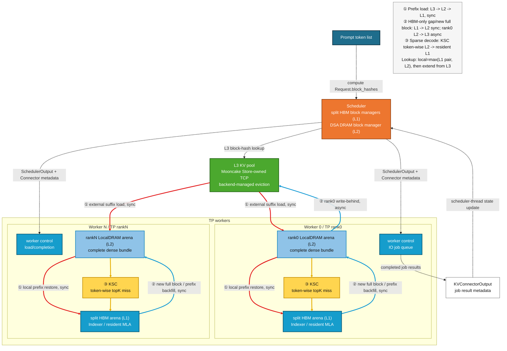

# 多级 KV 缓存详细设计

> 设计状态：当前complete-bundle、L1联合匹配及Store-owned TCP方案已确认并适配；任意component source mask、direct-HBM和layerwise async仍未定稿。
> 本文恢复原详细设计的对象、接口、时序、公式和示例，并以`b9d12863c2`的实际实现修正过期状态。

## 1. 阅读地图与当前路径

第2至5节定义边界、基础能力、不变量与key；第6至10节展开架构、admission、存取与完成回报；第11至18节说明地址、各执行阶段、失败/淘汰、后端和回填；第19至24节是配置、代码与设计验收。原第21节的特性状态归入路线图，逐轮运行证据归入工程经验，保留其余章节编号方便对照。

当前正式路径为L3→rank-local L2→HBM；单机DP各域TP0写、发生回载的各域TP读取。开启MTP时complete bundle必须包含proposer BF16 component。不要把历史AscendDirect样例或独立能力测试当作当前transport配置。

主要场景是同一实例内的长前缀重放、旧对话追加新prompt的部分前缀复用，以及约定单机DP域之间通过共享L3复用前缀。L2同时是active sparse decode的完整历史工作集，不能因“远端还有副本”就淘汰活跃请求的本地source。L3不接管逐token KSC miss，也不使请求跳过prefix后的PREFILL；P/D分离、跨机池化及直接构建sparse resident仍属于独立草案。

## 2. 目标与非目标

### 2.1 目标

1. 保留当前 scheduler-owned DSA L2 DRAM directory，不重新建立第二套本地
   block manager。
2. 新请求按唯一 `Request.block_hashes` 查询本地 L1 HBM pair、L2 complete
   bundle 与远端 L3。
3. 本地有效命中取 `max(HBM pair, L2 bundle)`；L3 只补充该最长本地前缀
   之后的连续 suffix。
4. TCP 首版将 L3-only suffix 恢复到各 rank 已注册的 L2，再复用现有
   L2->HBM restore；不为 TCP 另建 HBM staging 或第二套 read metadata。
5. prefill/decode 新 durable 满块完成同步 L1->L2 dump 后，由 TP rank0
   异步执行 L2->L3 write-behind。
6. 请求完成不等待 L3 put；块即将被复用时才使用基线风格 reuse fence。
7. eager 与 graph 共用相同 scheduler/worker 状态和最终 HBM block table；
   外部 IO 不进入 graph。
8. 当前Mooncake复用DSA控制面；未来MemCache等后端差异应封装在Backend层，
   不将候选后端写成当前已开放能力。
9. no-MTP 按完整 HBM pair 复用；MTP 按 target pair+MTP full-cache triple
   复用，并保留未来独立 component source mask 接口。

### 2.2 第一版非目标

- request preemption/resume；
- async scheduling；
- PP、DCP、PCP 与跨节点 TP；
- P/D 分离；
- L3 eviction policy 定制；
- L3 SSD tier；
- L3 load failure 后静默 recompute；
- 修改 Mooncake/MemCache 社区源码的淘汰算法。

## 3. 当前基线盘点

### 3.1 DSA L1/L2 已有能力

当前 target cache 具有三个不同的物理语义：

| 层级/平面 | 当前物理语义 | block id 空间 |
|---|---|---|
| HBM Indexer | 完整上下文 dense Indexer | 独立 pool |
| HBM resident MLA | prefill 时 dense；sparse decode 时 budget+tail | 独立 pool |
| rank-local DRAM | 完整 dense Indexer+MLA；MTP 时再含 BF16 full-cache | scheduler-owned 独立 pool |
| MTP HBM | BF16 full cache；active decode 不做 token-wise swap | 可选独立 pool |

`DSASchedulerDRAMBlockDirectory` 已经复用 vLLM `BlockPool` 的 null block、
refcount、hash map、free queue 和 LRU。scheduler 是 DRAM physical id、hash、
ready watermark 与 request->logical block 映射的唯一真源。

`DSAWorkerDRAMStore` 在每个 TP worker 创建相同容量、固定地址的
`empty_with_swapped_memory` arena，只镜像 scheduler assignment；worker 不分配
DRAM id。A5 GLM-5.2 一个逻辑 L2 block 当前包含：

```text
21 个 full Indexer layer:
    key bytes + scale bytes
78 个 target MLA layer:
    packed C8 [128, 1, 656]
no-MTP 总计 6,904,320 bytes / rank / logical block

MTP3 额外一个原生 BF16 full-cache layer:
    128 * (512 + 64 + 128) * 2 = 180,224 bytes
MTP complete bundle 总计 7,084,544 bytes / rank / logical block
```

本地 prefix cache 同时查询完整 L2 bundle 与 HBM。no-MTP 的 HBM 命中是
target Indexer+dense-MLA pair；MTP 的 HBM 命中是 target pair+MTP full-cache
triple。MTP L2 bundle 本身已经包含三 component，不再依赖原请求的 MTP HBM
副本才能恢复。

### 3.1.1 完整bundle的字节模型与固定预算

“完整bundle”是逻辑关联，不是把不同dtype物理拼成一个大tensor。同一个L2 ID索引各layer/plane的固定arena；worker不为L3临时pack payload，也不另设一套Indexer/MLA free-list。完整字节数由finalized spec计算：

```text
B = sum(group.page_size_bytes * len(group.layer_names))
    # target Indexer + target MLA + 启用耐久镜像时的MTP group
```

GLM-5.2 A5的Indexer为`21*(16,384+512)=354,816`字节，MLA为
`78*83,968=6,549,504`字节，合计`6,904,320`字节；MTP的三BF16 plane再增加
`180,224`字节，形成`7,084,544`字节的bundle。GLM-5.2 shared follower不重复分配Indexer
payload。MTP的L2耐久镜像在prefix caching或DSAL3Connector需要时启用；proposer active
decode仍使用full-HBM，不能由“full-HBM”推断其verified数据不进入L2。

EngineCore在worker创建L2 arena之前固化`DSADRAMCapacityPlan`。单机DP先取得共同内存快照，
再按各域自己的L1容量确定块数。定义：`D`为DP域数，`T`为每域TP数，`N_d`为本域HBM
Indexer块数，`m=hot_cpu_block_multiple`，`G/U`分别为每rank Mooncake global segment/local buffer字节数：

```text
M_d = min(host available, readable cgroup limit - usage)
M_node = min(M_d for every DP domain)       # 全域在任何L2分配前共同观测
Q = floor(M_node / D)                      # 每域等额字节配额，不是等额块数
A_d = Q - T * (G + U)                      # 当前TCP客户端后续要创建的Host内存
P_d = floor(A_d / T)
desired_d = ceil(N_d * m)
max_usable_d = floor(P_d / B) - 1           # 每个arena的block 0为空映射
usable_d = max(N_d, min(desired_d, max_usable_d))
arena_rows_d = usable_d + 1
per_rank_reserved_d = arena_rows_d * B
```

没有DSAL3Connector时上述L3预留为0。`max_usable_d < N_d`必须启动失败，不能执行最后一行
公式后超额分配；`A_d <= 0`同样失败。实际容量低于期望倍数可以由统一计划缩容并告警，
但worker分配失败不能各自悄悄缩容。容量还受int32 block-ID上限约束。

例如共同可用内存128 GiB、DP2/TP4、`G=4 GiB`、`U=1 GiB`、MTP bundle
`B=7,084,544`、本域`N_d=1000`、`m=2`时：每域配额64 GiB，扣除20 GiB后为44 GiB，
每rank可用11 GiB；`max_usable_d=1666`，所以分配1667行而不是期望的2001行。
每rank实际预留`11,809,934,848`字节，包含null行。此为预算算例，不是设备容量承诺。

当前代码兼顾常见cgroup v1/v2余量，读取失败时回退Host available，不是对任意容器/NUMA隔离的
完整资源保证。DP还检查共同Host boot identity、bundle字节数、TP规模和配置签名；各域
`N_d`可不同，L2目录与block ID仍各自独立。worker注册完arena后校验实际bundle字节数与计划一致，
不能把整机可用内存重复算给每个worker。跨机或NUMA独立配额不能套用本公式冒充已支持。

### 3.1.2 目录API与三个不同的水位

当前`DSASchedulerDRAMBlockDirectory`组合原生`BlockPool`，不与任何HBM pool共用实例：

| API | 返回或提交内容 | 不代表什么 |
|---|---|---|
| `ensure_request_blocks(request_id, logical_block_count)` | 连续扩表，返回`(start, new_physical_ids)` | 分配成功不代表payload ready；请求释放前不允许缩表 |
| `find_longest_cache_hit(block_hashes, max_length)` | 从block 0起的连续候选，遇miss停止 | 查询不touch，不占引用 |
| `can_attach_cached_prefix(blocks, new_block_count=...)` | 检查零引用hit和新增块共同消耗的free queue | 不能只检查新增suffix是否放得下 |
| `attach_cached_prefix(request_id, blocks)` | 全池admission成功后touch并绑定L2命中 | 不是worker自行选择source |
| `mark_ready_prefix(request, ready_block_count)` | 成功forward后发布新增完整hash | 水位不能倒退、越过已分配表或已有hash长度 |
| `take_unpublished_assignment(request_id)` | 返回尚未投影给worker的连续后缀 | metadata已下发不代表dump完成 |
| `free_request(request_id)` | 释放请求引用，ready块保留hash进入LRU | 不物理清零payload，也不替代L3 reuse fence |

必须区分“已分配长度”“已投影给worker长度”“完整durable ready长度”。L3还有独立的
planned/submitted/completed账本，不能用`num_computed_tokens`或assignment长度代替远端ready。
worker镜像允许多个active request row引用同一个physical block，维护active refcount而非唯一owner row。

### 3.2 当前 HBM target prefix 限制

启用 prefix caching 后，target Indexer、dense resident MLA 与可选 MTP group
均可发布 hash。resident MLA 同时容纳以下角色，因此只有 PREFILL/DENSE 表中的
块能够发布，ENTER 后的 budget/tail 永不发布：

```text
dense prefix block      有文本前缀语义
sparse budget block     无文本前缀语义
KSC resident slots      无连续前缀语义
tail/provisional block  未完全 durable
```

完整 HBM pair/triple 与 L2 分别查最长前缀，取较长者；单 component HBM
source mask 仍是后续优化项。

### 3.3 vLLM Connector 与 OffloadingConnector 可复用能力

vLLM v0.23 已经提供：

- `KVConnectorOutput` worker->scheduler 输出；
- `Scheduler.update_from_output()` 单线程更新入口；
- `kv_connector_worker_meta` 跨 TP 聚合；
- `kv_connector_no_forward()` 零 token control step；
- `OffloadingConnector` 的 job id、异步 store/load、完成回报；
- `_block_id_to_pending_jobs` 与 `jobs_to_flush` block-reuse fence；
- request finish 后 pending store 不阻塞客户端响应；
- `OffloadingManager.prepare/complete_store/load` 生命周期；
- worker `TransferResult(job_id, success, bytes, time, type)`。

这些结构应作为 DSA L3 的异步生命周期骨架。DSA 不应新建 scheduler 接收
线程，也不应使用独立 RPC 直接修改 scheduler BlockPool。

不能直接原样使用通用 `OffloadingConnector` 的原因是：

- 它的 store source 是普通 GPU/HBM block table；
- DSA sparse decode 的 resident block table 是 budget+tail，不再对应完整
  logical context；
- DSA 完整 source 位于自定义 rank-local DRAM arena；
- DSA 的 Indexer/MLA physical pool 容量和 block id 不同；
- DSA L2 一个 physical id 对应两个、MTP时三个 L3 component；
- TP rank0-only store 的完成计数不是 `world_size`。

因此实现应复用 Connector/job 模型，但使用 DSA-specific scheduler/worker
schema adapter。

### 3.4 后端能力与设计边界

当前正式路径是Store-owned TCP访问真实swapped Host L2。单卡、同卡组或HBM direct通过，不能外推任意NUMA Host H2H可用；第18节给出当前选路矩阵，历次排查的证据与方法见[工程经验](../engineering/diagnostics_and_lessons.md)。

### 3.5 vLLM、vLLM-Ascend 与 DSA 的复用边界

当前实现不是让 `DSAL3Connector` 与 `AscendStoreConnector` 同时运行，而是按
职责做三层组合：

| 层次 | 复用内容 | 当前所有者 |
|---|---|---|
| vLLM Connector 规范 | Factory、`KVConnectorBase_V1`、scheduler metadata、worker hooks、`KVConnectorOutput` 聚合、shutdown | vLLM |
| Ascend L3 数据面 | `Backend`、Mooncake Store-owned TCP；可选 GlobalTE/HIXL AscendDirect | vLLM-Ascend |
| DSA 策略适配 | split schema/key、scheduler-owned L2 IDs、rank0-only store、dump event、reuse fence | DSA |

`AscendStoreConnector` 本身同样继承 vLLM `KVConnectorBase_V1`，因此
vLLM-Ascend 并未抛弃 vLLM 生命周期；它是在接口内部增加
`KVPoolScheduler/KVPoolWorker/Backend`。DSA 也应遵循同一个外层接口，但不能
直接复用两类 pool 对象，因为它们假定 store source 是普通 HBM block table、
各 group block identity 可按基线解释，并按 worker/rank 保存。DSA 的 durable
source 则是完整 LocalDRAM bundle，resident HBM 是 budget+tail，且首版只允许
rank0 写。强行套用会把错误的 HBM block 语义隐藏在“复用”名义下。

因此当前选择是组合 `MooncakeBackend`，而不是复制 Mooncake/HIXL 实现，也不是
继承后覆盖大部分 `AscendStoreConnector`。同一进程只配置一个 connector；DSA
配置校验拒绝 `AscendStoreConnector`、`MultiConnector` 等并行组合，避免双
scheduler 状态机和重复注册。

对 vLLM-Ascend 公共模块的修改限制为可独立回归的通用增强：GlobalTE 增量幂等
注册/解注册、Mooncake put 返回原始逐 key 结果、显式 close。未来若
AscendStore 抽象出可插拔 source schema、rank policy 和成功结果合同，DSA
应继续下沉复用这些公共能力，使 `DSAL3Connector` 收敛为薄策略层。

### 3.6 基线offloader、connector与tiering的区别

下面是整编所用vLLM v0.23及Ascend基线的职责对照，不是对外部项目最新版或A5支持范围的认证。
不能把类已经注册、Host API可调用、或普通模型能外部命中，等同于DSA complete-bundle已经适配。

| 组件 | 数据与生命周期 | 与DSA的边界 |
|---|---|---|
| `SimpleCPUOffloadConnector` | HBM与pinned CPU镜像；scheduler控制hash/LRU/refcount，支持多group与eager/lazy保存 | Ascend版本复用`SimpleCPUOffloadScheduler`，用`aclrtMemcpyBatchAsync`及NPU stream/event；普通HBM块镜像不是KSC的完整逻辑历史 |
| `OffloadingConnector + CPUOffloadingSpec` | 通用异步job/handler入口；`CPUOffloadingManager`提供LRU/ARC及prepare/complete事务 | 可参考生命周期，不能原样解释DSA多pool与L2 bundle |
| `NPUOffloadingSpec` | NPU D2H/H2D handler，普通K/V CPU mirror，假设统一block size | 未表达DSA split-pool容量、component与durable合同；不能只替换copy函数就接入 |
| `RecomputeCPUOffloadConnector` | P/D Decode抢占前保存、resume后恢复，CPU不足走基线recompute；实验性hash sharing，处理sliding-window null与MTP lookahead裁剪 | 是恢复协议参考，不是通用L2 prefix pool；DSA当前仍拒绝preemption |
| 旧`CPUOffloadingConnector` | 源码残留的旧实现 | 当前Ascend注册入口没有注册它，不能作为可配置能力 |
| `AscendStoreConnector` | scheduler lookup、HBM注册、scatter-gather put/get、KV events与HMA；普通路径L3直接恢复到HBM | 复用Backend，不能让其标准block table取代DSA directory |
| `LMCacheAscendConnector` | Ascend包导入`lmcache_ascend`并导出上游`LMCacheConnectorV1`；实际CPU/NPU与remote数据面在外部包 | 此vLLM wrapper未声明`SupportsHMA`，不能绕过多group检查后就声称支持DSA三组件；其Mooncake注册L2模式见17.1 |
| `UCMConnector` | UCM内部DRAM cache通向Posix/NFS/3FS，含PipelineStore | 内部DRAM归UCM所有，未向DSA KSC提供固定arena所有权 |
| Mooncake P2P家族 | `MooncakeConnectorV1`做P/D bulk，`MooncakeLayerwiseConnector`做逐层传输，`MooncakeHybridConnector`处理hybrid/compressed cache | 是实例间传输，不是持久内容寻址L3对象池 |

真正的上游`TieringOffloadingManager`以CPU primary作为所有secondary的gateway：

```text
HBM -> CPU primary -> 所有secondary（cascade）
secondary hit -> CPU primary（promotion）-> HBM
primary.prepare_read() -> refcount保护 -> complete_read()
lookup()返回None：promotion尚在进行，scheduler后续重试；不是永久miss
```

`TieringOffloadingSpec`组合`CPUPrimaryTierOffloadingManager`与`fs`、`obj`或示例secondary。
FS使用Python线程文件IO，object tier使用NIXL和S3兼容存储。其共享mmap通常为
`/dev/shm/vllm_offload_<instance>.mmap`，每行按`rank0 payload | rank1 payload | ...`
排列，secondary取得`[num_blocks, complete_block_bytes]`的零拷贝memoryview。
这可参考“一个逻辑块覆盖多个rank”的控制语义，但DSA仍是各worker独立swapped arena，
不能把mmap行布局直接覆盖进来；本项目没有把上游NPU tiering整体接入。

`MultiConnector`则是组合多个独立connector：load选择第一个提供额外命中的connector，
save可广播。它不会自动把SimpleCPU块级联给AscendStore；两个保存目标往往分别从HBM读取。
同样，Mooncake DRAM+SSD、MemCache DRAM/L2.5/SSD、UCM DRAM+文件系统的内部冷热迁移，
都不等于框架拥有其DRAM block ID，更不等于可把该地址交给KSC。

基线AscendStore非layerwise key按model、parallel identity、group、cache role/family和
block hash区分；value是该group各层的地址/大小列表，layerwise再增加layer identity。
backend本身没有强迫Indexer和MLA绑定。基线普通模型路径还可能跳过
`DeepseekV32IndexerCache`独立KV spec，DSA则显式注册`DSAIndexerKVSpec`；所以普通模型
AscendStore命中不能证明DSA Indexer已保存。DSA各spec均可继承`FullAttentionSpec`，
也不能仅凭“存在非FullAttentionSpec”判断多group，更不能用全局N解释各自容量不同的pool。

DSA不整体包装成“sparse decode connector”：cache spec、请求阶段、allocator、LIDU/KSC/SFA
和双尾仍由DSA核心管理；外层`DSAL3Connector`只桥接传输生命周期。DSA关闭时不创建DSA
directory/adapter，不改变普通connector的key、cache config和IO流程。

## 4. 不变量

### 4.1 唯一 token identity

所有层级继续使用 vLLM 创建的唯一 `Request.block_hashes`。DSA 不重新计算
token hash，不按 request id 建 L3 identity。

复用的是原生整条hash链，包括parent hash、当前完整block token IDs及基线纳入的
multimodal hash/offset、LoRA identity、cache salt、prompt-embeds identity等附加信息。
不能重新只hash文本token，否则不同上下文或适配器可能错误复用。L3的模型revision、量化layout、
TP兼容语义与component schema指纹是另一层隔离，不能代替请求hash链。

### 4.2 logical block 与 physical id

```text
logical block index  请求完整上下文中的第几个 128-token block
L1 physical id       Indexer/MLA/MTP 各自 pool 内编号
L2 physical id       完整 DSA bundle 的 rank-local arena 行
L3 key               内容寻址 key，不等于任何 L1/L2 physical id
```

### 4.3 durable 规则

只有以下 token 可以写入 L2/L3 prefix cache：

- 已完成 target forward；
- 开启MTP时，已通过target verification；
- 位于完整 block；
- 对应 Indexer、MLA，以及启用时的 MTP BF16 payload 都已完成；
- scheduler 已拥有该 logical block 的 block hash。

不满尾块和 MTP provisional token 不得发布 L2/L3 key。

### 4.4 scheduler 单线程真源

所有 physical-id reuse、job state、remote-ready、failure 和 prefix lookup
结果只在 scheduler 主线程更新。worker 后台线程只能向本地 completion queue
写结果，不能回调或直接修改 scheduler 对象。

## 5. L3 对象与 key schema

### 5.1 component 拆分

每个 token block 在 L3 使用两个或三个对象：

```text
INDEXER component -> 所有 full Indexer layer 的 key/scale plane
MLA component     -> 所有 target MLA layer 的 dense packed plane
MTP component     -> 可选；所有 MTP layer 的原生 BF16 MLA+Indexer planes
```

no-MTP 要求前两个 component 均 ready；MTP 要求三个 component 均 ready。

拆分的理由：

- Indexer/MLA 在 HBM 已是独立物理池；
- 未来允许两个 component 从不同层级恢复；
- component失败可独立定位，为后续重试策略保留边界；当前按job明确回报，不承诺独立自动重试协议；
- 避免将 L3 ABI 锁死为当前 L2 bundle；
- GLM-5.2 只保存 21 个 full Indexer，不为 shared follower padding。

### 5.2 key 必备字段

L3 key 至少包含：

```text
namespace/version
model identity
quant/cache format
block size
component
schema fingerprint
request block hash
```

实际key由`DSAL3KeySchema.component_key()`生成；model、format和block等语义编码在fingerprint内，不逐项展开在key字面上：

```text
vllm-ascend:dsa-l3:v1:<fingerprint>:indexer:<block_hash_hex>
vllm-ascend:dsa-l3:v1:<fingerprint>:mla:<block_hash_hex>
vllm-ascend:dsa-l3:v1:<fingerprint>:mtp:<block_hash_hex>
```

schema fingerprint 应覆盖：

- full Indexer layer id 顺序；
- MLA layer id 顺序；
- 可选 MTP layer id 与原生 BF16 plane 顺序；
- 每个 plane dtype、byte size 和顺序；
- packed/非 packed 模式；
- Indexer shared topology；
- TP replica/shard 语义。

当前`DSAL3KeySchema.from_config()`还纳入target model/config hash、TP规模，以及启用MTP时
独立proposer模型身份和A5 target attention语义。TP规模属于兼容性，不是writer rank。
旧MTP候选语义不能沿用当前namespace；无MTP规则不因增加MTP支持而任意变更。

不能直接复用 DSA-disabled AscendStore key。当前 A5 GLM-5.2 的基线 HBM
对象约为 12,189,696 bytes/block，而 DSA packed-C8 L2 对象为
6,904,320 bytes/block，二者 payload ABI 不同。

### 5.3 TP identity

GLM/DeepSeek MLA 与 Indexer target payload 当前按 TP 副本处理：

- L2：每个 rank 保留本地副本；
- L2->L3：初版只由 TP rank0 上传一份；
- L3->HBM：每个 rank 分别加载到自己的 HBM block；
- key 不包含 TP rank。

因此 L3 中每个 `(schema fingerprint, component, block hash)` 只有一个逻辑对象，
不会像 L2/HBM 那样按 TP rank 保存八份。所有 rank 的 segment 组成一个容量池，
Mooncake 只为该 key 选择一个物理落点；当前 `ReplicateConfig()` 没有请求额外
框架副本。P1-R 的 all-rank get 是从同一池化对象向 8 个 rank-local L2 做读出
扇出，重复的是网络读流量和 L2/HBM 副本，不是 L3 存储对象。若 Mooncake 未来
启用自身容灾副本，那属于 backend-managed replication，不改变 DSA key 数量。

Mooncake 的“贡献池容量”和“写入 DSA 副本”是两个独立维度，不能都按
rank0-only 处理。当前 vLLM-Ascend AscendStore 采用 Mooncake 内嵌 client
模式：每个 TP worker 都以 `contribute_memory=True` 创建 backend，并向全局池
挂载一段 `global_segment_size`；只有 scheduler 查询客户端使用
`contribute_memory=False`。因此单机 TP8 配置每 rank 4 GiB 时，名义全局池容量
为 32 GiB，而不是 4 GiB。

DSA 应按同一基线范式划分角色：

- 所有 TP rank：创建可贡献存储的 Mooncake backend/TransferEngine，将各自的
  segment 汇入全局池，注册本rank固定L2 source/destination；当前不要求direct-HBM注册；
- TP rank0：作为当前副本型 Indexer/MLA payload 的唯一 producer，发起一次
  L2->L3 put，避免把相同 KV 数据按 TP 数重复写入；Mooncake Master 可把该次
  put 的对象分配到任一可用 segment；
- 其他 TP rank：不重复发起相同 put，但其贡献的 segment 仍是池容量的一部分，
  并在 load 时从全局池读取到自己的 HBM；
- scheduler：只拥有 lookup/admission 决策。远端 exists 可沿用 AscendStore 的
  控制面查询范式；当前DSA使用不贡献segment的scheduler client，不能让所有rank重复查询同一组key；
- store completion 的 expected producer count 为 1，load completion 的
  expected worker count 为参与 TP load 的 rank 数。

Mooncake 也支持“每个 rank 为 dummy client、每个推理实例仅一个 real client
贡献整机内存”的部署方式，但这要求单独的 dummy-real/store-service 架构，
不是当前 vLLM-Ascend AscendStore backend 的执行方式。P1-W 初版曾只有 TP0
初始化 Mooncake，会把名义池容量从 `TP * per_rank_segment` 缩成一个 rank 的
segment；现已改为 all-rank segment contribution、rank0-only put。P1-W 验收
必须同时检查每个 rank 的 backend 初始化日志和唯一 producer 的 store 日志。

Host/Device transport诊断和staging尝试不作为本文部署合同，统一见[工程经验](../engineering/diagnostics_and_lessons.md)。

单机DP时，每个域自己的TP0都是producer，发生回载的域在本域TP组内汇总成功，不增加EP级IO
collective。同一key可能被两个域并发尝试上传，因此rank0-only表示每域不重复写TP副本，不是
全服务只有一个writer。内容key不含具体DP/rank，segment连接身份却必须能区分各worker与服务实例。
TP副本语义来自模型投影结构，但扩展模型/量化/拓扑前仍须逐字节比较packed MLA、Indexer key/scale
和MTP BF16 payload；不能把“数学上是副本”当成字节ABI已验收。

## 6. 总体架构



图中虚线是 scheduler/worker/L3 lookup 的控制信息，红、蓝、黄实线分别对应
① prefix load、② full-block 下沉/backfill、③ decode KSC miss IO。当前外部
prefix 固定走 `L3 -> L2 -> L1`。蓝色 `L1 -> L2` 既承载每个 chunk 的新满块，
也承载 HBM pair 比 L2 更长时，首个 prefix-suffix chunk 对 L2 缺口的回填；
`L2 -> L3` 初版只有 rank0 提交。direct-HBM 不属于当前正确性合同。

## 7. Prefix lookup 与 load path

### 7.1 当前同步load顺序

1. DSA `get_computed_blocks()` 分别查询 L2 完整 bundle 与 L1 成对
   Indexer+dense-MLA 的最长连续 prefix。
2. 本地有效命中取`max(l2_blocks, hbm_pair_blocks)`，先保留零引用候选；
   HBM pair/triple在admission全部预检成功后的提交阶段才touch为新表前段。
3. vLLM 基线继续调用 Connector，L3 只查询最长本地命中之后的 suffix。
4. Indexer/MLA L3 component hit 取公共连续前缀。
5. scheduler 为 HBM-only L2 缺口、L3 suffix 和本轮 compute 一次分配完整 L2
   bundle，并同时完成 split HBM admission。
6. Connector metadata 携带 L3 component keys 与每 rank local L2 destination。
7. all-rank worker 在 forward 前用 Store-owned TCP 将 L3 suffix 写入各自 L2，
   再把 HBM 尚未覆盖的部分执行 `L2 -> HBM` restore。
8. 若 `hbm_pair_blocks > l2_blocks`，worker durable 水位保持在旧 L2 边界，
   不跨过尚未物化的缺口；首个 prefill forward 的既有 dump 将该缺口与本轮
   新满块一起同步补齐。
9. Worker 在完整 dump/epoch 条件满足后即可放行预先规划的 rank0 store；后台
   put 还须等待模型流上的 ready event。MTP 必须等 proposer 完成才放行，
   这一时刻可以早于 model output 返回 scheduler；scheduler 收到成功 output
   后才推进可供其他请求查询的完整 L2 ready/hash。两种发布边界不可混为一谈。
10. 任一 rank/component load 失败则 fail-fast，不发布 L2 hash。

这里的 `enable_prefix_caching=True` 是当前 vLLM 公共入口，同时启用 DSA L1
target hash 与 L2 directory 的 hash/refcount/restore。no-MTP 使用完整 HBM
pair；固定 MTP3 使用完整 HBM triple 和三 component bundle。两者都暂不支持
Indexer-only/MLA-only source mask。

### 7.2 为什么 TCP 第一版选择 L3->L2->HBM

优点：

- 对齐已通过的 Store-owned TCP swapped Host 数据面；
- 对齐 LMCache 的“注册固定 L2，get into 预分配 L2”模式；
- 不要求 TCP transport 识别或直接写 NPU HBM；
- L3 suffix 在 forward 前已经成为完整 L2 bundle，可直接供后续 KSC、prefix
  reuse 与 L2 eviction 使用；
- 已在 HBM 的成对 prefix 不重复执行 L2->HBM restore；若它比 L2 更长，
  首个 prefill forward 才用既有 dump 补齐缺失的 L2 bundle。

代价：

- scheduler 必须联合预留 L2 bundle 与 split HBM blocks；
- pending L3 load 期间 L2 destination 不可被复用；
- all-rank get 完成后才能原子发布完整 durable bundle 公共前缀；
- 初版必须 fail-fast，不能静默 recompute。

### 7.3 Direct-HBM边界与不能省略的L2 backing

AscendDirect 修复跨 NUMA Host H2H、或未来后端能可靠直接写 split HBM 后，可在
不改变 lookup/schema 的前提下增加 direct destination capability。它必须复用同一
scheduler source plan，不能另建一套 eager/graph metadata。该优化保留给：

- 非DSA或另行明确了backing的consumer；当前DSA Decode不能假设不需要完整L2；
- 大容量只读 prefix；
- 已证明 direct load 后无需立刻物化 L2 的场景。

当前目标A5依赖组合没有通过同一transport同时满足任意Host L2池化和direct-HBM的门禁，
正式数据面固定使用`L3 -> L2 -> HBM`。保留的direct字段/代码分支不表示配置已放行。
详细候选流程见[执行与恢复草案](../proposals/execution_and_recovery.md)，不能因目标consumer是PD就豁免L2不变量。

### 7.4 Layerwise接口与当前同步边界

vLLM-Ascend 基线 `AscendStoreConnector` 已提供 `use_layerwise`、`load_async`、
`num_prefetch_layers` 和 attention-side `wait_for_layer_load()`：worker 为每层构造
transfer task，提前提交后续层，并在该层 attention 前等待完成。

P1-R 暂不直接复用，原因是 DSA 当前每个 block 只有一个跨层 Indexer key 和一个
跨层 MLA key，Mooncake object 分别包含 42/78 个 plane descriptor；本地
`L2 -> HBM` restore 也在 prefill 前一次遍历全部 target layer。仅打开基线开关
无法得到可靠的逐层完成事件，还会让 eager/graph 合同变得含糊。

逐层readiness、schema演进和预取窗口仍需独立设计，候选方案归入
[执行与恢复草案](../proposals/execution_and_recovery.md)。本页只冻结同步合同，不把基线
`use_layerwise/load_async`开关或attention hook的存在当成DSA已适配。

### 7.5 Prefix仍经过PREFILL，不直接进入sparse

命中很长的prefix不改变请求阶段。进入`ENTER_SPARSE_DECODE`必须同时满足：

```text
request.num_output_tokens > 0
computed_tokens >= request.num_prompt_tokens
logical_context_tokens > sparse_activation_tokens
```

因此时序是`lookup/load -> PREFILL补末尾prompt/对齐块并取得logits -> 采样首output ->
下一forward才可能ENTER`。即使只剩1个token的首个forward也仍是PREFILL；MTP还需重建
drafting边界。部分命中加新prompt suffix使用完整dense历史恢复和现有prefill路径，
不是已经实现offload-aware sparse prefill。准入必须满足该dense阶段的HBM需求，不能只按最终
resident budget估算“有L2就一定能接纳”。

## 8. DSA allocator 改造

当前 `allocate_dsa_slots()` 仍显式拒绝：

```text
delay_cache_blocks
reserved_blocks
```

P1 只开放同步 L3 load：

- `num_external_computed_tokens > 0`；
- `delay_cache_blocks=False`；
- `reserved_blocks=0`；
- `load_async=False`。

planner使用本轮唯一pending prefix plan的长度，不从HBM/L2/L3各自再累加一次：

```text
request.num_computed_tokens
+ local_computed_tokens       # 已取较长的HBM pair/triple或L2，不只是L2 hit
+ external_l3_hit_tokens
```

HBM分配覆盖全部local+external前缀，已命中HBM块直接复用，其余范围由统一restore从L2写入。
Connector先把external suffix写入L2；HBM-only范围另行backfill。不能把local hit一律
当作HBM块，也不能一律当作L2；必须消费pending plan的component块列表及实际来源。

admission 必须在任何 pool 修改前同时检查：

- HBM Indexer；
- HBM resident MLA；
- 当前请求后续 full sequence reservation；
- 可选 MTP HBM；
- L2 logical directory 容量。

### 8.1 查询到恢复的事务合同

1. `prepare_prefix_cache_hit()`只构造`DSAPrefixCacheHitPlan`，L2/HBM查询均不因lookup自动
   持有新引用；`prepare_external_prefix_cache_hit()`将连续外部suffix并入同一个候选。
2. 全组件容量预检成功后，先保护命中的HBM pair/triple，再分配其余HBM块；
   `commit_prefix_cache_hit()`校验plan长度、component块列表和实际table一致，touch L2 hit，
   再分配HBM-only gap、external suffix与本轮需要的L2行。不得在touch前复用命中块。
3. L2 free-queue预检必须满足`zero_ref_hit_count + new_block_count <= free_count`。
   cached hit原本就在free queue中，touch后它不再可用；只检查new blocks会透支容量。
4. 同轮输出`DSAExternalPrefixLoadPlan`及`DSADRAMBlockRestore`，各component的目的HBM ID
   独立，source L2 ID共享；worker不得再查hash、选择tier或根据row长度重建计划。
5. worker先flush可能覆盖source的旧job，再在pre-update hook同步执行`L3 -> L2`；
   本域TP成功汇总后，才进入基线`_update_states()`、应用最终行序assignment及`L2 -> HBM`恢复。
   restore使用worker-lifetime固定ID buffer和当前NPU stream，在forward/replay前完成。
6. 完整layer/plane就绪后才推进durable/hash；HBM-only gap按18.2补齐。最终模型仅消费统一HBM
   block table，不为eager/graph复制一套恢复元数据。

该事务依赖当前scheduler单线程、同步调度及phase barrier，查询与提交之间没有任意并发allocator。
它不等于已实现异步scheduler、mixed阶段任意并行或失败后的跨rank回滚；这些能力仍不能解除配置拒绝。

## 9. 异步 L2->L3 write-behind

### 9.1 触发点

scheduler 在构造本轮 DSA projection 时已经知道 forward 成功后将推进到的
durable full-block watermark。它可以生成本轮尚未远端发布的：

```text
logical block index
L2 physical block id
block hash
INDEXER/MLA/可选 MTP component key
job id
```

任务随同一次 forward 的 Connector metadata 下发。worker 不得在 dump 之前
读取 L2。

这里存在一个明确的基线时序差异：vLLM `Scheduler.schedule()` 会在
`_update_after_schedule()` 和返回之前调用 Connector `build_connector_meta()`；
当前 DSA DRAM assignment/projection 则在 `super().schedule()` 返回后，由
`DSAOffloadScheduler._attach_dsa_cache_layout()` 生成。普通 Connector metadata
因此天然看不到同轮新增的 L2 physical ids。

当前已增加只对DSA connector生效的类型化后置扩展：

```text
base Scheduler.schedule()
    -> base connector metadata
    -> DSA projection / DRAM assignment
    -> dsa_connector.extend_dsa_store_jobs(
           scheduler_output=output, projection=projection,
           coordinator=coordinator, requests=requests)
    -> return final SchedulerOutput
```

该钩子同时把新分配/复用的 L2 physical ids 交给 reuse-fence 逻辑。不能只在
下一轮普通 `build_connector_meta()` 中扫描，因为最后一个 forward 之后可能只有
zero-token control step；也不能让 worker 根据 row 长度自行推导 store job。

### 9.2 worker 提交时序

no-MTP 的 target Indexer/MLA 都在 target forward 内完成 dump，因此可在
post-forward `get_finished()` 中直接记录 event 并提交异步 put。MTP 的第三个
component 由后续 proposer 写入，必须使用两阶段发布：

```text
target forward 完成 Indexer/MLA dump
    -> 基线 Connector context 退出并调用 get_finished()
    -> DSAL3Connector 只 stage 本轮 store jobs，不记录 ready event
    -> MTP proposer 写 cache，并完成 MTP HBM -> L2 dump
    -> runtime 校验所有 MTP layer 已完成当前 forward epoch
    -> finalize_kv_connector() 调用 wait_for_save()
    -> release staged jobs，记录 dump-ready event
    -> rank0 后台执行 L2 -> L3 put
```

vLLM 基线的 `defer_finalize=True` 只延后 `wait_for_save()` 和 metadata clear，
不会延后 `get_finished()`。因此不得在 MTP 路径的 `get_finished()` 中直接
提交当前 store job，否则 event 位于 proposer dump 之前，会把陈旧 MTP L2
payload 发布到 L3。zero-token Connector progress step 没有 attention forward，
其 job 已有 durable backing，仍可立即提交。上传保持异步，不在当前 token
generation 尾部执行同步 `join()`。

### 9.3 block reuse fence

复核 vLLM 基线后，第一选择不是长期增加 transfer ref，而是复用
`_block_id_to_pending_jobs + jobs_to_flush`：

1. pending job 记录它正在读取的 L2 physical block ids；
2. request finish 可以正常释放自己的 L2 refs；
3. block 可进入 L2 cached free queue，不长期减少可用容量；
4. scheduler 若再次分配同一个 physical id，先把关联 job id 放入
   `jobs_to_flush`；
5. worker 在应用新 assignment、执行任何 overwrite 之前等待这些 job 完成；
6. put 完成后再允许新请求覆盖该 L2 block。

该机制只在真实复用压力出现时等待相关job，不在request finish全量等待，也不以永久pin
占住所有已完成请求的块。Active request的正常引用仍必须保留，二者不能混为一谈。

### 9.4 request finish

request finish 不调用 `join()`，客户端响应不等待 L3。pending job 只保留：

- job metadata；
- old hash/component keys；
- source physical ids；
- reuse fence。

请求对象不再是 L3 object 的身份。所有请求完成但仍有 pending job 时，Connector
通过 `has_pending_transfers()` 让 `DSAOffloadScheduler.has_requests()` 保持为真，
复用 vLLM 的 zero-token connector progress step 收集 completion。客户端响应不
等待该 control step；但 EngineCore shutdown 必须等 pending job 清零后，才能
关闭各 TP rank 贡献的 Mooncake segment，避免 rank0 put 访问已退出的远端
segment owner。DSA L3要求明确的EngineCore drain timeout，示例用300秒上限；这与
原生worker终止窗口不是同一个计时器。当前worker侧仍可能按原生4秒+4秒策略升级终止，
不能把增大drain timeout说成已解决native退出。离线demo显式关闭engine core，
全域drain后还要取得全TP region注销/backend关闭回执，再进入原生进程退出。

## 10. job 与状态机

### 10.1 scheduler job

```text
job_id（异步 STORE）
direction: LOAD / STORE
request_id（诊断与 load resume 使用）
block_hashes
components
source/destination block ids
expected_worker_acks
status
bytes
```

store job 的 `expected_worker_acks=1`，因为只有 rank0 写。P1-R load 是随本轮
metadata 下发的 request-scoped 同步任务：所有 TP worker 在 pre-update hook 中
完成 get，任一 worker 抛错都会让整次 execute-model RPC fail-fast，因此首版不再
额外维护异步 ack 计数。P2 若改为异步 load，再增加 all-rank completion 聚合。

### 10.2 状态

```text
STORE_PLANNED（可随本轮dump预先规划）
  -> WORKER_STORE_STAGED（需要等待proposer时）
  -> STORE_SUBMITTED（记录ready event）
  -> 后台等待event、put与完整可读确认 -> success: REMOTE_READY
                                    -> failure: STORE_FAILED

model output成功 -> scheduler提交L2 ready/hash（独立的本地复用边界）

LOOKUP_CANDIDATE -> LOAD_PLANNED -> LOAD_SUBMITTED -> success: LOAD_COMPLETE
                                                -> failure: LOAD_FAILED
```

远端状态以 `(schema namespace, component, block hash)` 为身份；在飞 source
保护以 `(physical block id, generation/hash, job id)` 为身份。迟到事件必须同时
匹配 job id 和旧 hash，不能只凭可复用的 block id 更新状态。

### 10.3 完成回报

worker 后台线程完成阻塞式 Backend `put` 后，将结果写入本地线程安全队列。
worker 主线程在正常或 zero-token Connector `get_finished()` 中清空队列，生成
`KVConnectorOutput.kv_connector_worker_meta`。scheduler 在
`connector.update_connector_output()` 中消费。

P1-W 验收期间 scheduler 与 TP0 worker 分别维护 planned/submitted/finished/
failed/bytes 计数，并在 shutdown 打印汇总。普通 poll 与 reuse/shutdown flush
必须共用同一 completion 记录函数，避免“future 已完成但无 completed 日志”。
scheduler shutdown 若仍有 unacknowledged job 必须失败，不能清空账本后静默退出。
DSA L3 模块复用 `vllm.logger.logger`，与当前大多数 vLLM-Ascend 热路径一致；不能
使用只落到 `vllm_ascend` file handler 的独立 logger 后再凭 console 判断状态。

P1-R `get` 在 `model_runner._update_states()` 之前同步执行。成功后同轮 projection
应用 L2 assignment 并调用既有 prefix restore；失败则在任何 HBM forward/graph
replay 前抛错。该顺序复用 Connector 的 pre-update `handle_preemptions(metadata)`
hook，因为标准 `start_load_kv()` 晚于 `_update_states()`，不能满足
`L3 -> L2 -> HBM` 的依赖关系。

不创建 scheduler 接收线程；即使未来增加 IPC receiver，receiver 也只能入队，
不能直接修改 BlockPool。

### 10.4 当前基线缺口

适配时识别到的基线差异包括以下几类，不能原样当作DSA成功协议；本分支已在相应adapter/connector边界处理：

- AscendStore `completed_events` 只有计数，没有 success/error；
- AscendStore sending thread 在 `finally` 中也标记 event 完成；
- 旧Backend put缺少可验证逐key结果；当前Mooncake路径已保留并验证原始返回值；
- upstream `OffloadingConnectorWorker` 当前对 `TransferResult.success=False`
  直接 assert；
- `pending_count` 默认使用 world size，不适合 rank0-only store；
- AscendStore 非 layerwise `wait_for_save()` 会 `request_queue.join()`。

当前`DSAL3JobResult`携带job_id、success、transferred_bytes、error及retryable等信息，
不能把“线程结束”当作“远端发布成功”，也不把设计示意字段误称为实际dataclass字段。

## 11. worker 地址映射与 buffer registration

### 11.1 DSA L2 component view

`DSAWorkerDRAMStore`通过`get_l3_registration_regions()`和`build_l3_component_payload()`等只读地址API，按L2 physical ids生成：

```text
Indexer: keys, list[list[address]], list[list[size]]
MLA:     keys, list[list[address]], list[list[size]]
```

地址来自初始化期固定 arena；热路径不 `.contiguous()`、不创建 tensor、不重新
组织 payload。

Indexer、MLA以及启用时的MTP每个component仍包含多个plane。绑定backend时逐component核对
worker与schema的plane数及bytes/block；不只检查整个bundle总字节数相等。

本地restore复用`copy_full_cache_plane_bytes()`及其通用`KvCacheFullBlockDumpBytes`
opaque-byte copy路径，把source/destination反向用于swapped DRAM→HBM。它不做dtype转换，
也不要求Indexer与MLA目的ID相同。`runtime._execute_prefix_restore_jobs()`逐注册layer/plane
消费固定ID切片，再恢复所有MTP plane；不采用通用Recompute worker的Python block×tensor
`Tensor.copy_`循环来代替DSA split-pool映射。

### 11.2 registration 顺序问题

Mooncake `GlobalTE.register_buffer()` 已从单个 `is_register_buffer` 改为增量
interval 账本：

- 维护已注册 interval 集合，而不是全局 bool；
- 支持 HBM/L2 分阶段增量注册；
- 合并同 storage 连续区间；
- 重复区间幂等；
- partial failure 回滚或明确失败；
- shutdown 时 unregister/close。

GLM-5.2 A5 L2 当前约有 78 个 MLA arena 和 42 个 Indexer plane arena；P0
必须验证约 120 个 multi-buffer component 的 registration 数量与资源限制。

### 11.3 swapped-memory P0

当前结果：

Swapped arena注册、实际put/get、NPU回读和逐字节一致需要分别测试；单卡结果不替代
跨NUMA、TP8和单机DP。当前TP8/DP Store-owned TCP主路径及L3资源关闭已有证据，
但原生worker干净退出、长稳和所有组合的质量验收仍独立。

固定 device staging ring 仅保留为能力定位手段，不进入正式 DSA 设计。若未来
某个 L3 backend 在其内部透明使用 staging，它仍必须满足框架可见的 Host H2H
合同和性能门槛，DSA 不自行维护 ring slot 或拓扑路由。

## 12. 各模型阶段

### 12.1 prefill

- 每个 chunk 都可能产生新 durable 满块；
- L1->L2 继续使用当前同步 full-block dump；
- 本轮新增 ready block 生成异步 L3 store job；
- L3 external hit 只发生在请求第一次进入 scheduler 的 prefix lookup；
- chunked prefill 后续 chunk 不重复 lookup 已提交 prefix。

### 12.2 dense decode

- 新满块与 prefill 使用同一 dump/job 语义；
- HBM resident block仍有dense语义，完整块可与Indexer/MTP形成可复用pair/triple；
- L3 store source 始终取 L2，不依赖 HBM 请求布局。

### 12.3 sparse decode

- KSC 只执行 token-wise L2->resident-HBM miss copy；
- sparse budget block 不进入 L3；
- 新 durable tail 满块先同步写完整 L2 bundle，再异步上传 L3；
- active request 持有 L2 refs，因此 KSC 不会读到被重分配的 block；
- L3 不参与 decode 热路径的 token-wise miss。

### 12.4 compromise MTP

妥协版 MTP 多级 prefix 使用以下合同：

- active sparse decode 的 MTP proposer 仍使用原生 BF16 full-HBM cache，不做
  topK swap，也不依赖新的 BF16 稀疏算子；
- scheduler 以排除本轮 provisional query 后的 confirmed token 数计算 durable
  full-block watermark；
- prefill 在 MTP cache 写后 dump，decode 在本轮 proposer 第一次 cache 写前
  dump；一个 outer step 每个 MTP 层只发射一次；
- target forward 退出时 `get_finished()` 只暂存三 component store job；MTP
  dump 完成并通过 epoch 校验后，才由 `wait_for_save()` 记录 event、发布 L3
  job，禁止 Indexer/MLA ready 而 MTP payload 仍陈旧的半完成 bundle；
- target 双尾块与 MTP baseline rollback 各自保护未验证 token，任何 provisional
  tail 都不能推进 L2/L3 key；
- MTP complete L2/L3 bundle 增加第三个 BF16 component；prefix load 后同时恢复
  target Indexer、target MLA 与 MTP full cache；
- 对合并后的 L1/L2/L3 最长前缀只应用一次基线 Eagle 末块回退，用于重建
  drafting 边界状态；
- terminal 未 flush 满块只能降低命中长度，不能发布错误 key。

## 13. eager 与 graph

L3 lookup、load/store metadata、buffer registration 和 completion 都位于 host
控制面。L3 load 和 L2 restore 都在 model forward/graph replay 前完成，forward
只读取最终 HBM block table。

必须保持：

- 一个 `SchedulerOutput`/Connector metadata 真源；
- worker 先执行基线 `_update_states()`，再按最终行序应用 DSA projection；
- eager/graph 不维护两份 L3 row metadata；
- background store job 不进入 captured tensor；
- zero-token completion 不运行模型图；
- graph PAD 行不创建真实 L2/L3 job。

## 14. failure policy

### 14.1 load

第一版固定 `kv_load_failure_policy=fail`。任一 rank、任一 Indexer/MLA/启用时MTP
component load 失败：

- 不进入 forward；
- 不发布 L2 ready/hash；
- 进入基线请求/engine异常清理路径；不声称已实现跨rank可回滚load事务；
- 返回明确错误，必要时终止当前engine；
- 不使用裸 `invalid_block_ids`，因为 DSA 多物理 pool 重用 block id。

后续若支持 recompute，必须使用 group/tier-qualified failure identity 或 request
级失败结果，不能广播裸 block id。

本域TP汇总发生在进入restore/forward之前。即使TP0在`jobs_to_flush`阶段先遇到异常，
`prepare_step()`也把异常传入`load_sync(prior_error=...)`并参加本域成功汇总，不能提前抛出
而让同伴永久等一个缺席的rank。正常错误传播不等于进程崩溃容错，进程丢失仍属于独立故障范围。

### 14.2 store

store 失败不影响已经完成的推理：

- 对应 component 不标 remote-ready；
- reuse fence 解除；
- 活跃请求和L2源仍在时，scheduler可回退扫描水位供后续重新考虑；当前不保证独立限次重试/故障恢复协议；
- L2 已复用则放弃该次 L3 promotion；
- 不允许部分 Indexer/MLA object 构成完整 prefix hit。

### 14.3 backend 原子可见性

worker最终job回报是source-lifetime完成依据，后续lookup仍以Backend `exists`为远端可用真值。
当前adapter先批量查询已有key，只上传缺少的component；全部已存在时返回0传输字节，不重复put。
新put返回后还会复查**全部component可读**：Mooncake可能因另一writer已创建对象而把
`OBJECT_ALREADY_EXISTS`归为put成功，此时对象未必已完成。复查失败抛出
`DSAL3StoreNotReady`，不能发布remote-ready hint；这已是正常路径，不是仅debug检查。

Indexer/MLA/MTP是独立对象，不存在“多key一次提交就天然原子”的保证。完整prefix由各component
可读性的交集决定；partial/orphan对象不能提高命中长度。检查可读性也不是lease，随后仍可能被
后端淘汰。scheduler不靠轮询L3来判断旧source是否可覆写，仍消费job completion与reuse fence。

### 14.4 Reset与关闭不是一次清字典

local reset保留L3对象与namespace，用于强制外部回读；external reset轮换逻辑namespace，
旧对象交后端淘汰，不物理删除，也不保证进程重启后延续当前epoch。权重/模型身份变化不能只清L1。

单机internal-DP管理事务的顺序为`pause new -> drain running及IO -> prepare -> commit -> resume`。
`PAUSED_NEW`期间新请求排队，已有decode与write-behind继续推进。prepare只读检查全部pool零引用、
未消费load/restore及transfer状态；commit清本地hash和未分配lookup候选，external操作给所有域同一
UUID epoch，所有域确认后才resume。预先暂停的服务保持暂停。HTTP取消不撤销已开始事务；
owner无TTL，未知失败保留owner并要求重启，不允许另一API前端擅自接管。

正常关闭先全域drain，后在RPC通道仍存活时同步模型stream、取得全TP region注销/backend关闭
回执，最后才进入原生进程退出。资源关闭成功与native干净退出分别判定；详细管理协议见
[数据并行推理](data_parallel_inference.md)，具体故障证据见[工程经验](../engineering/diagnostics_and_lessons.md)。

## 15. L2 与 L3 淘汰

### 15.1 L2

L2 继续使用 vLLM BlockPool 全局 LRU。request free 使用 reverse-free 保留
tail-first eviction bias，但不承诺严格按每个请求尾部淘汰。

`free_blocks()`仅降引用并把零引用块放回free queue；payload/hash保留到后续
`get_new_blocks()`真正取走该ID时，由`_maybe_evict_cached_block()`删除旧hash并重置身份。
`touch()`会把零引用命中块摘出free queue并增加引用。未ready的assignment没有缓存价值，
DSA释放时将其prepend到队首优先复用；ready块维持reverse-free顺序。

ENTER释放dense MLA不等于立刻抹去所有prefix。尚未重分配的dense块可保留hash；若budget/tail
重新拿到同一physical ID，必须先驱逐旧dense身份，之后绝不能把sparse槽再发布成文本prefix。

正确性来自：

- prefix lookup 从 logical block 0 开始；
- 遇到第一个 miss 停止；
- pending store source 在 overwrite 前执行 reuse fence；
- active request ref 阻止 KSC source 被复用。

### 15.2 L3

Mooncake/MemCache 自主管理容量和淘汰。DSA 不修改后端源码，也不假设它按请求
尾部淘汰。Indexer/MLA component 分别 lookup，并从 block 0 求公共连续 prefix。

未来可增加 retention/TTL/parent-hash hint，但不是第一版正确性条件。

## 16. 背压与性能

当前已经提供的主要控制项：

```text
max_inflight_l3_store_jobs  # scheduler/worker job上限
max_descriptors_per_l3_put  # adapter跨key合批软上限
max_active_channels        # transport相关配置，不等同于TCP并发数
```

独立字节配额、poll间隔和连接预热策略属于可评估项，不是上述名称均已成为公共配置。达到job上限时：

- 暂缓新的 L3 promotion；
- 保留普通 L2 cache；
- 若 block 后续仍在且队列有空位再补传；
- L2 即将复用时只 flush 真正相关 job。

连接懒建链与steady传输应分别计时。初次warm load不是稳定带宽基准；需要记录真实payload
字节、descriptor数、连接状态和并发度，不用某次历史耗时作为当前性能承诺。

## 17. Backend 抽象

DSA connector 不直接 import Mooncake/MemCache API，复用 vLLM-Ascend
AscendStore `Backend`：

```text
exists(keys)
register_buffer(ptrs, sizes)
put(keys, addrs, sizes)
get(keys, addrs, sizes)
shutdown/close/drain
```

### 17.1 LMCache Mooncake 对照

当时审阅的LMCache `MooncakestoreConnector`实现为L2/L3边界提供了参考（固定源码观察，不声称所有后续版本完全相同）：

- 配置默认 `protocol=tcp`；
- 调用 `MooncakeDistributedStore.setup()` 时不注入外部 TransferEngine，由 Store
  自己创建对应协议的 engine；
- 初始化期把 LocalCPUBackend allocator 的整块固定 CPU buffer 通过
  `store.register_buffer()` 注册；
- put 直接使用该 L2 MemoryObj 的地址，get 先从 LocalCPUBackend 分配目标对象，
  再用 `batch_get_into()` 写回同一注册 arena；
- connector 关闭时先 unregister，再关闭 Store；
- NUMA 绑定发生在 Store setup 之前，但 block 分配、引用计数和淘汰仍由
  LocalCPUBackend 管理，Mooncake 不接管 L2 ownership。

因此“把 DSA L2 地址注册给 Mooncake”不构成层级耦合。注册仅是 transport 的
memory-region 合同；DSA scheduler 继续独占 L2 block 生命周期，Mooncake 只拥有
自己的 L3 segment 和 object。Store-owned TCP 真实介质门禁已经通过：原始
`mooncake-transfer-engine-npu==0.3.11.post1` 可直接注册 swapped L2，并在
NPU0↔1、跨 NUMA NPU0↔6 两组 worker 间完成双向逐字节往返。因此当前已确定
`TP0 L2 -> L3` 写入、`L3 -> all-rank local L2 -> HBM` 读取。AscendDirect
`L3->HBM` 是后续候选，不是本版仍待选择的并行实现；当前 direct-HBM 开关明确拒绝。
以后若更换数据面，schema、job、reuse fence 与 L2 ownership 仍须保持统一，
不能因 transport 增加第二套 scheduler/read metadata。

TP8 放大门禁也已经通过：4-plane/1 MiB 与 120-plane/6,904,320-byte 两组均由
8 个 rank 同时贡献 segment、注册 source/destination L2 regions，并完成环形
remote get。每 rank 结果均为 put=`[0]`、get 等于完整 payload bytes。该结果
覆盖进程数、region 数与单逻辑块 descriptor/payload，但测试 arena 只有 2 个
physical blocks；正式 scheduler 规划的几十 GiB L2 MR 注册仍属于框架 E2E 门禁。

原先`MooncakeBackend`硬编码ascend并注入GlobalTE，使Store-owned TCP不可达；当前已按
protocol区分：TCP让Store自建engine并使用Store注册/解注册，Ascend路径保留外部GlobalTE。
这是对框架使用方式的修正，不能由旧拒绝行为推导wheel没有TCP。

NPU wheel 的 TransferEngine 会同时安装 AscendDirect 和 TCP，且普通 memory
registration 会遍历全部已安装 transport，所以 TCP 日志仍可能出现 HIXL 初始化和
Host registration。实际 payload transport 由目标 segment descriptor 的
`protocol` 决定；TCP cross 门禁已证明跨 NUMA payload 不经过 HComm。首版可接受
未使用 AscendDirect 的初始化开销，后续再评估 TCP-only wheel 或 Mooncake 上游
按需安装 transport，不能为消除日志而修改 DSA scheduler。

需要统一返回合同：

```text
len(result) == len(keys)；None/缺少逐key结果/负错误码/异常均失败
put: Mooncake通常返回0；当前adapter检查负错误码，并在put后确认全部key可读
get_with_sizes: 每key返回值必须等于该component预期字节数；短读/错误码/异常均失败
```

当前Mooncake正式读取使用`get_with_sizes()`保留原始字节数，不走会把正字节数归一成0的
通用`get()`。例如no-MTP单块两component应返回`[354816, 6549504]`，不是`[0, 0]`；
MTP再检查第三component的`180224`字节。不能把“返回非负”当作整块load成功。

Mooncake multi-buffer 调用仍受 descriptor 数量和单次同步时延影响。A5 GLM-5.2
一个逻辑块当前包含 42 个 Indexer plane 与 78 个 MLA plane；若把 64 个块一次
交给 `batch_put_from_multi_buffers()`，会形成 7,680 个 descriptor。
`DSAL3BackendAdapter` 因此按 `max_descriptors_per_l3_put` 对 key 批次做贪心切分，
默认预算 128。Store-owned TCP 的 TP8 120-plane 单块门禁已通过；多块合批上限
仍应由 P1-W profiling 决定。该切分只改变
一次 backend 调用包含多少 key，不改变 L3 object key、component schema、job
完成语义或 scheduler 元数据。该 128 上限也与 Mooncake HiCache 文档的经验
batch page 上限一致。仅 AscendDirect 模式补齐 `ASCEND_CONNECT_TIMEOUT` 与
`ASCEND_TRANSFER_TIMEOUT`；TCP 不设置 HComm/HIXL timeout。

该预算是跨 key 合批的软限制，不是模型结构上限。若未来单个 Indexer 或 MLA
component 自身超过 128 个 descriptor，它仍保持一个完整 Mooncake key，由
Mooncake transport 在该 key 内部分 chunk；backend 只将其隔离成 single-key
put 并告警。scheduler
始终只接收逻辑 component/job 的最终完成状态，不跟踪 HIXL packet。

当前Mooncake已适配；MemCache仍是候选后端，其接入应复用相同DSA key/schema/job状态机，后端特有边界包括：

- Local EID 初始化；
- AICPU run 包检查；
- Backend put/get 实现；
- lease/GVA 特有能力（第一版 non-layerwise 不依赖）。

## 18. HBM联合命中与L2回填详细时序

当前HBM热副本与耐久层的关系为：

```text
Indexer: HBM -> L2 -> L3
MLA:     dense HBM -> L2 -> L3
MTP:     active full HBM -> durable full blocks in L2 -> L3
```

no-MTP 妥协版已实现以下正确性闭环：

- Indexer 与 dense MLA 同时命中形成 HBM pair，pair 允许比 L2 complete bundle
  更长；
- HBM pair 直接 touch 为请求 block table 前段；
- 本地有效命中为 `max(hbm_pair_blocks, l2_blocks)`；L3 从该边界之后查询；
- L3 suffix 固定 `L3 -> L2 -> HBM`，不执行 direct-HBM；
- HBM-only 范围先分配 L2 block，但不推进 durable ready；首个 prefill
  forward 用既有 full-block dump 补齐后才发布 hash；
- 不命中时保持现有 L2/L3 行为和 steady decode 热路径。

当前只按完整 HBM pair 复用，不拆 Indexer-only/MLA-only source mask。若一个
component 的 HBM 命中更长，超出 pair 的部分仍按 L2 restore 处理。这是有意的
阶段性保守策略，不改变最终 component-wise 研究方向。

Mooncake capability 以 transport 为边界：当前 Store-owned TCP 的
`tcp_transport.cpp` 没有 Ascend device-memory staging 分支，裸 socket read 写
NPU pointer 会返回 `EFAULT`。因此框架启动期拒绝 TCP direct-HBM；TCP 继续走
`L3 -> L2 -> HBM` 正式路径。为避免误入同样未闭合 L2 合同的 Ascend 路径，
当前框架对任意 protocol 的 `direct_hbm_load=true` 都会启动期拒绝。
direct-HBM 只保留为未来 NPU-aware backend 的独立研究项。

当前 A5 单机 TP8 的实测能力矩阵为：

| Mooncake transport | rank-local L2 / 跨 NUMA Host IO | L3 直达 NPU HBM | 当前用途 |
|---|---|---|---|
| `protocol=ascend` + `global_ub` | swapped Host 本地路径可用，但跨 NUMA H2H 曾在 HComm/URMA completion 失败 | 可用，基线 HBM 与独立 probe 已验证 | 研究候选，不进入当前部署 |
| Store-owned `protocol=tcp` | 可用，已完成 TP8 L2 write/loadback | 不可用；TCP 无 Ascend device staging，裸 socket 写 NPU pointer 返回 `EFAULT` | 当前正式 P1-W/P1-R/P1-HOT 数据面 |

因此“L2 跨 NUMA 池化”和“L3 direct-HBM”在当前 wheel 的单一 transport
实例中暂不可兼得。当前版本明确选择前者并冻结 `L3 -> L2 -> HBM`；框架侧
不能用拓扑硬编码或无界 staging 假装消除该缺口。

> **硬约束**：任何 tier 组合最终都必须在请求释放 dense MLA 或进入 sparse
> decode 前，使 L2 `[0, durable_full_blocks)` 成为完整且 ready 的
> durable bundle；MTP 时该 bundle 必须同时含 Indexer+MLA+MTP。HBM hit
> 只能改变 restore/source mask；HBM-only 数据
> 必须先回填 L2，不能把 HBM refcount 或一次 lookup 当成 durable backing。

后续独立 component mask 仍需：Indexer/MLA 分别选择最热 source、restore plan
拆成独立 source/destination/mask，并保持 worker 最终 HBM block table 为
eager/graph 唯一真源；这些不属于本轮 pair 版本。

### 18.1 当前妥协版规范数据流

当前 lookup 使用完整 pair/triple 粒度：

```text
hbm_pair_blocks = min(HBM Indexer, HBM dense MLA)
hbm_mtp_blocks  = min(hbm_pair_blocks, HBM MTP after Eagle drop)
hbm_blocks      = hbm_pair_blocks (no-MTP) or hbm_mtp_blocks (MTP)
l2_raw_blocks   = complete LocalDRAM bundle prefix
l2_blocks       = l2_raw_blocks                  # no-MTP
                = max(l2_raw_blocks - 1, 0)      # MTP replay boundary
local_blocks    = max(hbm_blocks, l2_blocks)
external_blocks = pooled L3 complete-bundle suffix after local_blocks
                # MTP 对 suffix 末端再 drop 1，合并前缀总共只 drop 一次

executable_prefix = local_blocks + external_blocks
```

**MTP回退例子**：若L2 raw有325块，转换后本地可复用324块；L3原始连续前缀到350块，
其查询从324开始，得到26块，再在新的远端末端回退1块，external=25，合并结果349块，
恰好是350-1。不是325先减1后又从350整体减一次。若远端只找到1块，则external回退后为0，
仍使用原本324块本地前缀。HBM triple也要按基线Eagle的额外检查/回退逻辑获取，不能用
简单的physical block列表长度代替可执行命中边界。

lookup/admission 必须先 pin/touch HBM pair/triple 与 L2 blocks，再修改 block
table，防止查询后、执行前被淘汰。

数据动作固定为：

| HBM pair | L2 bundle | L3 bundle | 计算源与动作 |
|---|---|---|---|
| 有 | 有/无 | 任意 | 直接复用 HBM；超出 L2 的范围在首个 forward 回填 L2 |
| 无/较短 | 有 | 任意 | 对 HBM 未覆盖的 L2 后缀执行 `L2 -> HBM` |
| 无 | 无 | 有 | `L3 -> L2 -> HBM` |
| 无 | 无 | 无 | prefix 在该 block 前结束 |

当 HBM pair 比 L2 更长时，L2 logical row 会先分配完整 block ID，但 worker
durable 水位停在原 L2 边界。即使更靠后的 L3 suffix 已经写入 L2，也不能跨过
中间 HBM-only 缺口发布 hash。

### 18.2 Prefill 与 durable 补齐时序

L3 suffix 在 forward 前先完整写入 L2，再恢复到 HBM。HBM-only 本地 prefix
造成的 L2 缺口并入首个 prefix-suffix prefill forward 的既有 full-block dump
plan：每层沿用当前 cache write 之后的同 stream D2H，把 prefix 缺口和该 chunk
新产生的满块一起增量写入 L2。model output 返回后 scheduler 再统一推进
ready/hash。

必须满足：

1. backfill source HBM 在首个 forward 完成前保持 pin，不能被 block pool 复用；
2. 每个 chunk 新产生的 durable 满块继续增量 `HBM -> L2`；
3. L2 component 齐备后才发布 complete-bundle ready/hash，并异步
   `L2 -> L3`；
4. request 释放 dense HBM、进入 `ENTER/SPARSE` 或向下游 P/D 交接前，必须
   等待 `[0, durable_full_blocks)` 的全部 L2 backfill 完成；
5. 已存在的 HBM pair 不重复从 L2/L3 加载；当前 pair 版本允许 full-block dump
   覆盖 HBM-only gap 之后已经由 L3 填入的 L2 suffix，以换取单调连续水位和
   简单正确性。逐 component/逐区间去重留给性能阶段。

prefix caching 开启时，dump metadata 在 runtime 初始化期按
`max_num_reqs * max_logical_blocks` 一次预分配，确保单 token 的首个 prefill
forward 也能回填长历史；steady decode 仍只切片复制实际 job 数，不在热路径
创建新空间。

后续 layerwise/multi-stream 优化可以用 event 让 `L3 -> L2 -> HBM` 与 prefill
计算部分重叠，但那是性能阶段；event 不能替代上述首个 forward 返回后的
ready 提交边界。

最终热路径因此是：

```text
lookup:   local=max(HBM pair, complete L2), then complete L3 suffix
load:     L3 -> L2 -> HBM / L2 -> HBM（只补 HBM pair 未覆盖部分）
prefill:  首个 chunk 的既有 dump 同步补 L2 prefix 缺口和新满块
persist:  complete L2 bundle -> L3 async
decode:   KSC 按 topK miss 执行 L2 -> resident HBM
```

该项原编号为 **P3-HOT（高）**，在当前执行 RoadMap 中前移为 P1，排在
L3 数据路径阶段性收口之后，不归入低优先级远期优化。

### 18.3 三种长度关系的完整例子

以下使用no-MTP，长度单位为128-token逻辑块；MTP须先按18.1完成Eagle边界换算，
不能对表里的数字再逐tier各减一次。假设请求还有未命中的suffix，admission容量足够。

| L1完整命中 | L2 ready | L3原始连续前缀 | 当前操作 |
|---:|---:|---:|---|
| 400 | 300 | 350 | 复用HBM400块；无L3独占后缀；首prefill将`[300,400)`从HBM补到L2 |
| 350 | 300 | 400 | 复用HBM350块；`[350,400)`从L3经L2到HBM；首prefill补`[300,350)` |
| 300 | 350 | 400 | 复用HBM300块；`[300,350)`从L2恢复；`[350,400)`从L3经L2恢复 |

第二行中，即使50个外部块已到L2，ready仍停在300，不能变400，因为`[300,350)`尚未物化。
首prefill完成gap和必要的连续dump后才推进ready。现有实现允许连续dump覆盖已从L3写入的
后缀，以保持单调水位；这不是最少字节方案，但不能为了去重提前发布跨洞prefix。

### 18.4 逻辑块、物理块与地址示例

假设请求logical block 2映射到L2 physical block 17，目标MLA HBM block为91，两者
数值可以不同。A5 packed MLA每块`128*656=83,968`字节，第9个token的源地址为：

```text
mla_plane_base + 17 * 83968 + 9 * 656
```

同一logical块的Indexer key/scale使用各自plane base与block stride，但复用L2
physical ID；L3身份则由prefix hash和component生成，不包含17或91。KSC解析源地址后，
按resident slot及HBM block table解析目的地址。只比较block ID不能证明payload一致。

### 18.5 查询、读取与重用竞争

请求A查到L3 key后，后端仍可能在get前淘汰它；exists不是lease。当前load必须报告失败并
阻止forward，不让部分TP继续。请求B释放的L2块若仍被旧store读取，可以进入cached free
队列，但重新分配该physical ID时必须先下发关联`jobs_to_flush`，在worker覆盖前等待。
这是远端可用性与本地源寿命两个不同问题，不能仅用“命中”bool处理。

## 19. 配置与当前支持矩阵

建议沿用标准 `KVTransferConfig`，使用能力命名的 Connector，例如：

```python
KVTransferConfig(
    kv_connector="DSAL3Connector",
    kv_role="kv_both",  # P1-W-only 使用 kv_producer
    kv_load_failure_policy="fail",
    kv_connector_extra_config={
        "backend": "mooncake",
        "max_inflight_l3_store_jobs": 8,
        "max_active_channels": 8,
        "max_descriptors_per_l3_put": 128,
    },
)
```

当前配置校验与支持范围：

| 能力 | 当前范围 |
|---|---|
| 单机 TP | 支持 |
| 单机DP2/TP4/EP8 | 已适配，按各域TP执行与汇总 |
| GLM-5.1/5.2 A5 C8 | 首要 |
| DeepSeek-V3.2 | 回归 |
| Mooncake | 支持 |
| MemCache | 后续同 schema |
| eager | 支持 |
| FULL graph | 支持，IO 在图外 |
| chunked prefill | 支持 |
| async scheduling | 拒绝 |
| 固定 MTP3 + greedy | 支持，complete bundle 含 BF16 MTP component |
| preemption | 拒绝 |
| PP/DCP/PCP | 拒绝 |
| load failure recompute | 拒绝 |

当前`config.py`只允许已经适配的DSAL3Connector及其合同，不是笼统放开所有AscendStore/MultiConnector组合。

## 20. 当前代码结构与职责

当前实现：

```text
vllm_ascend/dsa_offload/l3/
    __init__.py
    connector.py          标准 KVConnector 生命周期入口
    scheduler.py          lookup、job、reuse fence、completion
    worker.py             rank0 uploader、全 rank loader、completion queue
    metadata.py           pickle-safe job/result dataclass
    schema.py             component/key/schema fingerprint
    backend_adapter.py    对现有 AscendStore Backend 做严格返回封装
```

现有文件窄改：

| 文件 | 改造 |
|---|---|
| `dsa_offload/config.py` | 支持矩阵与 Connector 校验 |
| `kv_cache_manager.py` | 接受 external tokens，component admission |
| `kv_cache_coordinator.py` | HBM/L2联合hit commit、L2 assignment与external suffix |
| `scheduler.py` | 将新增/复用 L2 IDs 提供给 connector fence |
| `worker_dram_store.py` | component 地址视图和 registration regions |
| `model_runner_v1.py` | bind DSA L3 worker/store，保持基线 connector hooks |
| `mooncake_backend.py` | 严格 put/get 结果、close |
| `memcache_backend.py` | 候选后端参照，不表示已接入DSA当前支持矩阵 |
| `mooncake_transfer_engine.py` | 增量注册与 unregister |

不新增模型名特化模块，不修改 vLLM 源码，不复制 Scheduler 主循环。

## 22. 测试门禁

### 22.1 Python UT

- key/schema 稳定与 namespace 隔离；
- Indexer/MLA component 公共前缀；
- L2 hit + L3 suffix；
- L3 hole/partial component；
- external token allocator；
- rank0 store expected count；
- success/failure completion；
- request finish 不等待；
- physical id reuse 触发 flush；
- stale job/hash generation 防护；
- zero-token completion；
- backpressure；
- shutdown/reset。

上述是设计门禁，不表示仅检查同名UT数量就已完成验收。还须明确以下断言：

- 容量覆盖ceil取整、null行、cgroup余量、L3预留后不足一倍HBM镜像、各TP schema不一致与DP共同快照；worker分配失败不可静默缩容。
- 查询零引用、失败admission不泄漏引用、touch先于allocate、多个active row共享L2 ID、未ready assignment优先回收、free后hash保留和重分配时驱逐。
- Indexer/MLA/MTP任一component缺失即截断；稀疏残片不拼接；不同schema/model/proposer身份不串key；七输出2304语义不复用旧MTP候选namespace。
- `exists`数量错误、put缺结果/负码、并发writer返回成功但不可读、get短读、某TP失败及TP0 fence先失败都不得发布成功或进入forward。
- store完成晚于request finish、physical ID已进入free queue、normal poll与flush竞争、zero-token收尾及迟到job结果，都保持唯一完成回报与旧hash身份。
- HBM>L2 gap后接L3 suffix时不跨洞推进ready；MTP epoch未完成时不提交store，terminal未flush只减少命中。

### 22.2 NPU component

- realistic HBM/L2 schema bitwise；
- TP8 rank0 put/all-rank get；
- same-process HBM+L2 registration；
- empty/error return；
- first connection 与 steady bandwidth；
- in-flight reuse fence。

generic byte copy必须分别验证HBM→swapped L2与swapped L2→HBM，覆盖非零block offset、
分平面不同目的ID、MTP三BF16 plane及重复Graph replay。算子schema未注册的失败不属于kernel
精度失败；A5不构建的旧paired-plane能力可按注册状态skip，但正式generic byte路径不能用skip代替通过。

### 22.3 E2E

1. DSA disabled control；
2. DSA L2 only control；
3. DSA+Mooncake，清 L2/缩小 L2 强制 L3 hit；
4. eager/graph；
5. bsz=1/bsz>1；
6. 相同/混合长度；
7. chunked prefill；
8. prefill 新块与 decode 新块远端增长；
9. online continuous batching；
10. request finish/row reuse/L2 physical id reuse；
11. output token 与 top-logprobs 对照；
12. L3 put/get/object 数和 external hit 证据；
13. profiling 与长稳。

GLM-5.2 当前冷算与 HBM/L3 warm prefix 路径存在相同的 top-token 边界变化；
L3 验收应继续对照 HBM-prefix warm 结果，不能只比较 cold/warm token 是否完全相同。

### 22.4 分场景的可判定验收

| 场景 | 必须同时观察或断言 |
|---|---|
| 真实L3回读 | 保留远端对象、受控清L1/L2；记录component hit、external blocks、每个参与TP的精确字节数、L2落地和HBM restore；仅HTTP成功或聚合hit rate升高不够 |
| 至少三个prefill chunk | L2 ready单调；仅完整durable块增量提交；partial尾块填满后才发布；L3 submitted与完成状态分开 |
| 30K前缀扩展至40K | 复用连续旧前缀，只计算必要边界/新suffix并下沉新增durable内容；已有可读component不重复上传 |
| 改变chunk大小 | 原生block hash与component key稳定；不能按chunk序号命名key或重复提交全部历史 |
| HBM完整命中、HBM>L2、L2>HBM、HBM-only+L3 | 复用pair/triple、restore范围、首prefill backfill和ready边界逐一可追踪；无命中steady decode不增加逐层Python分配 |
| MTP边界 | L2-only、L3-only、L1>L2、L3>L1、跨128边界及接受/拒绝；预写/后写、Eagle单次回退和未验证token不发布分别检查 |
| 生命周期 | request/row/physical ID复用、load/store联合drain、local/external reset、全TP资源关闭回执及native退出分项记录；FD/连接长稳单独验收 |

**数据路径的阶段性收口与数值等价必须分开。** component bitwise、命中块数、各TP get/restore、
无transport failure及生命周期证据仍须分别通过，不能由输出比较替代。bsz=1/eager的严格token
门禁独立保留；Graph发生分叉时，不能凭Local自对照也分叉或reciprocal top-k就宣布L3正确。

非严格Graph回放的收口判断必须指向所运行版本的
[实际测试规则](../../../../../../examples/dsa_demo/online_l2_l3_closeout_test.py)，并保留原始trace与配置：

- `compare_phases()`仅在Graph且允许top-k variance时记录首分歧token互含；eager不启用该放宽。
- `build_same_source_variance_envelope()`汇总Local-L2内部及L3内部的两两回放签名。
- `find_cross_variance_absent_from_replay_controls()`区分“同prompt、分歧位置和token对已在同源
  重放精确复现”，与“该prompt已有同源波动且本次跨源分歧满足reciprocal top-k”。后者只是脚本的
  较弱归因规则，不能描述为这次分歧已经精确复现；不满足规则的跨源独有分歧仍需失败并调查。

上述条件与完整数据路径证据共同成立时，只能按既有测试约定阶段性收口，并分别标注同源精确
复现或较弱归因；存在未解释的跨源差异则不能收口，更不能写成数学上的“数值等价”。脚本的`top-k-equivalent`是历史结果标签；
其`exact_fingerprint()`也只比较文本、结束原因和token序列，不比较全量logits。
出现token差异时严格token比较仍未通过，全量logits等价仍未验证；即使token相同也不能推出logits
相同。该边界与[工程经验](../engineering/diagnostics_and_lessons.md)一致，不以文本可读性、请求
通过率或单次cold/warm差异代替验证，亦不将该收口规则泛化为新场景的精度豁免。

## 23. 已识别风险

| 风险 | 当前处理 |
|---|---|
| AscendDirect swapped H2H 跨 NUMA 失败 | P1-W 改用已通过 TP8 的 Store-owned TCP；保留 direct 结果作历史门禁 |
| 正式几十 GiB L2 MR 注册 | TP8 P1-W/P1-R 已通过；容量计划先扣除每 rank Mooncake global segment 与 local buffer |
| Backend put 吞错误 | 严格结果 adapter |
| completion 把异常当成功 | 显式 JobResult |
| physical id 在上传中复用 | upstream-style jobs_to_flush fence |
| base Connector metadata 早于 DSA projection | DSA 类型化后置 metadata 扩展钩子 |
| split pool 裸 block id 冲突 | job/component/group-qualified identity |
| rank0-only store 误按 world size 等待 | per-job expected ack count |
| DSA target key 与基线/异配置 key 冲突 | schema namespace + model-config/TP/cache-spec fingerprint |
| 首次 Mooncake 建链过慢 | connection warmup 与稳态指标分离 |
| TCP 短连接耗尽临时端口 | DSA TCP 初始化强制连接池开启，离线/在线入口显式导出 |
| 当前 Mooncake TCP pool 的 idle cleanup/FD 长稳风险 | 在线长稳监控 worker FD/ESTAB；升级或回合上游修复前不宣称生产长稳关闭 |
| 同一 Master 上多实例 segment 名冲突 | 每个实例显式使用不同 `MOONCAKE_TCP_SEGMENT_PORT_BASE`；禁止新旧实例同 base 交叠 |
| remote-ready 历史 key 无界增长 | hint set 按本地 L2 最大 component key 数清理；后端 exists 仍为最终真值 |
| lookup 后、get 前对象被 L3 淘汰 | P1-R 保持 all-rank fail-fast；P2 需 lease 或可回滚 recompute，不能把 exists 当永久承诺 |
| 权重更新/reset 后命中旧远端 KV | external reset 仅在 transfer drain 后轮换 DSA L3 namespace generation；旧对象不再命中并交给后端淘汰。该操作暂不物理 GC，重复测试默认不得轮换 namespace |
| Connector teardown 泄漏 | stop/join/unregister/close/drain |
| sparse resident 被通用 save 错读 | store source 固定为 DSA L2 component view |
| MTP provisional block 提前发布 | scheduler confirmed watermark + target 双尾 + MTP pre-write dump |
| eager/graph 元数据分裂 | 所有 IO 在图外，共用 scheduler plan/HBM table |

## 24. 决策摘要

1. L2 block id 绑定完整 durable bundle；MTP 时包含额外 BF16 component。
2. L3 按 Indexer/MLA/可选 MTP component 分对象，以 hash 为身份。
3. TCP 第一版 read 为 L2 hit + `L3-only suffix -> local L2 -> HBM`。
4. L3 suffix在forward前物化到L2；HBM-only gap之后的suffix可被现有连续dump覆盖，以保持单调ready，精细去重未开放。
5. L2->L3 只由 rank0 异步写。
6. 不在 request finish 等待。
7. 优先复用 vLLM OffloadingConnector job/reuse-fence/no-forward 模型。
8. worker 完成事件是 source lifetime 真值；scheduler 不轮询 L3 判断完成。
9. L3 eviction 由后端自治，DSA 只做连续公共前缀。
10. HBM pair/triple、固定MTP3多级prefix与约定单机DP主路径已适配；具体验证范围与质量限制分开维护。
