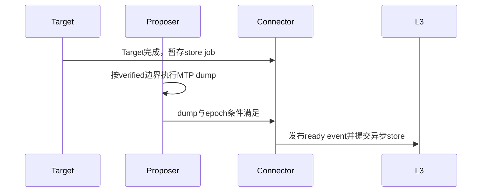

# MTP 与推测解码集成设计

> 设计状态：已确认。实施状态：固定MTP3、target双尾、proposer原生full cache、多级prefix与单机DP组合主路径已适配。
> 理想版动态query不属于当前接口，见[自适应推测解码草案](../proposals/adaptive_speculation.md)。

## 1. 两条执行链

| 对象 | 当前合同 |
|---|---|
| Target验算 | A5 packed-C8，最多frontier+3 draft；LIM/KSC/QSFA |
| MTP proposer | 原生BF16 Indexer+MLA full-cache group，active decode全量驻留HBM，eager |
| Prefix持久化 | proposer的verified满块作为第三component镜像进L2/L3 |

本文LIM/KSC/QSFA指A5 packed-C8 target路径。A3 BF16非MTP的LIDU/KSC/SFA
是另一组单query ABI，见[总架构](../architecture.md)第19至23节；它们不因proposer
使用BF16就成为MTP target的正式实现。

Proposer全HBM源于当前BF16算子/布局合同，不是为了让MTP永远绕过多级缓存。**Active decode是否做token-wise swap**和**verified prefix是否下沉**是独立决策。

配置限定`method=mtp`、3个draft、greedy、`async_scheduling=False`。Target resident预算默认8192/10240/12288，可配置为8192..16000内128的倍数；proposer full-cache容量由其spec和Indexer/MLA比例共同决定，不把target budget套给proposer。

### 1.1 权重精度不等于Cache格式

量化模型名称不能替代逐层checkpoint/spec核对。原始GLM-5.2模型快照有78个target层
`0..77`和一个MTP层`model.layers.78.*`；MTP层的Indexer `weights_proj/wk/wq_b`、
MLA `q_a_proj/q_b_proj/kv_a_proj_with_mqa/kv_b_proj/o_proj`及MoE、norm均为BF16。
它是完整的Transformer层，有自己的Indexer和MLA cache。3个draft是串行复用这一层
权重和同一份cache三次，不是三层MTP或三份full cache。其他模型必须从
`num_hidden_layers`、draft层声明和真实spec识别边界，不能硬编码78。

| 对象 | 当前格式 | 含义 |
|---|---|---|
| Target量化权重/计算 | 由checkpoint与loader决定 | W4A4等权重/计算格式不能推出所有层的cache格式 |
| Target Indexer key | FP8 E4M3FN，加FP32 scale | 每token为128-byte key及一个4-byte scale |
| Target MLA packed-C8 | 每token 656 bytes | 512-byte FP8 latent + 64个BF16 RoPE元素(128 bytes) + 4个FP32 scale(16 bytes) |
| Proposer Indexer | BF16 | 原生完整上下文key cache，不继承target C8开关 |
| Proposer MLA | BF16 NOPE+RoPE | 保持原生cache tuple与生产/消费算子合同，不做隐式C8转换 |

不同层采用不同dtype本身合法，前提是写cache的算子、cache布局和读cache的算子三者
一致。不能把BF16 token/投影权重与FP8 packed cache拼成一个未经支持的MLA prolog
签名，也不能只改spec或强转dtype来实现量化。早期把target/proposer一起纳入C8
resident的实现已放弃；这是当前选择BF16 full-HBM的原因，不是当前仍存在的错误。
另一条BF16 proposer卸载路线的完整容量与工程取舍见
[未采用的cache路线](../proposals/adaptive_speculation.md#17-mtp-cache路线的容量与取舍)。

### 1.2 三组容量与独立物理元数据

令`N`为resident base block数，`r=indexer_mla_block_ratio`，常用`r=3`：

| Group | Spec/所有者 | 物理blocks | 稀疏化后的行为 |
|---|---|---:|---|
| Target full Indexer | `DSAIndexerKVSpec`，只含full Indexer层 | `r*N` | 保留完整上下文 |
| Target resident MLA | `DSAResidentMLAAttentionSpec`，所有target MLA层 | `N` | 每请求budget加两块tail，其余durable载荷在L2 |
| MTP full | 原生`AscendMLAAttentionSpec`，`is_eagle_group=True` | `r*N` | active decode完整驻留，不随target ENTER释放历史块 |

GLM-5.2原始拓扑前两层独立Indexer，后续每四层共享一次选择，78个target MLA层约有
21个full Indexer；实现应取`F=count(indexer_types == "full")`，不是78或固定21。
Shared follower复用选择，不等于它没有独立MLA payload；MTP的独立Indexer不计入F。

Proposer的Indexer/MLA在同一full spec内，使用同一份**MTP自己的**block table和slot
mapping。当前worker要求原生三项BF16 tuple，shape按spec的`sparse_head_dim`顺序
核对，不能重排tuple，也不能混入C8 scale。Spec校验同时要求两项C8开关关闭、
`scale_dim=0`、`compress_ratio=1`。

| 可共享的语义 | 必须独立的物理寻址/状态 |
|---|---|
| `req_id`、prompt/accepted长度、position、调度及结束语义 | MTP full-cache group ID、block table、物理block ID |
| 完整上下文block生命周期、原子admission/释放规则 | proposer `draft_attn_groups`、`kv_cache_gid` |
| 基线Eagle provisional-tail语义 | `slot_mapping_group[draft_step]`、`seq_lens_group[draft_step]`、`query_start_loc_group[draft_step]`及基线需要的table镜像 |

完整token coverage应与target Indexer相同；物理ID不必相同，也不得借用target
resident的压缩position。Worker `_prepare_inputs`必须为第三组用真实`positions`
刷新slot mapping，不能只刷新前两组。Proposer后续draft step仍走基线slot更新。

Admission按三组需求做原子检查，最紧张的一组决定能否接纳，不能把空闲block总数
相加互抵。Target dense→sparse只释放target resident的相应历史块；请求完成时三组
统一释放请求持有引用，并保留基线prefix缓存的引用/淘汰语义，不等于抹除所有缓存块。
这也不宣称抢占恢复已经实现。

Active proposer不持有target的row mode、resident budget、pool row、LIM selection
state或token-wise miss plan。启用多级prefix时，另有专用full-cache dump/load上下文
及L2/L3第三组件，服务verified满块镜像；不能因为它有dump hook就把它当成稀疏proposer。

### 1.3 Full-HBM的容量推导

以下为单worker的KV载荷估算，不含权重；block size取128，层数取上述模型快照：

| 符号 | 单层单block字节数 |
|---|---:|
| `P_TR`，target packed-C8 MLA | `128*656 = 83,968` |
| `P_TI`，target C8 Indexer及scale | `128*(128+4) = 16,896` |
| `P_MR`，MTP BF16 MLA | `128*(512+64)*2 = 147,456` |
| `P_MI`，MTP BF16 Indexer | `128*128*2 = 32,768` |

普通全HBM基线所有必要cache层共同参与一个逻辑block的成本估算，不存在DSA的r:1：

```text
N_base = floor(H / (L*P_TR + F*P_TI + P_MR + P_MI))
```

当前方案二则为：

```text
C_target = L*P_TR + r*F*P_TI
C_full   = C_target + r*(P_MR + P_MI)
HBM_KV   ~= N*C_full
N        ~= floor(H / C_full)
```

其中H是可用于相应KV配置的预算，L为target MLA层数。实际计算以各group真实
`page_size_bytes * layer_count * multiplier`求和，再作block数对齐和override；
`num_gpu_blocks_override=N`仍表示base-N，派生的三组是`rN/N/rN`，不是各组都N。
不得忽略null block、对齐、固定scratch/graph占用，也不得把理论token coverage当作
扣除保留块后的可调度容量。

以`L=78,F=21,r=3`计算：`C_target=7,613,952 bytes`，
`C_full=8,154,624 bytes`，每N增加540,672 bytes。原文“约6%~7%”是粗估；
精确到这组输入，**成本分母增加7.10%，固定H下base-N约减少6.63%**，两者不能混称。
这是一层MTP的载荷成本，不是吞吐损失承诺。多MTP层要逐层累加真实spec成本，届时应
重新评估内存取舍；当前不为每个draft step重复乘三份cache。

## 2. 请求与query分轴

```text
B = 请求数
Q_b = 请求b本轮target query数
T = sum(Q_b)
q0输入frontier，后续query输入draft token
```

Scheduler/request级metadata仍为B行，TND query输出为T行。算子支持合法1..4 query组合，不等于框架开放动态draft策略；当前配置仍固定MTP3。Prefix warmup、边界和padding也必须遵循现有request/query合同。

`actual_seq_lengths_query`取基线`query_start_loc[1:]`，以累计end的相邻差分恢复
每请求query span。例：累计end为`[4,6]`，最终KV长度为`[1004,702]`，两请求的query
可见长度分别为`[1001,1002,1003,1004]`和`[701,702]`。Query按TND行寻址，block table
和pool row按请求行寻址；不能因`T!=B`把所有请求metadata一起扩为T行。

固定MTP3的空间保证为`|union(TopK_q)| <= Q_b*2048 <= 8192`，故不必把容量决定交给
sampler。预算按prompt分档，默认8192/10240/12288、阈值32768/65536；配置项
`resident_budget_tokens`允许8192..16000内128的倍数，要求非递减；边界准入还要满足
durable满块候选足够覆盖budget，不能用“本轮乐观长度刚到8192”直接触发first-fill。

### 2.1 Frontier、Bonus与真正可持久化的KV

Bonus不是特殊token种类，只是“全部有效draft接受后额外采样的下一token”这一来源标签。
Recovery是首次拒绝处采样的下一token。二者均已成为正式输出，但尚未作为下一轮target
输入，因此**还没有自己的target KV或target hidden state**。

下一轮proposer使用这个`next_frontier_token`的embedding，以及最后一个已由target
计算的输入位置的hidden state，产生下一批draft；下一次target才把frontier放在首行。
关闭MTP时，普通decode刚采样出的下一token也有同样生命周期。

```text
本轮target输入  = current_frontier + draft_0 + draft_1 + draft_2
完整logits用途  = 验draft_0、验draft_1、验draft_2、全接受时采bonus
num_accepted    = len(generated_token_ids) - 1
num_rejected    = num_draft_tokens - num_accepted
computed修正   = optimistic_computed - num_rejected
```

上式解释基线验算回退，不替代EOS/max_tokens等停止条件的实际完成账务。必须区分已输出
token数、target KV确实存在的verified边界和L2/L3 ready边界；“已经输出”不能作为满块
dump依据。为最终被拒draft换入的**历史**token仍合法，无需把它们从resident回滚，
而provisional token本身不能进入persistent `cache_slots`或被发布为durable块。

## 3. 全可见域TopK与双尾存储

令D为该请求共同durable满块前缀，Vq为query q的因果可见长度。每个query独立在`[0,Vq)`选Top2048。`offloaded_lens=D`仅区分prefix与tail，用于COPY/淘汰，不限制LI搜索域。两块128-token parity tail仍保存尚未卸载的KV，但只有入选部分参与Attention。

```text
attention输出： [全可见域TopK的2048列，prefix miss在前，其余hit在后]
物理tail slot： budget + token_position % 256
无效/未写/未来/输出空位：-1
```

输出固定2048列。入选tail一律是hit，不写反向表、不计miss或union COPY。
`resident_lengths=budget+256`仍表示可寻址span，不是参与Attention的token数。
官方MTP QSFA使用`sparse_mode=0`，只计算传入索引；因果性由LIM选取逻辑token保证。

旧2304策略是Top2048(D)+全部可见tail，本轮改为Top2048(Vq)，不是只改数组长度。
例如D=8192、Vq跨过8320时，8192..8319参与LI竞争，不再强制全部参与Attention。
双尾分配、写入与倒手保持不变，非MTP路径不变。packed-MTP L3语义标识更新为
`full-visible-topk2048-tail-hit-v2`，旧策略对象不能复用；本轮框架迁移待A5验收。

## 4. LIM七输出

均为caller-owned int32固定缓冲，顺序不能变：

| 顺序 | 语义 | 形状 |
|---|---|---|
| 0 | `topk_slots`，入选token的resident slots | `[T,1,2048]` |
| 1 | `topk_index`，与slots逐元素对应的logical token IDs | `[T,1,2048]` |
| 2 | per-query durable-prefix miss count | `[T]` |
| 3 | 请求resident可寻址span | `[B]` |
| 4 | 请求级去重copy source IDs | `[B,1,16384]` |
| 5 | 请求级去重copy destination slots | `[B,1,16384]` |
| 6 | 有效copy-prefix长度 | `[B]` |

TopK区域按miss-prefix/hit-suffix排列，tail正常参与LI但不参与miss union。多个query可重复选中同一source，因此第2项求和不等于第6项。KSC只消费4/5/6；可选CopySFA直接消费配对TopK与per-query miss，union copy_count>512时内部先COPY再SFA。

PAD不访问真实缓存；DENSE按完整因果可见KV选择，零copy；SPARSE维护resident状态。合法PAD/DENSE/SPARSE-steady混合可走快路径，first-fill使用填充路径。各核判定first-fill/steady的时序同步属于正确性合同，不是可随意删除的探针。

## 5. KSC、shared层与布局

KSC复制请求级去重prefix，不重新解释query miss。Count、pair、table错误必须明确失败；负哨兵不能当作0-copy。Tiling结构、kernel、ACLNN API、Torch binding和输出buffer一起升级，不能只换同名so。

Full Indexer层计算选择，shared follower复用选择计划，但各层MLA payload独立复制。Request-level临时输出不能被下一full group过早覆盖；buffer复用必须按消费时序证明，不是只验证单层调用。

Pool行号只负责寻址，不能参与逻辑victim策略。真实budget block、parity tail、InputBatch行和stable pool行是不同对象；不能为了确定性把有效KV块或尾块随意排序。

该victim要求限定当前A5 MTP manager。A3非MTP LIDU的`HashEvictScanSeed`
当前仍包含`cacheRowIdx`，不能把A5的修复状态描述为所有算子都已具备的行置换不变性。

Target KSC固定接收HBM/DRAM packed cache、两张请求级block table、copy src/dst/count，
所有tensor同NPU且连续，无attrs；不接query级source/miss输出。
Target packed MLA满块dump使用C8，Indexer key/scale用两个bytes调用；
proposer原生BF16 NoPE/RoPE/Indexer用三个bytes调用，不能误写为A5双plane dump。
Proposer使用真实dump_job_count，零作业跳过，不照搬target graph的padding作业。
全部target/proposer prefix restore都使用bytes的DRAM->HBM方向。
完整参数顺序、shape/dtype、tiling和空转合同见[总架构](../architecture.md)第11.10及第12.6节。

## 6. 前缀复用与恢复

HBM命中需要完整target Indexer+dense MLA+MTP full-cache triple；L2是同一逻辑区间的三组件bundle。和L3合并时保持最长连续前缀，并在联合结果上只执行一次基线Eagle末块回退。

外部suffix先读入L2，本域TP成功后恢复需要的target与proposer HBM，再执行首prefill。HBM-only gap在首prefill按计划补齐L2，不得在sparse decode时才发现缺少durable源。

KV恢复不会自动恢复LIM `cache_slots`。没有同代完整resident映射的新请求，应以负budget first-fill；不能仅因prefix命中就进入正budget steady状态。

## 7. Verified满块发布



Proposer prefill在cache写后dump；decode在覆盖相关内容前进行已确认满块的prewrite dump，同一outer step同层只执行一次。Target的`get_finished()`不代表MTP payload已经就绪，保存等待路径必须处在正确的proposer完成边界。

Scheduler computed、accepted/verified、L2 ready和L3 completed保持不同语义。未验证draft不能发布hash；首次ENTER必须保护待dump满块，并根据已计算位置保留真正部分尾块，而不是最后一个lookahead块。

请求若没有下一outer step，最后一块可能尚未发布为durable前缀；这会减少复用长度，但不能为多命中一块提前保存provisional内容。

已经生成但尚待执行的confirmed dump不能因为请求本step未被调度就丢弃，应保持到
下一次真实执行；请求直接结束时按现有终止边界处理，不能假定设备已执行未提交的IO。
MTP decode的dump必须早于本层KV写，而不只是早于KSC，因为逻辑块`k+2`会复用
块k的同一parity物理位置。Scheduler负责confirmed边界与请求引用，worker负责本地
copy计划与执行，不能另建一个由乐观scheduled长度推进的DSA验算账本。

## 8. Graph与DP

Runtime初始化时预分配request/query缓冲，Eager与Graph共用同一owner。Uniform target query可走FULL图；不满足准入的形态使用true eager。Proposer仍eager，与target模式独立。

DP runtime idle/PAD及capture都不得触发真实请求bundle IO、ready推进或真实请求行分配，
禁IO条件必须穿过proposer独立forward context。启动期capture会在专用dummy资源上
安装合法first-fill并执行内部LIM/KSC，不要求所有内部KV copy均为0；runtime idle/PAD
才必须发布零有效copy。L3读取成功汇总只在本域TP，不将条件性IO扩大为EP collective。

## 9. 源码与验收

`dsa_offload/contracts.py`定义容量和attention semantics；`runtime.py`、`resident_pool.py`、`input_batch.py`维护owner；`request_cache_layout.py`与coordinator负责admission/ENTER；`l3/`负责三组件和发布；`spec_decode/llm_base_proposer.py`接入基线proposer。

验收应覆盖query/request轴、跨128边界与两种parity、first-fill/steady、DENSE/PAD、full/shared消费顺序、真实swapped payload、Local/L3恢复、MTP发布时序与Eager/Graph。单卡算子、CPU控制面和整网证据不能互相替代。

具体修复机制和已知质量风险见[工程经验](../engineering/diagnostics_and_lessons.md)，不在本设计维护逐次调试日志。

## 10. 跨尾块的逐query例子

取D=8192、budget=8192，一轮4个query的可见长度依次为8319、8320、8321、8322。
所有query的LI都只读取`[0,8192)`，每条query的TopK可不同；tail如下：

| query | Vq | dense tail token范围 | 有效tail数 | 固定输出中的空tail槽 |
|---|---:|---|---:|---:|
| q0 | 8319 | `[8192,8319)` | 127 | 129 |
| q1 | 8320 | `[8192,8320)` | 128 | 128 |
| q2 | 8321 | `[8192,8321)` | 129 | 127 |
| q3 | 8322 | `[8192,8322)` | 130 | 126 |

q0/q1没有看到第二个tail block的有效token；q2/q3分别多看1/2个，剩余位置为-1。
不能因物理上存在两块tail就读入全部256个token。旧策略跨界后可能把第一块完整tail纳入
某些query的LI候选，新策略将共同durable边界之后的因果内容全部保留，这是明确的语义差异。

若D=8320，tail从parity1开始：token8320映射到`budget+128`，token8448映射到
`budget+0`。两个物理tail block ID即使分别为91和7，也必须按逻辑parity列使用，
不是按ID大小挑当前尾块。逻辑时间向前走时slot可以回绕，可见长度仍由Vq决定。

## 11. Query miss与union copy的例子

以下用小集合解释接口，实际TopK仍为2048。假设resident已有token10：

```text
q0选择 {10,20} -> miss {20}    -> per_query_miss_count=1
q1选择 {20,30} -> miss {20,30} -> per_query_miss_count=2
request union miss = {20,30}  -> copy_count=2，不是1+2=3
```

LIM先保护全部有效query的选择并集，再统一选择victim并更新映射；不能处理q1时驱逐q0
仍要读取的token。KSC只复制一次20/30，各query的source/slot输出指向相应结果。
Tail不参与miss union，因为它由真实KV写入路径维护在对应HBM parity位置。

## 12. First-fill、拒绝与下一轮dump

1. 前缀恢复后HBM/DRAM可能已有完整KV，但新请求没有同代resident映射。Worker为各
   selection group写负budget，LIM first-fill、KSC物化后才能成为steady。
2. 本轮target对frontier+draft验算，产生的后缀仍可能provisional，不能立即作为L3内容。
3. 接受/拒绝返回后由基线回滚可见长度。被拒绝位置可以保留旧字节，但后续LI、attention
   和dump只按已确认边界消费，不依靠每步清空整片tail来替代可见性合同。
4. 下一outer step按confirmed满块前缀生成target/proposer各自的dump，在覆盖parity
   位置前完成必要复制；同一outer step的多个draft子步骤不得重复发布同一块。
5. 全部component完成对应epoch后connector才允许write-behind读L2；最后验算若立即
   结束且无下一outer step，未terminal flush的块不能发布，宁可少命中一块。

必须分别跟踪KV字节已写、target已确认、L2已物化、L3已发布。恢复正确性不能只靠
单个copy算子通过或proposer吞吐打印，还要验证生产者完成与消费者读取之间的顺序。

## 13. Full/shared层与scratch寿命

Full Indexer层生成选择和copy plan，后续shared层复用选择，但各层MLA payload独立，
所以KSC仍逐层执行。只把follower的调用挪到full层不会减少字节或launch数，还可能让
full层越权持有其他层资源。

当前单stream保证follower消费完之前下一full层不会覆盖scratch；Graph捕获同一固定
地址链，不能再复制一套selection state。多层batched KSC或跨层prefetch需要新的
arena列表、事件与buffer复用合同，不是现有七输出自动提供的能力。

## 14. 算子交接的有效区与存储合同

### 14.1 当前A5输入与mutation声明

当前Torch入口是`npu_dsa_a5_li_manage_c8_out`，不是历史BF16 LIDU-MQ提案接口。
参数顺序如下，输出是传入buffer的原址写入，返回值为`()`：

```text
index_weights, query, query_dequant_scale, actual_seq_lengths_query,
index_key_cache, index_key_dequant_scale, index_block_table,
candidate_lens, final_seq_lengths_kv, row_modes, req_pool_entries,
cache_slots_pool(a!), sparse_and_tail_slots(b!), sparse_and_tail_src_ids(c!),
per_query_miss_counts(d!), resident_seq_lengths(e!),
copy_src_ids(f!), copy_dst_slots(g!), copy_counts(h!)
```

`a!`到`h!`对应Torch schema的mutable alias标记，不能删除后伪装成纯函数，也不能
让wrapper/OpDef为mutable参数产生临时contiguous副本，导致写回对象不是runtime
持有的storage。KSC仅将`hbm_kv_bytes`声明为mutable，dump仅将目的cache声明为mutable。
真实地址重叠、源数据ready与buffer寿命仍由调用方负责，schema不会代替生命周期校验。

本节统一用`H_idx`表示Indexer query head数，当前为32或64；
`num_indexer_blocks`表示本worker的Indexer cache物理块数，不能与head数混用。
`T`仍为query行数；容量公式中的`N`仅表示resident base block数，F仅表示full
Indexer层数。下面shape中的128分别由block size或Indexer head dim的位置决定。

| 输入 | 当前dtype/shape或限制 |
|---|---|
| `query` | FP8 E4M3FN `[T,H_idx,128]`，连续 |
| `query_dequant_scale` | FP32 `[T,H_idx]`，连续 |
| `index_weights` | BF16 `[T,H_idx]`；列stride为1，行stride至少H_idx |
| `index_key_cache` | FP8 `[num_indexer_blocks,128,1,128]`，只允许物理block轴padding |
| `index_key_dequant_scale` | 归一化view后FP32 `[num_indexer_blocks,128,1]`，只允许物理block轴padding |
| 累计query end、offloaded/final长度、row mode、pool entry | int32请求轴；SPARSE的`offloaded_lens`是共同durable满块前缀D，LI按final长度逐query搜索完整可见域；共享runtime内部该列仍名为candidate_lens |
| `index_block_table` | int32 `[B,max_blocks]`，完整Indexer寻址 |
| `cache_slots_pool` | int32 `[pool_capacity,token_capacity+1]`，末列为带符号budget |
| 七个输出 | 第4节所列int32连续buffer，与所有输入位于同一device |

以下C表示resident budget、F表示`final_seq_lengths_kv`，与已确认token水位分开。
下层 LIM 与框架调度子集须分开：每请求累计 ends 的差值允许 Q=1..4，最后
end 必须覆盖物理 T；SPARSE 要求 `C<=D<=min(W-1,128*M)`、D 按 128 对齐、
`Q<=F<=min(W-1,128*M)`、`D<=F-(Q-1)`、`F-D<=256`，C 为8192..16000内128的倍数。
最早 query 允许零 tail。DENSE 底层按 F 和 query span 决定 visible length，
不使用 offloaded 值；正式 runtime 仍将该列写为 tokens_after。
DENSE要求`Q<=F<=min(W-1,128*M)`，其中W为pool物理行宽，M为Indexer
block-table列数；形状检查通过不等于设备长度和地址自动合法。

框架 dispatch 由配置的 `max_decode_query_len>1` 决定：开启 MTP 后即使本批
T=B，也仍调用七输出 LIM，不降为五输出 LIDU。当前配置固定 MTP3，FULL
需要 uniform Q4，合法 ragged query 的单算子能力不等于动态 draft 策略已开放。
pool 的物理 W 按 architecture 11.2 对齐并在最高容量回退 raw width，不能把
`W-1`、模型有效长度和 score 行距当作同一个数。

当前token编码上限为`2^18=262144`，这是容量上限，不是要求每个pool row固定分配
262144列。实际token容量按模型配置规划，再加一列metadata；扩大上下文必须同时审查
编码、表宽、tiling和启动校验，不能静默截断token ID。

历史交接要求传完整`kw`加`weights_offset=128`来避免权重打包；当前A5选择了另一条
已接入路径：直接接受`kw[:,head_dim:]`的行stride，向ACLNN传递`weight_stride`。
两者保留的是“不为列后缀view逐层复制”的目标，不能把旧参数塞入当前19参数schema。
同理，从`[B,1,16384]`切出`[..., :2048]`时，B>1的行stride仍是16384，不能假称
紧凑连续输入。当前query输出是独立的2048列owner，直接交QSFA，不从copy plan切片。

### 14.2 有效行先判定，再访问载荷

| 情形 | 生产/消费约束 |
|---|---|
| SPARSE有效query | 在完整`[0,Vq)`独立选2048项；入选tail为hit，只有prefix miss进入COPY；source/slot逐元素配对，无重复KV参与softmax |
| DENSE有效query | `Vq<=2048`时完整因果前缀，否则在完整可见前缀选Top2048；不拼SPARSE双尾、不修改resident映射、copy=0 |
| PAD | 不解引用真实pool/table/cache；当前attention source/slot空位为-1，miss/copy为0，不触发真实IO |
| 正常copy=0 | KSC无载荷读写，不因poison source/destination/table内容报虚假miss |
| 有效copy前缀 | 仅`[0,copy_count)`有复制语义；source为序列token ID，destination为resident逻辑slot |
| 非法count/pair/table | 明确失败，负count不是正常空转，不带着半完成状态进入下一step |

KSC的16384列只表示物理容量，前缀外内容不是额外copy job。测试可在未消费suffix放入
poison，不能依赖“每步恰好被清空”；但当前2048列attention空位必须为-1，不能套用
旧BF16候选ABI中“attention suffix可未定义”的说法。旧动态query的无效后缀
零输出合同另见提案，当前七输出没有`valid_target_query_count`。

寻址必须经过两套请求级表：

```text
source token -> DRAM表[source // 128] -> source物理block + source % 128
resident slot -> HBM表[slot // 128] -> destination物理block + slot % 128
```

例如`source=[900,100,700,300]`、`slot=[17,2,63,9]`完全合法。Slot既不是source
token position，也不是全局物理地址；steady slot不要求连续或按token排序。Packed
656-byte row必须整行opaque copy，latent、RoPE和scale要保持同一token的对应关系。
QSFA的`key`和`value`使用同一packed MLA载荷，不创建第二份value cache。

### 14.3 First-fill、事务与失败边界

当前first-fill先验证全部query的TopK并集，再清理旧映射。先按query/rank顺序稳定
去重放入mandatory union，再按逻辑token ID升序加入尚未出现的durable候选，补齐
整个budget；`copy_count=budget`，初始slot为`0..budget-1`，最后发布正budget。
候选不足budget或非法token应失败，不能先破坏旧pool再假装完成。

Steady先保护全请求union的hit，再对union之外resident选择victim；每个miss只
分配一次slot、复制一次。这里“请求级一次提交”表示先完成联合保护和规划，不是要求
整个映射由一条原子机器指令写入。当前策略不承诺采用旧提案的q0-score filler/淘汰。

```text
本层LIM规划并更新映射 -> 本层KSC物化载荷 -> 本层QSFA读取
```

映射先发布成立的前提是单stream保序和失败即终止本轮。它不是跨设备事务，也没有
KSC失败后带着部分新映射继续推理的恢复语义。多流版本需要另行定义
`plan -> copy -> readiness -> commit`以及事件和复用规则。

### 14.4 固定存储的边界

Worker初始化/capture前按`B_capacity=max_num_reqs`、`T_capacity=4*B_capacity`
分配request/query/copy scratch；Eager只取active-prefix，Graph只取captured-prefix。
DSA新增可预知metadata仅通过`slice/narrow/view`及`copy_/fill_/out`刷新，不能逐层
`empty/zeros/full/arange/tensor/from_numpy/cat/stack`、list-to-tensor、D2H或`.item()`
分支来重建状态。Workspace上界必须由shape/attr确定。

这是metadata所有权约束，不是声称模型激活/logits没有正常分配或布局转换。当前QSFA
wrapper仍有query连续化；不能把“weights无额外打包”扩大成“全forward零copy”的
性能结论。只读输入的隐式copy、mutable别名和实际地址稳定性都需profiler/Graph验证。

## 15. 可执行验收清单

以下是覆盖要求，不代表所有用例已有当前版本的通过证据。当前固定MTP3不接受把历史
`num_speculative_tokens=1/2`或query `1..16`矩阵直接当作引擎准入；Q=1..4应在合法
单算子形态、warmup/边界输入中测试。单机DP功能已经适配，不沿用早期“DP/prefix均禁用”的状态。

| 层级 | 应覆盖的用例与判据 |
|---|---|
| 模型/spec/容量 | Target与MTP混合spec；MTP三项BF16 tuple顺序/shape；F与target层数不同；override=N派生rN/N/rN；任一pool不足均不部分分配 |
| LIM CPU golden | B=1/4/8/16，Q=1/2/3/4及eager混合；union为2048/6144/8191/8192；全重合/部分/不重合；三档budget；核对source集合、slot、victim、copy plan及最终pool |
| First-fill/steady | 全hit/部分miss/全miss，负转正budget，同一source多query只copy一次；新请求row复用与prefix恢复后first-fill；非法输入不静默成功 |
| 因果边界 | Tail offset 0/1/124/125/126/127，两种parity；source/slot配对；DENSE可见长度小于/等于/大于2048；未写/未来/空位-1 |
| KSC与QSFA | DRAM source、HBM destination poison/readback；zero-copy不写cache；真实swapped payload；slot顺序变化的因果golden；packed C8使用对应精度容差 |
| 多轮链路 | 无模型权重的LIM→KSC→QSFA，first-fill→steady→accept/reject→下一轮prewrite dump；shared follower消费后才能复用scratch；多次capture/replay更新固定地址内容 |
| 模型对照 | DSA off+MTP、DSA on+MTP、DSA on+no-MTP；GLM-5.1/5.2与兼容DeepSeek-V3.2；B=1/4/8及接近max_num_seqs |
| 请求生命周期 | 8191/8192/8193、32767/32768/32769、65535/65536/65537；0/1/2/3 draft接受交替；仅reject跨块、accepted跨块；EOS/max_tokens/stop、在线streaming、连续批次和释放压力 |
| 多级prefix与DP | 三组件Local/L3恢复、verified发布epoch、HBM-only gap、空DP域/dummy/PAD无IO；target FULL graph与proposer eager组合 |

新2048策略应与完整可见域官方LI及原始逻辑KV的Attention golden对齐，不能以旧2176/2304策略逐token相同作为通过条件。SPARSE的2048项全部有效，严格校验，不以padding XFAIL豁免。
端到端greedy token差异仍须分析；需要同时保留query span/position、逐层union/miss、
copy plan、tail parity、confirmed/dumped watermark和accepted count，才能区分语义
升级、量化数值差异与寻址/生命周期错误。

性能分别报告LIM、KSC、QSFA的p50/p95，first-fill与steady、高/低TopK重合、
KSC all-zero/mixed-zero/small-miss/large-fill。KSC可用B=1/4/8/16/24观察带宽和尾时延。
同时记录copy字节、接受长度/率、host prepare、每请求resident blocks、三池瓶颈、
TPOT/吞吐和workspace上界；不能只报告算子总耗时。PAD/zero-count不应按最大容量
执行无效payload工作，非MTP单query路径应单独做性能回归。

交付须覆盖OpDef、infer-shape/type、tiling、kernel、ACLNN、Torch schema/adapter、
Meta/fake输出形状、CPU golden、UT/ST、多轮Graph及复现命令；当前七输出升级必须
同时重编译安装CANN算子与`vllm_ascend_C`并重启worker。SoC限制应附版本、失败阶段、
最小shape/命令、完整日志和替代方案代价，不能把旧910C/BF16交付范围当作当前A5准入。

历史记录曾通过服务器UT及离线eager/FULL、在线FULL冒烟，含单条约40K和
8K/5K/70K/40K的B=4混合长度；这仅是当时方案二接线证据，不代替当前七输出版本的
完整QA、长稳、并发释放及profiling证据。
