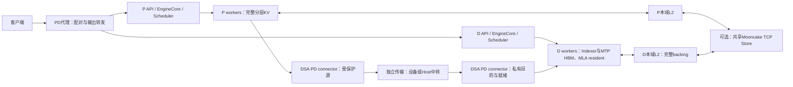
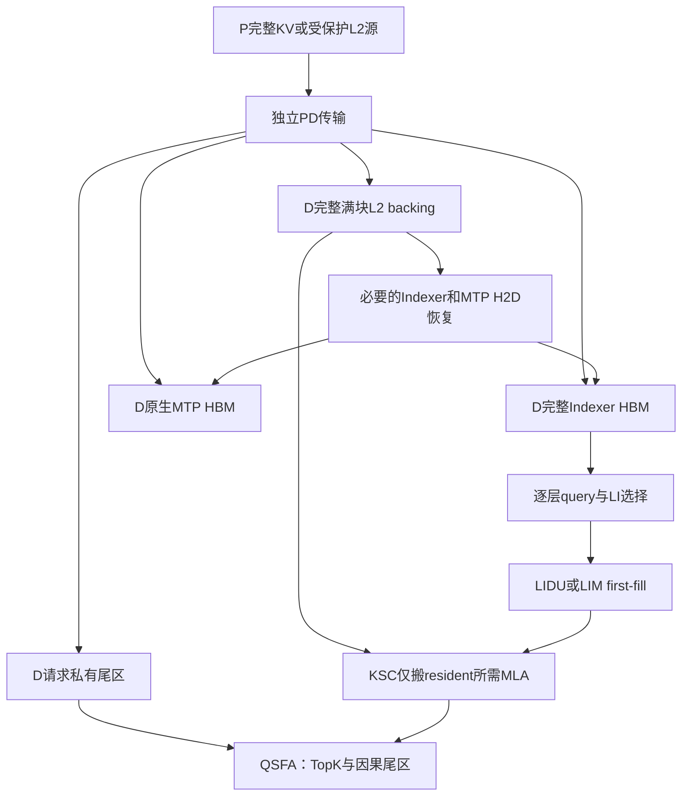
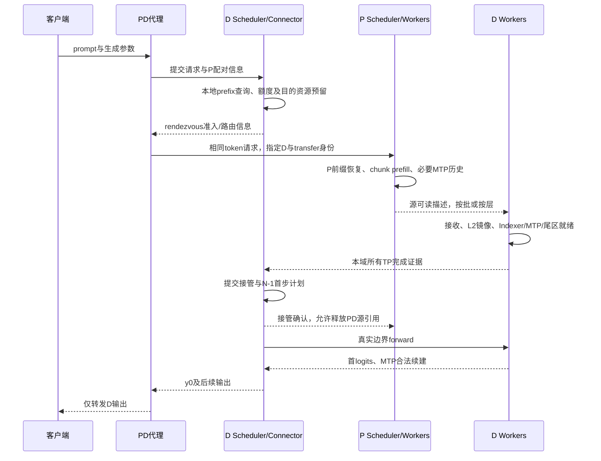

# DSA 稀疏卸载 P/D 分离详细设计

> 编写日期：2026-09-14。
> 状态：**首版需求范围已确认；本文为待评审的详细设计，尚未实现、未通过PD实机验证。**
> 实施基线：vLLM v0.23.0 + 本项目 vLLM-Ascend v0.23.0，DSA源码快照 `e74000d3ef`。
> 本文不解除现有配置守卫，不提供可直接部署本方案的命令，也不授权自动升级SDK或实施代码。

## 1. 目标、读法与状态

### 1.1 要解决的问题

将已完成的DSA稀疏卸载、多级prefixcache、固定MTP3和单机DP组合扩展到Prefill/Decode分离：

1. P负责prompt计算和必要的MTP历史构建，D负责对用户输出以及后续解码。
2. 长请求的D接管过程不先分配完整target MLA HBM，再释放成小budget；从接收阶段就采用完整Indexer、完整L2 backing、固定MLA resident和尾区。
3. P/D可共享兼容的L3满块；D新生成的已确认满块能够写入L3，供下一轮P复用。
4. L3共享Store可以关闭，PD交付仍有独立通路。该目标必须经介质验证，不能以隐式启动Store替代。
5. 保持基线Request/Scheduler/EngineCore/KVConnector生命周期；不新建组合专属runtime，不分裂Graph/Eager元数据。
6. 首版以功能闭环和基本精度正确为目标。性能数据可记录，优化专项后做，不设TTFT或吞吐硬指标。

这里P的“dense”主要指完整历史存储与prefill执行路径，不表示把GLM/DeepSeek模型本身的稀疏attention改成所有token参与的另一种算法。

### 1.2 证据与设计不能混用

本文使用四类表述：

| 类别 | 含义 |
|---|---|
| 已有源码事实 | 在冻结SHA或当前自研源码中查到的行为；不是新增PD组合实测通过 |
| 用户已确认范围 | 已讨论的首版目标与明确排除项 |
| 本文建议合同 | 本次给出的详细实现方案，需评审、编码和验证 |
| 待验证门禁 | API、设备、边界计算或组合行为必须通过测试才可开放 |

所有拟新增类型、字段、方法和配置都属于“建议合同”，即使使用代码格式也不代表当前已存在。
状态用语中，“ready”必须指出哪种资源、哪个范围和哪个完成事件，不能仅表示收到了一个通知。

### 1.3 文档关系

- [系统架构](../architecture.md)：已有planner、owner、算子和统一元数据的真值。
- [多级缓存](../features/multilevel_kv_cache.md)：已有L1/L2/L3匹配、完整bundle、write-behind及回收合同。
- [MTP](../features/speculative_decoding.md)：已集成七输出LIM、2304容量、共同durable历史与因果双尾。
- [DP](../features/data_parallel_inference.md)：已有单机DP、预算、dummy、控制面作用域。
- [工程经验](../engineering/diagnostics_and_lessons.md)：历史数值问题与Host/TCP/HBM验证边界。
- 本文是PD详细方案的唯一维护位置；[执行与恢复草案](execution_and_recovery.md)保留恢复等独立特性，不再维护第二份PD协议。

阅读顺序建议：2至4节了解范围与基线，5至10节审查数据及接管，11至15节审查MTP/缓存/DP/失败，16至20节审查落地与验收，21节查源码。

## 2. 首版支持范围

### 2.1 已确认的约束

| 维度 | 首版设计范围 | 明确不包含 |
|---|---|---|
| 基线 | 当前v0.23自研分支；官方新版仅作参考 | 为PD整体升级vLLM或移植新版runner |
| 首个认证模型 | A5、GLM-5.2 W4A4C8、当前packed-C8与IndexShare合同 | 自动推导所有MLA、量化、其他芯片均支持 |
| P/D TP | 同TP规模；同模型、权重语义及组件布局 | 异构TP、payload重分片 |
| 单侧拓扑 | P服务及D服务各自的TP/DP均在单机内 | 单个P或D服务内部跨机TP/DP、Ray适配 |
| 两侧关系 | 可分别部署在两台机器；同机不同卡组另测 | P/D共用模型EP通信组 |
| DP | 复用既有单机DP实现，阶段性覆盖两侧DP组合 | 新增请求work-stealing、跨DP迁移 |
| CP/PP | PCP=1、DCP=1、PP=1 | CP、PP、DBO等未经现有DSA准入的组合 |
| 调度 | 同步调度；沿用本地prefill/decode阶段隔离 | async_scheduling、请求抢占恢复 |
| P显存 | 每逻辑层独立KV，完整prefill历史 | 跨层循环复用/层buffer alias |
| D显存 | 长请求完整Indexer + MLA budget/tail；MTP启用时保留原生full HBM | 用完整MLA HBM中转冒充固定budget接管 |
| MTP | D固定MTP3；P加载必要MTP并构建历史，不做额外多步投机 | P完全不运行MTP却要求D自动补齐完整历史；动态MTP |
| 首token | D在N-1重算，D拥有对用户的首输出 | 直接接管P首输出、同时维护两种输出协议 |
| 多级缓存 | 完整pair/triple和bundle语义；P/D共享L3、新满块写回 | 任意组件任意来源的泛化拼接优化 |
| 传输 | 独立PD通路 + 可选Store-owned TCP L3 | 默认为TCP可直写HBM，或默认直传一定可用 |
| 失败 | 保守准入、显式失败、安全取消和回收 | 自动重派P、D长prefill重算兜底、透明续推 |
| 管理 | 安全复用现有本地管理；忙碌/不支持组合拒绝 | 新增跨P/D全局reset、在线namespace事务 |
| 优化 | 现成layerwise额外适配小则复用 | 以性能专项完成作为首版验收前置 |

同TP不要求两侧物理block ID、group编号、pool容量或内存地址相同。DP数相等也不是payload数学要求，但首轮验证宜先对称，再验证单侧DP变化；不能未经测试宣传任意DP部署组合。
请求准入后固定在所选D DP域，不因为L3可共享就跨域移动执行状态。

### 2.2 当前未实现的范围不要混入现有认证

目前已验证的共部/单机DP不等于PD支持。PD新增的所有通信介质、接管边界、P cache-only MTP、直接稀疏首步和端到端组合均待实施。
LoRA、多模态、流式输入、beam/多分支生成、任意logits processor等不扩大当前DSA认证边界；首版测试以文本、单输出、greedy为主。若允许更多采样参数，应单独验证其对P临时输出隔离及D输出账务的影响。

### 2.3 三个独立维度

以下不能互相替代：

- **传输介质**：设备直达、独立Host中转、共享Store中转。
- **提交粒度**：整请求交付、逐层/逐chunk搬运。
- **D开始计算时机**：首版所有必需历史就绪后才forward，不做逐层收到就提前启动模型。

可以逐层传、最后整体提交；可以Host中转但D始终没有完整MLA HBM；也可以直传却因目的布局错误仍产生完整MLA HBM峰值。

## 3. 基线能力与取舍依据

### 3.1 版本口径

官方版本按SHA而非分支名比较。2026-09-14尝试更新两个参考仓时Git TLS握手失败，本次继续使用已取得的冻结对象，不将下表main称为即时最新。

| 对象 | 冻结SHA | 本文用途 |
|---|---|---|
| vLLM v0.23.0 | `0fc695fc6d1d82e9a5ac6835ac8e4e1c83703665` | Request、scheduler、KVConnector V1、N-1和错误完成 |
| Ascend原始v0.23.0 | `5cb98caaadeff42b5b62b996e34bb2aaa29d20fd` | 普通PD、layerwise、Store组合与proxy |
| 自研Ascend | `e74000d3ef8811f78a8fa9e36e6a216365019129` | 真实改动入口；不是纯官方基线 |
| vLLM v0.26.0 | `568afb3a13806beb53bb2e6bd518269357b237c0` | 新接口对照 |
| Ascend 0.26.0rc线 | `31b1176a4226968f28c4bb6e04bb1a36636ed38d` | Sparse Remote D2H及Store演进 |
| vLLM v0.27.1 | `6e448d0ea9bf3d88d898b65449ca6dc2aec170ac` | 新接口对照 |
| Ascend 0.27.1rc线 | `9e2ba22f767e6d3deef757c77f6e91f226d37d7c` | Sparse Remote D2H及Store演进 |
| vLLM main快照 | `4b839c3378c6a40fa613328a9b97069ed83b181b` | Multi、NIXL等相关方案边界 |
| Ascend main快照 | `9b2871baeaf2149f3f8126f5fd2bc9ff2fb0958a` | 新Sparse管理、逐层通知 |

Ascend上述main的Dockerfile默认配vLLM v0.28.0，而不是任意vLLM main。0.26/0.27 release与main有分叉/cherry-pick，版本较新不自动意味着包含另一个分支全部能力。

### 3.2 v0.23的生命周期基础

上游vLLM提供：

1. `get_num_new_matched_tokens()`判断外部可提供长度及是否异步；资源分配后调用`update_state_after_alloc()`。
2. 异步接收请求进入`WAITING_FOR_REMOTE_KVS`，不带着未完成KV直接计算。
3. Worker通过`KVConnectorOutput.finished_recving`回报，scheduler再晋升请求；全prompt命中时回退到`num_tokens-1`取得首logits。
4. P完成计算后，`request_finished[_all_groups]()`可请求延迟释放；`finished_sending`才允许释放被传输使用的源块。
5. `kv_connector_no_forward()`允许没有真实forward时推进传输。该能力必须和DP dummy共同工作。
6. v0.23已有`kv_load_failure_policy="fail"`，可走`FINISHED_ERROR`，不必为PD先实现自动恢复。

这里第3步的默认`cache_blocks(N)`再回退N-1，不能直接当作DSA多池提交算法；9节专门定义边界处理。

### 3.3 Ascend的传输与池化不是同一件事

| 路径 | 已有事实 | 对本项目的结论 |
|---|---|---|
| 普通Mooncake P2P | v0.23可传KV，普通MLA路径可包含最后非满页 | 可借用握手、源保活、请求完成；不能直接假设三池目的解释正确 |
| MooncakeLayerwiseConnector | v0.23已有按层记录事件、后台队列、发送及完成回调 | 可复用触发思路；不是仅有空接口 |
| AscendStore | 存储backend含Mooncake及MemCache相关适配；Multi可组合不同角色 | 与本项目DSAL3的key、plane布局和完成语义不同 |
| 本项目DSAL3 | Store自持engine的TCP、完整bundle、各域TP0写、各TP读 | 保留为可选L3数据面，不直接承担必达PD交付 |
| 新Sparse Remote D2H | P发READ_READY，D拉取，完成后READ_DONE；MLA Host与Indexer HBM分开 | 目的布局方向有参考价值；不能移植整套BF16 manager |

此处MemCache指Ascend生态对应的MemCache/MemFabric方案，不是通用memcached。首版不顺带新增本项目MemCache L3 backend。

### 3.4 新Sparse方案能借什么，不能借什么

冻结的Ascend0.26/0.27/main已有Sparse相关manager、独立Indexer处理、Host MLA和hot-cache，以及PD D端short-extend视为decode的路径。
但其约束与本项目不同：主MLA以两张BF16 tensor解释、特定管理器单cache-group假设、TP间Host共享策略、固定hot缓存和原生选择/搬运路径，都不等于本项目packed-C8三池与rank-local L2。

可以借鉴：

- scatter完成后尽早通知，而不是每层计算末尾才通知；保留源可读event。
- D先获得目的资源，再由P提供源描述；源读完后独立确认。
- 将真正PD接管的短边界forward与一般chunk-prefill区分。
- producer/consumer复用KVConnector V1，不跨两部署建立模型collective。

不能照搬：

- 用统一`kv_cache_config.num_blocks`解释所有DSA tensor的page stride和group容量。
- 断言每个物理层只有一个cache入口；本项目同层存在独立Indexer和MLA，且有IndexShare。
- 把官方共享Host manager替换进现有L2目录，或把packed-C8当两张BF16 tensor。
- 认为新版Sparse D已有“新满块→共享L3→下一轮P”的完整闭环。所审Sparse consumer本地offload新token，但其save钩子不完成本项目所需的共享池发布。

### 3.5 两项优化的首版位置

**Layerwise P计算/传输重叠**：官方确有实现，本项目也保留相关save/notify/event入口。作为条件性复用项：有合法介质、组件聚合及chunk边界适配代价可控时纳入；否则先整请求交付。不是要求P循环复用HBM，也不是要求D提前逐层forward。

**P/D同时读L3前缀，仅由P发后缀**：所审Multi选择第一个正命中的loader，不自动合成“L3前缀+PD后缀”。Layerwise的全块通知例外也不提供双loader互斥写入和联合完成。新NIXL双向多轮缓存是相关但不同的机制。因此首版不做这一协同优化，保留P自身L3复用、D真实本地命中及D增量写回。

## 4. 总体架构与所有权

### 4.1 推荐组织

建议新增**一个DSA PD connector入口**，协调必达PD交付与可选的既有DSAL3 handler；不是直接把两个外部loader无条件塞进Multi后相加。
简称`DSAPDConnector`，为拟定名称。纯共部继续使用原来的无connector/DSAL3路径，默认行为不变。



图中P和D各可包含多个DP EngineCore；箭头不是全局同一调度循环。

### 4.2 不新增第二所有者

| 对象 | 唯一所有者 | PD只增加什么 |
|---|---|---|
| 请求token、采样进度、最终状态 | 原生Request/Scheduler | 接管身份和错误映射；不伪造output tokens |
| 本地Indexer/MLA/MTP block分配 | DSAKVCacheCoordinator及各BlockPool | PD-aware准入、边界私有化、接收布局事务 |
| L2 physical ID、hash、refcount、LRU | scheduler-owned DRAM目录 | 接收目的、源pin及完整bundle提交 |
| worker实际L2指针、plane布局 | DSAWorkerDRAMStore | 已批准ID到地址的映射、导入/导出视图 |
| resident行、cache_slots/LRU、first-fill | 现有resident_pool/runtime | 接管时合法初始化；不导入P的resident元数据 |
| 调度到设备元数据投影 | 现有scheduler_output/input_batch/runtime | 同一投影增加接管来源/边界字段 |
| 在途网络操作及其完成记录 | PD connector | 有界传输记录；不持有另一份可变KV allocator |
| L3对象/写后可读 | 既有L3 scheduler/worker/backend | 接受PD形成的合法完整bundle，不管理请求归属 |
| 请求配对与HTTP流 | PD代理 | 固定P/D实例和DP域、取消及结果转发，不决定KV就绪 |

### 4.3 两个不同的“角色”

`KVConnectorRole.SCHEDULER/WORKER`描述进程职责；`kv_producer/kv_consumer`描述传输方向；`prefill/decode`描述服务计算角色，三者不能混用。
D虽为PD consumer，仍是L3 write-behind producer。P虽为PD producer，仍可从L3加载prefix。不能用顶层`kv_role`直接关闭另一条合法数据路。

## 5. 缓存组件、布局与兼容身份

### 5.1 传输内容

| 组件 | P提供的语义 | D最终落点 | 禁止的替代 |
|---|---|---|---|
| target Indexer | 每个真实full source层的key及scale，合法逻辑token范围 | 全历史Indexer HBM；已提交满块另有L2镜像 | 只传TopK、遗漏scale、按78层重复传shared Indexer |
| target MLA | 每层完整逻辑历史packed-C8行；非MTP也不可只传resident子集 | 满块L2 backing；当前边界尾区HBM；按需KSC进入resident | 接收P物理resident表、只保留一次选择结果 |
| MTP full | 原生BF16各plane、合法历史范围与draft模型身份 | 原生MTP full HBM；合法完整块L2镜像 | 用主干KV或最后一个hidden冒充MTP历史 |
| 边界页 | 各组件已生成且允许复用的有效行 | 请求私有HBM/Host页或staging | 将部分页发布为普通满块prefix key |

当前示例为78个target MLA层、21个真实Indexer source及57个shared follower。层数和alias表从最终模型/spec生成，不在传输协议硬编码。MTP layer集合与主干分开枚举。
主干packed-C8每行656字节是当前ABI；传输按不透明字节保持内部量化数据，不能对scale做隐式dtype转换。

### 5.2 TP是副本，不是地址相同

在本次模型与CP/PP=1范围，Indexer、MLA latent/Krope以及原生MTP cache的逻辑载荷是TP副本，attention计算权重仍可能按TP切分。
首版建议**P TP-rank i供给D TP-rank i**，各目的rank独立确认，既避免TP0新增Host广播路径，也便于按rank核对传输字节。
这是首版确定性映射选择，不表示副本位级一致已对所有batch形态证明。任何TP0单副本扇出优化另测。

PD配对还包含P/D各自的DP rank，二者不必相等。EP rank属于各侧模型通信身份，不作为跨实例cache地址。

### 5.3 三种身份必须分离

| 身份 | 典型字段 | 不应包含/不能替代 |
|---|---|---|
| 内容兼容身份 | 模型权重版本、位置/RoPE语义、量化、组件plane布局、block size、MTP及attention策略版本 | 不按P/D角色、DP/TP rank或物理容量分裂内容 |
| 执行语义身份 | sparse阈值/budget档位、MTP策略、相关计算配置 | 同shape不代表不同策略产生的KV可无条件互换 |
| 会话/操作身份 | deployment/engine/session、DP/TP rank、request、transfer ID、attempt、generation | 不能进入长期内容key；不能只用可能重复的hostname/PID |

复用现有`DSAL3KeySchema`作为内容语义基础，不另造只含token hash的PD namespace。
目前schema已包含TP size、模型及spec语义、MTP组件和`durable-prefix-topk-causal-dual-tail-v1`，不直接包含pool ratio/num_blocks。P 1:1、D较大ratio本身不应使内容失配。
模型路径相同不是权重内容相同的证明；首版部署需显式核对同一权重版本。跨路径共享若需新字段，必须版本化并验证，不能直接删除原模型身份。

P cache-only MTP和D MTP3必须生成兼容的历史payload。不得把运行时draft循环次数当作删除MTP身份的理由；若当前`model_config.compute_hash()`或spec使它们不同，应比较具体字段并规范化纯执行差异，而非绕过fingerprint。
当前`dsa_mtp_cache_identity()`还明确包含`num_speculative_tokens`，所以直接P=1/D=3不但触及准入，也会影响共享身份。本文建议保留固定MTP3的兼容合同，P只改变历史构建的执行策略；若实施时改用P1，则必须先解决身份及dummy/容量的整体一致性，不能只放宽配置断言。

### 5.4 建议的传输描述

采用类型化、可序列化描述；大张量不塞进HTTP，源地址/注册句柄仅在受信控制通道交换。

| 描述项 | 必需字段及合同 |
|---|---|
| `TransferIdentity` | wire version、source/destination session、transfer/request ID、attempt；重启换session |
| `RequestContext` | canonical prompt token digest、N、声明max output、模型长度限制、cache salt、P/D路由身份 |
| `Compatibility` | 内容/执行语义fingerprint、组件及物理source-layer映射、TP size |
| `ComponentSpan` | component、layer/plane、逻辑token或block范围、valid rows、dtype/row bytes、实际stride |
| `SourceRegion` | 已注册region handle、offset、长度、source generation、可读event依赖 |
| `DestinationPlan` | 仅D本地保存的L2/HBM physical映射、容量额度、边界页和预计完成项 |
| `Completion` | 精确operation/rank/component/range、成功或错误、实际字节数、目标可见性状态 |

一次性源注册信息与每请求逻辑span分开，避免每层重复注册整片pool。stride取自真实tensor/arena布局，不能用另一个group的总块数反推。
接收端检查整数溢出、offset+length界限、注册区域、组件缺失、重叠目的范围、source generation及valid rows。
初版不跨不信任租户开放任意地址请求；HTTP端不能让调用者随意指定读写地址或远端URL，防止越权读写和SSRF。

## 6. 传输后端与最终落点

### 6.1 介质选择原则

**首选能力是独立PD，而不是某个包名。** 数据面经门禁后明确选择一种，不在每次异常时自动切换transport或升级依赖。

| 候选 | 无Store可用 | D无需完整MLA HBM | 前置条件 |
|---|---|---|---|
| 设备/Host混合直达 | 目标是可以 | 是 | P HBM到D HBM及真实swapped L2都通过；SDK同进程共存 |
| 独立Host中转 | 目标是可以 | 是 | P本地D2H、独立Host网络、D L2写入/必要H2D均通过 |
| 共享Store中转 | 否 | 可做到 | 可靠接管对象及保活；只能作为重新确认依赖后的候选 |
| 全MLA HBM对传后再D2H | 可做到 | 否 | 可作对照，不满足首版长请求显存目标 |

历史Store TCP成功只证明Store所持engine下的Host路径，不能证明独立TransferEngine TCP或Device TCP。
历史HBM Store往返通过也不能证明两个独立PD进程的HBM对传。跨NUMA Host H2H失败是当时SDK/地址/拓扑组合的证据，不是永久硬件结论。

### 6.2 推荐的先正确落点

必需MLA历史直接落D最终L2，Indexer/MTP经直达HBM或L2恢复HBM；无论哪条路径，首次稀疏消费前所有需要的L2满块镜像必须就绪。



图中Indexer/MTP直达与经L2是互斥的实际source plan选项，不要求重复接收两遍；直达方案仍需补齐这些组件的L2镜像，且将真实D2H完成计入ready。
最简单Host路径可统一接收至D L2/私有Host尾页，再做Indexer/MTP和尾部H2D。不能调用当前整bundle restore后顺带恢复全部MLA HBM。

### 6.3 事件与缓冲

- P计算stream写完后记录事件；发送/读取任务在正确device context上等待源可读。
- 网络完成与NPU目标可见性是不同合同；必要的Host→HBM或同步由后端明确定义。
- staging按窗口限额，不为每请求再复制一份无界完整KV。
- 同一注册区域可持多个逻辑引用；PD与L3独立engine的注册/注销不得相互破坏。
- 对真实`empty_with_swapped_memory`地址、非零offset、跨NUMA、跨机分别验证。
- backend已有有界安全重试可保留；重试不得使旧attempt继续写入新代目的页。

### 6.4 建议的最小transport接口

接口描述的是能力，不承诺Mooncake/MemFabric已有同名方法。Adapter封装实际SDK调用，不要求改SDK。

| 操作 | 输入/输出与责任 |
|---|---|
| `capabilities` | 返回Host/HBM来源和目的支持、pull/push、完成可见性及取消/撤销能力 |
| `register_regions` | 对最终arena/真实storage去重注册，返回有生命周期的handle；不得把注册成功视为可传 |
| `submit` | 接收已验证的span列表和源事件依赖，返回operation handle；只表示接受提交 |
| `poll` | 返回pending/succeeded/failed和实际完成范围，不能在runner无限阻塞 |
| `make_device_visible` | 需要时执行/确认目标H2D与设备可见事件；不可隐式恢复完整MLA HBM |
| `cancel_or_fence` | 明确返回访问已停止，或仍不可复用；不把“已发取消请求”当作终止 |
| `close` | 仅关闭自有operation/region/engine；失败保留可诊断状态 |

首版不会同时开发所有后端。G0先识别实际可用API，G1/G2成立则优先适配；若只缺直达而独立Host路径可用，选择Host adapter。
没有合法独立路径时停在能力门禁，不为此临时构造未经验证的网络协议或强制启用Store。

### 6.5 按层/按chunk搬运的附加合同

每个搬运单元以`transfer_id + component + physical_source_layer + plane + logical_range + generation`标识。
同一层的两次save/notify回调必须幂等；不能用“已经看到layer 77”推断所有层、shared source和MTP都完成。
一个请求的最终ready根据预先生成的必需项集合与实际完成集合逐项对齐；允许完成乱序，不允许有洞。

Chunk边界可能落在同一逻辑页内部。推荐按新增有效行发送；若SDK只能整页copy，则同一目的页的跨chunk写入必须串行，并等待旧访问结束，不能两次异步整页写互相覆盖。
P保留每层独立HBM仍不代表源永不变化：后续chunk可能写同一末页，源event只证明某一时点之前的写完成，不能阻止后续写；需要范围不重叠或明确的读完成保护。
MTP需下一已知token才稳定的chunk端点行，只有11.3节配对正确后才进入可读集合。
所有层完成前D不执行模型，因此这一机制仅重叠P计算与传输，不扩成D逐层提前forward。

## 7. 控制流：先D准入，再P计算，最后D接管

### 7.1 推荐D-first rendezvous

首版建议借用官方layerwise/D-first的顺序，即使初期按整请求传，也先让D完成资源准入，再触发P。
这样无需P算完几十K token后才发现D无法承接；也为后续layerwise保留接口，不要求同时实现层buffer复用。
普通P-first proxy不是直接换connector就能得到这一顺序，需要明确选择配套proxy/控制入口。



图中的D返回rendezvous信息是控制通道行为，不是提前结束用户的生成HTTP响应。可复用官方proxy/metaserver协调模式，不必新建全局调度器。
P API完成可能早于或晚于所有PD源释放；代理同时处理P错误、D错误和客户端取消，不能只等待一个HTTP 200。

### 7.2 请求与传输状态

原生Request状态不另复制；下表是connector内部生命周期记录。

| 状态 | 进入条件 | 可执行动作 | 禁止动作 |
|---|---|---|---|
| `WAIT_CAPACITY` | D已收到请求但尚未获配额 | 排队/超时/受控拒绝 | 让P无限生产源KV |
| `RESERVED` | HBM/L2及增长额度预检与分配事务成功 | 广告目的能力、触发P | 将未接收块发布prefix |
| `TRANSFERRING` | 来源兼容且源可读 | 异步接收、按范围记录完成 | 用户forward、复用在途目的页 |
| `LOCAL_READY` | 所有必需span完整且对本地设备可见 | 向scheduler回报本rank完成 | 单rank直接放行模型 |
| `COMMITTED` | 本DP全部TP完成，目录/边界计划提交 | 发ACK、准备真实首步 | 把ACK当首token已产生 |
| `ACTIVE` | D已执行接管首步 | 既有decode/MTP/dump | 继续把旧PD副本作为可变源 |
| `ABORTING` | 取消、错误、超时 | 停止新任务，等待或隔离在途访问 | 立即重用可能仍被DMA写入的页 |
| `CLOSED` | 引用和在途访问均解除 | 回收连接级/请求级资源 | 接受旧generation完成更新 |

`finished_recving`只在足以安全晋升的条件满足后发出；不能因为“已排队”发出。
本域聚合采用现有executor/connector元数据聚合机制或统一的本域控制步骤，不由后台线程临时发起模型collective。

### 7.3 P源保活

P的源可以来自完整HBM、已ready的L2或私有staging；每个span记录其实际owner。
`request_finished_all_groups()`延迟原生源块释放，并与DSA L2 pin、resident提前释放规则配合。当前`release_prefill_resident_blocks()`不能在PD仍读HBM时提前收缩。
若已安全复制到受保护staging，可以释放对应HBM源引用，但总staging额度必须有上界。

首版推荐请求级最终ACK后统一释放PD源引用；后续可按层READ_DONE提早释放相应引用。即使先收到某层READ_DONE，P对象仍可能被本地L3上传读取，最终回收要等待所有读者。
ACK丢失允许幂等重发控制消息，不重复执行生成；TTL到期不等于在途DMA已停止。

## 8. 容量准入与pool规划

### 8.1 P与D分开规划

P可优先使用`indexer_mla_block_ratio=1`作为初始容量建议：它是pool块数比，不是字节比，也不是attention TopK。
D可沿用或调整较大的ratio，但每请求resident budget仍由既有prompt档位冻结，不由ratio直接决定。
P和D都保留独立spec/pool，不为了让旧connector注册通过而伪造成同容量单group。

设每逻辑满块所有真实Indexer层合计I字节，所有target MLA层合计M字节，MTP合计T字节：

```text
本模型当前示例，B=128：
I =   354816 bytes
M =  6549504 bytes
T =   180224 bytes（启用一层相应BF16 MTP时）

n = ceil(N / B)
P完整KV载荷          ~= n * (I + M + T)
D已进入稀疏的KV载荷  ~= n * (I + T) + (R / B + tail_blocks) * M
D完整L2载荷上界      ~= n * (I + M + T)，另计private tail/staging
```

N=73496、n=575、R=12288、MTP双尾时，P约3.794 GiB/TP rank，D约0.884 GiB/TP rank。
这只是payload示例，不含权重、activation、graph pool、workspace、null/alignment、额外lookahead与并发保留；不作为实测峰值承诺。

### 8.2 按输出上限预留额度

令`Cmax`为输入校验后允许到达的prompt+最大输出长度；额外lookahead按真实最大地址访问范围核算，并受模型/算子上限约束。
容量账本分别记录：已分配、已pin、已承诺但未分配、可回收缓存，不能只看free block数。

| 资源 | 准入上界思路 |
|---|---|
| Indexer HBM | 覆盖Cmax及需要的lookahead，扣除已pin且兼容的共享前缀 |
| MTP HBM | 覆盖原生proposer历史/合法draft窗口，不能只按MLA budget计费 |
| target MLA HBM | 长请求R+固定尾区；短请求覆盖dense增长至转稀疏的最大需求 |
| L2 | 覆盖将来verified完整历史bundle、导入私有边界及必要过渡源 |
| 传输staging | 明确窗口字节数和最大在途操作，不与L2余额重复承诺 |
| P源保活 | 已完成待ACK的HBM/L2/staging计入P并发限制 |

额度不等于立即分配所有未来页；但分配器必须把其他请求的未兑现额度扣除，不能把同一空闲块承诺两次。
已有`full_sequence_must_fit`和`reserved_blocks`是有用基础，但主要面向已有调度语义，不能直接代表多pool未来输出额度已解决。
DP各域的配额仍独立；同机同时部署P、D、Store时，需部署级明确静态Host份额，不能两套服务都把同一MemAvailable当成自己的全部预算。首版不引入跨服务资源协调器。

### 8.3 原子分配

预检Indexer/MTP/resident/L2与slot后，再提交各池分配和额度；部分分配失败必须回滚所有本次新增引用。
接管期间源/目的都可能占用额外资源，不能仅按稳态D省下的HBM推断可接纳。
若准入后仍因设备OOM等异常失败，按错误路径收尾，不调用未适配的DSA preemption，不在D隐式转成长prefill。

## 9. N-1接管边界：有效数据与可执行进度分开

### 9.1 定义

本节全部token范围为左闭右开。N是prompt token数量，最后一个prompt token位置为`N-1`。

```text
B = 128
q0 = N - 1                  # D首次需要重算的query位置
F = floor(q0 / B) * B        # 完全位于边界query之前的满块前缀
W = F / B                   # 可先提交的完整bundle块数
boundary block = floor(q0 / B)
```

分开记录四类事实：

- `target_received_end`：target实际收到的有效范围，可能到N。
- `mtp_received_end`：MTP实际收到且不依赖P临时输出的范围，不能无条件填N。
- `computed`：原生scheduler下一次真实计算起点，接管放行前最终为q0。
- `bundle_ready_blocks`：所有必需组件和本域TP都就绪、可被L2目录承认的连续满块水位。

还要分清被接收但保留私有的边界页，以及已发布给其他请求的不可变prefix块。

### 9.2 首版推荐：边界块私有，先只提交W块

为避免N-1重写共享页以及MTP整块倒退，建议统一采用：

1. 公共可复用满块最多先提交`[0,F)`。
2. 包含q0的最后逻辑块保持请求私有；即使P传来物理完整页，也不立即发布为共享完整bundle。
3. target在`[F,q0)`的历史是D首query所需尾内容；位置q0由D重算，不能作为已完成输入跳过。
4. MTP仅接收与prompt已知token配对的合法历史；P临时y0影响的末行不得发布。
5. 首query和proposer完成后，再沿正常verified/dump规则推进后续水位；不强求请求结束前一定多发布最后一块。

这不要求删除已存在的共享L3对象，也不禁止别人继续读取它；本请求只是不能原地修改共享页。需要边界页私有副本或从导入源重建。

### 9.3 三个边界例子

| N | q0 | F | 先提交W块 | D首query之前的私有尾历史 |
|---:|---:|---:|---:|---|
| 41672 | 41671 | 41600 | 325 | `[41600,41671)`，71行；D再计算第41671行 |
| 41600 | 41599 | 41472 | 324 | `[41472,41599)`，127行；即使P原来有325个满块也如此处理 |
| 41601 | 41600 | 41600 | 325 | 空；D首query正好开启新块 |

特别是N=41600时，不能先把325块写成durable，再让现有MTP prewrite按`floor(41599/128)=324`计算并用clamp消除倒退断言。应从源头将第325块作为可重写边界私有处理。
N=1等极短输入走合法dense边界，W=0；空prompt按API/tokenizer既有规则处理，不把负位置传给算子。

### 9.4 与基线异步匹配长度的桥接

基线可用“远端承诺提供完整prompt”作为异步等待长度，但这个**调度承诺**不代表已接收内容已经可缓存或可计算。
建议PD connector按基线进入`WAITING_FOR_REMOTE_KVS`；在完成晋升处由DSA薄扩展消费接管结果：提交W及边界映射，设真实q0，阻止默认`cache_blocks(N)`把边界提前公开。

另一种实现是仅声明N-1个外部已计算token；不能在未审查其partial-block allocation、slot计费及基线断言前随意切换。首版选择一条桥接路径并写UT，不同时维护两种。
本设计推荐前一种以复用原生等待/全命中流程，但要求明确覆盖DSA `_update_waiting_for_remote_kv`对应的小入口，不复制整个schedule循环。

`finished_recving`、自定义worker meta与本地提交的处理顺序必须保证：scheduler看到完成的同一轮已持有接管有效范围；不得提前放行后下一轮才补元数据。

本请求已有本地命中超过F时，初始绑定也只把F以内的引用算入公共ready，边界另取私有副本；不先绑定较长水位再向下改。
已有其他请求或目录中的更长完整对象保持不变，避免把“本次接管回退”错误实施成全局cache失效。

建议scheduler提交的核心谓词为：

```text
identity_and_compatibility_ok
and destination_generation_matches
and completed_rank_set == expected_local_tp_rank_set
and target_indexer_HBM_covers([0, q0))
and MLA_L2_covers([0, F))
and private_tail_covers([F, q0))
and (not MTP or MTP_HBM_covers([0, q0)))
and complete_L2_components_cover([0, F))
and all_required_device_visibility_events_done
and not cancelled_or_failed
```

空区间天然满足covers；各范围必须逐component/真实source layer无洞，不以最大收到位置代替连续覆盖。
额外收到的target位置q0可以保留在私有页，但提交并不把它当作D已完成计算；D仍实际重写该位置。

### 9.5 初始化、导入、InputBatch绑定的顺序

目的页分配和必要清零必须发生在对端可开始传输之前，顺序如下：

```text
分配D本地ID -> worker创建/初始化实际目的区域 -> 广告可写或可接收能力
  -> 接收有效行 -> 完成与设备可见 -> 提交导入标记
  -> 首次InputBatch绑定，只安装表和合法元数据，不再次清零已导入payload
```

必须审查`_update_states()`对新分配块、MTP页及slot的初始化行为。若基线会在首次scheduled时清零这些块，需要携带同代“已初始化/已导入”事实，只跳过本次已导入区域的重复初始化。
不能全局关闭清零，也不能将未导入的PAD/provisional区域标成有效；其mask或必要poison/初始化仍按算子合同处理。
新请求复用旧physical ID时必须先换generation；旧导入标记不能使新请求跳过必要初始化。

## 10. D直接建立稀疏工作集

### 10.1 不靠query长度猜身份

增加一次性的、由已提交handoff产生的`PD boundary`标记，沿现有类型化plan进入worker。
只有以下条件同时满足才走直接稀疏边界：

- 本实例确为D，request绑定合法handoff，所有必需历史已接收且本域提交。
- 本轮真实起点为q0，真实query数量为1，没有凭空导入的P draft。
- 既有稀疏启用条件成立，并且可作为历史候选的F不少于冻结resident budget R。
- 每层Indexer可用；MLA候选历史L2完整；私有尾区有效；MTP启用时其合法历史可用。

普通P最后一个chunk长度为1依然是PREFILL；普通共部partial-prefix首步也沿既有路径。不能把`num_scheduled_tokens==1`直接解释成PD decode。
不满足稀疏条件的短请求走dense边界并按其上界准入，之后按现有规则转稀疏。

### 10.2 计划与设备投影

建议在现有`DSARequestCachePlan`增加接管来源/边界字段，而不是新增一个平行的`PDRequest`。
设备仍消费原有PAD/DENSE/SPARSE row mode；接管首次稀疏可复用ENTER的负budget/first-fill语义，host阶段另标识其不同起因。

```text
Scheduler提交接管
  -> InputBatch绑定D自己的Indexer/MTP完整表与resident budget+tail表
  -> row按request ID重排；不按接收完成顺序分配计算语义
  -> runtime绑定L2逻辑表、清理新代resident映射、安装私有tail
  -> 同一计划生成Eager或合法Graph bucket的设备输入
  -> 每层target得到query
  -> LI在完整Indexer上计算候选
  -> LIDU/LIM first-fill建立resident映射
  -> KSC从D L2搬本层完整payload中的选中token
  -> QSFA计算，并继续下一层
```

无法在接收Indexer时提前为全部层算好TopK，因为后层query依赖前层hidden state。传输线程不执行模型选择算法。

### 10.3 尾部与LIM合同

不改动当前非MTP2176、MTP2304 attention容量及七输出ABI。
MTP第一轮边界真实Q=1，后续验证步最多Q=4；固定buffer容量与真实有效query数分开。PAD不能变成有效draft。
首步共用候选前缀F，每个query的因果可见长度V决定tail有效区；attention中的无效位置仍是-1，而不是全256个tail槽无条件计算。

双尾是容量与parity映射，不代表P必须发送两块有效数据。逻辑块j映射到尾区时沿当前parity规则，不按physical ID大小选择尾块。
每次重新建立resident都清理同代映射关系；只规范化真正budget区域的既有确定性规则，不排序完整KV block table，不把尾块一起排序。
共享Indexer follower复用selection group结果，但每层自己的MLA仍独立KSC/attention，不能共享payload。

### 10.4 不污染已有恢复结构

现有`DSADRAMBlockRestore`要求Indexer/MLA目的列表长度匹配，不能给MLA空列表假装“只恢复Indexer”。
建议增加明确的PD导入/组件恢复描述，由同一个runtime执行；旧完整prefix restore合同保持不变。
现有`DSARequestCacheLayoutProjection`只允许scheduled request的assignment；等待IO的请求不能伪装成一个真实scheduled row来接收。
因此等待期目的绑定通过connector metadata携带，D首次真实调度再将已提交映射投影进InputBatch。两处引用同一个scheduler分配结果，不维护两份allocator。

### 10.5 Graph准入

Graph内只捕获固定地址设备操作，不捕获网络RPC、可变Python轮询或地址注册。
PD接收/组件H2D的完成必须在首forward放行前确认；之后Graph与Eager使用同一plan、相同因果长度、相同first-fill语义。
首步是否使用FULL取决于Q=1、first-fill及当前bucket合同是否已验证；未验证时可以显式走同元数据Eager边界，而不是伪造Q=4。后续稳态FULL和DP idle陪跑仍是首版目标。
若后续确认已有Q=1 FULL合法，则复用该bucket，不另造PD图。测试需分别报告“首步模式”和“稳态模式”，不能只见一次replay就宣称全部PD已入图。

## 11. P侧MTP历史构建与D侧续接

### 11.1 P不做额外投机的准确含义

P加载所需MTP权重与原生full cache，在target完成相应区间后构建历史；不再进行正常MTP3剩余的多步draft迭代，也不把draft交给D当作已确认输出。
不能仅设置`max_tokens=1`就认为P没运行proposer。当前runner在target采样后仍调用proposer，再finalize connector。
当前DSA配置还固定要求MTP3，因此不能把官方P1/D3示例直接当成本分支可执行配置。

建议保留相同MTP缓存语义与D端固定MTP3，在P运行时引入显式history-build模式，复用首pass输入和模型调用，跳过多步draft循环。
不在共享config上临时把`num_speculative_tokens`从3改1再改回，以免dummy/graph/容量/schema读到不同值。
是否顺带跳过无用LM head/采样可后做；正确历史、无额外draft迭代和完成时序优先。

### 11.2 移位语义必须显式验证

在当前普通非CP MTP首pass中，输入token左移一位，位置保持target位置，对应target hidden传给MTP。
对prompt内部位置t，所需配对可概括为`h_target[t] + embedding(x[t+1])`；t=0等特殊mask仍按原生模型处理，不自行替换。

因此：

- P最后位置N-1若配上P临时采样yP，其MTP行依赖yP，不是D已确认历史。
- 首版导出可复用MTP历史至N-1之前，即`[0,N-1)`；D重算q0得到自身hidden和y0，再用原生首pass覆盖/生成边界MTP行。
- 两侧yP与y0即使文本相同也不能当作所有中间量已一致的证明；按合法范围而非偶然token相等决定是否复用。
- Prefix命中无需重建全部历史，但必须有兼容MTP前缀；不能只拿主干KV独立补几万token的MTP。

### 11.3 Chunked prefill的MTP端点

对于P本次target区间`[a,b)`，若b<N，MTP最后一行需要已知的下一个prompt token x[b]。
实现时必须核查当前`prepare_next_token_ids_padded`的discard/backup路径是否提供该位置，而不是请求最终token或无效采样。
若原生路径不能保证这一输入，P history-build入口应显式提供x[b]，或保留最后所需hidden、在后续chunk补建，不能发布错误边界行。

这是**新入口必须证明的合同，不是认定当前共部代码已有该bug**。测试应在多个chunk边界逐行比对构建结果；只测末尾输出无法定位中间缺行。
最后chunk b=N没有真实x[N]，允许内部临时行但不导出/发布为合法历史；首版不跨PD传递整段主干hidden。

### 11.4 完成发布顺序

```text
P target对应层KV写完
  -> target组件可按层传输，但只能标记target就绪
  -> P MTP历史首pass完成
  -> 验证各组件合法范围，封闭边界页
  -> 完整交付清单可完成
  -> D全TP验证并提交
```

现有mixin在target context退出时即调用`get_finished()`，即使`defer_finalize=True`；`wait_for_save()`/清metadata才延至proposer后。
新增PD完成不能误用第一次`get_finished()`释放P MTP源。必须在proposer完成后才封闭三组件状态；若该步回报构造早于MTP完成，则通过下一connector-only step回报，而不是回写已发送的旧output对象。

P角色下L2共享prefix和L3 store计划也必须使用合法MTP水位：最终临时行未稳定时，完整三组件公共范围最多为F，而不是无条件`floor(N/B)`块。
仅裁剪PD发送、不限制P的L3发布仍可能把依赖yP的边界MTP行公开。应把“组件实际valid end”统一提供给本地发布和L3计划；不回退现有共部水位，也不把P整网计算完成当作任意边界都可共享。

P history-build早返回时还要阻止未生成的draft进入后续scheduler。使用明确的“历史构建完成、无draft”结果，不用复制同一token三次伪造正常MTP3输出。
P服务内所有TP/DP worker及idle proposer按同一history-build策略参与必要通信；不能真实rank只跑一pass而dummy仍跑三次导致collective序列错位。D服务保持正常MTP3路径，两侧通信组独立。

### 11.5 D首步之后

D以q0重算产生y0，再运行正常MTP首pass，随后可得到D自己的draft集合。后续target沿固定MTP3验证、accept/reject、prewrite dump和proposer后完成发布。
只对已经有有效KV且token已确认的满块晋升，不把已采样但尚未作为输入计算的最后一个output token记作完整cache。
若请求max_tokens很小、EOS或取消使最后一块未被后续step持久化，允许少命中；不能为了“多轮全部命中”提前发布provisional内容。

## 12. Prefixcache与L3共享

### 12.1 P路径保持完整bundle规则

P按已有L1、L2、L3匹配规则恢复合法完整前缀，缺失部分执行prefill，HBM-only缺口沿既有首chunk回填L2。
P有更长主干前缀却缺MTP时，沿通用合法前缀/必要主干续算规则；这不是PD专属功能开关。
P的prefix命中长度仅说明P少算多少，不能直接作为D已拥有多少的依据。

### 12.2 D真实本地命中

D接管时可以利用本域已ready、兼容且pin住的连续完整前缀，取代对应PD传输范围，但最多到本次安全边界F。
本地只有Indexer或resident TopK不算完整prefix；任意组件独立拼接不在首版泛化范围。
复用判定至少满足：Indexer可恢复到完整HBM、MLA backing齐全、MTP启用时合法历史齐全，且每个引用在接管期间不能淘汰。
对于已有长请求的D缓存，MLA通常只在L2/L3完整，不能要求“dense MLA HBM命中”才承认本地bundle；可复用L2完整bundle，随后仅恢复Indexer/MTP，按10节first-fill。

若D命中完整HBM pair/triple而L2较短，保留既有“重叠区优先L1回填”的方向：先pin住完整HBM源，由接管准备阶段将缺少的满块D2H到自己的L2，完成后再把该范围作为D已具备前缀广告给P。
这里不能等“首个chunk prefill顺便dump”，因为长请求D的首步已经走稀疏。应复用现有满块copy和目录提交能力，在connector-only准备阶段完成；不制造虚假prefill或scheduled row。
无法完成该本地回填时，不广告尚未ready的更长长度；可在P尚未开始传输前选择由P提供对应范围，或者明确失败。来源选择固定后不能让本地回填和远端写同时覆盖同一目的块。

如果没有合适本地前缀就完整接收P必需历史。先正确全量、后裁剪是可接受的阶段实现，但最终需明确标注哪些本地复用场景已支持，不能以零传输测试冒充实际PD。

### 12.3 不做双端L3协同裁剪

首版D当前handoff选择PD loader，不同时让独立L3 loader向同一逻辑后缀写入。
P仍可以从L3命中旧上下文；D已经在本地实际可用的prefix仍可裁剪；D无handoff的既有共部L3功能不被改动。
不把“D计划从L3读取”提前告诉P为可省略范围，避免L3淘汰/短读后双方都不再供给。
后续协同预取需要显式互斥range与联合ready，再单独设计。

### 12.4 P/D满块发布

内容key不包含P/D角色或具体TP/DP rank，兼容的P满块、D新增verified满块共享同一namespace。
每个DP域仍由TP0写入L3，保留当前单key互斥/写后可读确认与完整组件检查；PD传输按rank映射不改变L3 writer选择。
新对象发布依赖所有真实source层、MLA层、MTP组件、native block hash与源pin；target按层发送成功不等于L3完整bundle可以发布。

同key多writer的语义可互换仍须验证，尤其P prefill与D sparse产生的后续hidden可能有数值/策略差异。
首版不凭“同token hash”断言位级相同，也不自动新增分布式manifest/claim服务。
若发现同一内容身份下确有不可接受的混合组件结果，必须修正兼容身份或发布合同，再开放共享，不能把它归到性能专项。

### 12.5 多轮例子

```text
第1轮：P计算旧prompt -> D接管 -> D生成回答
       P已完成满块、D新增verified满块 -> 共享L3

第2轮：新的P请求 = 原prompt + 原回答 + 新用户消息
       P按实际token前缀匹配L3，命中部分少算
       P计算缺失后缀并向新配对D交付
```

下一轮可能使用不同P/D DP域；只共享不可变内容，不迁移上一轮resident状态。
Chat template、角色分隔符、重新分词会改变token前缀；自然语言看似同一对话不保证缓存命中。
最后不足一块、尚未dump的已生成token、MTP边界回退都可能导致少量重算，属于明确的复用边界。

## 13. DP与Graph进展合同

### 13.1 通信域不跨P/D连接

P侧有自己的DP EngineCore及TP/EP group；D侧另有一套。PD传输只连接已配对请求的源/目的worker，不把两服务加入同一个模型all-reduce或EP组。
代理固定D DP rank后，后续控制消息使用该engine identity，不能再次由普通LB随机落到其他DP。
P DP选择也要记录；P/D DP数不同时采用显式路由，不用rank取模猜engine端口。

### 13.2 等IO不阻塞模型主循环

假设D DP0正在接收40K，DP1正在decode：

1. DP0真实请求仍在`WAITING_FOR_REMOTE_KVS`，其PD任务由后台进行。
2. DP0 model step为零真实token时仍可推进connector完成，并按基线要求陪跑dummy。
3. dummy只参与模型必须的collective，不发起PD/L3真实copy，不推进真实请求dump水位。
4. DP1不能因DP0 Host等待线程占住runner而永远卡在EP。
5. DP0收到完成后，经固定的本域TP完成聚合和scheduler提交，下一合法轮次才加入真实计算。

禁止后台IO线程自行调用EP barrier。禁止只有TP0成功才执行all-reduce，而失败rank跳过。聚合参与者与执行位置必须固定，错误作为数据汇总。
优先利用现有executor对worker metadata的聚合，避免新增热路径同步；但必须检查实际`get_finished_count`及聚合实现覆盖所有必需rank，不能照抄DSAL3当前只回报job的计数。

上游`KVOutputAggregator`已有完成计数和`KVConnectorWorkerMetadata.aggregate()`。PD若按每TP rank各回报一次完成，则期望数使用本域实际参与worker数（首版PP=1时为TP size），并由worker对同operation去重。
不得因为一个rank重复回报而提前凑够计数；建议typed meta同时保留rank集合和generation，scheduler提交时检查集合等于预期参与者。
PD与L3共享一个顶层connector时，计数针对请求级PD完成，L3 job仍走自己的子metadata结果，不把TP0一次store完成混入PD接收计数。

### 13.3 等待记录与dummy记录分开

connector-only metadata可以包含未scheduled请求的接收/取消任务；模型InputBatch只包含真实scheduled行与合法PAD。
复用现有`skip_kv_transfer`、runtime dummy和row-mode守卫，但检查新组合不会把真实接收metadata塞进dummy的`start_load_kv()`生命周期。
同一runner返回路径需确保“推进真实后台IO”与“dummy不产生IO”同时成立，这两条不矛盾。

### 13.4 模式与精度

沿用本侧基线DP对token数、图模式和MoE路径的协商；不强制全DP统一prefill/decode阶段，也不通过全局关图掩盖问题。
Graph与Eager共用同一handoff、InputBatch行映射、durable范围和算子参数。固定地址改变的是内容，不是owner。
已有跨DP相位不对称时的MoE/图数值差异属于参考风险，不能预先认定新PD差异都来自基线；19节规定同路径对照与定界顺序。

## 14. 失败、取消与资源回收

### 14.1 失败策略

| 失败位置 | 对请求的行为 | 对资源的行为 |
|---|---|---|
| 配置/兼容性不符 | 加载大模型前或准入前明确拒绝 | 无传输、无共享对象污染 |
| D容量不足 | 有界排队或受控拒绝，不触发P计算 | 释放临时配额，保留已存在缓存 |
| P计算或MTP构建失败 | 请求失败，不使用仅target半成品 | 取消相关PD任务并安全释放 |
| 网络短读/失败/缺组件 | D不forward；映射`FINISHED_ERROR`等原生错误路径 | 目的页隔离，停止新IO并等待真实终止 |
| 某TP失败 | 本域请求一致失败；底层致命错误沿基线服务级处理 | 不让其他TP独自进入模型 |
| 客户端取消 | 同时取消所配对的P与D工作，不另选D续推 | 两端分别排空/隔离自己在途读写 |
| ACK迟到/重复 | 按identity幂等处理，不再生成 | 旧generation不能释放或提交新请求资源 |
| P或D进程崩溃 | 不自动迁移，不承诺单请求隔离 | 连接撤销/进程回收按SDK能力；不能在未确定写停止时复用地址 |

超时应区分排队、等待源、传输、目标H2D、提交ACK，使用单调时钟。一个“总超时”不能让实际还在DMA的页立即进入free pool。

### 14.2 复用基线错误机制的限度

配置强制`kv_load_failure_policy="fail"`，不启用D recompute或RecomputeScheduler。
若可以把失败映射成当前基线合法的invalid block标识，沿已有错误处理；DSA多pool中同整数ID可能属于不同组件，不能把L2 ID随意伪装成基线HBM invalid ID。
更稳妥的补充是PD worker meta携带request级typed error，经scheduler薄入口映射原生错误完成；不复制上游整段错误调度，不新增自动恢复状态机。

### 14.3 地址安全先于逻辑清理

取消回调、删除字典项或递增generation，只能阻止旧完成改变逻辑状态，不能阻止已提交的远端写入覆盖新请求。
必须具备下列之一才释放目的地址：后端确认所有访问完成/取消、连接/region撤销保证访问不再发生、或将页隔离到进程退出不再复用。
若SDK无法提供可证明的安全回收，首版应明确失败服务/保留隔离资源并限制上界，而不是声称取消已成功回收。

### 14.4 三类完成分别记账

- **PD完成**：必需数据已被D取得、可见并提交，关系到请求能否计算及P源何时释放。
- **L2完成**：完整bundle达到合法连续水位，关系到后续KSC和prefix复用。
- **L3完成**：后台缓存晋升可读，关系到下一请求能否远端命中，不决定当前D能否继续生成。

L3写失败可以按既有策略影响缓存收益；如果将来经过Store完成必达PD，则那些操作必须改按PD语义处理，不能复用best-effort丢弃策略。

### 14.5 Shutdown与管理

顺序为停止新准入、取消/排空本部署在途工作、确认源/目的访问结束、注销自己拥有的region/engine，再进入基线worker销毁。
不等待SDK永久通信stream作为普通模型stream，不绕过torch_npu退出钩子来伪造干净退出。
功能完成、DSA资源释放、native进程退出分别报告；历史torch_npu退出问题不能掩盖PD源仍被读取，也不能无限扩大成PD实现必须修复整个CANN。

本地reset只在无运行/接管/源pin等危险引用时进行；跨P/D全局reset和在线namespace切换不实现。单侧停服升级需校验两侧内容身份，旧对象按Store策略回收，不提供全池删除捷径。

## 15. API、代理与输出账务

### 15.1 请求配对

代理保存一个有界的配对记录：用户请求ID、P/D deployment和engine、各DP rank、transfer ID、状态和取消入口。
同一用户重试产生新attempt；老attempt的P控制响应不能绑定到新D。代理不保存NPU地址，不决定数据有效范围。
内部前后缀request ID可能被vLLM添加后缀，应使用明确传输ID做关联，不能靠字符串截断猜测。

### 15.2 首输出与采样

D持有用户真实SamplingParams、EOS/stop、最大输出、logprobs和流式输出控制。P内部可以产生临时结果以适配基线入口，但不追加到D输入，不计入用户completion，不提前向用户stream。
D首次在q0产生y0，输出从y0开始；下一target输入为y0，而不是重复输入prompt末token或P临时yP。
P内部`max_tokens=1`之类控制只用于P过程，不能覆盖D的用户max_tokens；P早期EOS不能被代理当成用户请求已经完成。

### 15.3 Usage与缓存指标

用户prompt_tokens按真实输入N计一次，completion_tokens只计D实际输出；不把P临时token、D N-1重算或MTP draft计入用户完成数。
内部统计分别记录P前缀命中、D本地命中、PD导入token数和L3实际get字节。基线cached_tokens可能包含远端已计算KV，不能把它直接解读为L3命中率。
不要求更改所有OpenAI兼容指标定义；必要时增加明确的诊断字段，而不是让用户usage重复计费。

## 16. 代码落点与最小修改面

### 16.1 复用与新增

不按“PD+MTP”“PD+DP”“PD+L3”各创建一个模块家族。建议以一个PD协议边界组织少量文件，公共状态仍放已有owner。

| 模块 | 当前限制/行为 | 拟定修改 |
|---|---|---|
| `dsa_offload/config.py` | 只准入DSAL3、固定MTP3、同步/单机等守卫 | 增加明确PD角色和组合校验；保留非PD默认与全部未支持gate |
| `kv_cache.py` | 生成独立Indexer/resident/MTP spec及容量 | P/D角色容量规划；不改成官方单group Host manager |
| `request_cache_layout.py` | computed<prompt为PREFILL、有output后才ENTER | 显式已提交PD边界入口，预算冻结不变 |
| `kv_cache_manager.py`、`kv_cache_coordinator.py` | dense/sparse分配、完整prefix及L2目录 | D接收布局/额度事务、边界私有化、只恢复所需组件、P源pin守卫 |
| `scheduler.py` | 薄阶段隔离、投影与完成发布 | 复用super schedule，PD完成/失败的小入口，未scheduled接收进展 |
| `scheduler_output.py`、`input_batch.py` | scheduled请求的列式投影 | 接管首步字段和已提交映射，同一Graph/Eager真源 |
| `runtime.py`、`worker_dram_store.py` | 完整restore、dump、实际指针 | PD目标绑定、组件恢复、W/边界处理、first-fill；不复制runtime |
| `resident_pool.py`、`ops.py` | 已修复行复用、LIM/KSC合同 | 原则上复用；仅必要的合法输入组装及新UT，不默认修改算子ABI |
| `worker/model_runner_v1.py` | DSAL3名称分支、初始化注册、MTP后finalize | 对DSA能力接口做显式查询，保持非DSA原流程；PD在正确时机恢复/提交 |
| `spec_decode/llm_base_proposer.py` | 固定多步draft及首pass | P history-build专用入口，复用模型输入/调用，D常规路径不变 |
| `attention/sfa_v1.py` | 既有scatter event、save/notify | 复用逐层通知；边界metadata来自统一runtime |
| `dsa_offload/l3/*` | 既有bundle与异步写回 | 通过组合入口委托，避免复制上传/download实现 |
| `dp_context.py`、`dp_control.py`、`dp_admin.py` | 本部署预算和管理 | 仅补作用域/在途守卫，不能扩成跨P/D全局管理 |

### 16.2 建议新增边界

初始可用`dsa_offload/pd/metadata.py`、`connector.py`、`transport.py`承载协议类型、scheduler/worker桥接及设备后端adapter。
只有实际复杂度要求时才进一步拆worker/scheduler实现，不预建十几个空壳模块；每个模块有中文职责说明。
网络SDK已有注册/传输/队列逻辑优先组合调用，不复制第三方完整实现。若无法安全独立复用，应明确提取哪些helper及其上游来源，不整体搬新版manager。

### 16.3 一个connector入口如何委托L3

建议顶层metadata包含PD子记录与可选DSAL3子记录，各子handler只接收自己的类型。
顶层区分：P请求允许现有L3 prefix lookup；D带handoff请求由PD负责外部范围；各侧正常verified bundle可委托L3 write-behind。
`bind_dsa_coordinator`、`bind_dsa_dram_store`、`extend_dsa_store_jobs`、worker meta和shutdown应以明确的DSA能力接口转发，不依赖猜测属性或空对象truthiness。

现有L3类型断言应保持有意义：通过正确子metadata视图调用，不让其直接接受未知PD wrapper。组合输出必须保留两种完成记录；不得在mixin finalize后清掉仍待proposer使用的子metadata。
`register_kv_caches`同样需要能力区分：L3 TCP不要求全HBM注册，PD可能要求；不能把当前`connector_name != DSAL3Connector`当作新路径的最终能力判断。

需要一起审查`kv_cache.py`中的`dsa_mtp_durable_offload_enabled()`及`_dsa_l3_host_reservation_bytes()`：当前有按DSAL3名称判断的分支。
建议PD启用MTP时显式启用完整MTP L2镜像合同，即使APC/L3关闭也保持导入/后续dump的统一组件集合，并在容量中计费；不能只注册MTP HBM却让bundle分配漏掉它。
这是PD模式的明确成本选择，不改变原共部APC/L3关闭时的行为。以后精简无缓存模式的镜像可另评估，不在首版隐式少分配。
可选L3实际启用时其segment/local buffer预留仍需计入；未启用时不构造L3 handler、不分配Store内存、不连接master。新的PD wrapper名称不能使这些预留被跳过。

### 16.4 基线不受影响的要求

- DSA关闭时不新增patch副作用、额外collective、线程或默认配置改变。
- DSA共部时现有PREFILL/DENSE/ENTER/SPARSE和L3路径保持原合同。
- 不复制/替换整个上游Scheduler，优先继承已有DSA薄类和KVConnector钩子。
- 不把DP管理模块无条件import到基线启动路径；能力探测必须基于真实类型/标记。
- 不清空整个cache或修改budget排序来绕过PD元数据错误。
- 所有新增字段清晰区分token、block、byte，避免用未命名整数跨层传递。

## 17. 配置与部署合同

本节是拟定语义，不是当前可运行的CLI。实施后准确配置与简明脚本放`examples/dsa_demo/README.md`附近，设计页不复制服务器地址。

### 17.1 建议配置分层

| 配置归属 | 应表达的字段 | 原则 |
|---|---|---|
| 基线配置 | TP/DP、model len、max seqs、chunk budget、同步调度、采样 | 继续使用vLLM/Ascend原入口 |
| DSA配置 | enabled、ratio、阈值/budget、L2比例、graph、PD计算角色 | 沿唯一类型化配置；未知key拒绝 |
| PD connector extra | wire version、transport、endpoint、会话、超时/窗口、P/D方向 | 明确必达交付能力，不隐含Store |
| 可选L3配置 | Store TCP配置、load/write开关及兼容身份 | 与PD transport各自持合法engine |
| MTP运行意图 | P history-build、D normal MTP3 | 不用临时篡改draft宽度实现 |

部署前双方交换兼容摘要；模型版本、组件、block size、TP或策略不兼容立即失败。P/D可以有不同pool容量和chunk budget，但数值验收需要记录这些差异。
跨机endpoint必须是对端可达地址；`127.0.0.1`仅同机有效。端口/engine identity包含部署及rank作用域，不能用重复hostname构造碰撞。

### 17.2 拓扑例子

```text
机器A：P服务，DP2 x TP4，内部EP8，8张NPU
机器B：D服务，DP2 x TP4，内部EP8，8张NPU
共享Store：独立部署或按显式Host配额部署，P/D均访问
P/D只通过PD数据与控制通道连接；两套EP8相互独立
```

该例需要16张卡，不是同一台八卡机器能同时运行两套DP2/TP4。
同机分P/D卡组需模型容量足够并通过该拓扑测试，不自动保证TP2/TP4能装下当前权重。
各DP域内部L2独立，仍按既有节点快照/配额格式化；独立P/D服务共享一台Host时要预先拆份额。

### 17.3 首版拒绝行为

没有合法PD参数的请求直达纯D服务应明确拒绝，不能默默跑长prefill。
角色缺失、无输出上限、非法N/max model len、未支持的CP/PP/async、PD与未适配connector混用、无Store模式却选择Store-only transport，都在分配大资源前检查。
是否继续允许独立共部服务正常使用原脚本，不受这一纯D限制影响。

## 18. 分阶段实施与停止条件

阶段号使用`PD-0`等，与已完成单机DP的P0-P6分开。

| 阶段 | 交付内容 | 进入下一阶段的证据 |
|---|---|---|
| PD-0 | 设计评审、版本/角色/兼容类型、CPU合同UT | 分配与状态推演通过；范围无矛盾，未删除gate |
| PD-1 | 无模型介质探针 | 独立PD payload、真实L2、可见性与安全回收；与TCP Store共存 |
| PD-2 | no-MTP、DP1、独立PD整请求交付 | 尾页/整块/N-1、D无完整MLA HBM、明确失败；同策略精度 |
| PD-3 | P/D多级prefix和共享L3 | P命中、D本地复用、新满块D→L3→下一P；无双loader重叠写 |
| PD-4 | P MTP历史构建、D MTP3 | shift/chunk端点、边界私有化、accepted/provisional及双尾；native UT和端测 |
| PD-5 | 两侧单机DP与Graph组合 | 不对称阶段、idle、接管等待、重入、并发、同域失败汇总 |
| PD-6 | 首版闭环、简明脚本、清理诊断代码 | 在线/离线适用入口、基本精度、取消/资源上界、文档支持矩阵更新 |

Layerwise额外工作可在PD-2后按介质和适配量穿插，不为追求性能推迟基本正确性；不开启时不得宣传计算/传输重叠已认证。
首版不以完整preemption/resume为前置；只实现PD自身必需的准入、保活、取消和失败合同。
任何阶段发现传输无法满足无Store目标、MTP历史无法合法构建或直接稀疏首步语义不成立，都先回到相应合同讨论，不用全MLA HBM隐式兜底或放宽断言制造通过。

## 19. 验证设计

### 19.1 最便宜证据优先

依次采用CPU纯逻辑UT、单卡/两进程无模型、受控小规模整网、复杂组合。用户机器稀缺，脚本预检失败应在加载权重之前结束。
不把demo脚本import当作框架UT依赖；逻辑合同放可独立测试的生产helper与正常UT。
后续测试脚本顶部集中配置、默认有界、保存持久化结果、小摘要与失败位置；不自动拉Store、不操作整机进程、不要求上传巨量token/logprob全量文件。

### 19.2 CPU与mock合同UT

| 类别 | 必需用例 |
|---|---|
| 角色/兼容 | DSA关闭无副作用，P/D与connector角色分离，同/不同TP、schema、量化、MTP组合拒绝 |
| 跨pool分配 | ratio不同、各group容量不同、非零physical ID、每池失败回滚、额度不重复承诺 |
| 范围 | N=1、B-1/B/B+1、q0、F/W、N=41600/41601/41672；token/block/byte单位 |
| 目录提交 | 先只提交W；边界页共享refcount>1时私有化；组件未齐/短读不得ready |
| 元数据 | 未scheduled接收合法、fake scheduled row拒绝；行重排、pool复用、PAD和旧generation |
| 完成 | MTP晚于target、重复/乱序完成、某rank失败、ACK重复/丢失、取消竞态 |
| 生命周期 | P提前finish、resident提前收缩禁止、L3并发读者、未完成DMA目的页不复用 |
| 基线桥接 | `WAITING_FOR_REMOTE_KVS`晋升、N-1和边界cache发布、fail不走recompute |
| 组合 | PD与L3子metadata隔离、store jobs保留、dummy不吞真实IO完成、get_finished不提前放行 |

### 19.3 无模型设备门禁

| 门禁 | 验证内容 | 明确不能替代的证据 |
|---|---|---|
| G0 | 两侧实际wheel/.so/CANN/torch_npu/SDK/API身份 | 本机源码中的类存在不算服务器能力 |
| G1 | 独立进程HBM→HBM，按实际pull/push API逐plane回读 | register/connect成功不算payload成功 |
| G2 | HBM→真实DSA swapped L2，offset/guard检查 | 普通malloc/pinned通过不算真实L2通过 |
| G3 | 需要时独立Host网络中转，无Store | Store-owned TCP成功不算独立transport通过 |
| G4 | PD engine与Store TCP同进程并存，注册/读写/close | 两个独立单测成功不算共存通过 |
| G5 | 同卡组、跨NUMA、P/D跨机，再扩TP映射 | 固定卡号不代表所有机器的相同拓扑 |

每项包含source event、destination可见、重复使用、非满尾行、MTP BF16及C8所有plane，按字节严格比较。
未写区域可poison检查，不让padding恰为零掩盖越界。取消和关闭单独报告，不能通过`os._exit`等绕过native清理宣称生产可用。

### 19.4 算子与无模型链路

复用LIDU/LIM/KSC/QSFA及通用字节复制现有单卡UT，新增PD导入产生的真实元数据：

- Q=1边界、Q=4后续、各budget、first-fill→steady。
- q0在块首/块末，双尾parity两种方向，含PAD和短dense行。
- logical token相同但InputBatch行、resident pool行、physical ID不同。
- full/shared Indexer顺序、layer follower的本层payload、连续两次接管复用row。
- MTP target验证前prewrite和proposer后full-cache完成，确保provisional未公开。

黄金标准分别检查logical token集合、source/slot配对、miss/copy有效前缀、tail因果mask、实际搬运payload及attention结果。
不能仅比较最终物理slot顺序，也不能只用UT全绿代替PD整网正确性。

### 19.5 端到端矩阵

| 测试组 | 场景 | 必需证据 |
|---|---|---|
| 基础 | no-MTP、L3关、DP1；5K/8K/40K/70K | P→D真实字节、q0、W、D首次阶段、输出账务 |
| 边界 | 构造B-1/B/B+1及稀疏启用/budget临界长度 | dense/稀疏选择、私有tail、无durable倒退 |
| Prefix | P本地/L3命中、D已有/没有本地bundle、HBM-only gap、部分命中 | D广告前本地回填完成，实际source range，无重复loader写、无gap |
| 多轮 | D生成超过若干128边界，下一P复用 | verified新满块发布、旧回答前缀真实token一致 |
| MTP | P history-build、D3，chunk端点、accept/reject | 无P额外draft循环，合法MTP历史与D边界续建 |
| Graph | Eager对照、首边界模式、稳态FULL、多bucket | 同metadata与selection；不是仅打印replay |
| DP | DP2/TP4可行拓扑，等长40K/40K与8K/70K、不对称缓存、idle重入 | 请求固定路由、各TP完成、对侧不饿死 |
| 失败 | 取消、超时、某组件/某rank失败、P断开、重复ACK | 用户明确错误、无假成功、无地址提前复用 |
| 生命周期 | 连续请求/多轮后资源上界、正常shutdown | PD/L2/L3各自结束，已知native退出风险单列 |
| 共部回归 | 原simple DP三轮、非MTP/MTP、L3开关及基线关闭DSA | 无新增启动副作用、元数据和已有认证路径不回退 |

max output需足以覆盖真实跨块和MTP accepted/provisional；不把单次10-token生成称作双尾长程验证。
在线主流程先闭环，离线若需PD代理/rendezvous辅助入口，应明确与单机共部`LLM.generate()`的差别，不修改同事入门脚本为一个永久复杂调试器。

### 19.6 精度判定层级

1. **传输正确性**：源有效区域与目的有效区域逐字节相等，guard无越界；严格通过。
2. **语义正确性**：位置、有效长度、causal tail、组件就绪、first-fill、token集合、MTP shift和采样账务严格正确。
3. **同策略对照**：同一P历史快照导入两套不同物理布局或同策略D执行，检查首分歧logits/TopK及输出；优先固定DP相位和图/MoE路径。
4. **端到端基本精度**：已有样例及明确构造边界，无不可解释损坏、串请求或稳定偏差。

PD D首query采用稀疏budget+tail，与P dense-prefill、旧2176 MTP选择或不同DP相位可能不是相同计算条件，不要求天然逐token一致。
但这不是放宽新错误的理由：出现差异先看传输/索引/有效范围，再看同策略算子与执行路径，最后才讨论容差或基线数值风险。
历史经验包括physical block顺序、pool行号参与错误决策、LIM first-fill/steady同步、MTP dump时机等；有这些经验不等于能预先宣布本次差异可解释。

### 19.7 最小可观测性

常规日志每请求输出少量状态跃迁，不逐layer逐pointer刷屏：

```text
transfer_id、P/D engine与DP rank、N/q0/F/W、组件范围、实际传输字节
本地prefix裁剪量、target/MTP就绪、全部TP提交、首步row mode/graph mode
失败阶段、错误码、source/destination引用是否解除、L3仅作独立统计
```

详细plane地址、hash、逐query选择、logits仅显式诊断启用，默认关闭。token/内容可能敏感，默认摘要不保存完整prompt。
保留简短JSON结果：环境身份、配置、功能/传输/精度/退出四类结论，不能仅输出一个混淆状态的PASS。

## 20. 评审门禁、开放问题与非目标

### 20.1 已选方向，不再重复询问

同TP、各侧服务内部单机、P不循环复用HBM、P仅必要MTP历史、D重算N-1、独立PD目标、保守准入、失败不自动恢复、无跨P/D管理事务、基本精度优先，均来自已讨论范围。
本文进一步提出D-first、PD组合入口、边界私有W提交和按rank映射，为技术设计建议，不冒充此前用户逐接口批准。

### 20.2 编码前必须闭合的技术项

| 项目 | 本文给出的合同 | 尚需证明/落实 |
|---|---|---|
| 独立传输后端 | 不依赖Store，D真实L2可写，必要HBM可见 | G0-G5实测及SDK取消/回收能力；失败时重新讨论依赖 |
| 逐层发送 | 复用官方hook/event，可最终整请求提交 | C8/IndexShare/MTP聚合与额外适配量，未达门禁则bulk |
| N-1提交 | 边界私有，先提交W；不clamp倒退 | 与实际KVCacheManager cache_blocks/refcount路径及完成聚合的UT |
| MTP首pass | prompt内部正确shift；最后临时行不导出 | chunk backup输入、P history-build入口、D首步hidden/采样续接 |
| 直接first-fill | 无完整MLA HBM，完整L2候选与合法tail | Q=1/N对齐、各budget、七输出和Graph bucket验证 |
| 共享内容 | 复用语义schema，不按角色隔离 | P/D配置身份字段差异、跨producer组件兼容及基本精度 |
| DP进展 | 原生dummy与connector-only、本域聚合 | 无scheduled接收、MTP延迟finalize、错误rank参与与前端固定路由 |

这些是实现/验证任务，不需要用户对技术事实投票。只有实际证据要求改变已确认范围时，才重新讨论取舍。

### 20.3 后续独立专项

性能专项可评估逐层更深流水、P循环buffer、Index/MLA/MTP独立source mask、双端L3协同预取、TP0扇出、异构TP、prefetch窗口、连接/注册复用和capacity-aware路由。
自动迁移、preemption/resume、断点续推、跨机DP及在线全局管理另行设计，同时考虑PD分离与共部。
首版必要的有界并发、进展保证、事件顺序和安全回收不是可删除的“性能探针”。

## 21. 源码索引与复核依据

以下链接固定版本；自研链接为仓内相对路径，迁移行号时以符号名为准。
本次文档编写不表示以下官方方案已在目标服务器安装或运行。

### 21.1 上游vLLM

- [v0.23 Scheduler：外部等待、N-1、错误及完成释放](https://github.com/vllm-project/vllm/blob/0fc695fc6d1d82e9a5ac6835ac8e4e1c83703665/vllm/v1/core/sched/scheduler.py)：`_update_waiting_for_remote_kv`、`_update_from_kv_xfer_finished`、`_free_request`。
- [v0.23 KVConnector V1/HMA](https://github.com/vllm-project/vllm/blob/0fc695fc6d1d82e9a5ac6835ac8e4e1c83703665/vllm/distributed/kv_transfer/kv_connector/v1/base.py)：分配、请求结束和完成接口。
- [v0.23 runner mixin](https://github.com/vllm-project/vllm/blob/0fc695fc6d1d82e9a5ac6835ac8e4e1c83703665/vllm/v1/worker/kv_connector_model_runner_mixin.py)：`get_finished`与延迟finalize不是同一时点。
- [v0.23传输失败配置](https://github.com/vllm-project/vllm/blob/0fc695fc6d1d82e9a5ac6835ac8e4e1c83703665/vllm/config/kv_transfer.py)：`kv_load_failure_policy`。
- [v0.23 worker结果聚合](https://github.com/vllm-project/vllm/blob/0fc695fc6d1d82e9a5ac6835ac8e4e1c83703665/vllm/distributed/kv_transfer/kv_connector/utils.py)：`KVOutputAggregator`及完成计数。
- [v0.23 MTP模型](https://github.com/vllm-project/vllm/blob/0fc695fc6d1d82e9a5ac6835ac8e4e1c83703665/vllm/model_executor/models/deepseek_mtp.py)：主干hidden依赖。
- [main快照MultiConnector](https://github.com/vllm-project/vllm/blob/4b839c3378c6a40fa613328a9b97069ed83b181b/vllm/distributed/kv_transfer/kv_connector/v1/multi_connector.py)：单外部loader选择不是range合成。
- [main快照NIXL说明](https://github.com/vllm-project/vllm/blob/4b839c3378c6a40fa613328a9b97069ed83b181b/docs/features/nixl_connector_usage.md)：双向多轮复用与共享L3协同预取的区别。

### 21.2 官方Ascend

- [v0.23 MooncakeConnector](https://github.com/vllm-project/vllm-ascend/blob/5cb98caaadeff42b5b62b996e34bb2aaa29d20fd/vllm_ascend/distributed/kv_transfer/kv_p2p/mooncake_connector.py)：普通PD、ceil尾页和源保活。
- [v0.23 MooncakeLayerwiseConnector](https://github.com/vllm-project/vllm-ascend/blob/5cb98caaadeff42b5b62b996e34bb2aaa29d20fd/vllm_ascend/distributed/kv_transfer/kv_p2p/mooncake_layerwise_connector.py)：发送线程/event、注册约束、D-first配套流程。
- [0.26 Sparse PD worker](https://github.com/vllm-project/vllm-ascend/blob/31b1176a4226968f28c4bb6e04bb1a36636ed38d/vllm_ascend/distributed/kv_transfer/kv_p2p/sfa_pd_rd2h/worker.py)、[0.27对应实现](https://github.com/vllm-project/vllm-ascend/blob/9e2ba22f767e6d3deef757c77f6e91f226d37d7c/vllm_ascend/distributed/kv_transfer/kv_p2p/sfa_pd_rd2h/worker.py)：按版本分别核查，不按main反推。
- [main Sparse PD scheduler](https://github.com/vllm-project/vllm-ascend/blob/9b2871baeaf2149f3f8126f5fd2bc9ff2fb0958a/vllm_ascend/distributed/kv_transfer/kv_p2p/sfa_pd_rd2h/scheduler.py)：D分配、remote_cached_tokens及rendezvous。
- [main Sparse PD worker](https://github.com/vllm-project/vllm-ascend/blob/9b2871baeaf2149f3f8126f5fd2bc9ff2fb0958a/vllm_ascend/distributed/kv_transfer/kv_p2p/sfa_pd_rd2h/worker.py)：READ_READY/READ_DONE、两张主KV tensor约束及提早通知。
- [main Sparse attention](https://github.com/vllm-project/vllm-ascend/blob/9b2871baeaf2149f3f8126f5fd2bc9ff2fb0958a/vllm_ascend/attention/sfa_kv_offload.py)：PD short-extend及本地新token offload，不等同共享L3发布。

### 21.3 当前自研关键入口

- [角色/组合守卫](../../../../../../vllm_ascend/dsa_offload/config.py)：`_validate_runtime_contract`。
- [布局planner](../../../../../../vllm_ascend/dsa_offload/request_cache_layout.py)：`plan`、`should_release_resident_after_prefill`。
- [分配入口](../../../../../../vllm_ascend/dsa_offload/kv_cache_manager.py)：`allocate_dsa_slots`、`_allocate_sparse_plan`。
- [多池coordinator](../../../../../../vllm_ascend/dsa_offload/kv_cache_coordinator.py)：前缀计划、MTP联合回退、resident释放。
- [scheduler投影](../../../../../../vllm_ascend/dsa_offload/scheduler_output.py)：`DSADRAMBlockRestore`、scheduled-row约束。
- [runtime](../../../../../../vllm_ascend/dsa_offload/runtime.py)：`_prepare_dump_plan`、组件恢复与dummy。
- [DSAL3 connector](../../../../../../vllm_ascend/dsa_offload/l3/connector.py)：MTP延迟发布、`get_finished`、子metadata及worker绑定。
- [L3 schema](../../../../../../vllm_ascend/dsa_offload/l3/schema.py)：内容身份和plane解释。
- [runner](../../../../../../vllm_ascend/worker/model_runner_v1.py)：`handle_preemptions`/`_update_states`、MTP后finalize、HBM注册分支。
- [proposer](../../../../../../vllm_ascend/spec_decode/llm_base_proposer.py)：`set_inputs_first_pass`、`prepare_next_token_ids_padded`、多步draft循环。
- [MTP模型适配](../../../../../../vllm_ascend/patch/worker/patch_deepseek_mtp.py)：GLM rot/norm及hidden输入。
- [公共算子常量](../../../../../../vllm_ascend/dsa_offload/contracts.py)：budget、block size、2176/2304及语义版本。

审查新增实现时，应把这些实际入口与本设计逐项对照，而不是只检查新增PD目录。
